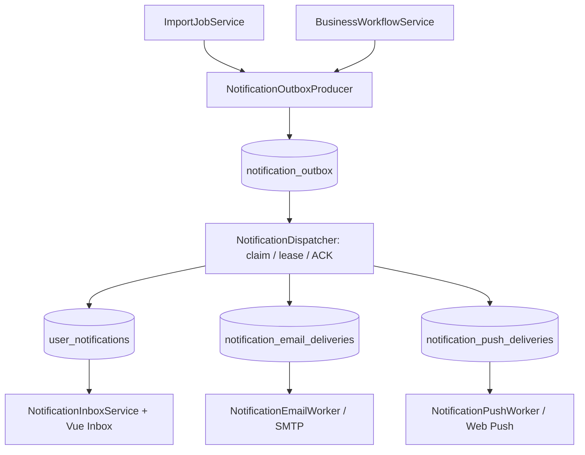
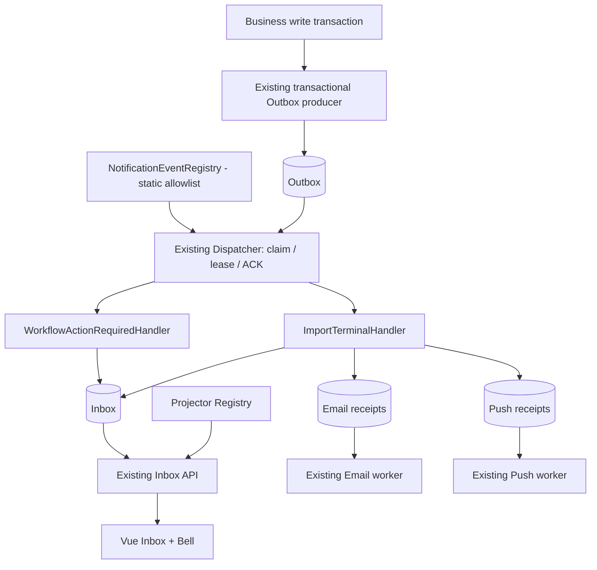

# DinkERP NFX-C — Thiết kế triển khai Business Event Registry và thông báo nghiệp vụ thực tế

**Phiên bản tài liệu:** 1.0 — 2026-10-27  
**Trạng thái:** DESIGN READY FOR REVIEW; chưa triển khai code NFX-C  
**Baseline bất biến:** `erp_v1.8.0.zip` → NFX-A1 → NFX-A2 → NFX-B → Hotfix NULL → Hotfix Fresh PBAC  
**SHA-256 `erp_v1.8.0.zip`:** `fde25bf21254c13b744645cddcbddf63d847c878712076e137753d60710fe907`  
**Stack:** CodeIgniter 4.7.x / PHP 8.3 / MariaDB 10.4 / Vue + Vite / CodeIgniter Tasks  
**Đối tượng:** Backend, Frontend, QA, vận hành.

> **Quyết định cốt lõi:** Không viết một hệ thống Notifications mới. Chuẩn hóa contract của **4 event hiện hữu** trong một registry tĩnh (NFX-C0), rồi ưu tiên **Email cảnh báo Import có lỗi/thất bại** trên cùng luồng Import đang chạy (NFX-C1). Product/Workflow event mới chỉ được triển khai sau khi chốt đúng người nhận và điều kiện nghiệp vụ.

---

## 0. Trạng thái các giai đoạn và cổng vào NFX-C

| Giai đoạn | Trạng thái |
|---|---|
| NFX-A1 — Notification UX | CLOSED, Browser UAT 5/5 |
| NFX-A2 — Advanced Inbox | CLOSED, Browser UAT 8/8 |
| NFX-B — My Work | **TECHNICAL COMPLETE**; Browser UAT rút gọn 4/4 |
| NFX-B — Workflow business UAT | **DEFERRED**, chưa có Workflow nghiệp vụ thực |
| NFX-C0 — Static Event Registry | **DESIGN ONLY** |
| NFX-C1 — Import Error Email Alerts | **DESIGN ONLY**, cần quyết định rollout/opt-in |
| NFX-C2 — Các sự kiện Product/Workflow mới | **PARKED**, chờ định nghĩa người nhận |

Bằng chứng NFX-B: Unit **180/180** (386 assertions), Integration **54/54** (372), Reliability **7/7** (77), cộng **241/241 backend / 835 assertions**. Frontend **28/28**; OpenAPI, type-check, build PASS theo log cung cấp. Không diễn giải đây là xác nhận production hoặc nghiệm thu Workflow thật.

### Gate trước code

1. Chốt NFX-C0 là refactor thuần nội bộ, **không** thay đổi response, chính sách, worker, dữ liệu hoặc event key.
2. Chốt NFX-C1 chỉ mở **Email cho 2 loại Import lỗi đã tồn tại**, không thêm event type In-App mới, không thêm bảng.
3. Mọi cảnh báo Email mới phải được người dùng **opt-in rõ ràng theo từng loại**; không tái sử dụng consent `import.completed.email`.
4. Chạy fixture trên `erp_test` với guard hiện hành; không chạy migration/fixture thử nghiệm trên database `erp`.

---

## 1. Rà soát thực trạng code thực tế

Nguồn được kiểm tra bằng cách giải nén ZIP v1.8.0 và áp dụng lần lượt năm patch A1, A2, B, Hotfix NULL và Hotfix PBAC; tất cả patch áp dụng được trên chuỗi sạch. Không truy cập database production hay thay đổi code ở giai đoạn thiết kế này.

### 1.1 Danh mục sự kiện

| Event type | Producer / nguồn | Người nhận | In-App | Email | Push |
|---|---|---|---|---|---|
| `import.completed` | `ImportJobService::finalizeTerminal()` → `NotificationOutboxProducer::enqueueImportTerminal()` | `import_jobs.created_by` (Shield user) | Có | **Có**, opt-in | **Có**, opt-in |
| `import.completed_with_errors` | Cùng producer, terminal `COMPLETED_WITH_ERRORS` | `import_jobs.created_by` | Có | Chưa | Chưa |
| `import.failed` | Cùng producer, terminal `FAILED` | `import_jobs.created_by` | Có | Chưa | Chưa |
| `workflow.action_required` | `BusinessWorkflowService` → `enqueueWorkflowTransition()` | Assignment snapshot + tái kiểm tra PBAC và action | Có | Chưa | Chưa |
| `security.permission_changed` | Chưa có producer đầy đủ | Chưa chốt | **UNAVAILABLE** | Không | Không |

Các trạng thái `AVAILABLE`/`UNAVAILABLE` của policy không phải bằng chứng rằng producer đã có dữ liệu thực để chạy. `security.permission_changed.in_app` phải tiếp tục `UNAVAILABLE`.

### 1.2 Sơ đồ các thành phần hiện hữu



`NotificationDispatcher` hiện chọn handler theo `source_type` (`workflow_transition` hoặc `import_job`). `NotificationInboxService::project()` tự kiểm tra hai dạng JSON và bốn event type. `NotificationEmailRules`/`NotificationEmailWorker` hiện hardcode `import.completed`; `NotificationCatalog` vừa mô tả policy vừa tính trạng thái producer.

### 1.3 Bảng dữ liệu và tính tương thích

- **9 bảng hiện hữu**: settings, user preferences, outbox, inbox, hai bảng workflow assignment, email deliveries, push subscriptions, push deliveries.
- Outbox `event_key` unique; Inbox unique `(recipient_user_id, event_key)`; Email receipts unique `(recipient_user_id, event_key)`.
- NFX-C0: **0 bảng mới, 0 dòng settings mới, 0 API endpoint mới**.
- NFX-C1: **0 bảng mới**, dự kiến **2 dòng policy mới** trong bảng `notification_settings`, không thay schema/chỉnh migration cũ.
- **12 runtime switches vẫn giữ nguyên**; không bổ sung switch cho từng event.

### 1.4 Các điểm cứng cần xử lý cẩn thận

| Code | Vấn đề hiện tại | Ràng buộc thiết kế |
|---|---|---|
| `NotificationDispatcher::deliver()` | Rẽ nhánh bằng `source_type`; hai hàm xử lý lớn | Rẽ nhánh bằng cặp `source_type + event_type` có allowlist |
| `NotificationInboxService::project()` | JSON validation và DTO hardcoded | Tách projector có contract nghiêm ngặt; không làm hỏng Inbox cũ |
| `NotificationCatalog::definitions()` | Khai báo policy gắn với trạng thái producer runtime | Phân biệt registry event tĩnh, catalog policy, đánh giá runtime có DB context |
| `NotificationEmailRules::consented()` | Chỉ chính sách `import.completed.email` | Tái sử dụng quy tắc consent theo **policy key đã allowlist** |
| `NotificationEmailRules::content()` | Chỉ chấp nhận `import.completed` | Template allowlist cho 3 terminal types, payload schema rõ |
| `NotificationEmailWorker::deliver()` | Query policy key cố định | Ánh xạ `event_type → policy key`, tái kiểm consent ngay trước SMTP |
| `NotificationRules` và `NotificationPolicyResolver` | Chặn default Email/Push bằng danh sách key hardcoded | Mô tả quy tắc `requires_explicit_consent` bằng metadata, giữ fail-closed |
| `NotificationOperationsAuditReader` | Chỉ kiểm `import.completed.email` và Push hiện hữu | Mở rộng audit cho mọi kênh Email/Push mới khi C1 |
| `NotificationPoliciesTab.vue`/`NotificationPreferencesTab.vue` | Label/ghi chú dành riêng `import.completed.email` | Bổ sung label và giao diện opt-in rõ ràng, không mở khóa default |
| `notificationInbox.ts` / OpenAPI | Union 4 event và event groups `[all,import,workflow]` | C0/C1 **không đổi** union, cursor, danh sách group |

---

## 2. Mục tiêu sản phẩm và giới hạn

### 2.1 C0 — kiến trúc có thể mở rộng nhưng không đổi kết quả

- Thêm một event sau này không phải sửa đồng thời quá nhiều `if/else` trong dispatcher và inbox projection.
- Mọi event được nhận diện bằng `event_type` + `source_type` + `payload schema`; dữ liệu sai bị bác bỏ *fail-closed*.
- Giữ nguyên kết quả, reason codes, trạng thái outbox, quyền, idempotency và nội dung 4 event lịch sử.
- Không thay đổi quyền sử dụng sản phẩm, không bật kênh, không thêm URL do payload chỉ định.

### 2.2 C1 — giải quyết nhu cầu thông báo có thật

Người tạo Import có thể **chọn nhận Email** khi:
- Import **thất bại** (`import.failed`).
- Import **hoàn thành nhưng có dòng lỗi** (`import.completed_with_errors`).

Tính năng In-App cho hai sự kiện này **đã tồn tại**; C1 mở rộng **kênh Email**, không tạo hai loại event mới. Người dùng không chọn opt-in vẫn chỉ nhận In-App theo policy đang có. C1 không gửi Email mặc định.

### 2.3 Ngoài phạm vi

Không xây no-code/dynamic rule engine; không thêm SQL điều kiện tuỳ ý; không cấu hình arbitrary webhook; không mở Email/Push hàng loạt; không tự tạo Workflow giả, Task ownership, SLA hoặc escalation. Không phát thông báo "đã sửa Product" cho chính người sửa khi chưa xác định người nhận có nhu cầu. Không sửa cơ chế Cron/Tasks đang hoạt động; không triển khai M11.7 telemetry.

---

## 3. Kiến trúc mục tiêu NFX-C0



### 3.1 Phân biệt ba thành phần

1. **`NotificationEventRegistry` — registry tĩnh theo code:** `event_type`, `source_type`, payload `schema_version`, handler ID, projector ID, channel capabilities, target semantics, idempotency strategy.
2. **`NotificationCatalog` — policy công khai:** policy key, default, quyền override, mandatory, khả dụng kênh; các hợp đồng API cũ vẫn dùng catalog này.
3. **`NotificationFlags`/`NotificationPolicyResolver` — runtime:** producer/write/delivery flags và chính sách SYSTEM/USER đọc trong DB; **không** suy luận quyền gửi chỉ vì event nằm trong registry.

**Không triển khai registry bằng cách lưu tên PHP class trong DB, nhận tên class từ request hoặc eval JSON tùy ý.** Phần event definition là allowlist bất biến theo bản deploy.

### 3.2 Contract đề xuất (pseudo-code, chưa phải file hiện hữu)

```php
final readonly class NotificationEventDefinition {
    public function __construct(
        public string $type,
        public string $sourceType,
        public int $payloadSchemaVersion,
        public string $handlerId,
        public string $projectorId,
        public array $supportedChannels,
        public string $targetKind,
    ) {}
}

interface NotificationEventHandler {
    /** Worker đã giữ giao dịch và khóa Outbox. Handler KHÔNG commit hay gọi HTTP/SMTP. */
    public function deliver(array $lockedOutboxRow, BaseConnection $db): NotificationDeliveryResult;
}
```

`NotificationDeliveryResult` chứa `status ∈ {PROCESSED,SUPPRESSED}` và `reason` tùy chọn; lỗi vĩnh viễn dùng cơ chế `NotificationPermanentFailure` đang có. Các status `RETRY/DEAD/PAUSED` vẫn do dispatcher điều khiển. Tất cả handler phải dùng **cùng `BaseConnection` và transaction** với ACK. Không mở transaction độc lập hay gửi SMTP trong handler.

### 3.3 Bốn registry entries khởi đầu

| `event_type` | `source_type` | `schema` | Handler | Inbox target | Channel capability |
|---|---|---:|---|---|---|
| `import.completed` | `import_job` | 1 | `ImportTerminalHandler` | `import_job` | In-App, Email, Push theo chính sách cũ |
| `import.completed_with_errors` | `import_job` | 1 | `ImportTerminalHandler` | `import_job` | Chỉ In-App ở C0 |
| `import.failed` | `import_job` | 1 | `ImportTerminalHandler` | `import_job` | Chỉ In-App ở C0 |
| `workflow.action_required` | `workflow_transition` | theo `WorkflowNotificationRules` hiện hữu | `WorkflowActionRequiredHandler` | `workflow_target` | In-App |

Ký hiệu `schema=1` của Import là **`payload_json` Outbox hiện hữu `{"schema":1}`**. `params_json` Inbox là cặp `success_rows/error_rows`; Workflow giữ nguyên chính xác schema trong `WorkflowNotificationRules::decode()`. Không chuyển đổi hàng lịch sử.

### 3.4 Đảm bảo strict decoding và replay lịch sử

- Decode chỉ đúng các field, kiểu, giá trị đã quy định; giới hạn độ dài JSON như code hiện tại.
- Cặp `source_type/event_type` không nằm trong registry → `NOTIFICATION_INVALID_EVENT`, không tự chuyển sang Import.
- `source_id`, target và `event_key` phải tuân thủ định dạng cũ; **không thay đổi** key `import-job:{id}:terminal`, cũng không thay kiểu key ngẫu nhiên của Workflow.
- Mọi event Import phải đối chiếu lại `import_jobs.status`; không phát khi source đã thay đổi.
- Workflow tiếp tục khóa bản ghi nghiệp vụ và tái kiểm tra VIEW/setstate/active user trong transaction.
- Trường hợp đã xử lý Inbox cũ: cùng input phải tạo đúng `title_key`, `body_key`, `params`, `priority`, `target` và nội dung API.
- `project()` được tách ra, nhưng vẫn **fail-closed** với row sai schema; không cho một event mới tạo row trước khi projector và DTO tương ứng được phát hành.

### 3.5 Bảo toàn worker concurrency

**Không sửa** protocol `SELECT ... FOR UPDATE`, claim/lease/token, retry/backoff, lease fencing, rollback+ACK, giới hạn batch, `singleInstance` Tasks. Multi-recipient fanout và ACK vẫn trong **cùng transaction**. Cờ Delivery OFF vẫn **PAUSE**, không terminal `SUPPRESSED`. Không ghi lỗi chi tiết/SMTP secrets/user PII vào log.

Email receipt unique không đảm bảo external SMTP exactly-once: nếu SMTP đã nhận nhưng ACK DB thất bại, gửi trùng vẫn là rủi ro *at-least-once*. Không quảng cáo bảo đảm mạnh hơn thiết kế hiện có.

---

## 4. Kế hoạch tách mã C0 thành các PR nhỏ

### PR-C0.1 — Registry và contract tests (không đổi runtime routing)

**Files mới đề xuất:**
- `backend/app/Modules/Notifications/Events/NotificationEventDefinition.php`
- `backend/app/Modules/Notifications/Events/NotificationEventRegistry.php`
- `backend/tests/m11/Unit/NotificationEventRegistryTest.php`

**Kiểm tra:** đúng 4 event; khóa event/source/schema duy nhất; channel capability chính xác; chưa khả dụng thì không thể đăng ký producer mới; registry không được đọc DB hay gửi I/O.

**Lưu ý:** Ban đầu dùng registry ở chế độ kiểm chứng/cross-check, chưa tách dispatch, để giảm rủi ro.

### PR-C0.2 — Tách handler từ Dispatcher

**Files mới đề xuất:**
- `Events/ImportTerminalHandler.php`
- `Events/WorkflowActionRequiredHandler.php`
- `Events/NotificationDeliveryResult.php` (hoặc kiểu kết quả tương đương)

**Files chỉnh:** `NotificationDispatcher.php` và test liên quan.

Giữ public command, batch, ACK, transaction, error code và fault-injection test seam cũ. Thay phân nhánh theo `source_type` thành lookup **cặp event/source** từ registry; handler được truyền DB transaction hiện tại.

**Điều kiện dừng:** Nếu các bài reliability fail (đặc biệt "fault after inbox insert rolls back" và "two independent processes claim one event exactly once"), rollback PR-C0.2.

### PR-C0.3 — Tách Inbox projectors và frontend parity

**Files mới đề xuất:**
- `Events/ImportInboxProjector.php`
- `Events/WorkflowInboxProjector.php`
- `Events/NotificationInboxProjectorRegistry.php`

**Files chỉnh:** `NotificationInboxService.php`, tests; frontend chỉ khi thật sự cần (mục tiêu là **không đổi**).

Dữ liệu cũ và mới phải tương đương từng field. `NotificationInboxQuery`, cursor v1/v2, `/my-work`, frontend A1/A2, PBAC fresh-per-listing **không được chỉnh**.

### Definition of Done C0

- Số bảng vẫn **9**; số policy keys vẫn **7**; số runtime switches vẫn **12**.
- 4 event hiện hữu, cùng event key, cùng số recipient/receipt khi cùng fixture.
- Không thay đổi API request/response, OpenAPI schema, frontend route/copy.
- Backend M11 suite **ít nhất không thấp hơn baseline 241/241**; frontend **ít nhất 28/28**, cộng test registry/handlers mới; reliability giữ nguyên.
- So sánh golden fixtures trước/sau C0, không phát Email/Push thật trong automated test.
- Browser smoke trên chuông/Inbox/Import; NFX-B vẫn ở mức technical complete, không buộc Workflow real UAT.

---

## 5. NFX-C1 — Email cảnh báo Import lỗi: vertical slice có giá trị sử dụng

### 5.1 Chức năng và ngữ nghĩa

| Trường hợp | Hành vi In-App | Email hiện tại | Email sau C1 |
|---|---|---|---|
| `COMPLETED` → `import.completed` | Giữ nguyên | Có opt-in | Giữ nguyên |
| `COMPLETED_WITH_ERRORS` → `import.completed_with_errors` | Giữ nguyên | Không | **Có nếu opt-in riêng** |
| `FAILED` → `import.failed` | Giữ nguyên | Không | **Có nếu opt-in riêng** |

**Người nhận:** người tạo job trong `import_jobs.created_by` đã map sang Shield user hiện hữu, đang hoạt động. Không nhận từ body HTTP, không dùng CC/BCC tự động, không gửi cho toàn bộ quản trị viên.

**Nguồn sự thật:** job status cuối cùng. Producer chỉ phát trong `ImportJobService::finalizeTerminal()` khi terminal UPDATE và Outbox INSERT cùng commit. Không gửi Email trong transaction này. Outbox `event_key` không đổi.

### 5.2 Hai policy keys mới đề xuất

| Key | Default | User override | Mandatory | Cách bật |
|---|---:|---:|---:|---|
| `import.failed.email` | `false` | `true` | `false` | User opt-in riêng |
| `import.completed_with_errors.email` | `false` | `true` | `false` | User opt-in riêng |

- `import.completed.email` **không** cấp quyền cho hai key mới.
- Giá trị `inherit`/không có preference mới → **không gửi**.
- Admin có thể khóa kênh bằng policy nhưng **không được** đặt default Email thành true.
- Khi user opt-out sau enqueue nhưng trước send → worker **CANCELLED**, không gửi.
- `DINKERP_M11_EMAIL_QUEUE_ENABLED` OFF → không tạo receipt mới; `DINKERP_M11_EMAIL_SEND_ENABLED` OFF → dừng gửi mà không đốt retry, theo worker hiện tại.
- Tiếp tục yêu cầu địa chỉ email hợp lệ, active user và một identity email hiện hành.
- Không mở Push cho 2 event lỗi trong C1.

### 5.3 Triển khai consent theo metadata, không hardcode key

Cần mở rộng `NotificationCatalog` với metadata mang ngữ nghĩa kênh và `requires_explicit_consent`; `NotificationRules::policyChanges()` và `NotificationPolicyResolver::assertPolicy()` phải dựa trên metadata tương ứng để **bác bỏ** `default_value=true` cho tất cả Email/Push cần explicit consent. Không chỉ thêm hai key mới vào danh sách `in_array` rời rạc.

`NotificationEmailRules::consentedForPolicyKey($key, $policy, $preference, $producerRequirement)` hoặc API tương đương:

1. Key nằm trong allowlist, đúng channel Email, khả dụng.
2. Policy hợp lệ, `default_value=0`, `allow_user_override=1`.
3. Preference có `override_value=1`, `override_epoch` trùng, `user_revision` hợp lệ.
4. Bật email-queue khi enqueue; **không** dùng system default để suy ra consent.
5. Worker tái kiểm consent bằng key ánh xạ từ `event_type` trước SMTP.
6. Giữ wrapper cho `NotificationEmailRules::consented()` cũ nếu cần để không phá test/hợp đồng hiện hữu.

Nếu một key chưa được provision trong DB, **không được** fallback sang `import.completed.email` hoặc system default; fail-closed.

### 5.4 Email receipt và nội dung

Trong `NotificationDispatcher` / `ImportTerminalHandler`, sau xác minh job terminal:

- Ánh xạ `event_type` ↔ `policy_key` tường minh, không suy đoán key từ chuỗi tùy ý.
- Kiểm tra consent hiện hành với key tương ứng.
- Nếu đồng ý, insert receipt vào `notification_email_deliveries` cùng transaction ACK Outbox.
- Unique `(recipient_user_id, event_key)` tiếp tục chặn tạo nhiều receipt cho một terminal job.
- Nội dung Email chỉ chứa dữ liệu đã kiểm chứng (`success_rows`, `error_rows`) và lời dẫn truy cập ERP, không chèn raw importer error, CSV cell, HTML, stacktrace, đường dẫn có token.

**Copy đề xuất** (template cố định, phải kiểm thử ngôn ngữ và escaping):

| Event | Subject | Body an toàn |
|---|---|---|
| `import.completed_with_errors` | `DinkERP - Nhập dữ liệu có dòng lỗi` | "Nhập dữ liệu đã hoàn tất nhưng có dòng lỗi. Thành công: N. Lỗi: M. Đăng nhập DinkERP để kiểm tra kết quả." |
| `import.failed` | `DinkERP - Nhập dữ liệu thất bại` | "Công việc nhập dữ liệu không hoàn tất. Hãy đăng nhập DinkERP để kiểm tra trạng thái và nhật ký." |

Không dùng `error_rows=0` để suy luận rằng job FAILED không có lỗi; lỗi có thể xảy ra trước khi ghi nhật ký từng dòng. Body phải mô tả đúng trạng thái.

### 5.5 Đồng bộ settings API và frontend

- `NotificationPoliciesTab.vue` và `NotificationPreferencesTab.vue`: label vi/en cho hai key; ghi chú opt-in, ẩn/khóa system default Email tương tự key cũ.
- `NotificationSettingsService` tiếp tục CAS revision/epoch và audit như cũ.
- `NotificationEmailWorker`: policy key theo `event_type`, revalidate recipient/consent; không gửi nếu key chưa hỗ trợ.
- `NotificationOperationsAuditReader`: báo trạng thái policy mới, không phát hiện "Ready" sai khi policy thiếu/corrupt.
- OpenAPI: kiểm tra schema key constraints. **Không cần API endpoint mới**; nếu schema có enum/pattern chứa key, cập nhật contract và regenerate SDK; nếu `key` là string, giữ shape và bổ sung mô tả/test.
- Frontend Inbox union `InboxNotification` và cursor V1/V2 **không đổi** ở C1 vì đây không phải event mới của In-App.

---

## 6. Database và rollout an toàn

### 6.1 C0

Không có migration hoặc thay đổi dữ liệu. Không xóa/chỉnh sửa chín bảng M11 và không backfill `payload_json` lịch sử.

### 6.2 C1 — chỉ thêm 2 hàng policy

Bảng `notification_settings` đã có `setting_key` khóa chính; dùng thao tác provision **additive, idempotent, forward-only**, chỉ insert khi vắng mặt và kiểm tra xung đột nếu row đã có khác chính sách an toàn. Không update lại policy người dùng/administrator hiện hữu. Không tự tạo preference opt-in.

**Điểm triển khai quan trọng:** `NotificationSettingsService::assertComplete()` yêu cầu tất cả key trong `NotificationCatalog::definitions()` phải hiện diện ở DB. Vì thế **không được phát hành code dùng 2 key mới trước khi provision rows**. Triển khai theo hai bước có kiểm soát:

1. Chạy script/migration dữ liệu **chỉ thêm hai policy rows** bằng tài khoản/phương thức vận hành được phép, trên clone/test trước; backup và kiểm tra row (`default=0`, `override=1`, epoch/revision hợp lệ). Khi code cũ còn chạy, các row thêm này không được gửi Email mới.
2. Deploy code C1 chứa catalog/worker/UI mới sau khi kiểm tra row và các flags. Thực hiện smoke API preferences/policies, đảm bảo chưa có user nào tự được opt-in.

Mã nguồn có `NotificationSeeder` additive nhưng chạy seeder cũ **không tự tạo key chưa tồn tại trong catalog cũ**; vì vậy cần chuẩn bị lệnh provision chủ động hoặc bảo đảm chạy đúng seeder phiên bản C1 trong cửa sổ triển khai. Không chạy PHP fixture integration trực tiếp trên production.

**Kế hoạch rollback C1:** tắt feature/capability new-Email trước, dừng queue creation của hai key, áp dụng rollback code khi cần. **Không xóa** receipt đã ghi, policy hoặc preference mới, không giảm revision/epoch; rollback mã cũ có thể bỏ qua hai row được thêm. Với receipt đang pending, phải chốt xử lý **CANCELLED/PAUSED có kiểm soát** trước khi rút code C1; tuyệt đối không để worker phiên bản cũ nhận receipt mới mà không hiểu `event_type`.

### 6.3 Điều kiện rollout/rollback không để kẹt queue

- Trong triển khai C1, bật producer/queue/send chỉ theo cấu hình đã phê duyệt; không tự bật flags.
- Không disable/sửa worker cũ khi vẫn còn receipt mới được lease.
- Khi cần rollback, xác định số receipt `PENDING/LEASED/RETRY` của 2 `event_type` mới và xử lý theo playbook được phép (không dùng SQL xóa hàng).
- Không sửa trực tiếp dữ liệu hoặc trạng thái Outbox/Inbox trong production để "dọn lỗi".

---

## 7. Hợp đồng bảo mật và phân quyền

| Bề mặt | Rule bắt buộc |
|---|---|
| Producer | Chỉ module nghiệp vụ gọi trong transaction; không có endpoint tự phát event tùy ý |
| Recipient | Từ nguồn nghiệp vụ có kiểm chứng; user active / not deleted |
| Payload | Schema whitelist, giới hạn kích thước, không raw HTML/error/PII |
| Inbox | Scope Shield user; deep-link chỉ allowlist; module đích kiểm PBAC lại |
| Email | Explicit opt-in theo **đúng key**, current epoch, identity hợp lệ; recheck trước SMTP |
| System policy | Admin không được bật mặc định Email/Push bằng cách sửa JSON trực tiếp |
| Worker | Claim/lease/retry/ACK hiện hữu, không log địa chỉ hay SMTP credentials |
| Registry | Static allowlist; không nạp class/tên bảng/SQL do client cung cấp |
| Migration | Chỉ thêm row, không xóa/bẻ schema, backup + preflight trước production |
| Tests | `erp_test` guard, không chạy trên `erp` |

Nhắc lại: hiển thị mục Inbox và quyền xem chứng từ là hai vấn đề riêng; mọi deep link phải reauthorize. Với event mới có dữ liệu nhạy cảm, cần thiết kế redaction/recheck tại thời điểm đọc Inbox trước khi phát hành.

---

## 8. Test plan và tiêu chí nghiệm thu

### 8.1 C0 — compatibility và reliability

| ID | Trường hợp | Expected |
|---|---|---|
| C0-01 | Registry có đủ 4 event và cặp source/event chính xác | PASS |
| C0-02 | Event/source lạ hoặc sai schema | Fail-closed, reason code hiện hữu |
| C0-03 | Replay Import 3 terminal types | Cùng Inbox DTO, keys, recipients |
| C0-04 | Replay Workflow action required bằng fixture | Snapshot recipient/PBAC đúng |
| C0-05 | Inbox listing, unread, mark read, cursor V1/V2 | Không regress |
| C0-06 | Outbox lease expired, old token ACK | Fenced, không duplicate Inbox |
| C0-07 | 2 worker claim 1 event | Chỉ 1 claim thành công |
| C0-08 | Fault sau Inbox insert trước ACK | Rollback cả insert và ACK |
| C0-09 | Delivery/Email Send OFF | PAUSE, không biến thành terminal failure |
| C0-10 | NFX-B `MyWorkflowService` thu hồi quyền | Test PBAC fresh-per-listing vẫn PASS |

### 8.2 C1 — Email Import lỗi

| ID | Trường hợp | Expected |
|---|---|---|
| C1-01 | Không có policy row mới | Không gửi; preflight/deploy fail-closed |
| C1-02 | Có policy, user chưa opt-in | Không tạo Email receipt |
| C1-03 | User chỉ opt-in `import.completed.email` | Không tự nhận Email lỗi |
| C1-04 | Opt-in lỗi riêng + Import FAILED | Một receipt hợp lệ, email đúng loại |
| C1-05 | Opt-in `completed_with_errors.email` riêng | Đúng event, counts đúng |
| C1-06 | Opt-out sau enqueue trước send | `CANCELLED`, không gửi |
| C1-07 | User inactive/locked/no email identity | `CANCELLED`, không gửi |
| C1-08 | Policy bị admin khóa / epoch cũ | Không gửi |
| C1-09 | Admin cố set Email default `true` | Reject + audit không thay đổi |
| C1-10 | Email Queue OFF hoặc Send OFF | Không queue mới / worker PAUSE |
| C1-11 | Retry/lease/transport lỗi | Không trùng receipt; không khẳng định SMTP exactly-once |
| C1-12 | Email template malicious payload | Reject, không raw HTML/injection |
| C1-13 | Rerun seeder/provision 2 lần | Không overwrite policy/user consent |
| C1-14 | Inbox/Push legacy | Không bị gửi thêm Push hoặc đổi payload |

**Thêm Browser UAT C1:** dùng một Import thử `COMPLETED_WITH_ERRORS` và một Import `FAILED` trên môi trường phù hợp, người dùng tự opt-in, đối chiếu receipt/Inbox/Email thực; tắt opt-in và xác nhận không có Email tiếp theo. Việc gửi Email thật chỉ thực hiện trên môi trường/tài khoản được chủ động cho phép.

### 8.3 Bộ lệnh QA tham chiếu từ pipeline đang dùng

```powershell
cd D:\XAMPP\htdocs\erp\backend
.\tools\test-unit.ps1 CHECK M11
.\tools\test-unit.ps1 RUN M11
.\tools\test-unit.ps1 RUN M11-RELIABILITY
```

```powershell
cd D:\XAMPP\htdocs\erp\frontend
pnpm run openapi:generate
pnpm run openapi:lint
pnpm run openapi:generate:check
pnpm exec vitest run src/features/notifications/__tests__
pnpm run type-check
pnpm run build
```

Mốc baseline là **241 backend / 28 frontend PASS**; sau C0/C1 số bài test phải **tăng**, không chỉ đạt mốc cũ. Chạy serially trên `erp_test` và kiểm tra queue rỗng theo `M11DatabaseGuard` trước Integration/Reliability. Không dùng `php spark migrate` trên DB nghiệp vụ khi C0 không có migration.

---

## 9. Các gói PR và lịch triển khai

| PR | Nội dung | Điều kiện merge | Dữ liệu |
|---|---|---|---|
| **C0.1** | Event definition, static registry, test contract | Pure/Unit PASS | Không |
| **C0.2** | Dispatcher delegates sang Import/Workflow handler | Unit/Integration/Reliability PASS | Không |
| **C0.3** | Inbox projector registry, golden DTO tests | API parity, Vue tests PASS | Không |
| **C1.1** | Metadata consent và 2 new policy definitions + preflight | Fail-closed policy tests, không tự bật | 2 policy rows cần provision trước runtime |
| **C1.2** | Email queues/templates/recheck consent & operations audit | Integration + Reliability, opt-out tests PASS | Không thêm bảng |
| **C1.3** | Settings frontend vi/en, OpenAPI/SDK, controlled Browser UAT | Type-check/build/UAT PASS | Không |
| **C2.x** | Event nghiệp vụ khác | Cần event charter đầy đủ | Chưa duyệt |

Không gom toàn bộ thay đổi thành một patch lớn. Nên bàn giao từng PR/patch có thể rollback độc lập.

---

## 10. Event charter bắt buộc cho event mới sau C1

Trước khi chấp nhận một event mới từ Product/Organization/People/Workflow, owner nghiệp vụ phải xác định:

1. **Trigger:** trạng thái/chuyển biến cụ thể, không phải mọi lần lưu thông tin.
2. **Source và transaction boundary:** module nào phát, có commit nguyên tử với outbox không?
3. **Recipient resolver:** ai cần biết, căn cứ vào trường/quan hệ nào, fallback khi không có recipient?
4. **Action:** người dùng có thể làm gì sau khi nhận, deep link hợp lệ là gì?
5. **Permission:** PBAC tại thời điểm tạo, phát và đọc; xử lý thu hồi quyền và trạng thái đổi.
6. **Dedupe semantics:** khóa event theo command/version nào, chống resend không mong muốn.
7. **Message data:** whitelist fields, PII, locale, expiry/priority.
8. **Channel and consent:** In-App first hay Email/Push opt-in? Có lý do nghiệp vụ không?
9. **Tests:** fixture thực, error/rollback, concurrent writer, authorization.
10. **Product acceptance:** Browser UAT với 2 user vai trò khác nhau.

**Product candidate (chưa triển khai):** `product.status_changed` chỉ có ý nghĩa nếu có người chịu trách nhiệm/người theo dõi được xác lập trong data model. `created_by` hoặc `updated_by` không tự động đồng nghĩa là người cần thông báo; cũng không gửi cho mọi user có `product.view`.

**Workflow candidate (hoãn):** `workflow.action_completed` hoặc `workflow.rejected` chỉ khi có Workflow nghiệp vụ thực, người cần nhận và thay đổi trạng thái được xác nhận. Không dùng dữ liệu `workflow_notification_assignees` để suy ra task ownership.

**Security candidate (hoãn):** `security.permission_changed` vẫn `UNAVAILABLE`; muốn bật phải có producer gắn transaction audit, đúng đối tượng được thay đổi quyền, không tiết lộ nội dung nhạy cảm.

---

## 11. Bản đồ file dự kiến chỉnh sửa

### Backend

```text
backend/app/Modules/Notifications/
  NotificationCatalog.php
  NotificationRules.php
  NotificationPolicyResolver.php
  NotificationOutboxProducer.php           # signature giữ nguyên
  NotificationDispatcher.php
  NotificationInboxService.php
  NotificationEmailRules.php
  NotificationEmailWorker.php
  NotificationOperationsAuditReader.php
  Events/NotificationEventDefinition.php   # NEW C0
  Events/NotificationEventRegistry.php     # NEW C0
  Events/ImportTerminalHandler.php         # NEW C0
  Events/WorkflowActionRequiredHandler.php # NEW C0
  Events/ImportInboxProjector.php          # NEW C0
  Events/WorkflowInboxProjector.php        # NEW C0
backend/app/Database/Seeds/NotificationSeeder.php
backend/tests/m11/Unit/
backend/tests/m11/Integration/
backend/tests/m11/Reliability/
```

### Frontend / API

```text
frontend/src/features/notifications/pages/NotificationPoliciesTab.vue
frontend/src/features/notifications/pages/NotificationPreferencesTab.vue
frontend/src/features/notifications/__tests__/
frontend/src/i18n/locales/vi.ts                # đường dẫn đã kiểm tra
frontend/src/i18n/locales/en.ts                # đường dẫn đã kiểm tra
contracts/openapi/openapi.yaml                 # chỉ khi cần thay schema/description
frontend/src/api/generated/*                   # chỉ bằng OpenAPI generator
```

*Các tên file trong `Events/` là thiết kế, chưa tồn tại; đường dẫn hai file i18n đã được kiểm tra trong baseline tổng hợp.*

---

## 12. Rủi ro và phương án xử lý

| Rủi ro | Mức | Xử lý |
|---|---|---|
| Refactor Dispatcher thay đổi trạng thái retry/ACK | Cao | PR nhỏ, golden fixtures, reliability 2 workers |
| Tạo policy keys trước/sau deploy lệch phiên bản | Cao | Data provision trước; kiểm tra catalog completeness |
| Admin bật mặc định Email không có consent | Cao | Metadata explicit-consent; backend + DB preflight + tests |
| Email Send OFF nhưng job bị tiêu attempts | Cao | Giữ PAUSE semantics, test |
| Email đã gửi rồi nhưng ACK DB thất bại | Trung bình | Nêu rõ at-least-once; không hứa SMTP exactly-once |
| Thêm event chưa có recipient hợp lệ | Cao | Event charter bắt buộc, không tự nhận owner |
| Inbox không hiểu event mới | Cao | Không fan-out trước khi projector/SDK/route đã được phát hành |
| Kiểm thử nhầm DB production | Rất cao | `M11DatabaseGuard`, `erp_test`, tách lệnh provision production |
| Browser UAT Workflow thiếu dữ liệu | Không phải lỗi | Giữ deferred, không ngăn C0/C1 Import |

---

## 13. Quyết định triển khai đề xuất

1. **Duyệt C0 để triển khai trước:** chỉ refactor registry + handlers + projectors, không đổi hành vi.
2. **Duyệt về nguyên tắc C1:** hai email opt-in riêng cho `import.failed` và `import.completed_with_errors`, mặc định OFF; trước khi coding, chốt copy Email và trình tự provision policy rows.
3. **Không triển khai C2 Product/Workflow** cho tới khi có event charter và bằng chứng người nhận nghiệp vụ.
4. Giữ nguyên **9 bảng**, **12 runtime switches**; C1 tăng số notification policy keys từ **7 lên 9**, không thêm bảng/migration schema.
5. Không đánh dấu NFX-C `IMPLEMENTED` chỉ vì tài liệu được duyệt. Các bước code/QA/Browsers UAT phải báo trạng thái riêng.

**Điểm bắt đầu hợp lý tiếp theo:** `PR-C0.1` — static event registry + contract/golden tests trên baseline đã xác minh.
