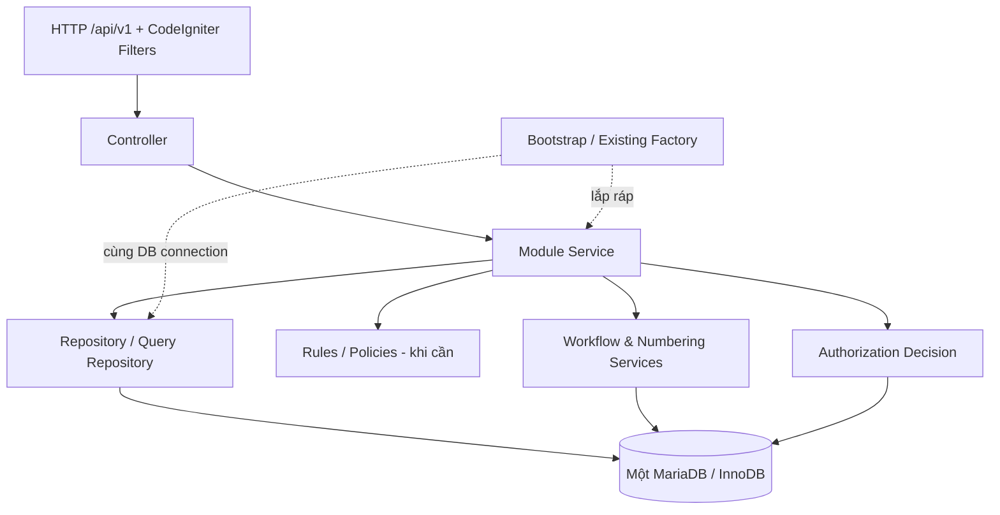
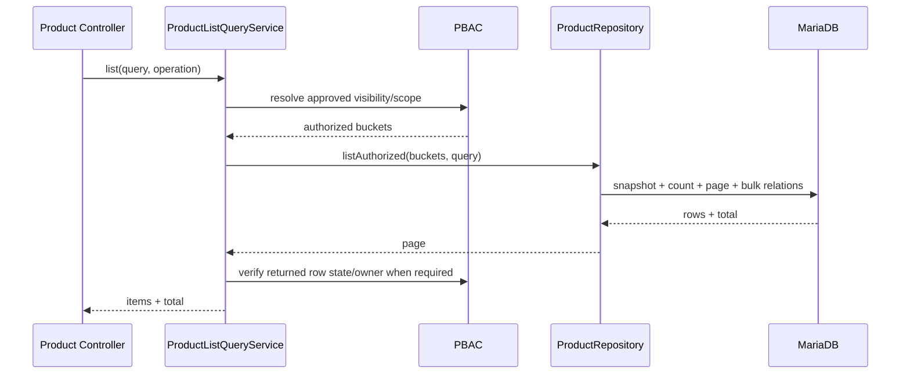

# DinkERP v1.2.2 — Backend Architecture Blueprint (Lean)

**Phiên bản đề xuất:** LEAN-BE-001 / 22-10-2026  
**Trạng thái:** Đề xuất thiết kế; CHƯA thay đổi mã nguồn  
**Đối tượng:** DinkERP, backend PHP 8.2+ / CodeIgniter 4 / MariaDB; quy mô ERP nhỏ–vừa.  
**Mục tiêu ưu tiên:** (1) an toàn nghiệp vụ và bảo mật, (2) đơn giản/dễ đọc, (3) hiệu năng có thể đo lường, (4) bảo trì và mở rộng từng module.  
**Căn cứ:** đọc lại `erp_v1.2.2.zip`, 511 file PHP dưới `backend/app`, 12 module root, controller, service, repository, factory, migration, bộ kiểm thử và guard mã nguồn.

> **Quyết định chính:** Chọn **Pragmatic Modular Monolith**. Chỉ có **ba loại thành phần bắt buộc trong luồng nghiệp vụ: Controller → Service → Repository**. Dùng Rule/Policy, Query Service, hợp đồng module (contract) và adapter **chỉ khi có lý do rõ ràng**. Không chuyển toàn hệ thống sang full Clean Architecture, full DDD, microservices, CQRS hai database hay DI container mới.

---

## 1. Kết quả tái kiểm tra: phân biệt sự thật và đề xuất

| Bằng chứng mã nguồn | Kết luận kiến trúc |
|---|---|
| `app/Modules` có 12 module với 165 PHP file; nhiều module đã có interface/adapter và compatibility facade | Đã có khung modular; không cần viết lại từ đầu |
| `Controllers/Api/ProductCatalog.php` chủ yếu parse/request/response, gọi `Api050ProductCatalogService` | HTTP controller đang khá mỏng; giữ endpoint/contract, giảm vai trò facade trung gian theo từng bước |
| `Services/Api050ProductCatalogService.php` (679 dòng) gộp Product + Pricing + PBAC + SQL list | Điểm cần tách trách nhiệm theo owner module, nhưng **không phá tối ưu SQL/PBAC** |
| `Modules/Product/Product/ProductMasterService.php` (876 dòng) vừa điều phối create/update/state, validate, numbering, audit, locking và giao dịch | Có thể tách phần đọc và rule độc lập khi sửa nghiệp vụ; không bắt buộc một class/một endpoint |
| `Modules/Pricing/PriceList/PriceListService.php` (636 dòng) quản lý list item mutation và giao dịch | Giữ write service; có thể tách query/list và invariant khi có nhu cầu |
| `Modules/Authorization/Decision/Application/PbacDecisionEngine.php` và các chính sách PBAC | Logic security-critical, cần bảo toàn behavior và read-only batch; không tách theo LOC thuần túy |
| `Modules/Numbering/Allocation/Application/AutoNumberingCounterAllocator.php::allocate()` từ chối transaction mở sẵn (`transDepth > 0`) và tự mở transaction chứa callback lưu nghiệp vụ | Có **transaction owner đặc thù**. Không áp dụng một `UnitOfWork` chung bọc tùy tiện quanh mọi create |
| `ProductRepository::withConsistentListSnapshot()` và `PriceListRepository::withConsistentListSnapshot()` mở REPEATABLE READ snapshot, từ chối nested transaction | Đang có tối ưu nhất quán PBAC/count/page; không đơn giản hóa thành `listAll()` rồi `array_filter()` |
| `Bootstrap` có 14 factory file; `app/Services` có 58 file, trong đó 27 dùng `class_alias` | Đây phần lớn là compatibility có kiểm thử, không tự ý xóa; ngừng tạo dependency ngược mới |
| Migration đã định nghĩa unique keys và index cho Product, Price List, Numbering, Policy | Không đề xuất DB migration/index hàng loạt khi chưa có `EXPLAIN` và số liệu tải |

### Kiểm tra thực sự đã thực hiện

- `php -l` trên **511 PHP file ứng dụng: 0 lỗi cú pháp**.
- **5/5** source-only compatibility/boundary smoke gates đã chạy và **PASS**: `test-services-ownership-boundary.php`, `test-services-decomposition-boundary.php`, `test-resource-application-boundary.php`, `test-resource-boundary.php`, `test-identity-boundary.php`.
- `.codex/skills/dinkerp-implementation/scripts/architecture-guard.php`: **FAIL với 7 cảnh báo** (3 file `app/Services/Product*` thuộc compatibility surface và 4 thông báo catalog/error code). Một phần là phạm vi check chưa phân biệt compatibility hoặc nơi định nghĩa dịch; cần phân loại, sửa gate hoặc catalog có chủ đích. **Không tuyên bố tất cả architecture gates đều xanh.**
- ZIP **không có** `backend/vendor` và cấu hình DB để chạy regression integration; chưa benchmark runtime, chưa có cơ sở công bố p95/QPS thực tế.

## 2. Kiến trúc mục tiêu



**Không thêm tầng cho đẹp.** Áp dụng ba vai trò chính:

1. **Controller (HTTP):** parse dữ liệu, HTTP validation tối thiểu, gọi service, trả response qua `ApiTransport`. Không viết SQL, không triển khai PBAC theo bản ghi, không quản lý transaction.
2. **Module Service (nghiệp vụ):** điều phối một nhóm use case liên quan, kiểm tra authorization, business invariants, chọn transaction owner/lock, gọi repository và các service module khác. Có thể gọi CodeIgniter DB transaction ở đây: không cần cố làm Application Service độc lập hoàn toàn với framework.
3. **Repository (dữ liệu):** query, insert, update, optimistic/row locking, paging/SQL projection; không tự quyết định cấp quyền nghiệp vụ. Truy vấn danh sách nhận phạm vi đã được authorize (approved buckets/filter) nếu cần.

**Tùy chọn, không bắt buộc:** `Rules` / `Validator` cho logic thuần có độ phức tạp hoặc tái sử dụng cao; `QueryService` cho danh sách có PBAC/count/snapshot phức tạp; `Contracts` cho public API giữa module hoặc storage/external integrations; DTO/value object cho trường dữ liệu nhạy cảm như money, quantity, evaluation time. Không có `UseCase` class cho từng CRUD nếu một service hiện tại vẫn rõ và dễ test.

### Hai đồ thị phải nhất quán

**Code dependency:** Controller -> public module service -> repository; các module gọi API công khai của module khác, không thò vào implementation của nhau.  
**Runtime ownership:** service của **module sở hữu dữ liệu** tạo thay đổi DB; cross-module write đi qua service chủ quản; việc điều phối transaction xuyên module phải rõ owner, cùng DB session.

## 3. Bản đồ module — giữ đúng 12 root module hiện tại

| Nhóm | Module | Vai trò / public surface ổn định |
|---|---|---|
| Nền tảng nghiệp vụ | Identity | Shield user/account/profile/membership; không tự ý bypass PBAC |
| Nền tảng nghiệp vụ | Authorization | Quyết định PBAC, group/policy administration, authorization audit |
| Nền tảng nghiệp vụ | Resource | Resource type/action metadata và state metadata integration |
| Nền tảng nghiệp vụ | Workflow | Lifecycle, state resolution, transitions, write guard |
| Nền tảng nghiệp vụ | Numbering | Series, scope, counter, issuing identifier đồng bộ |
| Nền tảng nghiệp vụ | Settings | Display settings, runtime config, config audit |
| Master Data | Foundation | Province, ward, danh mục vị trí |
| Master Data | Organization | Cây organization, ancestor, company owner |
| Master Data | Contact | Contact master và ownership/scope |
| Master Data | EmployeeStructure | Department, Position, Employee, Assignment |
| Nghiệp vụ hàng hóa | Product | Product Group, UOM, Product, Combo, Media, Product-specific Import |
| Nghiệp vụ giá | Pricing | Price List, resolution, Combo allocation |

**Các quan hệ mặc định:** Pricing -> Product (không có chiều Product -> Pricing); Product -> Numbering/Workflow/Authorization ở mức public service; PBAC đọc Employee/Assignment và Organization theo **read-only query surface** để tránh phụ thuộc vào mutation service; Workflow dùng PBAC quyết định transition, còn PBAC có thể cần đọc state từ read-only Workflow adapter. Những trường hợp read/write ngược chiều ở platform phải được phân tách theo *service/port* để không tạo vòng gọi/constructor; không yêu cầu tách cả platform thành microservices.

**Không tạo module `Import` nghiệp vụ mới** vì hiện chỉ có Product Import; parser CSV/XLSX và job-persistence generic giữ ở `Infrastructure/Import` theo baseline.

## 4. Thư mục mục tiêu — thực dụng, không đại phẫu

**Giữ layout chính**, không di chuyển các module hoạt động tốt chỉ để đồng nhất tên thư mục:

```text
backend/app/
  Config/
    Routes.php
    Services.php
  Controllers/Api/                  # giữ routes /api/v1 hiện tại
    ProductCatalog.php              # facade chuyển tiếp
    AuthorizationWorkflow.php       # facade chuyển tiếp
    ...
  Bootstrap/                        # tái sử dụng Factory hiện tại
    ProductReadAccessFactory.php
    NumberingFactory.php
    ...
  Modules/
    Product/
      Product/
        ProductMasterService.php    # hiện có; command + rule điều phối
        ProductRepository.php       # hiện có
        ProductListQueryService.php # chỉ thêm khi tách Api050 listProducts
        ProductRules.php            # tùy chọn, khi đã có tests
      ProductGroup/                 # giữ nguyên
      Uom/                          # giữ nguyên
      Combo/                        # giữ nguyên
      Lookup/                       # giữ nguyên
      Media/                        # giữ nguyên
      Import/                       # giữ nguyên
    Pricing/
      PriceList/
        PriceListService.php
        PriceListRepository.php
        PriceListListQueryService.php # tùy chọn khi tách API list
      Resolution/
      ComboAllocation/
    Authorization/                  # giữ cấu trúc đặc thù đang hoạt động
    Workflow/
    Numbering/
    EmployeeStructure/
    Organization/
    ...
  Infrastructure/                   # CHỈ kỹ thuật dùng chung
    Api/                            # transport, list parsing
    Decimal/
    Lock/
    Time/
    Import/                         # reader + generic import persistence
  Repositories/                     # legacy adapters; đóng băng tăng trưởng
  Services/                         # API facades/compatibility; đóng băng thêm business mới
  Database/Migrations/             # forward-only
  Language/
```

**Quy tắc cấu trúc bắt buộc:**

- Module đơn giản có thể chỉ có `XService.php` và `XRepository.php` — không ép tạo `Application/Domain/Infrastructure/Ports` rỗng.
- Module phức tạp (Authorization, Workflow, Numbering, EmployeeStructure) **giữ sub-capability và port đang mang lại giá trị**; không flatten hàng loạt.
- Không thêm implementation nghiệp vụ vào `app/Services`/`app/Repositories` gốc. Lớp ở đó tồn tại như facade/compatibility cho đến khi callers chuyển xong.
- `SqlProductListSource` và `SqlPriceListListSource` hiện ở shared Infrastructure; dời về module owner **chỉ trong PR refactor list**, giữ SQL/PBAC/response parity. Parser common list vẫn dùng chung.
- Không tạo `SharedKernel`, `CommonDomain`, `BaseService`, `BaseRepository` mới chỉ để có kiến trúc trông đồng đều.

## 5. Quy tắc ranh giới đơn giản (8 quy tắc)

1. **Controller -> Module Service.** Controller không import repository, Query Builder, transaction manager.
2. **Service kiểm soát nghiệp vụ.** PBAC theo persisted state/owner và invariant ở service chuyên trách; không dựa duy nhất vào client/route filter.
3. **Repository kiểm soát SQL.** Business state mutation qua module chủ sở hữu; Query Service có thể phối hợp authorized SQL read model.
4. **Không phụ thuộc internal module khác.** Không import `<OtherModule>/Infrastructure`, `<OtherModule>/Repository`; public read service là mặc định. Cho phép ngoại lệ read-only SQL join được ghi rõ khi hiệu năng hoặc tính nhất quán yêu cầu.
5. **Không dependency ngược từ canonical module vào compatibility mới.** Các compatibility bridge hiện tại chỉ loại bỏ sau khi đủ consumer/test parity; không cấm alias đang trong baseline.
6. **Không interface cho mỗi lớp.** Chỉ có interface khi cần contract giữa module, thay hạ tầng (storage/clock), nhiều implementation thực sự, hoặc test seam không có lựa chọn gọn hơn.
7. **Giao dịch có một chủ sở hữu rõ ràng.** Không giả định nested transaction an toàn. Cùng DB connection/session cho DomainLock, numbering và nghiệp vụ cùng giao dịch.
8. **API/DB invariants là bất biến:** `/api/v1`, OpenAPI, stable error codes, BIGINT/DECIMAL chuỗi JSON, 404/403, forward-only migration, authorized scope trước COUNT/LIMIT, money arithmetic dùng Decimal, không binary float.

### Quy tắc đặt tên đủ dùng

- `XService`: command/behavior của một capability; `XQueryService`: read/list phức tạp; `XRepository`: SQL; `XRules`: kiểm tra bất biến thuần logic; `XFactory`: lắp dependency đặc thù.
- `Port/Interface` đặt nơi consumer phụ thuộc **khi cần**. Không thêm suffix Interface vào mọi dependency của một service.
- Mỗi PR cần chỉ ra **owner nghiệp vụ**, **public entrypoint**, **DB tables touched**, **PBAC action**, **transaction owner**, **tests**.

## 6. Hai luồng thực thi tiêu chuẩn

### 6.1 Read/List Product — ưu tiên SQL, chính xác quyền



- Giữ `CommonListQueryAdapter`/allowlist, `EffectiveListBucketCompiler`, `PriceListAuthorizedBucketCompiler`, batch PBAC, fast-path SQL và fallback có semantics tương đương đang có.
- Không thay `withConsistentListSnapshot()` bằng đọc `listAll()` + filter/paginate trong PHP; fallback chỉ khi SQL path không chứng minh tương đương, phải được đo kích thước/dung lượng.
- Không tính `COUNT` của toàn bảng trước khi lọc authorized scope. Không chấp nhận tăng quyền do thay collation, không normalize số `"01"` thành `1` ngoài hợp đồng.
- Batch quan hệ và lookup để tránh N+1; DB indexes dựa trên EXPLAIN của câu truy vấn thực tế, không đoán thêm index.

### 6.2 Write/Create Product — xác định transaction owner

**Không áp dụng một giao dịch bọc ngoài chung cho mọi trường hợp.**

| Luồng | Transaction owner đích | Ràng buộc |
|---|---|---|
| Product tạo mã nhập tay (không dùng series) | Product Service | Dùng repository và locks phù hợp; có thể transaction cho nhiều bảng |
| Product tạo mã AUTO | Numbering allocator | Allocator mở transaction; business persistence nằm **bên trong callback** cùng connection |
| Product COMBO + AUTO + items | Numbering allocator **sở hữu transaction**; callback thực hiện create product và COMBO items cùng transaction | Đây là hướng thiết kế **cần ADR/POC và test thực tế**; hiện API facade có nhánh mở transaction COMBO riêng và allocator từ chối nested transaction |
| Price List replace item-set | Pricing Service | Lock Price List row + atomically replace differences |
| Product/Price List list snapshot | Query/repository snapshot | Đọc ngắn trong REPEATABLE READ; không nested vào write transaction |
| Product Import row | Product Import orchestrator hoặc Numbering allocator tùy loại mutation | Fail một dòng phải rollback các mutation của dòng đó; không gom cả file vào một transaction |

**Nguyên tắc triển khai cho transaction:** mọi lời gọi write xác định 1 trong 2 chế độ `ownsTransaction` hoặc `participatesInOwner`; không dùng abstraction/hàm chung mới trước khi giải quyết thật sự luồng Numbering. Nếu cần xử lý COMBO, triển khai một composite mutation callback trong Product module để toàn bộ Product/Combo/numbering ghi cùng transaction đã được Numbering mở; xác thực create và edit/state PBAC đầy đủ. Không chuyển issuance sang queue/event async.

**OperationContext:** tạo một lần ở boundary của một command, truyền xuyên suốt cả hành động để evaluation time, actor và request ID thống nhất. Không cache context của người dùng trong shared singleton.

## 7. Authorization, Workflow, Numbering — nền tảng phải bảo toàn

### Authorization/PBAC

- Base Permission bắt buộc, không System Admin bypass, `ABSOLUTE_DENY > ALLOW > DENY > NO_MATCH` và scope thừa kế chính xác như baseline.
- Quyết định dựa trên persisted target và authoritative Evaluation Organization; client hint không tăng quyền; trạng thái chưa thấy: 404, thấy nhưng cấm: 403.
- `PbacDecisionEngine` là vùng phức tạp hợp lý; không xẻ class theo số dòng nếu không tách được rule hoàn chỉnh và kiểm thử matrix.
- Điều cần tối ưu: tránh để PBAC dùng cả mutable EmployeeAssignmentService chỉ để đọc assignment. Nếu cần, công bố **read-only Assignment/Organization lookup** nho nhỏ, giữ logic về effective date và assignment path; batch request-scoped, không làm global permission cache thiếu invalidation.

### Workflow

- State config, state reader, transition/write guard là trách nhiệm riêng. Module sở hữu business row tự thực hiện update qua repo; Workflow không tự ý update mọi bảng nghiệp vụ.
- Khi PBAC cần state, dùng read-only state lookup; khi workflow thực thi action, phân quyền cùng snapshot/row lock theo bất biến cũ. Tránh vòng gọi dịch vụ đệ quy.

### Numbering

- Giữ counter, `FOR UPDATE`, DomainLock, cùng DB session/transaction, collision handling và rollback semantics. Các class compatibility hiện có không đổi chữ ký trong PR layout.
- Đặc biệt kiểm thử create + generated code + COMBO, manual code, retry/collision và import row trước mọi thay đổi transaction owner.

## 8. Chính sách hiệu năng thực dụng

**Nguyên tắc:** ưu tiên DB query đúng + ít object/call + batch dữ liệu trước khi thêm cache, event bus hoặc worker.

1. **Read-heavy lists:** SQL filter/COUNT/paginate sau PBAC; select cột cần; batch relational hydration; giữ consistent snapshot ở nơi đã có.
2. **Index:** migrations hiện đã có `products.code/sku/barcode` unique, khóa liên kết sản phẩm, unique `product_price_list_items(price_list_id,product_id,uom_id)`, index Price List theo org/status/thời gian. Chỉ thêm index qua migration mới khi `EXPLAIN`, cardinality, slow query cho thấy lợi ích.
3. **Connection/DI:** cùng một DB connection được truyền rõ tới service/repository/lock trong một operation. Existing factories đủ dùng; không cần composer DI framework, service locator trong business code hay tạo toàn bộ graph của 12 module mỗi request.
4. **PBAC:** tái sử dụng read-only batch hiện có **trong một truy vấn danh sách**, không cache cross-request decision mặc định; invalidation permission phức tạp hơn lợi ích ở quy mô này.
5. **Money & quantity:** dùng `Decimal`/chuỗi chính xác; không float; tránh convert string decimal sang double chỉ vì tối ưu.
6. **Import:** giữ pipeline sync cho tới khi số liệu tải/chặn request chứng minh cần background worker; nếu cần worker phải thiết kế durable job, idempotency, replay/recovery và actor/permission đúng trước.
7. **Telemetry nhẹ:** ghi `request_id`, endpoint, duration, status, SQL query count, số lần fallback PHP list, thời gian PBAC/query/lock nếu có thể; không log secrets hoặc dữ liệu nhạy cảm.
8. **Benchmark trước/sau:** trên dataset đại diện, so sánh `p50/p95`, DB time, query count, peak memory và concurrency failures; ngưỡng chấp nhận cho mỗi use case được xác lập từ baseline, không tự nhận nhanh hơn khi chưa đo.

## 9. Refactor backlog ưu tiên theo tác động/rủi ro

| Thứ tự | Hạng mục | Cách thực hiện | Rủi ro | Điều kiện hoàn thành |
|---:|---|---|---|---|
| 0 | Ghi nhận baseline và architecture guard | Giữ nguyên 5 compatibility gates đang xanh; phân loại 7 cảnh báo guard; cho phép legacy adapter rõ nhãn/expiry và sửa kiểm tra catalog thực tế | Thấp | Static source gate không chặn merge vì false positive, không bỏ qua lỗi mới |
| 1 | Mô tả owner và public service của 12 module | 1 bảng module + DB ownership + dependency policy; cập nhật ADR; không đổi code runtime | Thấp | Không thêm cross-module repo write mới |
| 2 | Chuẩn hóa creation/OperationContext cho luồng mới | Tái sử dụng `Bootstrap/*Factory` và cùng DB connection, OperationContext nhất quán; chưa buộc đổi constructor toàn hệ | Thấp–TB | Snapshot/PBAC/audit ổn định |
| 3 | Tách list query từ Api050 theo Product/Pricing | Delegation dần sang `ProductListQueryService`, `PriceListListQueryService` nhưng giữ route/API facade | TB | Golden-master data, SQL equivalence, count/page/order/404/403 |
| 4 | Chuẩn hóa transaction ownership Product/Numbering/COMBO | ADR/POC trước, commit callback atomic, kiểm thử concurrent/integration; không bọc giao dịch outer mặc định | Cao | Generated code và multi-table mutation atomic; rollback và audit chính xác |
| 5 | Giảm service lớn khi sửa nghiệp vụ | ProductMaster tách `Rules` / `Query`; PriceList/PolicyRepository tách read/write khi có test tương đương; không chia cơ học | TB | Giảm phạm vi sửa và test, không tăng số abstraction vô ích |
| 6 | Legacy compatibility deprecation | Đổi từng consumer sang canonical public services; giữ shim và CI gates; xóa chỉ sau khi callers=0 và tests đạt | TB | Không còn import ngược mới; backward compatibility đo được |
| 7 | Read-only authorization dependencies | Tách small `AssignmentScopeRead` và `OrganizationAncestorRead` nếu cần tránh mutable service graph | TB | PBAC goldens và batch performance không giảm |
| 8 | Import worker (chỉ nếu cần) | Chỉ triển khai nếu request timeout/file size/load thực tế đạt ngưỡng đã phê duyệt | Cao | Không mất idempotency, row rollback, progress semantics |

**Một PR = một boundary / một use case**; tránh chuyển đồng thời controller, service, repository, schema và frontend SDK trong cùng một PR khi không bắt buộc.

## 10. Quy trình chuyển đổi không gián đoạn (Strangler by Delegation)

Ví dụ với `GET /api/v1/products`:

1. Không thay URI, response, `Routes.php`, OpenAPI hoặc controller khi bắt đầu.
2. Tạo test characterization cho list: PBAC state/scope, Unicode sort/search, count, filters, row mutation giữa snapshot, pagination và error semantics.
3. Trích logic list sang `Modules/Product/Product/ProductListQueryService` qua một phương thức ủy quyền từ `Api050ProductCatalogService::listProducts`.
4. Giữ nguyên exact SQL fast-path/fallback và same-connection behavior; đo query count/memory/latency before-after.
5. Chỉ khi ổn định mới đổi Controller để gọi trực tiếp service canonical; sau đó loại bỏ method facade tương thích theo quy định.
6. Có khả năng rollback bằng revert ứng dụng; không DB migration trong giai đoạn này.

Tương tự với `price_lists`, sau đó các nhóm đơn giản hơn. Trong thời gian chuyển đổi, **API không thay** và nhóm phát triển vẫn có thể bổ sung tính năng tại module owner.

## 11. Quality gates cần có trước merge

**Static:** PHP lint, PHPStan hiện có, 5 vendor-free gates, chỉnh `architecture-guard` về trạng thái đáng tin và mở rộng kiểm tra dependency mới; không phát sinh import module->legacy ngoài whitelist đã đóng băng.  
**Contract:** OpenAPI/route/snake_case/BIGINT/DECIMAL/error code không đổi.  
**Security:** PBAC decision matrix, 404/403, owner/ancestor/state, denied count không lộ.  
**Transaction:** manual/auto numbering, COMBO, import rows, price list item set, deadlock/rollback/DomainLock.  
**Performance:** query counts + SQL `EXPLAIN` + benchmark dataset tương ứng, không chấp nhận O(N) full scan mới cho đường đọc nóng.  
**Operational:** request-id logging, config/migrations forward-only, rollback rehearsal; release theo module.

**Không nên merge thay đổi kiến trúc quan trọng chỉ với các source-only gates**: cần composer dependencies, DB test runtime, test concurrency/locking và API integration trên môi trường tương ứng.

## 12. Quyết định cần phê duyệt (ADR-LEAN-BE-001)

**Chấp thuận:**

- Backend đích là **Modular Monolith theo capability** và **Controller → Service → Repository**, 12 root module giữ nguyên.
- `Rules`/`QueryService`/Interface dùng khi có bằng chứng cần, **không ép chuẩn bốn tầng** cho Product/Pricing.
- Compatibility và factories hiện có giữ, nhưng ngừng phát triển dependency ngược mới.
- Trước mắt **không thêm** DI container, global UnitOfWork, CQRS/EventBus, ORM mới, message broker, microservices hay multi-DB.
- Product/Pricing module boundary và mọi approved P1 invariant vẫn là authority; việc nới cấu trúc module để thêm `ProductListQueryService`/`Rules` cần ADR và test phù hợp.
- Cải tiến đầu tiên là **query boundary + transaction ownership + architecture gates có baseline xanh**; việc đổi thư mục/namespace không phải KPI.

**Thước đo thành công sau chuyển đổi:** một developer có thể lần từ API endpoint đến rule, SQL, PBAC và transaction owner trong vài điểm nhảy có tên rõ; business behavior không đổi; feature mới chủ yếu sửa trong một module; không phát sinh vòng constructor/dependency mới; throughput/latency không suy giảm trên các truy vấn nóng; số lớp wrapper/legacy giảm dần theo từng release.

---

**Đánh giá giới hạn:** Phân tích được kiểm chứng ở mã nguồn và source-only gates. Chưa có thông tin production load, slow query log hoặc full MariaDB/Shield runtime, nên mọi khẳng định hiệu năng trong tài liệu là **nguyên tắc thiết kế và kế hoạch đo**, không phải kết quả benchmark.
