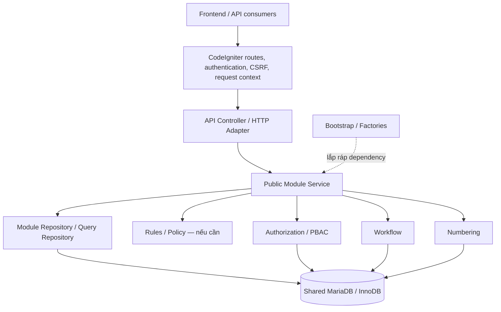
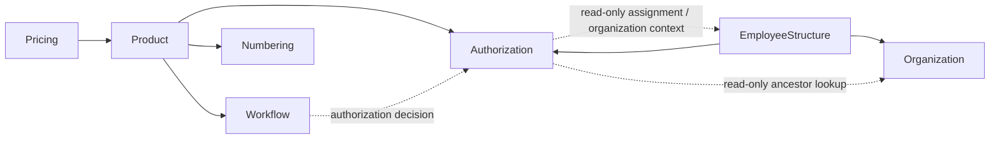
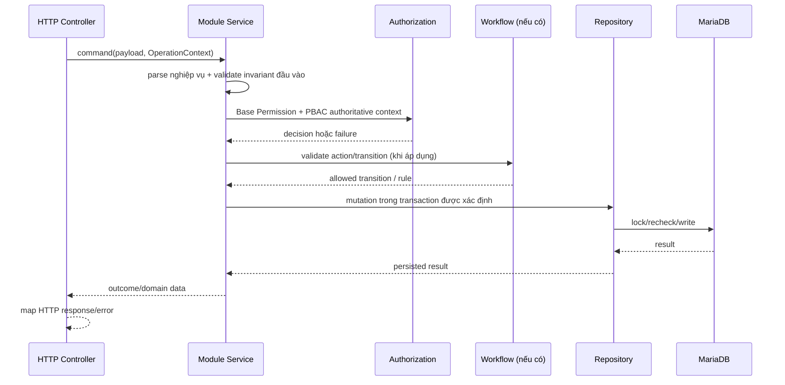
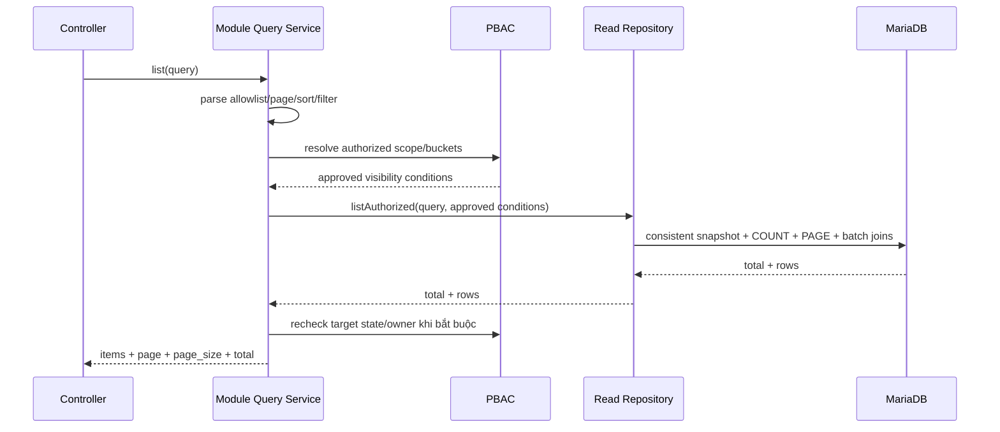
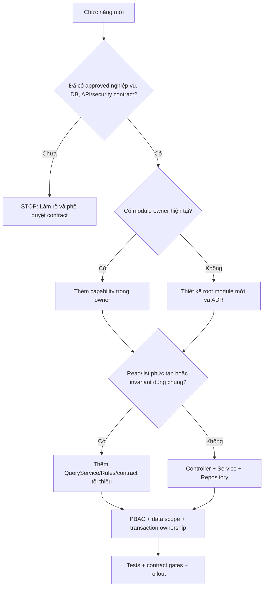

# DinkERP — TÀI LIỆU THIẾT KẾ KIẾN TRÚC BACKEND

**Architecture Standard & Module Design Guide**  
**Mã tài liệu:** DINKERP-BE-ARCH-001  
**Phiên bản:** 1.0 — Dự thảo trình phê duyệt  
**Ngày lập:** 22/10/2026  
**Phạm vi:** Backend DinkERP — PHP 8.2+, CodeIgniter 4, MariaDB/InnoDB  
**Loại tài liệu:** Tiêu chuẩn thiết kế độc lập, dùng cho chỉnh sửa module hiện hữu và triển khai module mới  
**Trạng thái thực thi:** Chưa mặc nhiên có hiệu lực; cần phê duyệt ADR/đầu mối kiến trúc trước khi áp dụng các thay đổi phá vỡ baseline.

> **Quyết định kiến trúc đề nghị:** DinkERP sử dụng **Pragmatic Modular Monolith**: một backend triển khai thống nhất, một cơ sở dữ liệu giao dịch chính, chia module theo chủ sở hữu nghiệp vụ; luồng mặc định là **Controller → Module Service → Repository**. Chỉ bổ sung Query Service, Rules/Policy, Adapter hoặc Interface khi có yêu cầu thực tế.

> **Cách đọc:** Các câu dùng **PHẢI/KHÔNG ĐƯỢC** là quy tắc dự kiến bắt buộc sau khi tài liệu được phê duyệt. **NÊN** là mặc định có thể nêu lý do để thay đổi. **CÓ THỂ** là tùy chọn. Những ví dụ tên lớp hoặc module giả định không phải yêu cầu tạo Resource/Action/API mới.

### Hướng dẫn tra cứu nhanh

| Việc cần làm | Phần quan trọng nhất |
|---|---|
| **Xây một module mới** | Mục 3–7, 9–11, **16**, 19 và Phụ lục A |
| **Hiệu chỉnh module cũ** | Mục 3–5, 15, **17**, 19 và Phụ lục B |
| **Thay query/list/PBAC** | Mục 6–7, 10, 13, 15 |
| **Thay ghi dữ liệu/Numbering/Workflow** | Mục 6–9, 15, 19 |
| **Phê duyệt thay đổi lớn** | Mục 18–20 |


---

## 0. Mục đích, phạm vi và giá trị sử dụng

Tài liệu này là **đặc tả kiến trúc backend tự đầy đủ** để nhóm phát triển có thể:

1. Nhận diện module nào sở hữu một nghiệp vụ, bản ghi và hành vi ghi dữ liệu.
2. Từ một endpoint tìm nhanh Controller, Service, Repository, PBAC, Workflow, Numbering và transaction owner.
3. Chỉnh sửa hoặc chia nhỏ module cũ mà không làm đổi hành vi đã được phê duyệt.
4. Tạo module mới với cấu trúc tối thiểu nhất quán, có khả năng mở rộng về sau.
5. Kiểm soát phụ thuộc chéo, khả năng kiểm thử, hiệu năng và nợ kỹ thuật trong CI/PR.

**Ngoài phạm vi:** thiết kế chi tiết từng nghiệp vụ, định nghĩa Resource/Action code mới, DBD mới, API mới khi chưa có phê duyệt; thiết kế frontend; triển khai microservices hoặc hệ thống phân tán; bắt buộc chuyển tất cả mã nguồn sang DDD/Clean Architecture đầy đủ.

### 0.1. Thứ tự nguồn thẩm quyền

Khi có khác biệt giữa các tài liệu hoặc mã hiện tại, áp dụng thứ tự xử lý:

1. **UR/FRS, Database Design, Implementation Contract và API Design/OpenAPI đã phê duyệt** quyết định nghiệp vụ, dữ liệu và hợp đồng bên ngoài.
2. **Quyết định kiến trúc (ADR) đã phê duyệt**, bao gồm ngoại lệ cụ thể, quyết định chi tiết cấu trúc và thay đổi có kiểm soát.
3. **Tài liệu kiến trúc này** quy định cách triển khai kỹ thuật và bảo trì xuyên module.
4. **Implementation hiện tại và characterization tests** cung cấp bằng chứng hành vi đang tồn tại, không tự động hợp thức hóa sai khác với hợp đồng được duyệt.

Nếu hợp đồng ở trạng thái `CONTRACT_PENDING`, **dừng triển khai phần đó**; không tự đặt endpoint, enum, bảng, Resource Type, Action code hay nghiệp vụ để lấp chỗ trống. Mọi thay đổi ngữ nghĩa cần được phê duyệt trước khi sửa code.

### 0.2. Phân biệt hiện trạng và tiêu chuẩn đích

- **Hiện trạng được kiểm tra ở baseline v1.2.2:** backend sử dụng CodeIgniter 4, có 12 module dưới `app/Modules`, đồng thời còn API facade, repository, service và compatibility class ở namespace cũ. Một số module đã tách nhiều capability/port.
- **Tiêu chuẩn đích:** giữ những module và integration có giá trị, không cần đổi đường dẫn vật lý chỉ để đồng bộ tên; code mới đi qua module owner và public entrypoint.
- **Lộ trình chuyển đổi:** các lớp legacy được miễn trừ có kiểm soát cho đến khi caller chuyển hết; không được lấy ngoại lệ legacy làm tiền lệ viết code mới.

### 0.3. Tiêu chí thành công

- Một tính năng mới thông thường có thể được hiểu và thay đổi chủ yếu trong **một module**, trừ integration được khai báo.
- Có thể xác định **owner, endpoint, rule, PBAC action, Evaluation Organization, SQL, lock, transaction owner và test** qua thiết kế module và vài bước lần code.
- Không có đường ghi dữ liệu chéo module không qua owner; không mở vòng dependency mới.
- API, PBAC, error code, database invariants và kết quả giao dịch được bảo toàn khi refactor.
- Không có thoái lui hiệu năng đáng kể trên dữ liệu thử nghiệm đại diện; so sánh bằng phép đo, không suy đoán.
- Giảm dần số lớp facade/alias không còn caller; không thay chúng bằng lớp wrapper tương đương mới.

---

## 1. Những quyết định kiến trúc nền tảng

| Mã | Quyết định | Lý do | Không áp dụng mặc định |
|---|---|---|---|
| AR-01 | **Modular Monolith** theo nghiệp vụ | Đơn giản triển khai và debug, vẫn có ranh giới module | Microservices, chia DB theo service |
| AR-02 | **Controller → Service → Repository** làm luồng chuẩn | Dễ học, dễ trace, ít tầng trung gian | Full Clean Architecture bắt buộc |
| AR-03 | **Một MariaDB/InnoDB** cho giao dịch nghiệp vụ hiện tại | FK, transaction, locking và vận hành đơn giản | Multi-DB, distributed transaction |
| AR-04 | **Module owner kiểm soát ghi** | Giữ bất biến, quyền và audit tại một nơi | Ghi trực tiếp vào bảng module khác |
| AR-05 | **Public service/contract rõ ràng** | Tránh coupling vào implementation nội bộ | Interface cho mọi class |
| AR-06 | **PBAC và scope ở tầng nghiệp vụ** | Bảo vệ bản ghi và collection độc lập HTTP | Chỉ dựa route/filter/frontend |
| AR-07 | **Transaction owner tường minh** | Giữ atomicity cho numbering, lock, mutation | Global UnitOfWork tự bọc mọi lời gọi |
| AR-08 | **SQL trước cache** | Hiệu quả và dễ vận hành trong ERP nhỏ/vừa | Redis, EventBus, CQRS tách read DB tự động |
| AR-09 | **Tối ưu và phân lớp theo nhu cầu** | Giảm abstraction rỗng và chi phí thay đổi | Tách mỗi endpoint thành một UseCase/DTO |
| AR-10 | **Refactor theo tính tương đương hành vi** | Giảm rủi ro trong hệ thống nhiều invariant | Big-bang rewrite/rename |

### 1.1. Nguyên tắc lựa chọn giải pháp

Khi có hai thiết kế đều đáp ứng nghiệp vụ và bảo mật, **chọn thiết kế có số khái niệm mới ít hơn**, ít đường đi hơn, SQL rõ ràng hơn và dễ kiểm thử hơn. Không đánh đổi tính đúng đắn PBAC/transaction để giảm vài dòng code hoặc tăng tốc một benchmark cục bộ.

Bộ quy tắc SOLID/DDD/Clean Architecture được sử dụng như công cụ suy xét **khi xuất hiện vấn đề cụ thể**, không phải checklist ép mọi module tuân thủ hình thức bốn tầng.

---

## 2. Kiến trúc tổng thể



Đây là **luồng trách nhiệm**, không ngụ ý mọi thao tác phải gọi đủ Authorization, Workflow và Numbering. Việc sử dụng những module đó phụ thuộc nghiệp vụ và hợp đồng đã phê duyệt.

### 2.1. Phân định trách nhiệm

| Thành phần | Trách nhiệm chính | Tuyệt đối tránh |
|---|---|---|
| `Routes`, Filters | Route, authentication/CSRF, request metadata, chính sách kỹ thuật HTTP | Thay thế PBAC theo dữ liệu thực |
| `Controller` | Parse/request shape, HTTP validation, gọi entrypoint, map response/error | Query SQL, lock, mở transaction, tự quyết định quyền bản ghi |
| `XService` | Điều phối nghiệp vụ, business validation/invariants, PBAC, thay đổi trạng thái, transaction owner | SQL dài hoặc logic giao thức HTTP |
| `XQueryService` (tùy chọn) | Phối hợp authorized scope + COUNT/page/snapshot/batch read | Thực hiện business mutation |
| `XRules` (tùy chọn) | Quy tắc thuần logic, không side-effect; hữu ích khi nhiều caller chung quy tắc | Tự mở transaction/SQL ngầm |
| `XRepository` | DB read/write theo owner, query, projection, optimistic/row locking | Tự suy diễn quyền nghiệp vụ, gọi Controller |
| `Module Public API` | Những hành vi/query cho phép module khác sử dụng | Phơi bày mọi internal class, SQL schema tùy tiện |
| `Factory` | Lắp object graph và truyền dependency, DB connection | Business logic, thay mặt module ghi dữ liệu |
| `Infrastructure` | Thư viện kỹ thuật chia sẻ: clock, decimal, lock, transport, import reader | Business rules riêng của Product/Pricing/nhóm khác |
| `Compatibility` | Alias/delegate tạm phục vụ caller cũ | Trở thành nơi phát triển nghiệp vụ mới |

**Quy tắc đơn giản:** Không thêm một tầng chỉ vì đã thấy tầng đó ở module khác. Không buộc phải có interface cho một repository cụ thể nếu không tồn tại nhu cầu thay thế, quan hệ module hoặc test seam thực tế.

### 2.2. Ranh giới HTTP và nghiệp vụ

HTTP Controller **không phải là một cách gọi nghiệp vụ duy nhất**: import, command hoặc tác vụ nội bộ cũng phải sử dụng module service được bảo vệ bởi rule và authorization phù hợp. Không dồn toàn bộ validation hoặc PBAC vào HTTP facade, nếu không các caller khác sẽ bỏ qua chính sách.

### 2.3. Tổ chức dependency

**Được phép mặc định:**

- Controller → public service của module chủ quản.
- Service → repository/rule trong cùng module; → public service hoặc contract của module khác có quan hệ đã khai báo.
- Repository → database/utility kỹ thuật; không vòng ngược về service nghiệp vụ.
- Module nghiệp vụ → thư viện Infrastructure generic; Infrastructure generic không import business module.
- Factory → các implementation được lắp ráp; implementation không gọi ngược Factory để thực thi nghiệp vụ.

**Không được phép mặc định:**

- Controller → Repository hoặc SQL.
- `ModuleA` → `ModuleB/Infrastructure`, `ModuleB/Repository`, class `internal` chưa công bố.
- `ModuleA` ghi bảng chủ quản của `ModuleB` qua SQL trực tiếp.
- Canonical module phụ thuộc mới vào `app/Services`/`app/Repositories` legacy chỉ để tiện sử dụng.
- Phụ thuộc vòng giữa module public services hoặc vòng constructor khi lắp dependency.

**Ngoại lệ read-only SQL projection:** chấp nhận JOIN dữ liệu module khác trong Query Repository nếu cần nhất quán hoặc hiệu năng, **chỉ** sau khi xác định rõ owner, PBAC/row visibility, danh sách cột được dùng, ảnh hưởng schema, quyền truy cập, test và người phê duyệt. Ngoại lệ này **không cấp quyền ghi**.

**Lưu ý chuyển tiếp platform API:** một số entrypoint Authorization, Workflow, Numbering hiện vẫn được công bố qua factory hoặc namespace lịch sử. Cho đến khi public canonical entrypoint được phê duyệt, module mới chỉ được gọi **entrypoint có ghi trong Module Design Record/compatibility registry**; không import trực tiếp repository/các lớp nội bộ chỉ vì API canonical chưa hoàn thiện. Không sửa hàng loạt đường dẫn namespace để hợp thức hóa tiêu chuẩn này.

---

## 3. Bản đồ 12 module nghiệp vụ hiện có

Module được chia theo **ownership**, không phải theo loại màn hình hoặc CRUD. Bảng dưới quy định phạm vi logic; tên bảng DB và Resource/Action cụ thể phải khớp DBD/contract đã duyệt.

| Module | Chủ sở hữu chính | Public capability dự kiến | Ranh giới cần giữ |
|---|---|---|---|
| `Identity` | Shield users, account/profile, membership liên quan identity | Identity/user operations được bảo vệ | Không bypass Authorization |
| `Authorization` | PBAC decisions, policy/group administration, authorization audit | `authorize`, decision/read scope và admin actions | Không trở thành module CRUD nghiệp vụ |
| `Resource` | Resource Type, Action metadata, resource-state integration metadata | Registry/read metadata và quản trị được duyệt | Resource Type ≠ một Resource row cho từng business record |
| `Workflow` | Lifecycle, state resolution, transition validation, write boundary | Resolve/validate/apply permitted transitions | Không tự ghi tùy tiện vào mọi bảng nghiệp vụ |
| `Numbering` | Series, scope/period, counter, synchronous identifier issuance | Reserve/issue qua business callback có transaction | Counter chỉ do Numbering quản lý |
| `Settings` | Display/runtime settings, config audit | Config reads/writes được duyệt | Không biến thành kho cấu hình nghiệp vụ của mọi module |
| `Foundation` | Danh mục tỉnh/phường và location master | Read/write location master | Không chứa business logic Contact/Organization |
| `Organization` | Organization tree, ancestor, company owner resolution | Organization read/write và ancestor/owner lookup | Client hint không thay authoritative owner |
| `Contact` | Contact master và business owner/scope | Contact read/write được bảo vệ | Ghi dữ liệu Contact qua owner |
| `EmployeeStructure` | Department, Position, Employee, Assignment | Public operations + assignment/scope lookup | Assignment context phải tách khỏi user identity |
| `Product` | Product Group, UOM, Product master/role, COMBO structure, Media, Product Import | Product operations, read lookup, product role/structure | Product **không** phụ thuộc Pricing |
| `Pricing` | Price List, price resolution, monetary COMBO allocation | Price List operations, pricing resolution | Pricing **có thể đọc** Product qua public API |

### 3.1. Quan hệ module nền tảng



Các cạnh **nét đứt là nhu cầu truy cập dữ liệu, không phải giấy phép tạo vòng gọi service**. Ở những quan hệ hai chiều cần thiết, dùng read-only interface/adapter nhỏ, không dùng cả mutable service graph và không gọi đệ quy giữa các decision engine.

### 3.2. Hồ sơ module bắt buộc

Mỗi module phải có một **Module Design Record** (có thể là `MODULE.md` hoặc mục trong tài liệu kiến trúc), gồm:

1. Module ID, mục tiêu, các capability và module owner.
2. Bảng/đối tượng dữ liệu sở hữu; bảng khác chỉ đọc; FK và nơi áp dụng migration.
3. Public methods/contracts cho module khác; danh sách dependency hợp lệ.
4. Endpoints và trạng thái hợp đồng API; Resource Type/Action, Resource Domain, source Evaluation Organization.
5. Danh sách command/query, invariants, transaction owner, lock order, audit.
6. Workflow/Numbering/Import/Integration sử dụng nếu có, hoặc đánh dấu **Không áp dụng**.
7. Performance-sensitive queries, phép đo và test suite.
8. Quyết định/ngoại lệ đã được chấp thuận, người chịu trách nhiệm và ngày rà soát.

Không cần tạo thêm *runtime class* để lưu các thông tin này: bản ghi thiết kế là tài liệu, không phải một framework mới.

---

## 4. Cấu trúc thư mục và quy tắc tăng trưởng module

### 4.1. Bố cục backend chuẩn

```text
backend/app/
├── Config/                      # Routes, framework configuration
├── Controllers/Api/             # HTTP adapters; giữ route hiện hữu
├── Filters/                     # Authentication/CSRF/request concerns
├── Bootstrap/                   # Factory hiện có, composition
├── Modules/                     # Business ownership
│   ├── Identity/
│   ├── Authorization/
│   ├── Resource/
│   ├── Workflow/
│   ├── Numbering/
│   ├── Settings/
│   ├── Foundation/
│   ├── Organization/
│   ├── Contact/
│   ├── EmployeeStructure/
│   ├── Product/
│   ├── Pricing/
│   └── <FutureModule>/          # Chỉ sau khi có thiết kế được duyệt
├── Infrastructure/              # Technical utilities generic
│   ├── Api/
│   ├── Decimal/
│   ├── Lock/
│   ├── Time/
│   ├── Mutation/
│   └── Import/
├── Database/Migrations/         # Migrations forward-only
├── Exceptions/                  # Machine-readable domain errors
├── Language/vi/                 # API human messages
├── Language/en/
├── Services/                    # Legacy API facades/aliases; không tăng business mới
└── Repositories/                # Legacy repositories/adapters; không tăng business mới
```

Chú thích `<FutureModule>` biểu thị vị trí quy ước, **không phải tên module được duyệt**. Không tự tạo module, bảng hoặc action từ ví dụ.

### 4.2. Ba mức cấu trúc hợp lệ

**Mức S — module CRUD đơn giản:**

```text
Modules/<Module>/
├── <Capability>Service.php
├── <Capability>Repository.php
└── MODULE.md
```

**Mức M — module có truy vấn/phân quyền hoặc rule phức tạp:**

```text
Modules/<Module>/<Capability>/
├── <Capability>Service.php
├── <Capability>Repository.php
├── <Capability>QueryService.php       # Tùy nhu cầu
├── <Capability>Rules.php              # Tùy nhu cầu
└── Contracts/                        # Chỉ public contracts cần thiết
```

**Mức L — module nhiều capability hoặc integration:**

```text
Modules/<Module>/
├── <CapabilityA>/
│   ├── ...
├── <CapabilityB>/
│   ├── ...
├── Integration/                      # Adapter ở owner module
├── Contracts/                        # Public interface/DTO nếu có
└── MODULE.md
```

Module phức tạp đã có `Application`, `Domain`, `Infrastructure`, `Ports` hợp lý (đặc biệt Authorization, Workflow, Numbering, một số module nền tảng) **được phép giữ**. Không di chuyển/flatten chỉ để bắt chước cấu trúc mức S hoặc M.

### 4.3. Khi nào tạo module mới?

**Tạo root module mới** khi thỏa phần lớn điều kiện: có khái niệm nghiệp vụ và lifecycle riêng; sở hữu dữ liệu/mutation độc lập; bộ quy tắc phân quyền và invariant rõ ràng; có ranh giới tích hợp lâu dài với các module còn lại; đã có UR/FRS/DBD/contract được duyệt.

**Thêm capability vào module cũ** khi chức năng thay đổi cùng một aggregate/bản ghi do module đó sở hữu, hoặc cần dùng chung cùng invariant và transaction owner.

**Đưa vào `Infrastructure`** khi là kỹ thuật thực sự không biết nghiệp vụ (ví dụ CSV/XLSX reader, Decimal, Clock, generic persistence). Một helper được dùng ở hai module **không tự động** trở thành domain/service dùng chung.

Ví dụ theo baseline: Product Import vẫn thuộc Product; generic import reader/persistence thuộc `Infrastructure/Import`. **Không tạo `Modules/Import`** chỉ vì có một tính năng Product Import.

### 4.4. Khi nào cần tách class?

Tách một service/repository nếu có ít nhất một dấu hiệu thực chất:

- Có từ hai nhóm quy tắc thay đổi tương đối độc lập, dẫn tới các PR xung đột hoặc phạm vi kiểm thử quá rộng.
- Một read/list path có PBAC, COUNT, sort, snapshot và SQL optimization khác hẳn write path.
- Một rule thuần logic được dùng lặp lại ở nhiều entrypoint (HTTP, import, batch).
- Hai loại consumer cần những public methods khác nhau hoặc chuỗi dependency khó kiểm soát.
- Có bằng chứng N+1, query khó kiểm thử, locking behavior khó cô lập.

**Số dòng code chỉ là tín hiệu cần xem xét, không phải ngưỡng tách bắt buộc.** Không tạo các lớp `BaseService`, `BaseRepository`, `GenericCrudService`, `CommonDomain` nếu không chứng minh được nhu cầu và hành vi tương đồng.

---

## 5. Hợp đồng nội bộ và dependency governance

### 5.1. Public module API

Mỗi module xác định rõ **class/method được module khác gọi**. Một public method theo cú pháp PHP không đương nhiên là public module contract. Các class còn lại mặc định là internal implementation.

Public contract ưu tiên trực tiếp `XService` hoặc `XReadService` có tên rõ. Interface chỉ nên bổ sung khi:

1. Consumer cần tránh phụ thuộc vào một concrete implementation của module khác.
2. Có hai implementation thực sự (ví dụ storage/local và storage/remote) hoặc biên hệ thống ngoài.
3. Cần test seam/circular dependency break không có cách gọn hơn.
4. Kiến trúc đang có port hiệu quả và thay đổi sẽ phá boundary nếu bỏ port.

**Không tạo 1 interface + 1 concrete class cho toàn bộ CRUD chỉ để mô phỏng Hexagonal Architecture.**

### 5.2. Chính sách dữ liệu và phụ thuộc

| Hành vi | Mặc định | Điều kiện ngoại lệ |
|---|---|---|
| Module A gọi public read service B | Cho phép nếu dependency được khai báo | Kiểm tra không tạo vòng runtime |
| Module A gọi public command service B | Cho phép khi nghiệp vụ cần, owner B chịu trách nhiệm mutation | Transaction orchestration và quyền phải rõ |
| Module A truy cập `BRepository` hoặc `B/Infrastructure` | Cấm | ADR nếu không thể khác, có thời hạn |
| Module A JOIN read-only bảng B | Hạn chế, được duyệt theo query | Query documented + row visibility + schema impact + tests |
| Module A INSERT/UPDATE/DELETE bảng B trực tiếp | Cấm | Không dùng như shortcut hiệu năng |
| Shared Infrastructure import business module | Cấm | Nếu là business code thì phải chuyển sang owner module |
| Product import Pricing | Cấm với baseline Product/Pricing | Thay đổi chỉ theo approved architecture decision |
| Pricing đọc Product | Cho phép qua public Product read capability | Không ghi Product trực tiếp |

### 5.3. Vòng phụ thuộc

Xác định hai loại vòng riêng biệt:

- **Source dependency cycle:** A import B, B import A. Được phép duy trì chỉ khi là compatibility có whitelist và test hiện hữu; code mới không thêm vòng.
- **Runtime service cycle:** A xây/gọi B, B xây/gọi A. Không cho phép đưa vào thiết kế mới, kể cả source dependency theo hướng khác nhìn có vẻ hợp lệ.

Khi gặp quan hệ hai chiều thực sự ở Authorization/EmployeeStructure/Organization/Workflow, tạo **read-only seam nhỏ** cho dữ liệu cần thiết hoặc chuyển điều phối sang service chủ sở hữu operation; không tạo một graph singleton mọi module gọi lẫn nhau.

### 5.4. Legacy compatibility

`app/Services` và `app/Repositories` cũ được coi là **vùng đóng băng tăng trưởng**: cho phép bugfix, delegation và API facade phục vụ tương thích. Business behavior mới phải nằm trong module owner. Mọi compatibility alias/adapter có **owner, caller list, test bảo vệ và điều kiện xóa**. Không xóa class chỉ vì tên legacy hoặc vì `class_alias` xuất hiện trong thống kê tĩnh.

---
## 6. Chuẩn thực thi một request

### 6.1. Luồng command (Create/Update/Delete/Set State)



Đây là mô hình tổng quát. Với mutation race-sensitive, **thứ tự lock, re-read, re-authorization và validation cuối cùng** phải tuân thủ invariant từng capability; không xem một PBAC check trước transaction là đủ nếu owner/state/assignment có thể thay đổi trước khi commit.

**Chuẩn command:**

1. `Controller` xác thực hình dạng request theo hợp đồng HTTP, không đưa nguyên request object xuống domain service.
2. `Service` tạo/nhận **một `OperationContext`** cho command; chuẩn hóa dữ liệu nghiệp vụ bằng cùng hợp đồng cho các caller khác nhau.
3. Quyết định `Resource/Action`, authoritative Evaluation Organization, target visibility và quyền từ persisted state hoặc canonical create context.
4. Thực thi invariant, quyết định transaction owner/lock; thao tác liên quan nhiều bảng phải atomic.
5. Sau lock, **đọc lại dữ liệu cần bảo vệ** và kiểm tra các điều kiện có thể đổi theo concurrency, đúng với contract đã duyệt.
6. Repository thực hiện SQL, không quyết định PBAC. Audit/log được ghi ở điểm yêu cầu trong contract, cùng phạm vi nhất quán cần thiết.
7. HTTP adapter map kết quả và lỗi bằng stable machine code, không đưa stack trace/SQL details ra API.

### 6.2. `OperationContext` và tính nhất quán ngữ cảnh

DinkERP đã có `App\Infrastructure\Mutation\OperationContext` gồm: `actorUserId`, `evaluationTime`, `requestId`, `systemActor`; `MutationContext` có thể sinh operation context. **Tái sử dụng những kiểu hiện có**, không tạo một `ContextManager` mới.

- `evaluationTime` được chụp một lần cho một command, không gọi wall-clock rải rác cho cùng một quyết định.
- `actorUserId` là actor của hành động; `systemActor` biểu thị operation do hệ thống thực thi **không đồng nghĩa miễn PBAC**.
- `requestId` dùng để tương quan log/audit; không nhét dữ liệu bí mật vào log.
- **Evaluation Organization không phải client-provided truth** và hiện không phải trường có sẵn trong `OperationContext`. Nó phải được giải quyết theo resource/action từ dữ liệu authoritative ở Authorization layer.
- Không giữ actor/user/operation context trong singleton dùng chung cho nhiều request.

### 6.3. Luồng Read/Show

- Resolve Resource Domain và authoritative evaluation context cho bản ghi **đã tồn tại**.
- Kiểm tra visibility trước action permission: bản ghi **không nhìn thấy** được biểu diễn theo contract là `404`; bản ghi **nhìn thấy nhưng không được phép thực hiện action** là `403`.
- Không cho phép truyền ID khác hoặc hint `organization_id` để mở rộng phạm vi mà backend chưa xác thực.
- Nếu cần đọc nhiều bảng, tránh N+1; khi dữ liệu đọc đòi hỏi snapshot nhất quán thì dùng read transaction/snapshot được thiết kế rõ.

### 6.4. Luồng List/Search/Lookup



**Bắt buộc cho collection:**

- PBAC/scope filter **trước** `COUNT`, `meta.total` và `LIMIT/OFFSET`; không hiển thị tổng số bản ghi bị cấm.
- Dùng allowlist cho `q`, filter, sort; giữ semantics so sánh chuỗi, collation, Unicode, stable tie-break ordering và số dạng chuỗi theo contract.
- Thực hiện SQL filter/page khi xác minh được đúng PBAC; không tự chuyển sang `listAll()` và lọc/paginate toàn bộ trên PHP.
- Giữ consistent read snapshot nếu cần đồng bộ `COUNT` và `PAGE`. Các snapshot hiện hành có thể từ chối nested transaction; không bọc chúng trong write transaction.
- Batch-load relations/lookups; nếu xuất hiện fallback PHP thì theo dõi số bản ghi, latency và trường hợp kích hoạt.
- Không tái sử dụng một PBAC visibility result từ request khác nếu chưa có cơ chế invalidation/authorization epoch đủ chứng minh.

**Tách `XQueryService` chỉ khi query list có điều phối scope/bucket/snapshot hoặc nhiều bước read đáng kể**. Đối với `getById` đơn giản, có thể dùng `XService` gọi `XRepository` trực tiếp.

---

## 7. Chuẩn Authorization / Resource Scope / PBAC

Đây là **cross-cutting business control**, không phải một HTTP filter đơn giản.

### 7.1. Bốn tiền đề không được phá

1. **Base Permission là điều kiện bắt buộc** trước PBAC evaluation; không có nhánh “System Admin thì ALLOW toàn bộ”.
2. Trong mỗi lane áp dụng precedence: `ABSOLUTE_DENY > ALLOW > DENY > NO_MATCH`. Sau khi Base Permission tồn tại, `NO_MATCH => ALLOW` theo semantics P1 hiện hành. Không rút gọn hoặc đảo precedence thành global deny/allow tùy tiện.
3. Kết quả phải bao gồm chính xác ancestor path/assignment eligibility và denied-set intersection theo thuật toán đã duyệt; applicable `ABSOLUTE_DENY` không bị lọc mất.
4. Quyết định dựa trên **persisted target**, metadata Resource Domain và Evaluation Organization authoritative; client `organization_id`/selector chỉ là gợi ý đầu vào được kiểm tra.

### 7.2. Resource Domain và Evaluation Organization

| Resource Domain | Context chuẩn | Ghi chú |
|---|---|---|
| `SYSTEM` | `GROUP` | Không suy ra context khác từ client |
| `MASTER` | `GROUP` | Ví dụ master data theo Group |
| `ORGANIZATION` | Context do resolver được đăng ký cung cấp | Resolve từ owner/parent/scope authoritative của chính resource |

`COMPANY` **không phải Resource Domain**. Company/Organization là các loại scope dữ liệu có thể tham gia resolver khi contract quy định, không thay bộ ba domain canonical.

Ví dụ baseline đã được duyệt:

- `organization.create` đánh giá ở **Parent Organization**.
- Employee Assignment create sử dụng `organization_id` của request **đã được backend xác minh**; bản ghi tồn tại sử dụng `organization_id` được persist; list kiểm tra theo từng persisted row.
- Department, Position và Employee là Group-shared `MASTER` nên protected operations evaluate ở `GROUP`.
- Assignment là `ORGANIZATION`-scoped; quyền từ assignment đủ điều kiện dựa trên effective time và đúng ancestor path; không lấy Primary Assignment làm lane duy nhất.
- Client filter/primary assignment mặc định không thể ghi đè owner/context bắt buộc của Resource.

Với một Resource mới, **không có quy tắc suy luận tự động** như “cứ thấy `organization_id` thì đủ an toàn”. Phải ghi rõ resolver nào tính evaluation context cho create/read/update/list và fail-closed khi thiếu.

### 7.3. Hợp đồng bảo mật tối thiểu của một endpoint

Bản ghi trong thiết kế module phải khai báo:

| Mục | Nội dung cần điền |
|---|---|
| Endpoint/operation | Method, URI, contract ID/trạng thái |
| Resource Type | Mã đã duyệt, không tự phát minh |
| Action | Action code đã duyệt |
| Resource Domain | `SYSTEM`, `MASTER` hoặc `ORGANIZATION` |
| Evaluation Org source | Persisted target, parent/owner, create scope, registered resolver |
| Base Permission | Điều kiện tiên quyết |
| Visibility | Khi nào 404, khi nào 403; chính sách list scope |
| Mutable fields | Trường nào được sửa và có làm đổi ownership/state không |
| Race safety | Dữ liệu nào phải re-read sau lock |
| Audit | Khi nào cần ghi decision/mutation audit |

### 7.4. Hiệu năng Authorization

- Có thể batch PBAC read trong **một request/operation** với read-only context; tránh gọi từng row khi có authorized bucket có ngữ nghĩa tương đương.
- Không cho PBAC phụ thuộc toàn bộ mutable Employee Assignment Service chỉ để đọc assignment; dùng read-only assignment/scope/organization lookup nếu thực sự cần.
- Không bật global permission cache mặc định nếu không chứng minh invalidation khi policy, membership, assignment, state hoặc effective time thay đổi.
- Không dùng “cho qua để list nhanh hơn” hoặc tính `COUNT(*)` của vùng không được phép.

---

## 8. Chuẩn Workflow, trạng thái và audit

### 8.1. Ranh giới ownership

- `Workflow` sở hữu **định nghĩa lifecycle, state, transition, write-boundary validation** và business action coordination đã duyệt.
- **Module nghiệp vụ sở hữu bản ghi** vẫn thực hiện mutation vào bảng của mình thông qua repository của chính nó.
- `Workflow` có thể yêu cầu PBAC quyết định action; Authorization cần state thì đi qua read-only state lookup, không tạo chuỗi gọi ngược vô hạn.
- Hành động chuyển trạng thái không được ngụy trang thành `update(status)` nếu hợp đồng đòi `set-state` hay transition action riêng.

### 8.2. Checklist workflow cho module mới

1. Có thật sự cần workflow hay chỉ cần trạng thái đơn giản theo contract?
2. Resource/state config và action code đã được duyệt chưa?
3. State reader tìm được canonical persisted state bằng ID/owner không?
4. Transition có kiểm tra Resource/Action + evaluation context tại thời điểm thay đổi không?
5. Lock/re-read/compare state và write guard được đặt trong cùng transactional boundary phù hợp chưa?
6. Business mutation và audit có được rollback đúng khi transition thất bại không?

Không tạo một lifecycle engine phụ mới trong module nghiệp vụ nếu đã có Workflow chung đáp ứng semantics được duyệt.

### 8.3. Audit và lỗi

Audit theo chính sách đã duyệt, không đồng nghĩa phải logging vô điều kiện tất cả nội dung payload. Các trường actor/time/request ID phải nhất quán; không ghi password, token, toàn bộ dữ liệu nhạy cảm hoặc payload import thô vào log dùng chung. Lỗi domain phải là machine code ổn định, có context kỹ thuật ở server-side và được map sang thông báo ngôn ngữ tại HTTP boundary.

---

## 9. Numbering, transaction và concurrency — phần bắt buộc thiết kế riêng

### 9.1. Quy tắc transaction ownership

Mỗi luồng ghi phải khai báo **chính xác một owner transaction**:

- `ownsTransaction`: thành phần mở/commit/rollback và chịu trách nhiệm atomicity.
- `participatesInOwner`: thành phần được gọi trong callback/transaction của owner, dùng **cùng DB connection/session**, **không tự mở nested transaction** khi owner hiện hành không cho phép.

Không đưa `UnitOfWork` toàn cục vào code để bọc mọi service. Đặc biệt, allocator Numbering của baseline v1.2.2 đã từ chối transaction đang mở (`transDepth > 0`) và **tự sở hữu transaction** trong đó callback persist bản ghi nghiệp vụ được gọi trước commit.

### 9.2. Các case chuẩn

| Kịch bản | Owner | Điều kiện phải giữ |
|---|---|---|
| Create bản ghi với mã người dùng nhập, không cấp counter | Service owner bản ghi | Validate unique, authorization, invariant, nhiều bảng atomic nếu có |
| Create dùng AUTO Numbering | Numbering allocator | Sinh mã và persist business row trong cùng callback/DB session/transaction |
| Create cấu trúc nhiều bảng + AUTO | Numbering allocator, callback của module nghiệp vụ | Tất cả business rows và counter cùng rollback/commit; cần POC/tests khi đụng logic hiện tại |
| Set state/update nhiều bảng | Service owner nghiệp vụ | Lock/re-read, enforce PBAC và invariant trong transaction phù hợp |
| Replace toàn bộ item set | Service owner aggregate | Lock parent, tính diff, validate, ghi thay đổi atomic |
| List snapshot | Read Query/Repository | Snapshot đọc ngắn; không nested vào transaction ghi không hỗ trợ |
| Import theo dòng | Import orchestrator hoặc Numbering allocator tùy command | Một dòng lỗi rollback chính dòng đó; không bọc toàn file trong một transaction |

**Quy tắc:** Transaction ownership được mô tả **theo use case**, không chỉ theo class. Một class có thể có case sử dụng numbering và case nhập tay với owner khác nhau.

### 9.3. Numbering invariants hiện hành

- `auto_numbering_series` và `auto_numbering_counters` gắn Resource Type.
- Generated business identifier **không thay thế** BIGINT technical primary key.
- Scope có `GROUP`, `COMPANY`, `ORGANIZATION`; mode có `AUTO_REQUIRED`, `AUTO_IF_EMPTY`; reset có `NEVER`, `YEARLY`, `MONTHLY`, `DAILY` theo contract hiện có.
- Issuance và persist business create dùng **chung transaction**; allocation rollback có thể tái cấp lại; identifier đã commit không được cấp lại.
- `AUTO_IF_EMPTY` với mã nhập tay không được tiêu thụ counter.
- Xử lý collision candidate, uniqueness DB, `FOR UPDATE`, DomainLock và rollback theo serialization semantics đã duyệt.
- Không hard-delete series đã sử dụng; không sửa resource/series code/scope/reset policy sau khi đã phát hành.
- Không chuyển phát hành mã sang queue/event bất đồng bộ.

### 9.4. Lock, concurrency và retry

- Mọi DomainLock/advisory lock thuộc cùng **database connection/session** với nghiệp vụ, có finite timeout và được release trong `finally`/cơ chế bảo đảm tương đương.
- Định nghĩa lock keys/order theo aggregate; không dựa vào sleep hoặc chỉ check trước rồi ghi sau.
- Các update race-sensitive cần lock, re-read và phát hiện đổi owner/state/version trước commit.
- Chỉ retry tối đa một lần **nếu use case retry-safe/idempotent** theo contract. Không retry bừa một mutation có side effect ngoài database.
- Unique constraint vẫn là phòng tuyến cuối, kể cả sau validation ở PHP.
- Không gọi network, gửi email, đọc/ghi file lớn hoặc chờ API bên ngoài trong transaction khóa dữ liệu kéo dài, trừ trường hợp đã có thiết kế atomicity/bồi hoàn phù hợp.

### 9.5. Pattern tham khảo: Auto Numbering + multi-table create

```text
[Controller]
    -> [Owner Module Service]
        -> validate input / owner / PBAC
        -> prepare callback persistBusiness(identifier, sameDbConnection)
        -> [Numbering Service.allocate(callback)]  <-- transaction owner
             BEGIN
             lock / select counter FOR UPDATE
             build candidate identifier
             callback:
                 insert owned parent record
                 insert owned children/relations
                 audit mutation theo contract
             update counter
             COMMIT
        -> return persisted result
```

Đây là **pattern mục tiêu cần kiểm thử**, không phải khẳng định implementation Product COMBO hiện có đã hoàn toàn đúng pattern. Trước khi sửa luồng tạo COMBO dùng AUTO, phải chứng minh atomicity trên MariaDB/Shield runtime và chạy concurrency tests cho tình huống rollback/collision.

---

## 10. Database, repository và migration

### 10.1. Quyền sở hữu dữ liệu

Mỗi bảng/aggregate có **một owner nghiệp vụ** được ghi trong Module Design Record. Cross-module foreign key hợp lệ nếu DBD chấp thuận, nhưng FK không cấp quyền cho module khác tự mutation bảng owner.

- Repository của owner kiểm soát insert/update/delete và lock liên quan.
- Module khác cần thay đổi bản ghi: gọi public command service của owner.
- Cross-module read projection cần tài liệu hóa, không ép gọi N dịch vụ để thực hiện một JOIN đơn giản nếu PBAC vẫn chính xác.
- Không tạo schema/column/triggers thay nghiệp vụ mà không có DBD/Change được duyệt.
- Không sử dụng business identifier thay cho BIGINT technical primary key.

### 10.2. Nhiệm vụ repository

Repository thực hiện SQL Query Builder/raw SQL (khi cần), transaction-specific row locks, pagination/projection, batch relation loading, mapping record. **Service kiểm soát quyền và rule**. Query repository có thể nhận cấu trúc authorized scope đã resolve; nó không được tự tạo policy riêng.

NÊN ưu tiên các method theo mục đích cụ thể:

```text
findById(id)
findForUpdate(id)
insert(data, operation)
updateMutable(id, changes, operation)
listAuthorized(query, approvedScopes)
```

Đây là tên **minh họa**, không bắt đổi tên tất cả method hiện hành. Với aggregate lớn, có thể tách `ReadRepository` hoặc `XQueryService`, nhưng không bắt buộc mô hình CQRS hoặc database riêng.

### 10.3. Migrations và thay đổi schema

- Migration **forward-only**; không sửa migration đã áp dụng ở bất kỳ môi trường dùng chung.
- Thay đổi schema phải có design/DBD approval và test trên dữ liệu đại diện.
- Dùng chiến lược **expand → deploy compatible code → backfill nếu cần → contract** với các thay đổi rủi ro cao.
- Bảo vệ BIGINT identifiers, uniqueness, FK, DECIMAL precision và các index đã định nghĩa.
- Chỉ tạo/thay index sau khi xem `EXPLAIN`, cardinality, slow queries và chi phí write; không thêm index hàng loạt theo cảm tính.
- Ưu tiên rollback **ứng dụng** và migration tương thích ngược; không giả định `down()` có thể đảo ngược mọi schema change hoặc khôi phục dữ liệu đã mất.

### 10.4. Decimal, thời gian, timezone

- Money/quantity dùng `Decimal`/chuỗi chính xác, **không dùng binary float** cho tính toán authoritative.
- BIGINT/DECIMAL trên API phải giữ biểu diễn chuỗi JSON theo hợp đồng; không ép qua số JavaScript hoặc giá trị PHP float rồi serialize.
- Evaluation time/business timezone được resolve một lần theo chính sách; không dùng trực tiếp `time()`, `date()`, `now()` rải rác trong service điều phối cho cùng nghiệp vụ.
- So sánh hiệu lực và thời gian của Pricing/Assignment/Numbering phải tuân theo contract, không tùy tiện dùng timezone request hoặc locale người dùng.

---

## 11. API, contract, lỗi và localization

### 11.1. API shape

- Giữ namespace URL `/api/v1` với endpoint hiện hữu; các endpoint mới chỉ khai báo khi có `CONTRACT_READY` và đã được phê duyệt.
- JSON keys `snake_case`. BIGINT và DECIMAL domain values đi bằng JSON string theo contract.
- Collection response, paging metadata và error mapping sử dụng `ApiTransport`/hạ tầng tương đương hiện có, không mỗi module tự tạo format response.
- Route/Controller không được bỏ PBAC theo persisted state bằng một check quyền tổng quát ở filter.
- Search/sort/filter theo allowlist và giới hạn phân trang đã được hợp đồng công bố; không cho client gửi SQL field/table name tùy ý.

### 11.2. Đồng bộ hợp đồng khi thay API

Một thay đổi API hợp lệ cần đồng thời:

1. Xác minh thay đổi được approval theo UR/FRS/API Design và resource/action metadata.
2. Cập nhật OpenAPI và chạy contract lint.
3. Cập nhật/generated typed frontend artifacts theo pipeline; **không sửa tay generated files**.
4. Bổ sung tests cho response shape, error status/code, 404/403, dữ liệu số và version compatibility.
5. Có migration/deprecation policy nếu consumer cũ đang sử dụng.

### 11.3. Domain error

- Service throw domain error bằng **stable machine code** (ví dụ class `App\Exceptions\DomainException` hiện hữu), không dùng chuỗi thông báo tiếng Việt/Anh để client parse logic.
- Controller/transport map sang HTTP status và thông báo hiển thị; diagnostic exception chain chỉ tồn tại server-side.
- Thông báo/translation không thay machine code, enum, `Resource/Action`, field name hay dữ liệu do người dùng nhập.
- Locale hỗ trợ `vi`, `en`, fallback `vi` theo baseline; locale không thay đổi PBAC, business timezone hoặc dữ liệu lưu trữ.

---
## 12. Import, tích hợp ngoài và tác vụ dài

### 12.1. Nguyên tắc tách generic và business

- Parser CSV/XLSX, khái niệm generic `ImportDocument`/`ImportRow`, job/row persistence mang tính kỹ thuật thuộc `App\Infrastructure\Import`.
- Template nghiệp vụ, mapping field, validation, authorization và mutation thuộc module **sở hữu dữ liệu nhập** (baseline hiện tại là Product).
- `Infrastructure/Import` **không được import** Product/Pricing hoặc module nghiệp vụ khác.
- Một luồng import mới không mặc nhiên tạo `Modules/Import`. Chỉ xem xét module nghiệp vụ import chung khi có **nhiều target độc lập** và ownership rõ theo ADR.

### 12.2. Ràng buộc với Product Import hiện tại

- Modes: `CREATE_ONLY`, `UPDATE_ONLY`, `UPSERT` theo contract đã duyệt.
- `product.import` là start gate ở GROUP; từng logical mutation vẫn phải xác minh quyền `product.create`, `product.edit`, `product.setstate` khi áp dụng.
- Một dòng thất bại phải rollback toàn bộ mutation của dòng và auto-number liên quan; không gom cả tệp vào một DB transaction.
- Bảo toàn source-local `source_key`, entity identity `product_code`, dependency graph, cycle detection, original row number và persisted row results.
- Job status/row status và cách reconcile counts phải giữ theo implementation contract; không tự coi source hash trùng là idempotent success.
- Không persist toàn bộ payload thô vào log chỉ để phục vụ theo dõi import.

### 12.3. Khi nào cần background worker?

Mặc định giữ xử lý synchronous nếu đáp ứng timeout, memory và vận hành. Chỉ cân nhắc worker khi có dữ liệu cho thấy sync đang là nút thắt hoặc yêu cầu phục hồi tác vụ vượt quá HTTP lifecycle. Nếu đưa worker vào, **PHẢI** thiết kế durable job state, idempotency key/semantics, quyền và actor, retry policy, row replay/recovery, progress và đối soát. Không thêm queue chỉ để đáp ứng sơ đồ kiến trúc.

### 12.4. Tích hợp bên ngoài trong tương lai

Một integration mới phải xác định module sở hữu quyết định nghiệp vụ, adapter kỹ thuật, timeout, cơ chế failure/retry, idempotency và đường audit. Không thực hiện network call lâu trong DB transaction đang giữ row/advisory lock. Nếu cần phát external side effect đúng sau commit, thiết kế cơ chế đảm bảo phát lại/bù trừ được phê duyệt; **không giả định** một in-memory event listener có bảo đảm giao dịch.

---

## 13. Hiệu năng và vận hành

### 13.1. Ưu tiên tối ưu theo chi phí thực

Thứ tự thông thường:

1. SQL đúng và chọn lọc: điều kiện PBAC, index hiện có, tránh full-table PHP materialization.
2. Loại N+1 và batch các quan hệ lookup.
3. Giảm phạm vi lock và thời gian transaction, kiểm soát concurrency.
4. Đo điểm nghẽn hydration, serialization, tính toán decimal và import.
5. Sau cùng mới cân nhắc caching, index mới, job worker hoặc kiến trúc phân tán.

Không mặc định chi phí gọi phương thức PHP nội bộ là nút thắt quan trọng hơn database round-trip.

### 13.2. Observability tối thiểu

NÊN ghi các trường có thể đối chiếu giữa các môi trường:

| Nhóm | Chỉ số / trường |
|---|---|
| Request | `request_id`, endpoint/operation, status, total duration |
| DB | Query count, tổng DB time (nếu đo được), slow query, deadlock/lock timeout |
| Security | Security decision outcome theo cơ chế audit được duyệt; không log toàn bộ sensitive context |
| Read list | SQL fast path/fallback, số rows, paging, count duration |
| Write | Owner use case, transaction outcome, collision/retry count, duration |
| Import | Job ID, batch/row progress, số SUCCESS/ERROR/SKIPPED, thời gian xử lý |

Không log access token, password, bí mật, nội dung ảnh/file hoặc thông tin cá nhân đầy đủ. Mọi log bổ sung phải xem xét chính sách bảo vệ dữ liệu của dự án.

### 13.3. Kiểm thử hiệu năng

Mỗi refactor tại đường nóng có bản đo **trước/sau trên cùng dataset và cấu hình**: `p50/p95`, DB time, query count, memory peak và lỗi cạnh tranh dữ liệu. Mốc pass/fail phải được đặt dựa trên baseline và yêu cầu nghiệp vụ; tài liệu này **không bịa SLO hay benchmark hiện có**.

NÊN chuẩn bị ít nhất: dữ liệu thưa; dữ liệu nhiều bản ghi; dữ liệu theo nhiều Organization/ancestor scope; trường hợp người dùng chỉ nhìn thấy một phần nhỏ; sort/filter Unicode; trạng thái/owner thay đổi đồng thời; nhập số lượng lớn các child records.

### 13.4. Thành phần chưa cần triển khai

Không thêm mặc định: Redis permission cache, message broker, EventBus framework, generic domain-event bus, two-database CQRS, ORM mới, container DI bên thứ ba, distributed tracing platform hoặc background worker cho tất cả modules. Mỗi thành phần cần ADR chứng minh lợi ích/chi phí và tác động vận hành cụ thể.

---

## 14. Factory, dependency wiring và test seams

### 14.1. Nguyên tắc lắp ráp

- Tái sử dụng `backend/app/Bootstrap/*Factory.php` và framework services đang hoạt động.
- Với code mới, **ưu tiên constructor injection tường minh**, đặc biệt dependency đổi được và database connection. Không ép rewrite constructor legacy đang có default `db_connect()` nếu không có task/testrun phù hợp.
- Trong một operation, service, repository, Numbering, Lock và PBAC adapter liên quan phải dùng **connection/session nhất quán** theo design của operation đó.
- Factory được gọi ở composition entrypoint; service không gọi ngược Factory để lấy hidden dependency trong lúc xử lý nghiệp vụ nếu có thể truyền rõ.
- Không khởi tạo object graph của cả 12 module cho mọi request.

### 14.2. Testability không cần interface đại trà

Cho phép kiểm thử service bằng repository fake/stub **khi có test seam thực tế**. Nếu constructor hiện concrete và mock khó, cân nhắc dùng narrow interface/adapter ở chỗ phụ thuộc đặc biệt; đừng tạo interface cho toàn bộ 12 module cùng lúc. Quy tắc nghiệp vụ thuần nên được tách thành `Rules` khi có giá trị test độc lập.

### 14.3. Cấp phụ thuộc nhất quán

Trong mỗi Module Design Record cần khai báo các dependency quan trọng, nhất là service khác cần `OperationContext`, `ConnectionInterface`, `Clock`, `DomainLockService`, PBAC read context. Không yêu cầu mô tả từng object trivial như formatter hoặc DTO.

---

## 15. Chiến lược kiểm thử và Quality Gates

### 15.1. Các nhóm test bắt buộc theo thay đổi

| Tầng kiểm thử | Mục đích | Khi nào bắt buộc |
|---|---|---|
| Static boundary | Kiểm soát import, forbidden module edges, legacy growth | Mỗi PR backend |
| Unit/Rules | Bảo vệ invariant độc lập IO | Khi thêm/chỉnh business rules |
| Repository/integration | Kiểm tra SQL, index assumptions, transactions trên MariaDB | Khi sửa SQL/schema/lock/transaction |
| PBAC matrix | Base Permission, absolute deny, scope, owner, state, 404/403 | Mọi operation protected mới/chỉnh |
| API contract | Route, response, error code, JSON numeric strings, OpenAPI | Khi chạm Controller/API behavior |
| Concurrency | Race, lock order, collision, retry-safe, rollback | Numbering, hierarchy, assignment, item-set, multi-table mutation |
| Performance regression | Query count, snapshot/COUNT/paging, p95 khi có tải đại diện | Luồng list/query nóng, query refactor |
| Compatibility | Facade/alias delegation và caller legacy | Khi chuyển entrypoint/namespace |

### 15.2. Gate kỹ thuật khuyến nghị

1. `php -l` cho PHP files thay đổi hoặc toàn bộ `backend/app`.
2. PHPStan theo cấu hình hiện hành, với baseline violation được quản lý tường minh.
3. Các test source-only/boundary và architecture guard đáng tin cậy.
4. PHPUnit unit/integration với composer dependencies và MariaDB/Shield test environment.
5. Contract lint OpenAPI và regenerate typed artifacts khi API đổi.
6. Benchmark hoặc EXPLAIN theo diện ảnh hưởng đã xác định.
7. Review migration, rollback/forward recovery và log/audit privacy.

**Hiện trạng khi lập tài liệu:** lần kiểm tra v1.2.2 có 511 file PHP lint đạt; 5/5 source-only compatibility gates đạt; architecture guard tổng quát còn 7 cảnh báo (legacy compatibility và catalog/error-code checks cần phân loại). Không được biến việc này thành “7 lỗi production”; cũng **không được tuyên bố tất cả gate đã PASS**. Trước khi nâng guard thành merge blocker, xác lập whitelist có lý do hoặc sửa detection để phân biệt baseline hợp lệ với vi phạm mới. Môi trường ZIP không có `backend/vendor` và MariaDB tích hợp, nên chưa có kết luận runtime hoặc benchmark.

### 15.3. Golden-master / parity test khi refactor

Khi di chuyển code mà yêu cầu **không đổi hành vi**, phải so sánh giữa old và new implementation trên các vector:

- Input/validation (kể cả empty/null, quantity/decimal string, field không cho sửa).
- Machine error code, HTTP status, 404/403, số liệu hiển thị được/không được.
- SQL count/filter/sort/page, dữ liệu Unicode, thứ tự ổn định, fallback behavior.
- Persisted DB rows/audit, tính nhất quán owner/state/evaluation time.
- Lock order, concurrent update, numbering counter/collision, rollback, retry.
- Tài nguyên vận hành: query count, latency, memory.

Test parity **không hợp thức hóa** hành vi legacy trái hợp đồng đã phê duyệt; trường hợp đó phải có change-control trước khi thay.

---

## 16. Quy trình phát triển một module mới (New Module Playbook)

Áp dụng cho module được phê duyệt trong tương lai; các trường `[ ... ]` dưới đây là placeholder và **không phải các mã nghiệp vụ/API thực tế**.

### Bước 1 — Chốt nguồn nghiệp vụ trước khi viết code

**Input tối thiểu:** approved UR/FRS, DB design/change, implementation contract, API contract trạng thái `CONTRACT_READY` cho surface triển khai, Resource Type/Action/domain/resolver khi cần bảo vệ, dữ liệu mẫu và đặc tả lỗi.

**Output:** một trang tóm tắt use cases, invariants, public operations, trạng thái dữ liệu và yếu tố concurrency.

**STOP:** Không tiếp tục nếu Resource/Action/domain, owner, API schema hoặc transaction behavior còn bất định ảnh hưởng tính đúng đắn.

### Bước 2 — Quyết định owner và mức module

- Hỏi: đây là aggregate mới thực sự độc lập hay chỉ là capability của module hiện hữu?
- Điền data ownership, module dependencies và public services.
- Chọn Mức S hoặc Mức M theo độ phức tạp; Mức L chỉ khi thật sự có nhiều capability.
- Kiểm tra tránh các hướng phụ thuộc bị cấm, đặc biệt Product → Pricing và generic Infrastructure → business modules.

### Bước 3 — Thiết kế nghiệp vụ, authorization và transaction

Cho **mỗi command/list** lập bảng:

| Use case | Resource/Action | Eval Org source | Data owner | Transaction owner | Lock/re-read | Audit |
|---|---|---|---|---|---|---|
| `[Create]` | `[approved]` | `[canonical create scope]` | `[module]` | `[module hoặc Numbering]` | `[nếu cần]` | `[policy]` |
| `[Update]` | `[approved]` | `[persisted owner]` | `[module]` | `[module]` | `[row lock + recheck]` | `[policy]` |
| `[List]` | `[approved]` | `[authorized persisted scopes]` | `[module]` | `[read snapshot nếu cần]` | `[không ghi]` | `[policy]` |

Mọi ô chưa rõ liên quan bảo mật/atomicity là việc cần giải quyết trong thiết kế, không để “TODO” trong code production.

### Bước 4 — Thiết kế lưu trữ và API

- Viết DB migration **mới**, FK/unique/index sau phân tích query.
- Xác định mutable fields, optimistic/row locking và hiệu lực dữ liệu.
- Xác định Controller mapping + stable error codes + OpenAPI examples; không tạo resource/action chưa duyệt.
- Với list, khai báo allowlist, PBAC filter trước count, cursor/page/sort semantics theo contract.

### Bước 5 — Tạo code tối thiểu

```text
backend/app/Modules/<ApprovedModule>/
  <Capability>Service.php
  <Capability>Repository.php
  MODULE.md

backend/app/Controllers/Api/<ApprovedController>.php
backend/app/Database/Migrations/<ApprovedMigration>.php
backend/tests/Modules/<ApprovedModule>/...
```

Tạo Query Service/Rules/Contracts/Factory khi **có lý do ghi trong Module Design Record**. Các path trên là ví dụ cấu trúc, không có nghĩa phải đặt tên class y hệt.

### Bước 6 — Tích hợp hệ thống

- Route/CodeIgniter Filter/Shield và request context.
- Resource metadata, PBAC resolver/authoritative context, workflow transition nếu có.
- Numbering + cùng transaction nếu cấp mã; Organization scope/owner; audit.
- Factory wiring với đúng DB session và operation context.
- Generated frontend SDK sau khi OpenAPI được cập nhật.

### Bước 7 — Kiểm thử và bàn giao

- Unit + integration + API + PBAC + concurrency (nếu liên quan).
- Static dependency check, source-only gates và OpenAPI lint.
- SQL EXPLAIN/benchmark nếu có danh sách lớn, scope phức tạp hoặc high-volume imports.
- Hoàn thiện Module Design Record: owner, public API, SQL/table ownership, transaction, khi đổi schema/bảo mật cần sửa test nào.
- PR theo scope nhỏ; không gộp module mới với cleanup hàng loạt module cũ.

### 16.1. Bộ quy tắc để reviewer bác bỏ thiết kế quá phức tạp

NÊN yêu cầu giảm độ phức tạp nếu PR tạo: interface 1–1 không có lý do; factory cho một object không có wiring đặc biệt; DTO chỉ sao chép mảng request mà không bảo vệ dữ liệu; generic repository dùng cho mọi module; service A → service B → service C chỉ để gọi một SQL query; global event bus không có durability; transaction wrapper làm nested Numbering; hoặc thêm business logic vào `app/Services` legacy.

---

## 17. Quy trình chỉnh sửa module hiện hữu (Existing Module Retrofit)

**Nguyên tắc:** đổi **một boundary hoặc một use case mỗi PR**, bảo toàn public behavior và dễ rollback. Đừng rename toàn bộ folder/namespace trước khi cải thiện ownership/dependency.

### 17.1. Sáu bước lặp cho mỗi refactor

1. **Inventory:** xác định controller, service, repo, dependency, Resource/Action, bảng chạm tới, ownership, transaction owner.
2. **Baseline:** characterization tests (API, PBAC, SQL results, 404/403, transaction/concurrency, performance nếu nóng).
3. **Introduce seam:** tạo public method/delegate/service hoặc read-only port **nhỏ** ở module owner; chưa xóa caller cũ.
4. **Migrate callers:** chuyển từng caller sang canonical service, giữ shim cho consumer chưa đổi.
5. **Verify:** chạy test parity, architecture rules, contract, runtime MariaDB và benchmark phù hợp.
6. **Retire:** xóa shim sau khi caller count = 0, test đạt và có change approval; ghi lại ADR/deprecation.

### 17.2. Lộ trình đề xuất theo nhóm module

| Nhóm | Việc nên làm trước | Những thứ cần giữ nguyên | Độ rủi ro |
|---|---|---|---|
| Tất cả | Tạo Module Design Record, ownership/dependency map, baseline guard | Public API, DB schema, Resource/Action | Thấp |
| `Product` | Di chuyển `listProducts`/SQL orchestration khỏi `Api050...` bằng delegation sang Product Query Service | SQL fast path/fallback, PBAC, snapshots, hierarchy, COMBO | Trung bình |
| `Pricing` | Chuyển Price List read/list orchestration về Pricing owner; thu hẹp facade `Api050...` | Resolution, monetary Decimal, effective period, owner scope | Trung bình |
| `Product` + `Numbering` | ADR + POC cho AUTO + COMBO multi-table transaction owner và callback | Issuance/collision/lock/rollback semantics | Cao |
| `Authorization` | Định nghĩa public PBAC decision/read surface; tách read-only assignment lookup **khi cần** | Base Permission, precedence, scope, audit | Cao |
| `Workflow` | Làm rõ public transition/write guard, state-read seam; tránh runtime cycle | State transition + persisted state safety | Cao |
| `EmployeeStructure` + `Organization` | Công bố read-only Assignment/ancestor lookups; document actual persisted scope | Hierarchy/assignment/primary overlap | Trung bình–cao |
| `Identity` + `Resource` | Document public operations, giảm legacy callers từng phần khi có task | Shield, Base Permission, resource metadata | Trung bình |
| `Foundation` + `Contact` + `Settings` | Áp dụng quy tắc mới **khi chỉnh chức năng**, không rewrite chỉ để đồng dạng | CRUD behavior, scope, display config/audit | Thấp–trung bình |
| `Product/Import` | Giữ per-row atomicity, xác định generic vs product ownership | Row status, dependency order, PBAC, identifier | Cao nếu sửa orchestration |

Các hạng mục có rủi ro cao cần DB/runtime/concurrency tests, không được merge chỉ vì PHP lint/source-only test PASS.

### 17.3. Case study refactor: `GET /api/v1/products`

**Hiện trạng v1.2.2:** `Controllers/Api/ProductCatalog.php` gọi `Services/Api050ProductCatalogService.php`; facade phối hợp Product, Pricing, PBAC và SQL list. `ProductRepository` và SQL list source đã có tối ưu cho phân trang và snapshot.

**Đích:**

```text
GET /api/v1/products
  -> ProductCatalog Controller (giữ URL/response)
  -> Api050ProductCatalogService::listProducts (delegate tạm)
  -> Modules/Product/Product/ProductListQueryService (module owner)
  -> PBAC read context / Product SQL read source
  -> Database (authorized count/page/snapshot)
```

**Quy trình:** viết parity tests trước; chuyển logic thực vào query service; giữ nguyên exact SQL fast-path và fallback; đo trước/sau; đổi controller gọi canonical module service chỉ khi ổn định; xóa facade sau khi không còn consumer. Không thay OpenAPI, DB schema và tên trường chỉ để làm mới kiến trúc.

**Definition of Done:** kết quả API, paging, total, sort, Unicode, 404/403, PBAC state/owner, query plan và transaction/snapshot parity; không xuất hiện dependency Product → Pricing; có cách rollback ứng dụng.

### 17.4. Quản lý exceptions của baseline

Tất cả vi phạm của guard cũ được phân loại: **(a)** lỗi thực, **(b)** compatibility được duyệt và có kế hoạch xóa, **(c)** false positive của guard, **(d)** trường hợp hợp đồng cần làm rõ. Chỉ whitelist loại (b) theo file/hướng phụ thuộc với chủ sở hữu và điều kiện hết hạn; sửa detection cho (c); không bỏ qua toàn bộ directory.

---
## 18. Quản trị kiến trúc và thay đổi có kiểm soát

### 18.1. Khi nào phải lập ADR?

**Bắt buộc ADR/phê duyệt kiến trúc** khi quyết định có tác động vượt module hoặc thay đổi một trong các điều sau:

- Mở/thay đổi ranh giới root module, ownership dữ liệu, chiều dependency quan trọng.
- Thay đổi cơ chế PBAC, Resource Domain/Evaluation Organization hoặc quyền hệ thống.
- Thay đổi transaction owner, advisory locks, auto-number atomicity, retry/idempotency.
- Tạo service/platform dùng chung, interface/port công khai mới có nhiều consumer, hoặc shared infrastructure biết nghiệp vụ.
- Thêm worker, cache cross-request bảo mật, event bus, message broker, external integration có side effect.
- Chuyển phương pháp lưu trữ/phân trang của một đường đọc bảo mật quan trọng.
- Phá hợp đồng API/DB/legacy compatibility ngoài thay đổi đã duyệt.

**Không cần ADR riêng** cho refactor nội bộ không đổi public surface, không vượt dependency/transaction boundary, được bảo vệ bởi test tương đương; chỉ cần cập nhật Module Design Record và PR notes.

### 18.2. Mẫu quyết định kiến trúc

```text
ADR-ID: [mã]
Title: [vấn đề/đề xuất]
Status: PROPOSED | ACCEPTED | REJECTED | SUPERSEDED
Owner / Approver: [trách nhiệm]
Context: [hành vi hiện tại, nghiệp vụ, rủi ro]
Decision: [quy tắc cụ thể]
Alternatives rejected: [ít nhất các lựa chọn thực tế]
Impacts: [module, API, DB, security, transaction, performance]
Compatibility & migration: [seam, parity tests, rollback]
Validation evidence: [integration, PBAC, concurrency, EXPLAIN]
Revisit trigger: [điều kiện xem xét lại]
```

### 18.3. Ngoại lệ kiến trúc

Ngoại lệ phải là **hữu hạn và có người chịu trách nhiệm**: file/namespace, lý do, nguy cơ, test bảo vệ, hạn/điều kiện xóa. Không chấp nhận ngoại lệ kiểu “legacy code được làm mọi thứ” hoặc whitelist cả `Modules/*` không có giới hạn.

### 18.4. Cách dùng tài liệu trong phát triển thường ngày

- **Trước task:** đọc Module Design Record và các approved contracts liên quan; xác định owner, PBAC và transaction.
- **Trong design review:** dùng bảng dependency, matrix authorization và transaction owner.
- **Trong PR:** đính kèm checklist mục 19; nêu những thay đổi cùng test/benchmark.
- **Sau merge:** cập nhật ownership, public surface/ADR/compatibility ledger nếu thay đổi; không để tài liệu lệch code.
- **Hàng quý hoặc trước phase lớn:** rà soát public dependencies, legacy shims, các query fallback và rủi ro transaction.

---

## 19. Checklist chấp nhận kiến trúc (Definition of Done)

Bảng này là checklist áp dụng cho mọi thay đổi backend. Những mục không liên quan ghi `N/A` với một câu lý do, không cần chạy bài test không liên quan.

| # | Câu hỏi nghiệm thu | Yêu cầu |
|---:|---|---|
| 01 | Use case có approved contract và owner chưa? | Bắt buộc |
| 02 | Đã lựa chọn module hiện có hay root module mới đúng ownership? | Bắt buộc |
| 03 | Controller chỉ làm HTTP adapter, không query DB/transaction? | Bắt buộc |
| 04 | Service là nơi điều phối PBAC/rules/transaction? | Bắt buộc |
| 05 | SQL/mutation nằm tại repository thuộc module owner? | Bắt buộc |
| 06 | Không có cross-module repository import/write mới? | Bắt buộc |
| 07 | Không có source/runtime cycle mới; factory không ngược vào service? | Bắt buộc |
| 08 | Đã công bố Resource/Action, Domain, authoritative Eval Org source? | Với protected operation |
| 09 | 404/403 và list total không rò dữ liệu không được thấy? | Với protected operation |
| 10 | Base Permission/PBAC và persisted-state validation nằm tại điểm đúng? | Với protected operation |
| 11 | Đã chỉ rõ transaction owner và participants/same connection? | Với mutation đa bước |
| 12 | Lock/re-read/collision/rollback được kiểm thử? | Với race-sensitive mutation |
| 13 | Numbering issuance và business row atomic nếu cấp mã AUTO? | Với Numbering |
| 14 | Workflow transition, audit và status change giữ invariant? | Với stateful resource |
| 15 | List filter trước COUNT/page, có allowlist và batch query? | Với list/search |
| 16 | Money/quantity dùng Decimal, BIGINT/DECIMAL API vẫn là chuỗi? | Với dữ liệu số có precision |
| 17 | API/OpenAPI/error/localization được đồng bộ khi hợp đồng đổi? | Với API change |
| 18 | Migration forward-only; index/FK được duyệt và đánh giá? | Với DB change |
| 19 | Có characterization/unit/integration/PBAC/concurrency tests đúng phạm vi? | Bắt buộc tương ứng |
| 20 | Có bằng chứng query count/EXPLAIN/p95 cho đường nóng? | Với performance-sensitive change |
| 21 | Có compatibility/deprecation plan cho caller cũ? | Với refactor boundary |
| 22 | Có phương án rollback/recovery và ghi change record? | Bắt buộc với thay đổi có rủi ro |

### 19.1. Quy tắc quyết định merge

- **Không merge** nếu chưa rõ owner, PBAC authoritative scope hoặc atomicity cho mutation bảo mật/quan trọng.
- **Không merge** một thay đổi Numbering/COMBO/transaction chỉ với lint và source-only tests.
- **Không merge** đổi API/DB semantics vượt phạm vi approved contract.
- **Có thể merge** refactor nội bộ từng bước nếu parity tests theo diện ảnh hưởng đạt và rollback ứng dụng khả thi.

---

## 20. Kế hoạch hiệu lực và các quyết định còn mở

### 20.1. Mốc áp dụng tài liệu

**Mốc A — Phê duyệt:** xác nhận ADR kiến trúc tổng thể, chỉ định người quản lý module records, thông qua bảng owner/dependency và xác định quyền ngoại lệ.

**Mốc B — Gate đáng tin:** phân loại cảnh báo architecture guard, ghi whitelist đúng phạm vi; chạy lại kiểm thử source-only và integration environment; ghi baseline kỹ thuật chính thức.

**Mốc C — Áp dụng ngay cho code mới:** tất cả module/capability mới tuân thủ quy tắc owner, Controller/Service/Repository, PBAC, transaction, OpenAPI, MODULE.md.

**Mốc D — Tái cấu trúc code cũ từng phần:** ưu tiên query boundaries của Product/Pricing và transaction ownership ở Numbering/COMBO; các module khác sửa khi có nhu cầu chức năng hoặc rủi ro đáng kể.

**Mốc E — Loại bỏ compatibility:** sau khi caller cũ = 0, behavior parity chứng minh được và có recovery plan.

### 20.2. Danh mục cần quyết định trước khi đổi behavior

| Chủ đề | Vấn đề phải giải quyết | Cách chấp nhận |
|---|---|---|
| Product COMBO + AUTO | Transaction owner/callback cho multi-table atomic create, không nested allocator | ADR + POC MariaDB + concurrency regression |
| Architecture guard | 7 cảnh báo baseline, phân biệt alias hợp lệ và catalog checks | Phân loại per-file + CI green có kiểm soát |
| Public module interfaces | Công bố các entrypoint được consumer khác dùng | Module Design Record + dependency scan |
| Cross-module SQL read | Những projection nào được duyệt để tránh N+1 mà vẫn đúng PBAC | Query owner, data visibility, SQL tests |
| Production performance baseline | p95/query count/memory và thresholds thực tế chưa có từ ZIP | Telemetry + benchmark trên dữ liệu đại diện |
| Legacy removal | Caller/dependency count và điểm xóa tương thích | Deprecation ledger + tests + rollback |

**Kết luận thiết kế:** DinkERP không cần xây dựng một kiến trúc mới hoàn toàn. Cần một **quy ước kiểm soát ownership và luồng thực thi nhất quán**, bảo vệ security/transaction invariants, áp dụng **mô hình đơn giản cho module mới**, đồng thời loại dần sự lẫn lộn giữa canonical module và legacy compatibility ở code hiện tại. Kiến trúc này giúp hệ thống lớn lên theo nghiệp vụ mà không lớn lên theo số tầng abstraction.

## PHỤ LỤC A — Mẫu Module Design Record (sao chép cho mỗi module)

```markdown
# MODULE: [Tên module đã duyệt]

## A1. Tổng quan
- Owner/team:
- Business purpose / bounded context:
- Module type: Root module | Capability of existing module
- Approved UR/FRS/DBD/Implementation Contract/API references:
- Status: DESIGN | IMPLEMENTING | STABLE | DEPRECATED

## A2. Dữ liệu và quyền sở hữu
| Object/Table | Owner | Read/Write | FK to other modules | Notes |
|---|---|---|---|---|
| ... | ... | ... | ... | ... |

## A3. Public interfaces và dependency
| Entrypoint | Consumer(s) | Request/Return | Side effects | Stability |
|---|---|---|---|---|
| ... | ... | ... | ... | ... |

Allowed module dependencies:
Forbidden/exception edges (ADR + expiry):
Factory and DB connection wiring:

## A4. Capability và bảo mật
| Operation | Resource/Action | Domain | Eval Org source | Visibility / 404-403 | Audit |
|---|---|---|---|---|---|
| ... | ... | ... | ... | ... | ... |

## A5. Business invariants
- Invariant #1:
- Invariant #2:
- Immutable or state-dependent fields:
- Workflow binding (or N/A):
- Numbering binding (or N/A):

## A6. Giao dịch
| Operation | Owner transaction | Participants | Lock key/order | Re-read | Retry |
|---|---|---|---|---|---|
| ... | ... | ... | ... | ... | ... |

## A7. HTTP/API
| Endpoint | Contract status | Controller | Module service | Error code | Test |
|---|---|---|---|---|---|
| ... | ... | ... | ... | ... | ... |

## A8. Performance & operation
- Critical read/write paths:
- Index/query plan and baseline metrics:
- List PBAC/count/page method:
- Observability fields:
- Limits/timeouts:

## A9. Tests & releases
- Unit/integration/PBAC/concurrency/contract tests:
- Database/HTTP compatibility:
- Rollback or recoverability:
- Legacy facade dependencies:

## A10. Change log / ADR
- ADR links:
- Approved exceptions and expiry:
- Last reviewed:
```

> **Lưu ý:** mẫu ở phụ lục là khung điền cho mỗi module, không mặc định rằng mọi module phải có workflow, numbering hay nhiều bảng. Trường không áp dụng ghi `N/A`; không tạo runtime code tương ứng chỉ để điền biểu mẫu.

---

## PHỤ LỤC B — Bất biến hiện hành cần bảo vệ khi hiệu chỉnh các module cũ

Đây là **bộ guardrails tóm lược** để nhận diện rủi ro kiến trúc; chi tiết nghiệp vụ cuối cùng vẫn do approved contract quy định.

### B1. Product / ProductGroup / UOM / COMBO

- Product Group là hierarchy adjacency list có độ sâu tùy ý; chặn self-parent/cycle; reparent hợp lệ; không cascade trạng thái vào descendants. Mutation cây dùng DomainLock `product-group-tree` và kiểm tra cycle dưới lock.
- Product master dùng **một entity Product**, không tự phát triển Variant entity/table trong P1. Derived roles: `SIMPLE`, `PARENT`, `CHILD`, `COMBO`. Product Parent/Child chỉ sâu tối đa một cấp, **khác** Product Group tree.
- `SIMPLE`/`CHILD` là transactionable leaves; `PARENT` không transactionable; COMBO cho phép nested composition không cycle và phải flatten về leaves khi vận hành.
- Không tự cho phép conversion/semantic change làm vỡ lịch sử, UOM/Price List/COMBO references đã persist.
- Product Group và UOM inactive không được dùng cho reference mới nếu contract cấm; historical references vẫn phải đọc được.

### B2. Pricing

- Price resolution dựa trên Product + UOM + Company + Effective Time; ưu tiên Company Price List, fallback Group Price List rồi default tương ứng UOM theo hợp đồng.
- COMBO pricing chỉ ở Base UOM; allocation resolve mỗi root price một lần, bỏ qua nested COMBO price khi flatten.
- Weight của mỗi leaf = leaf quantity × leaf Base-UOM `products.price`; không dùng leaf Price List để tính weight.
- Weight tổng không dương bị từ chối; monetary rounding 2 chữ số thập phân và residual assignment quyết định deterministic.
- Cùng leaf xuất hiện từ nhiều root phải được aggregate amount/quantity đúng contract; không sử dụng binary float.

### B3. EmployeeStructure / Organization

- Department giữ riêng hierarchy và cấm cycle; Position không ngầm sở hữu Department/Organization; Employee quan hệ Organization/Department/Position **thông qua Assignment**.
- Department/Position/Employee là Group-shared MASTER; Assignment là Organization-scoped.
- Assignment effective/ancestor eligibility theo đúng evaluation path; GROUP assignment có thể áp dụng descendant, sibling Company không rò quyền.
- Primary Assignment overlap có transaction/concurrency safety; Secondary Assignment đủ điều kiện vẫn là lane PBAC hợp lệ.

### B4. Authorization / Workflow / Resource

- Base Permission không được bỏ; System Admin không bypass.
- `ABSOLUTE_DENY > ALLOW > DENY > NO_MATCH`; deny scope inheritance và persisted owner authoritative.
- Resource Domain canonical là `SYSTEM`, `MASTER`, `ORGANIZATION`; security context xác định bằng resolver; không đổi semantics Resource thành per-record authorization tùy tiện.
- Workflow transition và write boundary phải bảo toàn action/PBAC/state và DB mutation ownership.

### B5. Numbering / Import

- Counter + business create atomic, row lock + advisory lock cùng session, collision handled, AUTO_IF_EMPTY manual không consume counter.
- Product Import per-row mutation atomic, dùng Product rules/PBAC trực tiếp ngay cả khi không đi qua API facade; job result/count reconcile theo persistence contract.

---

## PHỤ LỤC C — Sơ đồ quyết định nhanh khi bắt đầu một tính năng



**Ghi nhớ:** Nếu thấy một module mới cần nhập nhiều internal class của module khác, điều đầu tiên nên xem lại là **ownership và public contract**, không phải thêm interface hoặc lớp adapter tự động.

---


---

**Kết thúc tài liệu — DINKERP-BE-ARCH-001 v1.0 (Draft).**
