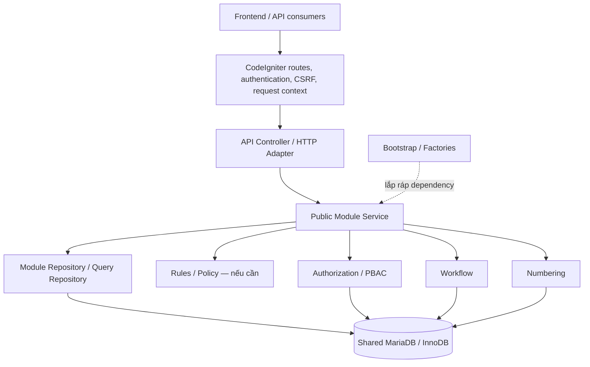
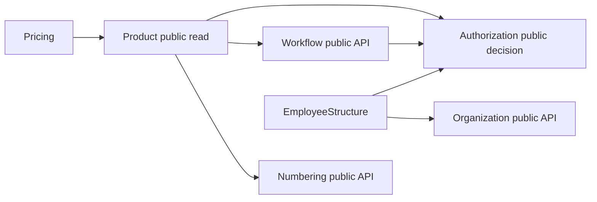
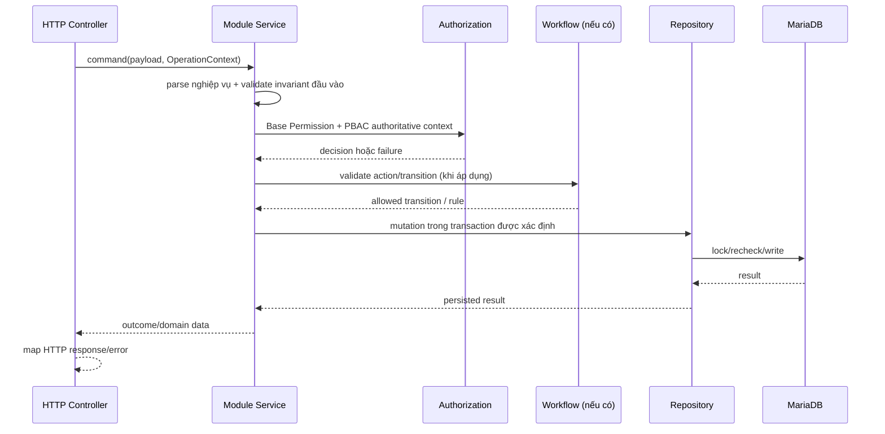
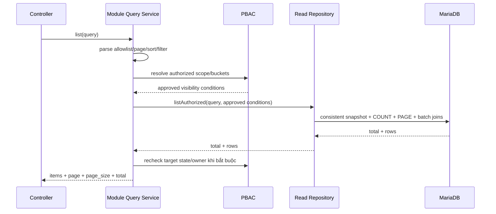
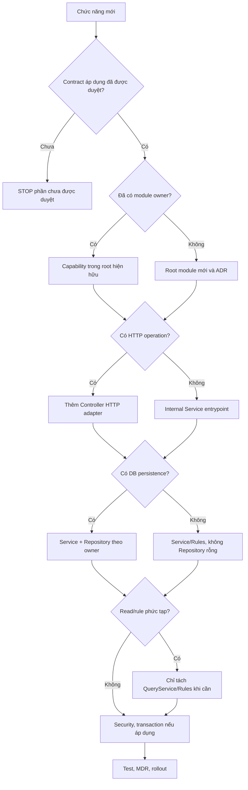

# DinkERP — TÀI LIỆU THIẾT KẾ KIẾN TRÚC BACKEND

**Architecture Standard & Module Design Guide**  
**Mã tài liệu:** DINKERP-BE-ARCH-001  
**Phiên bản:** 1.1.1 — Candidate Baseline, chờ phê duyệt chính thức  
**Ngày lập:** 22/10/2026  
**Ngày rà soát/hiệu chỉnh v1.1.1:** 22/10/2026  
**Phạm vi:** Backend DinkERP — PHP 8.2+, CodeIgniter 4, MariaDB/InnoDB  
**Loại tài liệu:** Tiêu chuẩn thiết kế độc lập, dùng cho chỉnh sửa module hiện hữu và triển khai module mới  
**Trạng thái thực thi:** **PROPOSED BASELINE**. Chưa tự động thay thế hợp đồng đã duyệt hoặc áp dụng thay đổi mã nguồn. Sau khi phê duyệt, quy tắc cho code mới có hiệu lực theo mốc ở Mục 20; hiện trạng legacy tuân lộ trình chuyển đổi có kiểm soát.

> **Quyết định kiến trúc đề nghị:** DinkERP sử dụng **Pragmatic Modular Monolith**: một backend triển khai thống nhất, một cơ sở dữ liệu giao dịch chính, chia module theo chủ sở hữu nghiệp vụ; luồng mặc định cho nghiệp vụ có lưu trữ là **Controller → Module Service → Repository**. Không bắt buộc tạo Repository cho phép tính thuần hoặc thao tác không có persistence. Chỉ bổ sung Query Service, Rules/Policy, Adapter hoặc Interface khi có yêu cầu thực tế.

> **Cách đọc:** Các câu dùng **PHẢI/KHÔNG ĐƯỢC** là quy tắc dự kiến bắt buộc sau khi tài liệu được phê duyệt. **NÊN** là mặc định có thể nêu lý do để thay đổi. **CÓ THỂ** là tùy chọn. Những ví dụ tên lớp hoặc module giả định không phải yêu cầu tạo Resource/Action/API mới.

### Hiệu chỉnh v1.1.1 so với v1.1

Bản v1.1.1 **không thay đổi** lựa chọn Pragmatic Modular Monolith hoặc hợp đồng nghiệp vụ. Đây là bản **làm rõ tiêu chuẩn để xét phê duyệt**: (1) ưu tiên approved API contract khi ánh xạ 404/403; (2) đưa Product COMBO + AUTO vào Known Implementation Risk; (3) chặn runtime recursion của Authorization read adapter; (4) một `OperationContext` cho một command; (5) quy định cụ thể đầu ra dependency/architecture scanner; (6) chuẩn hóa MDR, gate `N/A`, read-only SQL projection và public Product read entrypoints đang dùng. Chi tiết tại **Phụ lục G** và báo cáo Resolution đi kèm.

### Bản sửa đổi v1.1 so với v1.0

Bản 1.1 ưu tiên **làm rõ chỗ có thể dẫn tới triển khai sai** thay vì tạo kiến trúc phức tạp hơn. Các nhóm hiệu chỉnh trọng tâm: PBAC/`NO_MATCH`, vòng phụ thuộc platform, transaction ownership & Numbering, bảng kỹ thuật dùng chung, `COUNT`/pagination sau PBAC, chuẩn `MODULE.md`, thay đổi API nội bộ, tiêu chí hiệu lực và ngoại lệ của legacy. Nhật ký thay đổi có đối chiếu ở **Phụ lục D**.

### Hướng dẫn tra cứu nhanh

| Việc cần làm | Phần quan trọng nhất |
|---|---|
| **Xây một module mới** | Mục 3–7, 9–11, **16**, 19; dùng MDR template v1.1.1 nêu tại Phụ lục A |
| **Hiệu chỉnh module cũ** | Mục 3–5, 15, **17**, 19 và Phụ lục B |
| **Thay query/list/PBAC** | Mục 6–7, 10, 13, 15 |
| **Thay ghi dữ liệu/Numbering/Workflow** | Mục 6–9, 15, 19 |
| **Phê duyệt thay đổi lớn** | Mục 18–20 |


---

## 0. Mục đích, phạm vi và giá trị sử dụng

Tài liệu này là **đặc tả kiến trúc backend tự đầy đủ** để nhóm phát triển có thể:

1. Nhận diện module nào sở hữu một nghiệp vụ, bản ghi và hành vi ghi dữ liệu.
2. Từ một endpoint tìm nhanh Controller, Service, Repository, PBAC, Workflow, Numbering và transaction owner.
3. Chỉnh sửa hoặc chia nhỏ module cũ mà không làm đổi hành vi đã được phê duyệt.
4. Tạo module mới với cấu trúc tối thiểu nhất quán, có khả năng mở rộng về sau.
5. Kiểm soát phụ thuộc chéo, khả năng kiểm thử, hiệu năng và nợ kỹ thuật trong CI/PR.

**Ngoài phạm vi:** thiết kế chi tiết từng nghiệp vụ, định nghĩa Resource/Action code mới, DBD mới, API mới khi chưa có phê duyệt; thiết kế frontend; triển khai microservices hoặc hệ thống phân tán; bắt buộc chuyển tất cả mã nguồn sang DDD/Clean Architecture đầy đủ.

### 0.1. Thứ tự nguồn thẩm quyền và xử lý xung đột

1. **UR/FRS, Database Design, Implementation Contract và API Design/OpenAPI có hiệu lực đã phê duyệt** là thẩm quyền cho nghiệp vụ, dữ liệu, permission, hành vi API và giao dịch đã đặc tả.
2. **Approved change/decision của cùng thẩm quyền nghiệp vụ**, có nêu rõ phần hợp đồng bị sửa hoặc supersede, được áp dụng theo phạm vi phê duyệt. Một ADR kỹ thuật **không tự được phép** ghi đè UR/FRS/DBD/API contract.
3. **ADR kiến trúc đã phê duyệt** quyết định cấu trúc module, dependency, kỹ thuật tích hợp và ngoại lệ trong phần chưa bị ràng buộc bởi (1)–(2).
4. **Tiêu chuẩn kiến trúc này** áp dụng cho cách tổ chức backend, quality gates, thiết kế module và chuyển đổi legacy.
5. **Mã nguồn/characterization tests hiện tại** là bằng chứng hiện trạng; không làm hợp thức hóa sai lệch với hợp đồng có hiệu lực.

Khi hai văn bản cùng cấp không thống nhất, **không chọn tùy ý một bên**: lập conflict record (tài liệu, phiên bản, điều khoản, ảnh hưởng), xin quyết định của đúng owner trước khi sửa hành vi.

`CONTRACT_PENDING` nghĩa là không triển khai **surface đang pending**. Module xử lý thuần nội bộ không có HTTP API thì ghi `API: N/A` cùng phạm vi đã được duyệt, không tự phát minh endpoint. Không tự tạo Resource/Action/enum/table/cột mới khi hợp đồng chưa sẵn sàng.

### 0.2. Phân biệt hiện trạng và tiêu chuẩn đích

- **OBSERVED (hiện trạng v1.2.2):** CodeIgniter 4, 12 root module dưới `app/Modules`, các legacy facade/repository/alias và một số capability/port; chưa kết luận runtime/performance từ ZIP.
- **TARGET (quy tắc chuẩn):** thay đổi mới đi qua module owner/public entrypoint; không thêm dependency ngược hoặc cross-owner write.
- **TRANSITION (ngoại lệ có quản lý):** mã legacy tồn tại trong sổ ngoại lệ, có consumer, test, người phụ trách và điều kiện loại bỏ. Không lấy ngoại lệ làm tiền lệ viết code mới.
- **OPEN DECISION:** những việc chưa được approved như thay transaction owner COMBO/AUTO hoặc thay đổi contract không được biến thành yêu cầu coding tức thời.

**Cách diễn giải:** `PHẢI/KHÔNG ĐƯỢC` trong tài liệu này quy định mục tiêu bắt buộc **khi baseline được phê duyệt**; không đồng nghĩa mã v1.2.2 đã đạt hoặc buộc phải rewrite ngay. Phụ lục B là các bất biến **P1 hiện hành**, không tự động trở thành business contract bất biến cho tất cả phase ERP tương lai.

### 0.3. Tiêu chí thành công

- Một tính năng mới thông thường có thể được hiểu và thay đổi chủ yếu trong **một module**, trừ integration được khai báo.
- Có thể xác định **owner, endpoint, rule, PBAC action, Evaluation Organization, SQL, lock, transaction owner và test** qua thiết kế module và vài bước lần code.
- Không có đường ghi dữ liệu chéo module không qua owner; không mở vòng dependency mới.
- API, PBAC, error code, database invariants và kết quả giao dịch được bảo toàn khi refactor.
- Không có thoái lui hiệu năng đáng kể trên dữ liệu thử nghiệm đại diện; so sánh bằng phép đo, không suy đoán.
- Giảm dần số lớp facade/alias không còn caller; không thay chúng bằng lớp wrapper tương đương mới.

### 0.4. Thuật ngữ tối thiểu

| Thuật ngữ | Cách hiểu áp dụng trong DinkERP |
|---|---|
| **Root module / Capability** | Root module sở hữu phạm vi nghiệp vụ; capability là chức năng con trong cùng ownership, không mặc nhiên thành root module mới. |
| **Business data owner** | Module quyết định invariant, quyền ghi và lifecycle của bảng/aggregate nghiệp vụ. |
| **Technical data owner** | Năng lực nền tảng sở hữu persistence kỹ thuật như job state/counter/audit; bảng technical không được chia quyền ghi trực tiếp tùy ý. |
| **Public module entrypoint** | Class/method **được ghi trong Module Design Record cho consumer khác**; `public` theo cú pháp PHP chưa đủ. |
| **Transaction owner** | Coordinator chịu trách nhiệm ranh giới commit/rollback hoặc một atomic statement của use case; khác với owner của bảng nghiệp vụ. |
| **Authoritative Evaluation Organization** | Organization context do resolver và persisted resource/approved create context tính; không phải selector do client tùy ý đưa vào. |
| **Characterization/Parity test** | Kiểm thử ghi nhận hành vi đang có để bảo vệ refactor; nếu khác approved contract thì phải mở change-control, không coi legacy là thẩm quyền cao nhất. |
| **Architecture conformance** | Kết luận có bằng chứng module đáp ứng chuẩn; không đồng nghĩa với việc đã phê duyệt tài liệu chuẩn. |

**Bốn nhóm trạng thái khác nhau, không được dùng lẫn:**

| Nhóm | Giá trị hợp lệ | Ý nghĩa |
|---|---|---|
| Vòng đời hồ sơ module (MDR) | `DRAFT`, `ACCEPTED`, `IMPLEMENTING`, `IMPLEMENTED`, `DEPRECATED` | Tình trạng thiết kế/triển khai hồ sơ, không phải chứng nhận code đạt chuẩn |
| HTTP API contract | `CONTRACT_READY`, `CONTRACT_PENDING`, `N/A` | Áp dụng **cho từng operation/surface**, không suy diễn từ status toàn module |
| Kết quả quality gate | `PASS`, `FAIL`, `NOT_RUN`, `BLOCKED_ENV`, `N/A` | `N/A` = không áp dụng **có lý do**; `NOT_RUN` = cần chạy nhưng chưa chạy |
| Architecture conformance | `COMPLIANT`, `LEGACY_APPROVED`, `GAP_TO_FIX`, `NOT_VERIFIED` | Kết luận có evidence theo từng module/capability |

Các mã `READY`, `KNOWN_LEGACY` hoặc `APPROVED_NEW_CODE` **không** là giá trị thay thế cho các nhóm trạng thái chuẩn trên; ngoại lệ compatibility quản lý riêng theo exception registry.

---

## 1. Những quyết định kiến trúc nền tảng

| Mã | Quyết định | Lý do | Không áp dụng mặc định |
|---|---|---|---|
| AR-01 | **Modular Monolith** theo nghiệp vụ | Đơn giản triển khai và debug, vẫn có ranh giới module | Microservices, chia DB theo service |
| AR-02 | **Controller → Service → Repository** làm luồng chuẩn | Dễ học, dễ trace, ít tầng trung gian | Full Clean Architecture bắt buộc |
| AR-03 | **Một MariaDB/InnoDB** cho giao dịch nghiệp vụ hiện tại | FK, transaction, locking và vận hành đơn giản | Multi-DB, distributed transaction |
| AR-04 | **Module owner kiểm soát ghi** | Giữ bất biến, quyền và audit tại một nơi | Ghi trực tiếp vào bảng module khác |
| AR-05 | **Public service/contract rõ ràng** | Tránh coupling vào implementation nội bộ | Interface cho mọi class |
| AR-06 | **PBAC và scope ở tầng nghiệp vụ** | Bảo vệ bản ghi và collection độc lập HTTP | Chỉ dựa route/filter/frontend |
| AR-07 | **Transaction owner tường minh** | Giữ atomicity cho numbering, lock, mutation | Global UnitOfWork tự bọc mọi lời gọi |
| AR-08 | **SQL trước cache** | Hiệu quả và dễ vận hành trong ERP nhỏ/vừa | Redis, EventBus, CQRS tách read DB tự động |
| AR-09 | **Tối ưu và phân lớp theo nhu cầu** | Giảm abstraction rỗng và chi phí thay đổi | Tách mỗi endpoint thành một UseCase/DTO |
| AR-10 | **Refactor theo tính tương đương hành vi** | Giảm rủi ro trong hệ thống nhiều invariant | Big-bang rewrite/rename |
| AR-11 | **Dependency graph không vòng ở code mới** | Tránh vòng nguồn/constructor giữa platform modules | Đánh đồng read-need hai chiều với dependency code hai chiều |
| AR-12 | **Ownership của bảng kỹ thuật cũng tường minh** | Job/import/audit không trở thành vùng SQL vô chủ | Cho mọi module ghi tùy ý vào bảng kỹ thuật |
| AR-13 | **Gates theo bằng chứng và phạm vi thay đổi** | Quy chuẩn có thể chạy CI, chặn vi phạm mới mà không phá code cũ | Chặn merge bởi false positive/đánh dấu xanh khi runtime chưa kiểm chứng |

### 1.1. Nguyên tắc lựa chọn giải pháp

Khi có hai thiết kế đều đáp ứng nghiệp vụ và bảo mật, **chọn thiết kế có số khái niệm mới ít hơn**, ít đường đi hơn, SQL rõ ràng hơn và dễ kiểm thử hơn. Không đánh đổi tính đúng đắn PBAC/transaction để giảm vài dòng code hoặc tăng tốc một benchmark cục bộ.

Bộ quy tắc SOLID/DDD/Clean Architecture được sử dụng như công cụ suy xét **khi xuất hiện vấn đề cụ thể**, không phải checklist ép mọi module tuân thủ hình thức bốn tầng.

---

## 2. Kiến trúc tổng thể



Đây là **luồng trách nhiệm**, không ngụ ý mọi thao tác phải gọi đủ Authorization, Workflow và Numbering. **Controller → Service → Repository là đường mặc định khi có HTTP + persistence**, không phải một chuỗi class bắt buộc: pure calculation không cần Repository; batch/import không cần Controller; Query Service là nhánh thay thế cho read phức tạp. Quyền phải được kiểm tra tại service/entrypoint có thẩm quyền đối với mọi caller, không chỉ ở HTTP.

### 2.1. Phân định trách nhiệm

| Thành phần | Trách nhiệm chính | Tuyệt đối tránh |
|---|---|---|
| `Routes`, Filters | Route, authentication/CSRF, request metadata, chính sách kỹ thuật HTTP | Thay thế PBAC theo dữ liệu thực |
| `Controller` | Parse/request shape, HTTP validation, gọi entrypoint, map response/error | Query SQL, lock, mở transaction, tự quyết định quyền bản ghi |
| `XService` | Điều phối command/behavior, business validation/invariants, PBAC, state, transaction boundary của use case | SQL dài hoặc logic giao thức HTTP |
| `XQueryService` (tùy chọn) | Phối hợp authorized scope + COUNT/page/snapshot/batch read | Thực hiện business mutation |
| `XRules` (tùy chọn) | Quy tắc thuần logic, không side-effect; hữu ích khi nhiều caller chung quy tắc | Tự mở transaction/SQL ngầm |
| `XRepository` | DB read/write theo owner hoặc nền tảng kỹ thuật được giao ownership; projection, locking, query | Tự suy diễn PBAC, gọi Controller, mutate business table của owner khác |
| `Module Public API` | Những hành vi/query cho phép module khác sử dụng | Phơi bày mọi internal class, SQL schema tùy tiện |
| `Factory` | Lắp object graph và truyền dependency, DB connection | Business logic, thay mặt module ghi dữ liệu |
| `Infrastructure` | Thư viện kỹ thuật chia sẻ: clock, decimal, lock, transport, import reader | Business rules riêng của Product/Pricing/nhóm khác |
| `Compatibility` | Alias/delegate tạm phục vụ caller cũ | Trở thành nơi phát triển nghiệp vụ mới |

**Quy tắc đơn giản:** Không thêm một tầng chỉ vì đã thấy tầng đó ở module khác. Không buộc phải có interface cho một repository cụ thể nếu không tồn tại nhu cầu thay thế, quan hệ module hoặc test seam thực tế.

### 2.2. Ranh giới HTTP và nghiệp vụ

HTTP Controller **không phải là một cách gọi nghiệp vụ duy nhất**: import, command hoặc tác vụ nội bộ cũng phải sử dụng module service được bảo vệ bởi rule và authorization phù hợp. Không dồn toàn bộ validation hoặc PBAC vào HTTP facade, nếu không các caller khác sẽ bỏ qua chính sách.

### 2.3. Tổ chức dependency

**Được phép mặc định:**

- Controller → public service của module chủ quản.
- Service → repository/rule trong cùng module; → public service hoặc contract của module khác có quan hệ đã khai báo.
- Repository → database/utility kỹ thuật; không vòng ngược về service nghiệp vụ.
- Module nghiệp vụ → thư viện Infrastructure generic; Infrastructure generic không import business module.
- Factory → các implementation được lắp ráp; implementation không gọi ngược Factory để thực thi nghiệp vụ.
- **Consumer-owned read port** cho dữ liệu platform có quan hệ logic hai chiều: consumer sở hữu interface đọc hẹp; adapter trong Bootstrap/Integration nối với public read capability của provider. Consumer **không** import provider internal để tránh source-cycle.

**Không được phép mặc định:**

- Controller → Repository hoặc SQL.
- `ModuleA` → `ModuleB/Infrastructure`, `ModuleB/Repository`, class `internal` chưa công bố.
- `ModuleA` ghi bảng chủ quản của `ModuleB` qua SQL trực tiếp.
- Canonical module phụ thuộc mới vào `app/Services`/`app/Repositories` legacy chỉ để tiện sử dụng.
- Phụ thuộc vòng giữa module public services hoặc vòng constructor khi lắp dependency.

**Read-only SQL projection qua bảng module khác:** được phép khi cần nhất quán/hiệu năng nếu **hai data owner chấp thuận projection cụ thể trong MDR hoặc registry** (bảng/cột, lý do, SQL/query owner, PBAC/row visibility, schema impact, test, reviewer, thời điểm rà soát). **Không buộc ADR riêng cho mỗi JOIN** thuộc dependency/read projection đã duyệt. ADR + đúng contract/DB approval là bắt buộc nếu projection làm **mở hoặc đổi module boundary/data ownership**, tạo dependency mới có tác động hệ thống, thay security semantics hoặc vi phạm hướng dependency đã chốt. Không bao giờ suy ra quyền INSERT/UPDATE/DELETE từ approval đọc.

**Lưu ý chuyển tiếp platform API:** một số entrypoint Authorization, Workflow, Numbering hiện vẫn được công bố qua factory hoặc namespace lịch sử. Cho đến khi public canonical entrypoint được phê duyệt, module mới chỉ được gọi **entrypoint có ghi trong Module Design Record/compatibility registry**; không import trực tiếp repository/các lớp nội bộ chỉ vì API canonical chưa hoàn thiện. Không sửa hàng loạt đường dẫn namespace để hợp thức hóa tiêu chuẩn này.

---

## 3. Bản đồ 12 module nghiệp vụ hiện có

Module được chia theo **ownership**, không phải theo loại màn hình hoặc CRUD. Bảng dưới quy định phạm vi logic; tên bảng DB và Resource/Action cụ thể phải khớp DBD/contract đã duyệt.

| Module | Chủ sở hữu chính | Public capability dự kiến | Ranh giới cần giữ |
|---|---|---|---|
| `Identity` | Shield users, account/profile, membership liên quan identity | Identity/user operations được bảo vệ | Không bypass Authorization |
| `Authorization` | PBAC decisions, policy/group administration, authorization audit | `authorize`, decision/read scope và admin actions | Không trở thành module CRUD nghiệp vụ |
| `Resource` | Resource Type, Action metadata, resource-state integration metadata | Registry/read metadata và quản trị được duyệt | Resource Type ≠ một Resource row cho từng business record |
| `Workflow` | Lifecycle, state resolution, transition validation, write boundary | Resolve/validate/apply permitted transitions | Không tự ghi tùy tiện vào mọi bảng nghiệp vụ |
| `Numbering` | Series, scope/period, counter, synchronous identifier issuance | Reserve/issue qua business callback có transaction | Counter chỉ do Numbering quản lý |
| `Settings` | Display/runtime settings, config audit | Config reads/writes được duyệt | Không biến thành kho cấu hình nghiệp vụ của mọi module |
| `Foundation` | Danh mục tỉnh/phường và location master | Read/write location master | Không chứa business logic Contact/Organization |
| `Organization` | Organization tree, ancestor, company owner resolution | Organization read/write và ancestor/owner lookup | Client hint không thay authoritative owner |
| `Contact` | Contact master và business owner/scope | Contact read/write được bảo vệ | Ghi dữ liệu Contact qua owner |
| `EmployeeStructure` | Department, Position, Employee, Assignment | Public operations + assignment/scope lookup | Assignment context phải tách khỏi user identity |
| `Product` | Product Group, UOM, Product master/role, COMBO structure, Media, Product Import | Product operations, read lookup, product role/structure | Product **không** phụ thuộc Pricing |
| `Pricing` | Price List, price resolution, monetary COMBO allocation | Price List operations, pricing resolution | Pricing **có thể đọc** Product qua public API |

### 3.1. Quan hệ module nền tảng — phân biệt luồng code và nhu cầu dữ liệu



**Sơ đồ trên chỉ minh họa những dependency công khai một chiều; không phải dependency graph đầy đủ của code hiện tại.** Authorization cần dữ liệu Employee/Assignment/Organization; Workflow cần state; nhưng **nhu cầu đọc dữ liệu không cho phép tự tạo cạnh import ngược**.

**Mẫu xử lý một nhu cầu đọc hai chiều:** `Authorization` định nghĩa một read port hẹp (ví dụ *AssignmentScopeRead*, chỉ là tên minh họa). Bootstrap lắp adapter lấy dữ liệu authoritative từ `EmployeeStructure`/`Organization` thông qua **read capability chuyên phục vụ PBAC**, không phải service mutation tổng quát. `Authorization` không import `EmployeeStructure\Repository`; `EmployeeStructure` tiếp tục gọi public Authorization decision ở đường command.

**Ràng buộc chống vòng gọi runtime:** đường đọc `Authorization → read port → provider/adapter` **KHÔNG ĐƯỢC** gọi `Authorization::authorize()` hoặc kiểm tra lại PBAC thông qua entrypoint tự phụ thuộc vào Authorization. Đây là *privileged internal read for policy evaluation*, chỉ phục vụ eligibility/scope của decision engine; dữ liệu trả về giới hạn ở trường cần thiết, không được expose như public endpoint/lookup cho nghiệp vụ khác. Adapter phải có owner, consumer duy nhất hoặc allowlist consumer, mục đích đọc, chính sách truy cập và test. Không dùng cờ `skipAuthorization` tổng quát cho mọi service.

**Ví dụ wiring định hướng (tên là minh họa, không phải class phải tạo):**

```text
Bootstrap
  ├─ AssignmentScopeAdapter(read-only authoritative EmployeeStructure/Organization data)
  └─ PbacDecisionEngine(assignmentScopeRead: AssignmentScopeAdapter)

EmployeeStructure command → PbacDecisionEngine.authorize(...)
PbacDecisionEngine → AssignmentScopeAdapter.readEligibility(...)
AssignmentScopeAdapter → read capability do provider sở hữu, không gọi authorize(...)
```

**Test bắt buộc cho seam mới:** bootstrap object graph thành công; gọi PBAC decision có dependency spy/guard ghi số lượt và **fail nếu read adapter tái nhập decision engine**; matrix ACTIVE/effective assignment, ancestor path, negative scope; thử dùng read capability từ caller không được công bố phải bị chặn bởi boundary rule. Không chỉ kiểm tra source import DAG.

Đồ thị source dependency đối với **code mới** phải không có vòng ở mức public service/module. Những chu trình đang tồn tại chỉ được duy trì theo compatibility whitelist có owner và kế hoạch xóa; không thiết kế thêm vòng mới. Check **cả** static import và runtime object/constructor graph.

### 3.2. Hồ sơ module bắt buộc

Mỗi module phải có một **Module Design Record**. **Root module mới** đặt ở `backend/app/Modules/<Module>/MODULE.md` và được review cùng code. **Module legacy** có thể tạm được quản lý qua danh mục thiết kế trung tâm có link tới module cho tới mốc retrofit; không yêu cầu 12 PR chỉ để tạo file rỗng. **Capability mới trong root hiện có PHẢI cập nhật chính `MODULE.md` của root** (hoặc central MDR trong giai đoạn chuyển tiếp legacy) và bổ sung operation, owner, public entrypoint, dependency, test; không tự tạo thêm root `MODULE.md` trùng thông tin. Tài liệu capability bổ sung chỉ làm phụ lục/link từ MDR root khi cần. Hồ sơ gồm:

1. Module ID, mục tiêu, các capability và module owner.
2. Bảng/đối tượng dữ liệu sở hữu, phân loại **business/platform-technical**, bảng khác chỉ đọc, FK và migration; bảng shared không được vô chủ.
3. Public methods/contracts cho module khác; danh sách dependency hợp lệ.
4. Endpoints và trạng thái hợp đồng API; Resource Type/Action, Resource Domain, source Evaluation Organization.
5. Danh sách command/query, invariants, transaction owner, lock order, audit.
6. Workflow/Numbering/Import/Integration sử dụng nếu có, hoặc đánh dấu **Không áp dụng**.
7. Performance-sensitive queries, phép đo và test suite.
8. Quyết định/ngoại lệ đã được chấp thuận, người chịu trách nhiệm, caller list, review date và điều kiện xóa.
9. Trạng thái hợp đồng API (`CONTRACT_READY` / `CONTRACT_PENDING` / `N/A`); nếu không có external API ghi `N/A` rõ lý do. Các trạng thái hợp đồng khác theo đúng từ vựng của nguồn đã duyệt.

Không cần tạo thêm *runtime class* để lưu các thông tin này: bản ghi thiết kế là tài liệu, không phải một framework mới.

---

## 4. Cấu trúc thư mục và quy tắc tăng trưởng module

### 4.1. Bố cục backend chuẩn

```text
backend/app/
├── Config/                      # Routes, framework configuration
├── Controllers/Api/             # HTTP adapters; giữ route hiện hữu
├── Filters/                     # Authentication/CSRF/request concerns
├── Bootstrap/                   # Factory hiện có, composition
├── Modules/                     # Business ownership
│   ├── Identity/
│   ├── Authorization/
│   ├── Resource/
│   ├── Workflow/
│   ├── Numbering/
│   ├── Settings/
│   ├── Foundation/
│   ├── Organization/
│   ├── Contact/
│   ├── EmployeeStructure/
│   ├── Product/
│   ├── Pricing/
│   └── <FutureModule>/          # Chỉ sau khi có thiết kế được duyệt
├── Infrastructure/              # Technical utilities generic
│   ├── Api/
│   ├── Decimal/
│   ├── Lock/
│   ├── Time/
│   ├── Mutation/
│   └── Import/
├── Database/Migrations/         # Migrations forward-only
├── Exceptions/                  # Machine-readable domain errors
├── Language/vi/                 # API human messages
├── Language/en/
├── Services/                    # Legacy API facades/aliases; không tăng business mới
└── Repositories/                # Legacy repositories/adapters; không tăng business mới
```

Chú thích `<FutureModule>` biểu thị vị trí quy ước, **không phải tên module được duyệt**. Không tự tạo module, bảng hoặc action từ ví dụ.

### 4.2. Ba mức cấu trúc hợp lệ

**Mức S — capability lưu trữ đơn giản:**

```text
Modules/<Module>/
├── <Capability>Service.php
├── <Capability>Repository.php
└── MODULE.md
```

Nếu module không sở hữu dữ liệu cần persistence (chẳng hạn tính toán thuần theo hợp đồng đã duyệt), **không tạo Repository rỗng** chỉ để đủ ba tầng. Module root mới vẫn có `MODULE.md`. Với module hiện hữu không cần dời namespace/đổi thư mục khi chỉ sửa một use case.

**Mức M — module có truy vấn/phân quyền hoặc rule phức tạp:**

```text
Modules/<Module>/
├── MODULE.md                         # Một hồ sơ tại root
└── <Capability>/
    ├── <Capability>Service.php
    ├── <Capability>Repository.php      # Nếu có persistence
    ├── <Capability>QueryService.php    # Khi read/list phức tạp
    ├── <Capability>Rules.php           # Khi có rule cần tách
    └── Contracts/                     # Chỉ public contracts thực sự cần
```

Không tự tạo đủ mọi file: `Service` có thể là internal/command/read entrypoint, `Repository` chỉ cần khi truy cập persistence và `Controller` chỉ ở lớp HTTP.

**Mức L — module nhiều capability hoặc integration:**

```text
Modules/<Module>/
├── <CapabilityA>/
│   ├── ...
├── <CapabilityB>/
│   ├── ...
├── Integration/                      # Adapter ở owner module
├── Contracts/                        # Public interface/DTO nếu có
└── MODULE.md
```

Module phức tạp đã có `Application`, `Domain`, `Infrastructure`, `Ports` hợp lý (đặc biệt Authorization, Workflow, Numbering, một số module nền tảng) **được phép giữ**. Không di chuyển/flatten chỉ để bắt chước cấu trúc mức S hoặc M.

### 4.3. Khi nào tạo module mới?

**Tạo root module mới** khi đa số các điều kiện cốt lõi được chứng minh: business capability có ownership/lifecycle độc lập; sở hữu dữ liệu hoặc một public behavior ổn định; có invariant/security boundary riêng; tích hợp lâu dài với các module khác. Cần phê duyệt thiết kế/ADR và những contract **có áp dụng**. Internal-only capability ghi `API: N/A`, không tự tạo endpoint cho đủ biểu mẫu.

**Thêm capability vào module cũ** khi chức năng thay đổi cùng một aggregate/bản ghi do module đó sở hữu, hoặc cần dùng chung cùng invariant và transaction owner.

**Đưa vào `Infrastructure`** khi là kỹ thuật thực sự không biết nghiệp vụ (ví dụ CSV/XLSX reader, Decimal, Clock, generic persistence). Một helper được dùng ở hai module **không tự động** trở thành domain/service dùng chung.

Ví dụ theo baseline: Product Import vẫn thuộc Product; generic import reader/persistence thuộc `Infrastructure/Import`. **Không tạo `Modules/Import`** chỉ vì có một tính năng Product Import.

### 4.4. Khi nào cần tách class?

Tách một service/repository nếu có ít nhất một dấu hiệu thực chất:

- Có từ hai nhóm quy tắc thay đổi tương đối độc lập, dẫn tới các PR xung đột hoặc phạm vi kiểm thử quá rộng.
- Một read/list path có PBAC, COUNT, sort, snapshot và SQL optimization khác hẳn write path.
- Một rule thuần logic được dùng lặp lại ở nhiều entrypoint (HTTP, import, batch).
- Hai loại consumer cần những public methods khác nhau hoặc chuỗi dependency khó kiểm soát.
- Có bằng chứng N+1, query khó kiểm thử, locking behavior khó cô lập.

**Số dòng code chỉ là tín hiệu cần xem xét, không phải ngưỡng tách bắt buộc.** Không tạo các lớp `BaseService`, `BaseRepository`, `GenericCrudService`, `CommonDomain` nếu không chứng minh được nhu cầu và hành vi tương đồng.

---

## 5. Hợp đồng nội bộ và dependency governance

### 5.1. Public module API

Mỗi module xác định rõ **class/method được module khác gọi**. Một public method theo cú pháp PHP không đương nhiên là public module contract. Các class còn lại mặc định là internal implementation.

Public contract ưu tiên trực tiếp `XService` hoặc `XReadService` có tên rõ. Interface chỉ nên bổ sung khi:

1. Consumer cần tránh phụ thuộc vào một concrete implementation của module khác.
2. Có hai implementation thực sự (ví dụ storage/local và storage/remote) hoặc biên hệ thống ngoài.
3. Cần test seam/circular dependency break không có cách gọn hơn.
4. Kiến trúc đang có port hiệu quả và thay đổi sẽ phá boundary nếu bỏ port.

**Không tạo 1 interface + 1 concrete class cho toàn bộ CRUD chỉ để mô phỏng Hexagonal Architecture.**

### 5.2. Chính sách dữ liệu và phụ thuộc

| Hành vi | Mặc định | Điều kiện ngoại lệ |
|---|---|---|
| Module A gọi public read service B | Cho phép nếu dependency được khai báo | Kiểm tra không tạo vòng runtime |
| Module A gọi public command service B | Cho phép khi nghiệp vụ cần, owner B chịu trách nhiệm mutation | Transaction orchestration và quyền phải rõ |
| Module A truy cập `BRepository` hoặc `B/Infrastructure` | Cấm | ADR nếu không thể khác, có thời hạn |
| Module A JOIN read-only bảng B | Hạn chế, được duyệt theo query | Query documented + row visibility + schema impact + tests |
| Module A INSERT/UPDATE/DELETE bảng **nghiệp vụ** B trực tiếp | Cấm | Không dùng như shortcut hiệu năng |
| Module A ghi bảng **kỹ thuật chung** (`import_jobs`, audit, numbering...) | Chỉ qua API/repository do **technical owner** công bố | Không gọi trực tiếp SQL của bảng kỹ thuật từ module khác |
| Shared Infrastructure import business module | Cấm | Nếu là business code thì phải chuyển sang owner module |
| Product import Pricing | Cấm với baseline Product/Pricing | Thay đổi chỉ theo approved architecture decision |
| Pricing đọc Product | Cho phép qua public Product read capability | Không ghi Product trực tiếp |

### 5.3. Vòng phụ thuộc và cách phá vòng ở module nền tảng

Phân loại rõ:

1. **Source dependency cycle:** module A import hoặc phụ thuộc kiểu vào internal của B, trong khi B import lại A. **Cấm thêm ở code mới**; hiện trạng chỉ được giữ khi có whitelist theo đường dẫn và test.
2. **Runtime/constructor cycle:** A build/call B và B build/call A dẫn đến construction loop hoặc recursive business call. **Cấm cả với interface** nếu object graph vẫn gọi vòng.
3. **Nhu cầu dữ liệu hai chiều:** A xử lý nghiệp vụ B, nhưng B cần đọc ít field từ A. Đây **không phải giấy phép** tạo vòng 1 hoặc 2.

**Cách giải quyết ưu tiên:** xác định owner của operation; đặt read interface hẹp tại **consumer** hoặc một module-neutral contract được duyệt; provider adapter chỉ đọc dữ liệu phục vụ quyết định có thẩm quyền, **không gọi ngược authorization/consumer decision**, được nối trong Bootstrap; kiểm tra cả graph và hành vi thực thi sau wiring. Nếu vòng vẫn tồn tại, xem lại phân chia trách nhiệm trước khi thêm interface tiếp. Mẫu wiring, mục đích đọc hạn chế và negative tests tại Mục 3.1.

Các quan hệ Authorization–EmployeeStructure/Organization/Workflow phải tuân cách này. **Không đặt tên class là `Port` rồi coi như đã xử lý vòng phụ thuộc.** Cần test static graph + test bootstrapping/runtime cho các entrypoint chính.

### 5.4. Legacy compatibility

`app/Services` và `app/Repositories` cũ được coi là **vùng đóng băng tăng trưởng**: cho phép bugfix, delegation và API facade phục vụ tương thích. Business behavior mới phải nằm trong module owner. Mọi compatibility alias/adapter có **owner, caller list, test bảo vệ và điều kiện xóa**. Không xóa class chỉ vì tên legacy hoặc vì `class_alias` xuất hiện trong thống kê tĩnh.

---
### 5.5. Mức ổn định và quy trình thay đổi public API nội bộ

Phân loại interface theo **người tiêu dùng và cam kết ổn định**:

- **HTTP Public API:** có URI/OpenAPI, thay đổi chỉ theo approved external contract và version/deprecation policy.
- **Inter-module Public Service/Read Contract:** class/method được ghi trong `MODULE.md` cùng inputs, outputs, errors, security, transaction expectation và consumer list. Không đổi/xóa signature làm gãy caller mà thiếu migration plan.
- **Module Internal Implementation:** repository/rule/helper không được dùng bởi module khác; được refactor tự do hơn nếu parity tests đủ.
- **Shared technical contract:** chỉ công bố capability kỹ thuật thực sự dùng chung; business module không được dùng technical repository như đường tắt để ghi bảng nghiệp vụ khác.

Khi muốn thay public entrypoint: **thêm đường mới → chuyển consumer → đo test/parity → đánh dấu deprecate → xóa khi không còn caller**. Với internal interface trong cùng module không cần ADR riêng nếu không ảnh hưởng public boundary, PBAC, transaction hoặc DB/API semantics.

---

## 6. Chuẩn thực thi một request

### 6.1. Luồng command (Create/Update/Delete/Set State)



Đây là mô hình tổng quát. Với mutation race-sensitive, **thứ tự lock, re-read, re-authorization và validation cuối cùng** phải tuân thủ invariant từng capability; không xem một PBAC check trước transaction là đủ nếu owner/state/assignment có thể thay đổi trước khi commit.

**Chuẩn command:**

1. `Controller` xác thực hình dạng request theo hợp đồng HTTP, không đưa nguyên request object xuống domain service.
2. **Command entrypoint tạo hoặc nhận duy nhất một `OperationContext`**, sau đó truyền **cùng đối tượng** cho toàn bộ service/participant/callback thuộc command (kể cả create COMBO và audit). Không gọi `MutationContext::begin()` lại tại các bước con chỉ vì cần `evaluationTime`. Nếu command gọi qua legacy facade, facade phải giữ context trong phạm vi **command đó**, không cache qua các request. Chuẩn hóa dữ liệu nghiệp vụ bằng cùng hợp đồng cho các caller khác nhau.
3. Quyết định `Resource/Action`, authoritative Evaluation Organization, target visibility và quyền từ persisted state hoặc canonical create context.
4. Thực thi invariant, quyết định transaction owner/lock; thao tác liên quan nhiều bảng phải atomic.
5. Sau lock, **đọc lại dữ liệu cần bảo vệ** và kiểm tra các điều kiện có thể đổi theo concurrency, đúng với contract đã duyệt.
6. Repository thực hiện SQL, không quyết định PBAC. Audit/log được ghi ở điểm yêu cầu trong contract, cùng phạm vi nhất quán cần thiết.
7. HTTP adapter map kết quả và lỗi bằng stable machine code, không đưa stack trace/SQL details ra API.

### 6.2. `OperationContext` và tính nhất quán ngữ cảnh

DinkERP đã có `App\Infrastructure\Mutation\OperationContext` gồm: `actorUserId`, `evaluationTime`, `requestId`, `systemActor`; `MutationContext` có thể sinh operation context. **Tái sử dụng những kiểu hiện có**, không tạo một `ContextManager` mới.

- `evaluationTime` được chụp **một lần tại command boundary**, đi theo cùng `OperationContext` vào command participants và Numbering/business callbacks; không tạo một `OperationContext` mới cho từng operation nội bộ.
- **Observed migration gap v1.2.2:** `Api050ProductCatalogService::operation()` có thể gọi `MutationContext::begin()` nhiều lần và tạo evaluation time mới ở các bước liên quan. Chưa chứng minh sai dữ liệu runtime; ghi vào retrofit backlog và thêm test assert cùng actor/evaluationTime/requestId giữa các bước COMBO, import và audit trước khi sửa.
- `actorUserId` là actor của hành động; `systemActor` biểu thị operation do hệ thống thực thi, **không đồng nghĩa miễn PBAC**. Nếu actor không phải user đăng nhập, đường cấp quyền cho system job phải có **hợp đồng và test riêng**, không truyền `actorUserId = null` vào PBAC rồi coi như `ALLOW`. Không cho background job mặc nhiên bypass quyền nghiệp vụ.
- `requestId` dùng để tương quan log/audit; không nhét dữ liệu bí mật vào log.
- **Evaluation Organization không phải client-provided truth** và hiện không phải trường có sẵn trong `OperationContext`. Nó phải được giải quyết theo resource/action từ dữ liệu authoritative ở Authorization layer.
- Không giữ actor/user/operation context trong singleton dùng chung cho nhiều request.

### 6.3. Luồng Read/Show và tương thích 404/403

**Thứ tự thẩm quyền:** HTTP status, machine error code và cấu trúc response của **từng operation** PHẢI theo API contract/OpenAPI/Implementation Contract đã phê duyệt; refactor **không tự đổi** `403 ↔ 404` chỉ để tuân thủ một nguyên tắc kiến trúc tổng quát. Nếu approved contract và hành vi hiện hữu khác nhau, ghi conflict record và yêu cầu owner hợp đồng quyết định trước khi thay behavior.

- Với **API mới**, ưu tiên thiết kế không lộ sự tồn tại bản ghi ngoài visibility được cấp: phương án thường gặp là `404` khi không được tiết lộ sự tồn tại và `403` khi bản ghi hiển thị được nhưng action bị từ chối; lựa chọn cuối cùng phải được xác nhận trong **approved operation contract** và threat-model/security review. Không mặc định mọi loại lỗi từ chối đều có thể suy ra một trong hai status mà không xét ngữ nghĩa của API.
- Với **API legacy**, phải ghi **behavior hiện tại, approved behavior, quyết định giữ hay thay** trong MDR, kể cả HTTP code và machine error code. Không buộc đổi response để pass kiến trúc; nếu phải thay thì mở approved API/security change và có migration/compatibility tests.
- **Bằng chứng v1.2.2:** `AuthorizedProductReadService` phát sinh `PRODUCT_AUTHORIZATION_DENIED`; `ApiErrorMapper` ánh xạ `*DENIED*` thành HTTP `403` ở đường Product read. Đây là hành vi source-observed cần characterization test; **chưa mặc nhiên được chứng nhận đúng approved contract**.
- Resolve Resource Domain, authoritative evaluation context và persisted state theo hợp đồng; không cho client dùng ID/hint `organization_id` để nới quyền.
- Nếu có nhiều bảng/snapshot, tránh N+1 và giữ read transaction ngắn khi cần; không tự nested vào write transaction không hỗ trợ.

Đường **Show** khác **List**; kiểm thử cả không tồn tại, không nhìn thấy, nhìn thấy nhưng action denied, state inactive, error code/status và việc không lộ thông tin nhạy cảm. `404/403` của từng operation phải dựa trên contract có hiệu lực, không dựa duy nhất vào tên exception.

### 6.4. Luồng List/Search/Lookup



**Bắt buộc cho collection:**

- **`meta.total`, thứ tự trang và items phải cùng mô tả tập các bản ghi được nhìn thấy tại policy/snapshot được chọn cho operation theo contract.** Khi có SQL authorization bucket chính xác, áp filter quyền **trước** `COUNT` và `LIMIT/OFFSET`; không tiết lộ tổng bản ghi bị cấm.
- Nếu per-row state/owner cần **recheck sau SQL**, **không được** đơn giản bỏ các row bị cấm sau khi đã đếm/phân trang rồi trả `total` hoặc trang thiếu bản ghi. Phải làm query filter tương đương về ngữ nghĩa hoặc dùng fallback chính xác được giới hạn/đo; trường hợp không chứng minh được phải dừng refactor và làm rõ contract.
- Dùng allowlist cho `q`, filter, sort; giữ semantics so sánh chuỗi, collation, Unicode, stable tie-break ordering và số dạng chuỗi theo contract.
- Thực hiện SQL filter/page khi đã chứng minh tương đương PBAC; không tự chuyển sang `listAll()` và lọc/paginate toàn bộ trên PHP. Fallback hiện hữu được phép giữ khi cần đúng ngữ nghĩa, có metric và thử nghiệm dataset lớn.
- Giữ consistent read snapshot nếu `COUNT`, `PAGE`, owner/state cần nhất quán. **Snapshot consistency là tính nhất quán trong phạm vi read operation**, không phải cam kết nhìn thấy ngay mọi thay đổi PBAC/assignment vừa xảy ra ở transaction khác. Nếu yêu cầu thu hồi quyền tức thời/linearizable, đó là security contract riêng cần cơ chế và tests tương ứng; không tuyên bố đạt chỉ vì recheck trong cùng snapshot. Các snapshot hiện hành có thể từ chối nested transaction; không bọc chúng trong write transaction.
- Với PHP-materialization fallback, đo/giới hạn **candidate rows, peak memory, DB query count, duration và p95** theo dataset đại diện. Khi vượt ngân sách hoặc không chứng minh được authorized total/page chính xác, **không trả kết quả một phần giả như thành công**; dừng rollout/đường refactor, tối ưu query hoặc xử lý lỗi theo approved API contract. Không tự phát minh HTTP status/error code mới.
- Batch-load relations/lookups; theo dõi số bản ghi, latency và tình huống fallback. Cache chỉ trong phạm vi operation/snapshot phù hợp.
- Không tái sử dụng PBAC visibility từ request khác nếu không có invalidation/authorization epoch đã được approved và kiểm chứng.

**Tách `XQueryService` chỉ khi query list có điều phối scope/bucket/snapshot hoặc nhiều bước read đáng kể**. Đối với `getById` đơn giản, có thể dùng `XService` gọi `XRepository` trực tiếp.

---

## 7. Chuẩn Authorization / Resource Scope / PBAC

Đây là **cross-cutting business control**, không phải một HTTP filter đơn giản.

### 7.1. Các bước bắt buộc và precedence — không diễn giải `NO_MATCH` thành mở quyền mặc định

1. **Resource/action phải hợp lệ, resource còn đủ điều kiện (state/status) và Evaluation Organization được resolve từ dữ liệu authoritative**. Missing resolver/context hoặc resource action không hợp lệ không thể trở thành `NO_MATCH` được phép. Baseline v1.2.2: Resource Type inactive từ chối các business actions thông thường; đường phục hồi `resource.setstate` vẫn phải qua PBAC đầy đủ theo contract.
2. **Base Permission là điều kiện bắt buộc trước chính sách PBAC**; System Admin chỉ có quyền được gán tường minh, không có bypass hoặc tự động được phép action mới.
3. **Employee/assignment eligibility:** actor/user phải đáp ứng điều kiện employee ACTIVE + effective assignment theo baseline; domain `ORGANIZATION` yêu cầu assignment trên đúng ancestor path. Eligibility không được bypass bởi `NO_MATCH`.
4. **Policy lane:** trong **từng lane**, `ABSOLUTE_DENY > ALLOW > DENY > NO_MATCH`. Sau toàn bộ mandatory gates, lane không match được xử lý `NO_MATCH → ALLOW` **theo P1 đã phê duyệt**, không biến thành default public access.
5. **Tổng hợp lane:** actor lane và các lane assignment đủ điều kiện được tổng hợp theo hợp đồng; applicable `ABSOLUTE_DENY` ở bất kỳ lane nào chặn toàn bộ. `DENY` thông thường ở một lane **không tự động** chặn nếu lane đủ điều kiện khác cho phép theo thuật toán hiện hành. Không thay bằng `deny-overrides` toàn cục hay `first-match`.
6. **Kế thừa scope:** resolve ancestor path/assignment trước denied-set intersection; applicable `ABSOLUTE_DENY` không bị mất bởi phép intersection/optimization. Client selector, group membership hoặc Primary Assignment không được tự mở rộng authoritative scope.

Các semantics này là **bất biến P1 của code/hợp đồng hiện tại**, không phải một bộ thư viện phân quyền chung được dùng mặc định cho sản phẩm khác. Thay đổi policy engine/precedence bắt buộc có approved security change + test matrix.

### 7.2. Resource Domain và Evaluation Organization

| Resource Domain | Context chuẩn | Ghi chú |
|---|---|---|
| `SYSTEM` | `GROUP` | Không suy ra context khác từ client |
| `MASTER` | `GROUP` | Ví dụ master data theo Group |
| `ORGANIZATION` | Context do resolver được đăng ký cung cấp | Resolve từ owner/parent/scope authoritative của chính resource |

`COMPANY` **không phải Resource Domain**. Company/Organization là các loại scope dữ liệu có thể tham gia resolver khi contract quy định. **Organization type `GROUP` khác Authorization Group participant type `GROUP`**; không dùng chung khóa/ngữ nghĩa chỉ vì tên giống nhau.

Ví dụ baseline đã được duyệt:

- `organization.create` đánh giá ở **Parent Organization**.
- Employee Assignment create sử dụng `organization_id` của request **đã được backend xác minh**; bản ghi tồn tại sử dụng `organization_id` được persist; list kiểm tra theo từng persisted row.
- Department, Position và Employee là Group-shared `MASTER` nên protected operations evaluate ở `GROUP`.
- Assignment là `ORGANIZATION`-scoped; quyền từ assignment đủ điều kiện dựa trên effective time và đúng ancestor path; không lấy Primary Assignment làm lane duy nhất.
- Client filter/primary assignment mặc định không thể ghi đè owner/context bắt buộc của Resource.

Với một Resource mới, **không có quy tắc suy luận tự động** như “cứ thấy `organization_id` thì đủ an toàn”. Phải ghi rõ resolver nào tính evaluation context cho create/read/update/list và fail-closed khi thiếu.

### 7.3. Hợp đồng bảo mật tối thiểu của một endpoint

Bản ghi trong thiết kế module phải khai báo:

| Mục | Nội dung cần điền |
|---|---|
| Endpoint/operation | Method, URI, contract ID/trạng thái |
| Resource Type | Mã đã duyệt, không tự phát minh |
| Action | Action code đã duyệt |
| Resource Domain | `SYSTEM`, `MASTER` hoặc `ORGANIZATION` |
| Evaluation Org source | Persisted target, parent/owner, create scope, registered resolver |
| Base Permission | Điều kiện tiên quyết |
| Visibility | Approved operation-level HTTP status + machine error code, hành vi legacy nếu khác, quy tắc list scope |
| Mutable fields | Trường nào được sửa và có làm đổi ownership/state không |
| Race safety | Dữ liệu nào phải re-read sau lock |
| Audit | Khi nào cần ghi decision/mutation audit |

### 7.4. Hiệu năng Authorization

- Có thể batch PBAC read trong **một request/operation** với read-only context; tránh gọi từng row khi có authorized bucket có ngữ nghĩa tương đương.
- Không cho PBAC phụ thuộc toàn bộ mutable Employee Assignment Service chỉ để đọc assignment; dùng read-only assignment/scope/organization lookup nếu thực sự cần.
- Không bật global permission cache mặc định nếu không chứng minh invalidation khi policy, membership, assignment, state hoặc effective time thay đổi.
- Không dùng “cho qua để list nhanh hơn” hoặc tính `COUNT(*)` của vùng không được phép.

---

## 8. Chuẩn Workflow, trạng thái và audit

### 8.1. Ranh giới ownership

- `Workflow` sở hữu **định nghĩa lifecycle, state, transition, write-boundary validation** và business action coordination đã duyệt.
- **Module nghiệp vụ sở hữu bản ghi** vẫn thực hiện mutation vào bảng của mình thông qua repository của chính nó.
- `Workflow` có thể yêu cầu PBAC quyết định action; Authorization cần state thì đi qua read-only state lookup, không tạo chuỗi gọi ngược vô hạn.
- Hành động chuyển trạng thái không được ngụy trang thành `update(status)` nếu hợp đồng đòi `set-state` hay transition action riêng.

### 8.2. Checklist workflow cho module mới

1. Có thật sự cần workflow hay chỉ cần trạng thái đơn giản theo contract?
2. Resource/state config và action code đã được duyệt chưa?
3. State reader tìm được canonical persisted state bằng ID/owner không?
4. Transition có kiểm tra Resource/Action + evaluation context tại thời điểm thay đổi không?
5. Lock/re-read/compare state và write guard được đặt trong cùng transactional boundary phù hợp chưa?
6. Business mutation và audit có được rollback đúng khi transition thất bại không?

Không tạo một lifecycle engine phụ mới trong module nghiệp vụ nếu đã có Workflow chung đáp ứng semantics được duyệt.

### 8.3. Audit và lỗi

Audit theo chính sách đã duyệt, không đồng nghĩa phải logging vô điều kiện tất cả nội dung payload. Các trường actor/time/request ID phải nhất quán; không ghi password, token, toàn bộ dữ liệu nhạy cảm hoặc payload import thô vào log dùng chung. Lỗi domain phải là machine code ổn định, có context kỹ thuật ở server-side và được map sang thông báo ngôn ngữ tại HTTP boundary.

---

## 9. Numbering, transaction và concurrency — phần bắt buộc thiết kế riêng

### 9.1. Quy tắc transaction boundary và ownership theo use case

**Mỗi command phải có người chịu trách nhiệm tính nguyên tử và kết quả commit**, nhưng không phải mọi câu lệnh đơn đều cần `BEGIN/COMMIT` thủ công:

- **`atomicStatement`**: một lệnh SQL đơn, không có multi-row invariant/lock đặc biệt; DB bảo đảm atomicity của statement. Service owner chịu trách nhiệm validation/auth và lỗi; hồ sơ ghi `transaction: atomicStatement`.
- **`ownsTransaction`**: operation coordinator chủ động `BEGIN`, quản lý lock/recheck, `COMMIT`/`ROLLBACK`; **chỉ một** active transaction opener đối với phạm vi cần atomicity.
- **`participatesInOwner`**: các repository/service tham gia phải chạy trên **cùng MariaDB connection/session và transaction đã mở**, không tự commit/rollback hoặc mở transaction lồng khi contract không cho phép. Phải được thiết kế/kiểm thử như participation path, không chỉ dựa vào tình cờ dùng `db_connect()`.
- **`readSnapshot`**: luồng đọc `COUNT`/`PAGE` có thể tự mở read transaction ngắn; không nested vào write transaction nếu current repository từ chối.

**Quyền ghi theo owner không biến mất khi một service tham gia transaction của owner khác.** Ví dụ, Numbering giữ transaction cho AUTO issuance nhưng Product service/repository vẫn sở hữu business validation/mutation. Một operation liên module cần chỉ rõ transaction opener, participants, connection, lock order, re-read, audit và cách rollback.

Không đưa `UnitOfWork` toàn cục bọc mọi service. `AutoNumberingCounterAllocator::allocate()` ở baseline v1.2.2 kiểm tra `transDepth > 0` và tự mở transaction với callback lưu nghiệp vụ trước commit. **Không bọc một outer transaction quanh allocator**; luồng COMBO/AUTO thay đổi owner cần ADR, POC và integration/concurrency tests.

### 9.2. Các case chuẩn

| Kịch bản | Owner | Điều kiện phải giữ |
|---|---|---|
| Create bản ghi với mã người dùng nhập, không cấp counter | Service owner bản ghi | Validate unique, authorization, invariant, nhiều bảng atomic nếu có |
| Create dùng AUTO Numbering | Numbering allocator | Sinh mã và persist business row trong cùng callback/DB session/transaction |
| Create cấu trúc nhiều bảng + AUTO | Numbering allocator, callback của module nghiệp vụ | Tất cả business rows và counter cùng rollback/commit; cần POC/tests khi đụng logic hiện tại |
| Set state/update nhiều bảng | Service owner nghiệp vụ | Lock/re-read, enforce PBAC và invariant trong transaction phù hợp |
| Replace toàn bộ item set | Service owner aggregate | Lock parent, tính diff, validate, ghi thay đổi atomic |
| List snapshot | Read Query/Repository | Snapshot đọc ngắn; không nested vào transaction ghi không hỗ trợ |
| Import theo dòng | Import orchestrator hoặc Numbering allocator tùy command | Một dòng lỗi rollback chính dòng đó; không bọc toàn file trong một transaction |
| Một mutation SQL độc lập không cần lock nhiều bước | Module service (`atomicStatement`) | Vẫn cần PBAC, validation, DB constraint và error mapping; không ép tạo `BEGIN` thủ công |

**Quy tắc:** Transaction/atomicity strategy được mô tả **theo use case**, không chỉ theo class. Một service có thể dùng `atomicStatement` ở một command, `ownsTransaction` ở command khác và `participatesInOwner` trong callback Numbering. Các participant không được tự commit sớm; audit và mutation phải nhất quán với contract.

### 9.3. Numbering invariants hiện hành

- `auto_numbering_series` và `auto_numbering_counters` gắn Resource Type.
- Generated business identifier **không thay thế** BIGINT technical primary key.
- Scope có `GROUP`, `COMPANY`, `ORGANIZATION`; mode có `AUTO_REQUIRED`, `AUTO_IF_EMPTY`; reset có `NEVER`, `YEARLY`, `MONTHLY`, `DAILY` theo contract hiện có.
- Issuance và persist business create dùng **chung transaction**; allocation rollback có thể tái cấp lại; identifier đã commit không được cấp lại.
- `AUTO_IF_EMPTY` với mã nhập tay không được tiêu thụ counter.
- Xử lý collision candidate, uniqueness DB, `FOR UPDATE`, DomainLock và rollback theo serialization semantics đã duyệt.
- Không hard-delete series đã sử dụng; không sửa resource/series code/scope/reset policy sau khi đã phát hành.
- Không chuyển phát hành mã sang queue/event bất đồng bộ.

### 9.4. Lock, concurrency và retry

- Mọi DomainLock/advisory lock thuộc cùng **database connection/session** với nghiệp vụ, có finite timeout và được release trong `finally`/cơ chế bảo đảm tương đương.
- Định nghĩa lock keys/order theo aggregate; không dựa vào sleep hoặc chỉ check trước rồi ghi sau.
- Các update race-sensitive cần lock, re-read và phát hiện đổi owner/state/version trước commit. PBAC có thể đã được kiểm tra sơ bộ trước transaction nhưng phải đánh giá lại những yếu tố thay đổi được trong phạm vi lock/snapshot theo contract, không giả định quyền luôn bất biến.
- Chỉ retry tối đa một lần **nếu use case retry-safe/idempotent** theo contract. Không retry bừa một mutation có side effect ngoài database.
- Unique constraint vẫn là phòng tuyến cuối, kể cả sau validation ở PHP.
- Không gọi network, gửi email, đọc/ghi file lớn hoặc chờ API bên ngoài trong transaction khóa dữ liệu kéo dài, trừ trường hợp đã có thiết kế atomicity/bồi hoàn phù hợp.

### 9.5. Pattern tham khảo: Auto Numbering + multi-table create

```text
[Controller]
    -> [Owner Module Service]
        -> validate input / owner / PBAC
        -> prepare callback persistBusiness(identifier, sameDbConnection)
        -> [Numbering Service.allocate(callback)]  <-- transaction owner
             BEGIN
             lock / select counter FOR UPDATE
             build candidate identifier
             callback:
                 insert owned parent record
                 insert owned children/relations
                 audit mutation theo contract
             update counter
             COMMIT
        -> return persisted result
```

Đây là **pattern mục tiêu cần kiểm thử**, không phải khẳng định implementation Product COMBO hiện có đã hoàn toàn đúng pattern. Trước khi sửa luồng tạo COMBO dùng AUTO, phải chứng minh atomicity trên MariaDB/Shield runtime và chạy concurrency tests cho tình huống rollback/collision.

### 9.6. Known Implementation Risk — Product COMBO + AUTO (KIR-001)

**Status:** `OPEN / NOT_RUNTIME_VERIFIED` (source-observed, chưa xác nhận từ MariaDB). **Mức ưu tiên:** P0 trước mọi thay đổi liên quan luồng COMBO + AUTO. **Owner xử lý:** module Product (orchestration) và Numbering (allocator), với Architecture Owner review; đây là *vai trò cần phân công*, không phải tên người đã được chỉ định.

- **Observed call path:** `Api050ProductCatalogService::createProduct()` mở transaction khi payload có `combo_items` → `ProductMasterService::create()` có thể sử dụng AUTO series → `AutoNumberingCounterAllocator::allocate()` từ chối `transDepth > 0`. Vì vậy có **khả năng xung đột ownership** trên nhánh COMBO + AUTO; không khẳng định tất cả CREATE COMBO đều thất bại.
- **Phạm vi cần kiểm thử:** COMBO có/không có `combo_items`; mã manual, `AUTO_IF_EMPTY`, `AUTO_REQUIRED`; series hữu hiệu/không có series; lỗi validation/PBAC của child; collision/counter; rollback sau ghi parent; DB session/advisory lock; concurrent create.
- **Chặn thay đổi thiếu bằng chứng:** Không thay transaction opener, callback Numbering, lock order hoặc create-composition flow nếu chưa có ADR được duyệt, POC MariaDB/Shield + tests integration/concurrency trên matrix và kế hoạch rollback ứng dụng.
- **Đường xử lý mục tiêu đang chờ quyết định:** Numbering có thể sở hữu transaction cho AUTO và Product cung cấp callback ghi parent/children cùng session; **không áp dụng như patch tự động**. Khi test xác minh được hiện trạng, ghi chính xác điều kiện lỗi/success và approved remediation trong KIR/MDR.

Việc phát hành Standard như **policy baseline** không đồng nghĩa KIR-001 đã được xử lý hoặc code runtime compliant.

---

## 10. Database, repository và migration

### 10.1. Quyền sở hữu dữ liệu

Mỗi bảng/aggregate có **một data owner tường minh**, thuộc một trong hai nhóm: **Business owner** (`Product`, `Pricing`, ...), hoặc **Platform/technical owner** (`Numbering` counters, generic Import job/row persistence, audit hoặc bảng hệ thống nếu DBD đã duyệt). **Shared database không có nghĩa shared write access**.

- Repository/service của owner chịu trách nhiệm insert/update/delete và lock của bảng mình sở hữu. Bảng kỹ thuật dùng chung phải công bố **technical write API/repository** hợp lệ; module gọi nó không tự viết SQL vào bảng technical owner.
- Ví dụ đã xác minh: `App\Infrastructure\Import\Persistence\ImportJobRepository` thao tác `import_jobs`; các mutation `products` vẫn thuộc Product. Đây là **technical table owner ngoại lệ hợp lệ**, không phải lỗ hổng trong nguyên tắc module owner.
- Module A cần thay đổi bản ghi B: gọi public command surface của B, có transaction participation rõ khi cần atomic cross-owner. FK không cho phép direct write vào owner khác.
- Cross-module read projection chỉ được phép khi owner/field/visibility/schema impact và tests đã được ghi nhận; không ép N+1 để tránh JOIN đơn giản.
- Không tạo schema/column/triggers chưa được DBD/change approval. Không dùng business identifier thay BIGINT technical key.

### 10.2. Nhiệm vụ repository

Repository thực hiện SQL Query Builder/raw SQL (khi cần), row locks, pagination/projection, batch relations và mapping record. **Service/Authorization kiểm soát quyền và rule**; query repository có thể nhận **approved visibility plan** (buckets/filter) đã resolve nhưng không được tự suy luận policy. Những snapshot method đang `transDepth === 0` là explicit boundary, không gọi từ transaction khác theo mặc định.

NÊN ưu tiên các method theo mục đích cụ thể:

```text
findById(id)
findForUpdate(id)
insert(data, operation)
updateMutable(id, changes, operation)
listAuthorized(query, approvedScopes)
```

Đây là tên **minh họa**, không bắt đổi tên tất cả method hiện hành. Với aggregate lớn, có thể tách `ReadRepository` hoặc `XQueryService`, nhưng không bắt buộc mô hình CQRS hoặc database riêng.

### 10.3. Migrations và thay đổi schema

- Migration **forward-only**; không sửa migration đã áp dụng ở bất kỳ môi trường dùng chung.
- Thay đổi schema phải có design/DBD approval và test trên dữ liệu đại diện.
- Dùng chiến lược **expand → deploy compatible code → backfill nếu cần → contract** với các thay đổi rủi ro cao.
- Bảo vệ BIGINT identifiers, uniqueness, FK, DECIMAL precision và các index đã định nghĩa.
- Chỉ tạo/thay index sau khi xem `EXPLAIN`, cardinality, slow queries và chi phí write; không thêm index hàng loạt theo cảm tính.
- Ưu tiên rollback **ứng dụng** và migration tương thích ngược; không giả định `down()` có thể đảo ngược mọi schema change hoặc khôi phục dữ liệu đã mất.
- Khi phát hành có code cũ/chưa cập nhật trên nhiều instance, phải có **compatibility window**: triển khai schema mở rộng trước, code hỗ trợ cả schema cũ/mới khi cần, backfill idempotent và kiểm tra hoàn thành rồi mới contract. Không xóa cột/index/bảng trong cùng release với consumer cuối cùng chưa chuyển.
- Migrations vẫn phải tuân framework; quy tắc `forward-only` là **không sửa lịch sử đã áp dụng và không dựa vào destructive rollback** như phương án phục hồi sản xuất, không phải cấm mọi phương thức `down()` trong file migration.

### 10.4. Decimal, thời gian, timezone

- Money/quantity dùng `Decimal`/chuỗi chính xác, **không dùng binary float** cho tính toán authoritative.
- BIGINT/DECIMAL trên API phải giữ biểu diễn chuỗi JSON theo hợp đồng; không ép qua số JavaScript hoặc giá trị PHP float rồi serialize.
- Evaluation time/business timezone được resolve một lần theo chính sách; không dùng trực tiếp `time()`, `date()`, `now()` rải rác trong service điều phối cho cùng nghiệp vụ.
- So sánh hiệu lực và thời gian của Pricing/Assignment/Numbering phải tuân theo contract, không tùy tiện dùng timezone request hoặc locale người dùng.

---

### 10.5. Quản lý schema và migration theo owner khi chỉ có một migration directory

DinkERP hiện dùng chung `backend/app/Database/Migrations`. **Đường dẫn migration tập trung không làm mất ownership theo module.** Mỗi thay đổi schema phải khai báo trong PR/MDR: bảng được thay, data owner, approved DBD/change, consumer impacted, cách migrate dữ liệu và kiểm thử dữ liệu sau migration. Migration không được gọi service nghiệp vụ để quyết định dữ liệu trong lúc schema đang thay đổi; logic backfill đặc thù cần plan idempotent, logs và kiểm tra thành công riêng.

Khi bổ sung bảng mới, xác định owner **trước khi** chọn repository. Nếu bảng phục vụ technical import/audit/numbering chung, phải chỉ rõ technical owner và public write path, không dùng nhãn “shared” để bỏ qua quyết định ownership.

---

## 11. API, contract, lỗi và localization

### 11.1. API shape

- Giữ namespace URL `/api/v1` với endpoint hiện hữu; các endpoint mới chỉ khai báo khi có `CONTRACT_READY` và đã được phê duyệt.
- JSON keys `snake_case`. BIGINT và DECIMAL domain values đi bằng JSON string theo contract.
- Collection response, paging metadata và error mapping sử dụng `ApiTransport`/hạ tầng tương đương hiện có, không mỗi module tự tạo format response.
- Route/Controller không được bỏ PBAC theo persisted state bằng một check quyền tổng quát ở filter.
- Search/sort/filter theo allowlist và giới hạn phân trang đã được hợp đồng công bố; không cho client gửi SQL field/table name tùy ý.

### 11.2. Đồng bộ hợp đồng khi thay API

Một thay đổi API hợp lệ cần đồng thời:

1. Xác minh thay đổi được approval theo UR/FRS/API Design và resource/action metadata.
2. Cập nhật OpenAPI và chạy contract lint.
3. Cập nhật/generated typed frontend artifacts theo pipeline; **không sửa tay generated files**.
4. Bổ sung tests cho response shape, error status/code, 404/403, dữ liệu số và version compatibility.
5. Có migration/deprecation policy nếu consumer cũ đang sử dụng.

### 11.3. Domain error

- Service throw domain error bằng **stable machine code** (ví dụ class `App\Exceptions\DomainException` hiện hữu), không dùng chuỗi thông báo tiếng Việt/Anh để client parse logic.
- HTTP status + machine code cho **mỗi lỗi công khai mới** PHẢI có mapping tường minh được review trong contract/error catalog và API test; **không dựa duy nhất** vào substring của tên code để suy ra status. Có thể dùng `ApiErrorMapper` hiện có và bổ sung exception mapping hẹp, **không** tạo error framework mới.
- **Observed v1.2.2:** `ApiErrorMapper::status()` đang có nhánh suy diễn `*NOT_FOUND* → 404`, `*DENIED* → 403` (và ngoại lệ). Giữ tương thích cho mã hiện hữu theo approved contract; không thay hàng loạt mapper gây đổi response ngoài phạm vi.
- Controller/transport map sang HTTP status và thông báo hiển thị; diagnostic exception chain chỉ tồn tại server-side.
- Thông báo/translation không thay machine code, enum, `Resource/Action`, field name hay dữ liệu do người dùng nhập.
- Locale hỗ trợ `vi`, `en`, fallback `vi` theo baseline; locale không thay đổi PBAC, business timezone hoặc dữ liệu lưu trữ.

---
## 12. Import, tích hợp ngoài và tác vụ dài

### 12.1. Nguyên tắc tách generic và business

- Parser CSV/XLSX, `ImportDocument`/`ImportRow`, job/row persistence kỹ thuật thuộc `App\Infrastructure\Import`; với các bảng `import_jobs`/`import_job_rows`, component này là **technical data owner** theo DBD hiện hành, không phải shared mutable table vô chủ.
- Template nghiệp vụ, mapping field, validation, authorization và **business row mutation** thuộc module **sở hữu dữ liệu nhập** (baseline là Product). Module import gọi API/repository kỹ thuật được công bố, không viết tùy ý trực tiếp vào bảng trạng thái import.
- `Infrastructure/Import` **không được import** Product/Pricing hoặc module nghiệp vụ khác.
- Một luồng import mới không mặc nhiên tạo `Modules/Import`. Chỉ xem xét module nghiệp vụ import chung khi có **nhiều target độc lập** và ownership rõ theo ADR.

### 12.2. Ràng buộc với Product Import hiện tại

- Modes: `CREATE_ONLY`, `UPDATE_ONLY`, `UPSERT` theo contract đã duyệt.
- `product.import` là start gate ở GROUP; từng logical mutation vẫn phải xác minh quyền `product.create`, `product.edit`, `product.setstate` khi áp dụng.
- Một dòng thất bại phải rollback toàn bộ mutation của dòng và auto-number liên quan; không gom cả tệp vào một DB transaction.
- Bảo toàn source-local `source_key`, entity identity `product_code`, dependency graph, cycle detection, original row number và persisted row results.
- Job status/row status và cách reconcile counts phải giữ theo implementation contract; không tự coi source hash trùng là idempotent success.
- Không persist toàn bộ payload thô vào log chỉ để phục vụ theo dõi import.

### 12.3. Khi nào cần background worker?

Mặc định giữ xử lý synchronous nếu đáp ứng timeout, memory và vận hành. Chỉ cân nhắc worker khi có dữ liệu cho thấy sync đang là nút thắt hoặc yêu cầu phục hồi tác vụ vượt quá HTTP lifecycle. Nếu đưa worker vào, **PHẢI** thiết kế durable job state, idempotency key/semantics, quyền và actor, retry policy, row replay/recovery, progress và đối soát. Không thêm queue chỉ để đáp ứng sơ đồ kiến trúc.

### 12.4. Tích hợp bên ngoài trong tương lai

Một integration mới phải xác định module sở hữu quyết định nghiệp vụ, adapter kỹ thuật, timeout, cơ chế failure/retry, idempotency và đường audit. Không thực hiện network call lâu trong DB transaction đang giữ row/advisory lock. Nếu cần phát external side effect đúng sau commit, thiết kế cơ chế đảm bảo phát lại/bù trừ được phê duyệt; **không giả định** một in-memory event listener có bảo đảm giao dịch.

---

## 13. Hiệu năng và vận hành

### 13.1. Ưu tiên tối ưu theo chi phí thực

Thứ tự thông thường:

1. SQL đúng và chọn lọc: điều kiện PBAC, index hiện có, tránh full-table PHP materialization.
2. Loại N+1 và batch các quan hệ lookup.
3. Giảm phạm vi lock và thời gian transaction, kiểm soát concurrency.
4. Đo điểm nghẽn hydration, serialization, tính toán decimal và import.
5. Sau cùng mới cân nhắc caching, index mới, job worker hoặc kiến trúc phân tán.

Không mặc định chi phí gọi phương thức PHP nội bộ là nút thắt quan trọng hơn database round-trip.

### 13.2. Observability tối thiểu

NÊN ghi các trường có thể đối chiếu giữa các môi trường:

| Nhóm | Chỉ số / trường |
|---|---|
| Request | `request_id`, endpoint/operation, status, total duration |
| DB | Query count, tổng DB time (nếu đo được), slow query, deadlock/lock timeout |
| Security | Security decision outcome theo cơ chế audit được duyệt; không log toàn bộ sensitive context |
| Read list | SQL fast path/fallback, số rows, paging, count duration |
| Write | Owner use case, transaction outcome, collision/retry count, duration |
| Import | Job ID, batch/row progress, số SUCCESS/ERROR/SKIPPED, thời gian xử lý |

Không log access token, password, bí mật, nội dung ảnh/file hoặc thông tin cá nhân đầy đủ. Mọi log bổ sung phải xem xét chính sách bảo vệ dữ liệu của dự án.

### 13.3. Kiểm thử hiệu năng

Mỗi refactor tại đường nóng có bản đo **trước/sau trên cùng dataset và cấu hình**: `p50/p95`, DB time, query count, memory peak và lỗi cạnh tranh dữ liệu. Mốc pass/fail phải được đặt dựa trên baseline và yêu cầu nghiệp vụ; tài liệu này **không bịa SLO hay benchmark hiện có**.

NÊN chuẩn bị ít nhất: dữ liệu thưa; dữ liệu nhiều bản ghi; dữ liệu theo nhiều Organization/ancestor scope; trường hợp người dùng chỉ nhìn thấy một phần nhỏ; sort/filter Unicode; trạng thái/owner thay đổi đồng thời; nhập số lượng lớn các child records.

### 13.4. Thành phần chưa cần triển khai

Không thêm mặc định: Redis permission cache, message broker, EventBus framework, generic domain-event bus, two-database CQRS, ORM mới, container DI bên thứ ba, distributed tracing platform hoặc background worker cho tất cả modules. Mỗi thành phần cần ADR chứng minh lợi ích/chi phí và tác động vận hành cụ thể.

---

## 14. Factory, dependency wiring và test seams

### 14.1. Nguyên tắc lắp ráp

- Tái sử dụng `backend/app/Bootstrap/*Factory.php` và framework services đang hoạt động.
- Với code mới, **ưu tiên constructor injection tường minh**, đặc biệt dependency đổi được và database connection. Không ép rewrite constructor legacy đang có default `db_connect()` nếu không có task/testrun phù hợp.
- Trong một **transactional mutation**, tất cả participants thực hiện ghi/row lock/advisory lock và read-for-update liên quan phải dùng **đúng cùng connection/session**. PBAC read diễn ra trước transaction có thể khác snapshot; những input/state có thể thay đổi phải được re-read/recheck trong boundary theo contract. Không yêu cầu mọi read-only lookup độc lập trên toàn request dùng một connection duy nhất.
- Factory được gọi ở composition entrypoint; service không gọi ngược Factory để lấy hidden dependency trong lúc xử lý nghiệp vụ nếu có thể truyền rõ. Đặc biệt read-port adapter dùng phá vòng phải được wire ở Bootstrap và không tạo graph hai chiều.
- Không khởi tạo object graph của cả 12 module cho mọi request.

### 14.2. Testability không cần interface đại trà

Cho phép kiểm thử service bằng repository fake/stub **khi có test seam thực tế**. Nếu constructor hiện concrete và mock khó, cân nhắc dùng narrow interface/adapter ở chỗ phụ thuộc đặc biệt; đừng tạo interface cho toàn bộ 12 module cùng lúc. Quy tắc nghiệp vụ thuần nên được tách thành `Rules` khi có giá trị test độc lập.

### 14.3. Cấp phụ thuộc nhất quán

Trong mỗi Module Design Record cần khai báo các dependency quan trọng, nhất là service khác cần `OperationContext`, `ConnectionInterface`, `Clock`, `DomainLockService`, PBAC read context. Không yêu cầu mô tả từng object trivial như formatter hoặc DTO.

---

## 15. Chiến lược kiểm thử và Quality Gates

### 15.1. Các nhóm test bắt buộc theo thay đổi

| Tầng kiểm thử | Mục đích | Khi nào bắt buộc |
|---|---|---|
| Static boundary | Kiểm soát import, forbidden module edges, legacy growth | Mỗi PR backend |
| Unit/Rules | Bảo vệ invariant độc lập IO | Khi thêm/chỉnh business rules |
| Repository/integration | Kiểm tra SQL, index assumptions, transactions trên MariaDB | Khi sửa SQL/schema/lock/transaction |
| PBAC matrix | Base Permission, absolute deny, scope, owner, state, 404/403 | Mọi operation protected mới/chỉnh |
| API contract | Route, response, error code, JSON numeric strings, OpenAPI | Khi chạm Controller/API behavior |
| Concurrency | Race, lock order, collision, retry-safe, rollback | Numbering, hierarchy, assignment, item-set, multi-table mutation |
| Performance regression | Query count, snapshot/COUNT/paging, p95 khi có tải đại diện | Luồng list/query nóng, query refactor |
| Compatibility | Facade/alias delegation và caller legacy | Khi chuyển entrypoint/namespace |

### 15.2. Gate kỹ thuật, tình trạng bằng chứng và nguyên tắc bật merge blocker

**Kiểm tra tĩnh cho mỗi PR backend:** PHP lint, PHPStan theo baseline, architecture dependency scanner (public/internal import, module DAG, legacy growth), các source-only boundary tests và contract lint nếu có API thay đổi.

**Kiểm tra theo ảnh hưởng:** PHPUnit integration trên **MariaDB/InnoDB + Shield** khi sửa repository, transaction, Numbering, PBAC, workflow hoặc DBD; concurrency/collision/rollback khi có lock; API integration, OpenAPI lint và regenerate typed artifacts khi thay public contract; `EXPLAIN`/benchmark theo scope query nóng.

**Baseline status của ZIP v1.2.2 (bằng chứng lịch sử, không phải bằng chứng xanh hôm nay):** 511 PHP lint đạt, 5 source-only compatibility gates đạt, `architecture-guard.php` còn **7 cảnh báo** (ba flat legacy Product compatibility và bốn catalog/error-code checks cần phân loại). Chưa có vendor, MariaDB runtime hoặc performance benchmark từ ZIP. Không tuyên bố integration/performance pass khi chưa chạy.

**Deliverables bắt buộc để triển khai executable architecture baseline (Milestone B, chưa mặc định đã có công cụ):**

| ID | Đầu ra kiểm chứng | Phương pháp/tiêu chí nghiệm thu |
|---|---|---|
| `ARCH-01` | Module public API registry | Mapping root module → allowed class/method/consumer, từ MDR; scanner phát hiện import nội bộ trái registry |
| `ARCH-02` | Static dependency graph + forbidden-edge scan | Scan các `use`/type references hợp lệ; phát hiện vòng **trực tiếp và gián tiếp**; báo path chu trình; dynamic factory/alias ghi giới hạn và test bổ sung |
| `ARCH-03` | Data write ownership ledger + review check | Map table → business/technical owner; phát hiện SQL mutation nghi vấn bằng static rules **và** review/mutation integration test. Static scanner không được tuyên bố chứng minh mọi dynamic SQL path |
| `ARCH-04` | Compatibility exception registry | Mỗi shim/forbidden edge được duyệt có path, owner, callers, lý do, test, revisit/removal trigger; không whitelist cả directory |
| `ARCH-05` | Runtime bootstrap/call-cycle test | Test các factory/service entrypoint quan trọng, nhất là PBAC assignment read seam; spy phát hiện recursive Authorization decision |
| `ARCH-06` | Positive/negative fixtures của scanner | Ít nhất: import public hợp lệ PASS; import internal, forbidden reverse edge, transitive cycle, new legacy dependency FAIL; approved exception giới hạn PASS; sai path exception FAIL |
| `ARCH-07` | CI change report & evidence index | CI ghi rule ID/file/edge, exit code, known baseline vs new violation, test path và trạng thái gate; fail đúng vi phạm mới trước khi thành required blocker |

**Ngưỡng chứng nhận:** Chỉ nói **static module boundary verified** cho loại phụ thuộc mà scanner thực sự phủ; **runtime graph verified** khi bootstrap/recursion tests chạy; **write ownership verified** khi review + SQL/mutation integration đầy đủ. Ba kết luận không thể thay thế nhau. Không tuyên bố quét static phát hiện chính xác mọi SQL động.

**Trước khi bật architecture guard thành required merge blocker:**

1. Ghi lại rule ID, path cụ thể, lý do, owner, date/revisit trigger cho những edge legacy hợp lệ; không whitelist tràn cả `Modules/` hay `Services/`.
2. Phân biệt `LEGACY_APPROVED`, `FALSE_POSITIVE`, `REAL_VIOLATION`, `CONTRACT_OPEN`. Sửa detector false positive; với violation thực cần kế hoạch/decision chứ không che trong whitelist.
3. Xác nhận CI đã phát hiện **vi phạm mới** qua negative fixtures và không cấm lầm những compatibility shim đang tồn tại.
4. Công bố kết quả trên môi trường có vendor/DB trước khi tuyên bố **runtime baseline verified**. Nếu môi trường DB không có, các PR tác động transaction/security phải chờ pipeline thích hợp, không được cho qua do test unavailable.

**Trạng thái gate phân biệt:** `PASS`, `FAIL`, `NOT_RUN`, `BLOCKED_ENV`, `N/A` (ghi lý do không áp dụng). `NOT_RUN` ≠ `PASS`; `BLOCKED_ENV` ≠ `PASS`; legacy exception hợp lệ nằm ở **exception registry**, không phải status `PASS` của test không chạy. Metrics/thresholds được đặt theo baseline đo được, không tự điền số giả.

### 15.3. Golden-master / parity test khi refactor

Khi di chuyển code mà yêu cầu **không đổi hành vi**, phải so sánh giữa old và new implementation trên các vector:

- Input/validation (kể cả empty/null, quantity/decimal string, field không cho sửa).
- Machine error code, HTTP status, 404/403, số liệu hiển thị được/không được.
- SQL count/filter/sort/page, dữ liệu Unicode, thứ tự ổn định, fallback behavior.
- Persisted DB rows/audit, tính nhất quán owner/state/evaluation time.
- Lock order, concurrent update, numbering counter/collision, rollback, retry.
- Tài nguyên vận hành: query count, latency, memory.

Test parity **không hợp thức hóa** hành vi legacy trái hợp đồng đã phê duyệt; trường hợp đó phải có change-control trước khi thay.

---

## 16. Quy trình phát triển một module mới (New Module Playbook)

Áp dụng cho module được phê duyệt trong tương lai; các trường `[ ... ]` dưới đây là placeholder và **không phải các mã nghiệp vụ/API thực tế**.

### Bước 1 — Chốt nguồn nghiệp vụ trước khi viết code

**Input tối thiểu:** UR/FRS và Implementation Contract **của capability** đã duyệt; DBD/Change khi có persistence; API Design/OpenAPI trạng thái `CONTRACT_READY` **cho endpoint thực sự triển khai** (`API: N/A` với internal-only use case); Resource Type/Action/domain/resolver khi operation thuộc resource protected; dữ liệu mẫu và stable error semantics.

**Output:** một trang tóm tắt use cases, invariants, public operations, trạng thái dữ liệu và yếu tố concurrency.

**STOP:** Không triển khai surface ảnh hưởng bảo mật/atomicity khi Resource/Action/domain (nếu áp dụng), owner, API schema (nếu có endpoint) hoặc transaction behavior còn bất định. Những phần độc lập đã `READY` có thể tiếp tục trong scope đã duyệt, không tạo placeholder runtime để vượt gate.

### Bước 2 — Quyết định owner và mức module

- Hỏi: đây là aggregate mới thực sự độc lập hay chỉ là capability của module hiện hữu?
- Điền data ownership, module dependencies và public services.
- Chọn Mức S hoặc Mức M theo độ phức tạp; Mức L chỉ khi thật sự có nhiều capability.
- Kiểm tra tránh các hướng phụ thuộc bị cấm, đặc biệt Product → Pricing và generic Infrastructure → business modules.

### Bước 3 — Thiết kế nghiệp vụ, authorization và transaction

Cho **mỗi command/list** lập bảng:

| Use case | Resource/Action | Eval Org source | Data owner | Transaction owner | Lock/re-read | Audit |
|---|---|---|---|---|---|---|
| `[Create]` | `[approved]` | `[canonical create scope]` | `[module]` | `[module hoặc Numbering]` | `[nếu cần]` | `[policy]` |
| `[Update]` | `[approved]` | `[persisted owner]` | `[module]` | `[module]` | `[row lock + recheck]` | `[policy]` |
| `[List]` | `[approved]` | `[authorized persisted scopes]` | `[module]` | `[read snapshot nếu cần]` | `[không ghi]` | `[policy]` |

Mọi ô chưa rõ liên quan bảo mật/atomicity là việc cần giải quyết trong thiết kế, không để “TODO” trong code production.

### Bước 4 — Thiết kế lưu trữ và API

- Viết DB migration **mới**, FK/unique/index sau phân tích query.
- Xác định mutable fields, optimistic/row locking và hiệu lực dữ liệu.
- Nếu có HTTP surface: xác định Controller mapping + stable error codes + OpenAPI examples; nếu internal-only: ghi `HTTP/API: N/A` và mô tả caller được phép. Không tạo resource/action chưa duyệt.
- Với list, khai báo allowlist, PBAC filter trước count, cursor/page/sort semantics theo contract.

### Bước 5 — Tạo code tối thiểu

Ví dụ bên dưới áp dụng khi capability **có HTTP endpoint và sở hữu dữ liệu cần persistence**. Với internal-only operation: không tạo Controller/route/OpenAPI không cần thiết. Với pure computation hoặc read-only contract không sở hữu bảng: không tạo Repository/Migration rỗng. Root module mới vẫn có `MODULE.md`.

```text
backend/app/Modules/<ApprovedModule>/
  <Capability>Service.php
  <Capability>Repository.php
  MODULE.md

backend/app/Controllers/Api/<ApprovedController>.php
backend/app/Database/Migrations/<ApprovedMigration>.php
backend/tests/Modules/<ApprovedModule>/...
```

Tạo Query Service/Rules/Contracts/Factory khi **có lý do ghi trong Module Design Record**. Các path trên là ví dụ cấu trúc, không có nghĩa phải đặt tên class y hệt.

### Bước 6 — Tích hợp hệ thống

- Route/CodeIgniter Filter/Shield và request context **khi có HTTP API**; batch/internal entrypoint vẫn phải có operation identity và policy.
- Resource metadata, PBAC resolver/authoritative context, workflow transition **theo approved resource contract**, không mặc định module nào cũng có state machine.
- Numbering + cùng transaction nếu cấp mã; Organization scope/owner; audit.
- Factory wiring với đúng DB session và operation context.
- Generated frontend SDK sau khi public OpenAPI được cập nhật; không tạo SDK cho module internal-only.

### Bước 7 — Kiểm thử và bàn giao

- Unit + integration + API + PBAC + concurrency (nếu liên quan).
- Static dependency check, source-only gates và OpenAPI lint.
- SQL EXPLAIN/benchmark nếu có danh sách lớn, scope phức tạp hoặc high-volume imports.
- Hoàn thiện Module Design Record: owner, public API, SQL/table ownership, transaction, khi đổi schema/bảo mật cần sửa test nào.
- PR theo scope nhỏ; không gộp module mới với cleanup hàng loạt module cũ.

### 16.1. Bộ quy tắc để reviewer bác bỏ thiết kế quá phức tạp

NÊN yêu cầu giảm độ phức tạp nếu PR tạo: interface 1–1 không có lý do; factory cho một object không có wiring đặc biệt; DTO chỉ sao chép mảng request mà không bảo vệ dữ liệu; generic repository dùng cho mọi module; service A → service B → service C chỉ để gọi một SQL query; global event bus không có durability; transaction wrapper làm nested Numbering; hoặc thêm business logic vào `app/Services` legacy.

---

## 17. Quy trình chỉnh sửa module hiện hữu (Existing Module Retrofit)

**Nguyên tắc:** đổi **một boundary hoặc một use case mỗi PR**, bảo toàn public behavior và dễ rollback. Đừng rename toàn bộ folder/namespace trước khi cải thiện ownership/dependency.

### 17.1. Sáu bước lặp cho mỗi refactor

1. **Inventory:** xác định controller, service, repo, dependency, Resource/Action, bảng chạm tới, ownership, transaction owner.
2. **Baseline:** characterization tests (API, PBAC, SQL results, 404/403, transaction/concurrency, performance nếu nóng).
3. **Introduce seam:** tạo public method/delegate/service hoặc read-only port **nhỏ** ở module owner/consumer đúng boundary; chưa xóa caller cũ. Không thêm lớp wrapper nếu chuyển call trực tiếp an toàn và có test.
4. **Migrate callers:** chuyển từng caller sang canonical service, giữ shim cho consumer chưa đổi.
5. **Verify:** chạy test parity, architecture rules, contract, runtime MariaDB và benchmark phù hợp.
6. **Retire:** xóa shim sau khi caller count = 0 **kể cả tests/CLI/scripts/legacy integrations được khảo sát**, test đạt và có change approval; ghi vào compatibility registry và kế hoạch release/rollback.

### 17.2. Lộ trình đề xuất theo nhóm module

| Nhóm | Việc nên làm trước | Những thứ cần giữ nguyên | Độ rủi ro |
|---|---|---|---|
| Tất cả | Tạo Module Design Record, ownership/dependency map, baseline guard | Public API, DB schema, Resource/Action | Thấp |
| `Product` | Di chuyển `listProducts`/SQL orchestration khỏi `Api050...` bằng delegation sang Product Query Service | SQL fast path/fallback, PBAC, snapshots, hierarchy, COMBO | Trung bình |
| `Pricing` | Chuyển Price List read/list orchestration về Pricing owner; thu hẹp facade `Api050...` | Resolution, monetary Decimal, effective period, owner scope | Trung bình |
| `Product` + `Numbering` | ADR + POC cho AUTO + COMBO multi-table transaction owner và callback | Issuance/collision/lock/rollback semantics | Cao |
| `Authorization` | Định nghĩa public PBAC decision/read surface; tách read-only assignment lookup **khi cần** | Base Permission, precedence, scope, audit | Cao |
| `Workflow` | Làm rõ public transition/write guard, state-read seam; tránh runtime cycle | State transition + persisted state safety | Cao |
| `EmployeeStructure` + `Organization` | Công bố read-only Assignment/ancestor lookups; document actual persisted scope | Hierarchy/assignment/primary overlap | Trung bình–cao |
| `Identity` + `Resource` | Document public operations, giảm legacy callers từng phần khi có task | Shield, Base Permission, resource metadata | Trung bình |
| `Foundation` + `Contact` + `Settings` | Áp dụng quy tắc mới **khi chỉnh chức năng**, không rewrite chỉ để đồng dạng | CRUD behavior, scope, display config/audit | Thấp–trung bình |
| `Product/Import` | Giữ per-row atomicity, xác định generic vs product ownership | Row status, dependency order, PBAC, identifier | Cao nếu sửa orchestration |

Các hạng mục có rủi ro cao cần DB/runtime/concurrency tests, không được merge chỉ vì PHP lint/source-only test PASS.

### 17.3. Case study refactor: `GET /api/v1/products`

**Hiện trạng v1.2.2:** `Controllers/Api/ProductCatalog.php` gọi `Services/Api050ProductCatalogService.php`; facade phối hợp Product, Pricing, PBAC và SQL list. `ProductRepository` và SQL list source đã có tối ưu cho phân trang và snapshot.

**Đích:**

```text
GET /api/v1/products
  -> ProductCatalog Controller (giữ URL/response)
  -> Api050ProductCatalogService::listProducts (delegate tạm)
  -> Modules/Product/Product/ProductListQueryService (module owner)
  -> PBAC read context / Product SQL read source
  -> Database (authorized count/page/snapshot)
```

**Quy trình:** viết parity tests trước; chuyển logic thực vào query service; giữ nguyên exact SQL fast-path và fallback; đo trước/sau; đổi controller gọi canonical module service chỉ khi ổn định; xóa facade sau khi không còn consumer. Không thay OpenAPI, DB schema và tên trường chỉ để làm mới kiến trúc.

**Definition of Done:** kết quả API, paging, total, sort, Unicode, **HTTP status/machine errors hiện hành theo approved operation contract** (không tự áp 404 mới), PBAC state/owner, query plan và transaction/snapshot parity; không xuất hiện dependency Product → Pricing; có cách rollback ứng dụng.

### 17.4. Quản lý exceptions của baseline

Tất cả vi phạm của guard cũ được phân loại: **(a)** lỗi thực, **(b)** compatibility được duyệt và có kế hoạch xóa, **(c)** false positive của guard, **(d)** trường hợp hợp đồng cần làm rõ. Chỉ whitelist loại (b) theo file/hướng phụ thuộc với chủ sở hữu và điều kiện hết hạn; sửa detection cho (c); không bỏ qua toàn bộ directory.

---
## 18. Quản trị kiến trúc và thay đổi có kiểm soát

### 18.1. Khi nào phải lập ADR?

**Bắt buộc ADR/phê duyệt kiến trúc** khi quyết định có tác động vượt module hoặc thay đổi một trong các điều sau:

- Mở/thay đổi ranh giới root module, ownership dữ liệu, chiều dependency quan trọng.
- Thay đổi cơ chế PBAC, Resource Domain/Evaluation Organization hoặc quyền hệ thống.
- Thay đổi transaction owner, advisory locks, auto-number atomicity, retry/idempotency.
- Tạo service/platform dùng chung, interface/port công khai mới có nhiều consumer, hoặc shared infrastructure biết nghiệp vụ.
- Thêm worker, cache cross-request bảo mật, event bus, message broker, external integration có side effect.
- Chuyển phương pháp lưu trữ/phân trang của một đường đọc bảo mật quan trọng.
- Phá hợp đồng API/DB/legacy compatibility ngoài thay đổi đã duyệt.

**Không cần ADR riêng** cho refactor nội bộ không đổi public surface, không vượt dependency/transaction boundary, được bảo vệ bởi parity tests; chỉ cần cập nhật Module Design Record và PR notes. **Một read-only JOIN đã nằm trong dependency cho phép** chỉ cần **MDR + sự chấp thuận của hai data owner** về bảng/cột/PBAC/schema impact/tests, không cần ADR cho từng JOIN. Nếu projection mở boundary mới, thay ownership, security semantics hoặc chiều module dependency thì lập ADR và approval thích hợp. **ADR kỹ thuật không thay thế approval nghiệp vụ/DB/API** của đúng owner nếu quyết định làm đổi semantics.

### 18.2. Mẫu quyết định kiến trúc

```text
ADR-ID: [mã]
Title: [vấn đề/đề xuất]
Status: PROPOSED | ACCEPTED | REJECTED | SUPERSEDED
Owner / Approver: [trách nhiệm]
Context: [hành vi hiện tại, nghiệp vụ, rủi ro]
Decision: [quy tắc cụ thể]
Alternatives rejected: [ít nhất các lựa chọn thực tế]
Impacts: [module, API, DB, security, transaction, performance]
Compatibility & migration: [seam, parity tests, rollback]
Validation evidence: [integration, PBAC, concurrency, EXPLAIN]
Revisit trigger: [điều kiện xem xét lại]
```

### 18.3. Ngoại lệ kiến trúc

Ngoại lệ phải là **hữu hạn và có người chịu trách nhiệm**: file/namespace, lý do, nguy cơ, test bảo vệ, hạn/điều kiện xóa. Không chấp nhận ngoại lệ kiểu “legacy code được làm mọi thứ” hoặc whitelist cả `Modules/*` không có giới hạn.

### 18.4. Cách dùng tài liệu trong phát triển thường ngày

- **Trước task:** đọc Module Design Record và các approved contracts liên quan; xác định owner, PBAC và transaction.
- **Trong design review:** dùng bảng dependency, matrix authorization và transaction owner.
- **Trong PR:** đính kèm checklist mục 19; nêu những thay đổi cùng test/benchmark.
- **Sau merge:** cập nhật ownership, public surface/ADR/compatibility ledger nếu thay đổi; không để tài liệu lệch code.
- **Hàng quý hoặc trước phase lớn:** rà soát public dependencies, legacy shims, các query fallback và rủi ro transaction.

---

## 19. Checklist chấp nhận kiến trúc (Definition of Done)

Bảng này là checklist áp dụng cho mọi thay đổi backend. Những mục không liên quan ghi `N/A` với một câu lý do, không cần chạy bài test không liên quan.

| # | Câu hỏi nghiệm thu | Yêu cầu |
|---:|---|---|
| 01 | Use case có approved contract và owner chưa? | Bắt buộc |
| 02 | Đã lựa chọn module hiện có hay root module mới đúng ownership? | Bắt buộc |
| 03 | Controller chỉ làm HTTP adapter, không query DB/transaction? | Bắt buộc |
| 04 | Service là nơi điều phối PBAC/rules/transaction? | Bắt buộc |
| 05 | SQL/mutation nằm tại repository thuộc module owner? | Bắt buộc |
| 06 | Không có cross-module repository import/write mới? | Bắt buộc |
| 07 | Không có source/runtime cycle mới; factory không ngược vào service? | Bắt buộc |
| 08 | Đã công bố Resource/Action, Domain, authoritative Eval Org source? | Với protected operation |
| 09 | 404/403 + machine code đúng approved contract và không làm lộ dữ liệu ngoài phạm vi? | Với protected operation |
| 10 | Base Permission/PBAC và persisted-state validation nằm tại điểm đúng? | Với protected operation |
| 11 | Đã chỉ rõ transaction owner và participants/same connection? | Với mutation đa bước |
| 12 | Lock/re-read/collision/rollback được kiểm thử? | Với race-sensitive mutation |
| 13 | Numbering issuance và business row atomic nếu cấp mã AUTO? | Với Numbering |
| 14 | Workflow transition, audit và status change giữ invariant? | Với stateful resource |
| 15 | List filter trước COUNT/page, có allowlist và batch query? | Với list/search |
| 16 | Money/quantity dùng Decimal, BIGINT/DECIMAL API vẫn là chuỗi? | Với dữ liệu số có precision |
| 17 | API/OpenAPI/error/localization được đồng bộ khi hợp đồng đổi? | Với API change |
| 18 | Migration forward-only; index/FK được duyệt và đánh giá? | Với DB change |
| 19 | Có characterization/unit/integration/PBAC/concurrency tests đúng phạm vi? | Bắt buộc tương ứng |
| 20 | Có bằng chứng query count/EXPLAIN/p95 cho đường nóng? | Với performance-sensitive change |
| 21 | Có compatibility/deprecation plan cho caller cũ? | Với refactor boundary |
| 22 | Có phương án rollback/recovery và ghi change record? | Bắt buộc với thay đổi có rủi ro |
| 23 | Đã phân loại business/technical data owner; shared technical tables không bị ghi tùy ý? | Với persistence |
| 24 | Có bằng chứng `items`, `meta.total`, page đều thuộc cùng tập authorized khi recheck row? | Với protected list |
| 25 | New module có `MODULE.md`/ADR, API `CONTRACT_READY` hoặc `N/A` hợp lệ? | Với module mới |
| 26 | Mọi cross-owner transaction participant cùng DB session, không tự commit/nested? | Với mutation liên module |
| 27 | Runtime/security/concurrency gate thiếu môi trường ghi `NOT_RUN`/`BLOCKED_ENV`, không coi PASS; gate không áp dụng ghi `N/A` + lý do? | Khi gate liên quan |
| 28 | Mọi participant của cùng command có dùng cùng `OperationContext` và evaluation time? | Với command đa bước, callback và audit |
| 29 | Authorization-only read seam đã ngăn recursive PBAC và bị giới hạn consumer/dữ liệu? | Với platform read adapter |
| 30 | Có KIR, owner, matrix, ADR/POC và rollback trước khi đổi COMBO + AUTO transaction? | Với Product/Numbering thay đổi liên quan `KIR-001` |

### 19.1. Quy tắc quyết định merge

- **Không merge** nếu chưa rõ owner, PBAC authoritative scope hoặc atomicity cho mutation bảo mật/quan trọng.
- **Không merge** một thay đổi Numbering/COMBO/transaction chỉ với lint và source-only tests.
- **Không merge** đổi API/DB semantics vượt phạm vi approved contract.
- **Có thể merge** refactor nội bộ từng bước nếu parity tests theo diện ảnh hưởng đạt và rollback ứng dụng khả thi.

---

## 20. Kế hoạch hiệu lực và các quyết định còn mở

### 20.1. Phân biệt **chuẩn được phê duyệt** và **baseline triển khai**

**Trạng thái hiện tại của v1.1.1:** `PROPOSED BASELINE` — có thể dùng cho design review và lập retrofit backlog ngay, nhưng không thay thế hợp đồng đã duyệt và không công bố rằng codebase đã tuân thủ.

| Mốc | Việc phải hoàn tất | Kết quả/điều kiện chấp nhận |
|---|---|---|
| **A — Approve** | Chỉ định Architecture Owner, phê duyệt AR-01..13, danh mục module/data owner và nguyên tắc ngoại lệ | Văn bản/ADR trạng thái `ACCEPTED`, ngày hiệu lực và phạm vi rõ |
| **B — Establish executable baseline** | Phân loại 7 cảnh báo guard; bàn giao **ARCH-01..07 (§15.2)**; chốt allowlist chi tiết, chạy CI source gates và test bootstrap; thiết lập MariaDB/Shield integration | Scanner có positive/negative fixtures; phát hiện vi phạm mới; báo cáo test trung thực PASS/FAIL/NOT_RUN/BLOCKED_ENV/N/A; chưa tự chứng nhận SQL dynamic/runtime |
| **C — Apply to new code** | Mọi root module mới có `MODULE.md`; capability mới tuân ownership, PBAC, txn/API contract tương ứng | Không phát sinh cross-owner write, vòng dependency hoặc legacy implementation mới |
| **D — Retrofit incrementally** | Ưu tiên Product/Pricing query, công bố public read seams, POC Numbering/COMBO trước khi đổi owner | Mỗi PR bảo toàn behavior và có gate đúng diện rủi ro |
| **E — Retire legacy** | Đếm đầy đủ callers, kiểm tra deprecation, chuyển dần shim, release rollback | Không xóa nhầm entrypoint còn consumer |

**Không coi Mốc A = mã đã chuẩn hóa:** tài liệu là chuẩn mục tiêu; mức tuân thủ từng module được thể hiện bằng `COMPLIANT`, `LEGACY_APPROVED`, `GAP_TO_FIX`, `NOT_VERIFIED` trong conformance register (Phụ lục E).

**Quy trình sửa chuẩn:** bản tiếp theo phải có version, change log, danh sách affected ADR/contracts, người phê duyệt và effective date. Thay đổi wording làm đổi nghĩa PBAC/transaction/API không được âm thầm đổi tài liệu rồi áp vào code.

### 20.2. Danh mục cần quyết định trước khi đổi behavior

| Chủ đề | Vấn đề phải giải quyết | Cách chấp nhận |
|---|---|---|
| Product COMBO + AUTO — `KIR-001` | **Known implementation risk**: nhánh facade mở transaction và AUTO allocator từ chối nested; phân công owner xử lý | ADR + POC MariaDB/Shield + matrix manual/AUTO, combo_items, collision, rollback, concurrency trước khi sửa behavior |
| Architecture guard | 7 cảnh báo baseline, phân biệt alias hợp lệ và catalog checks | Phân loại per-file + CI green có kiểm soát |
| Public module interfaces | Công bố các entrypoint Product đang được Pricing sử dụng (ProductRoleService, ProductUomService, ComboExpansionService), sau đó các module khác | Inventory class/method/consumer trong MDR Product, owner approval + dependency scan; **không tạo wrapper 1:1 chỉ để ghi vào registry** |
| Cross-module SQL read | Những projection nào được hai data owner duyệt để tránh N+1 mà vẫn đúng PBAC | MDR projection approval + query owner, fields, visibility, SQL tests; ADR **chỉ khi mở boundary/chuyển semantics** |
| Production performance baseline | p95/query count/memory và thresholds thực tế chưa có từ ZIP | Telemetry + benchmark trên dữ liệu đại diện |
| Legacy removal | Caller/dependency count và điểm xóa tương thích | Deprecation ledger + tests + rollback |
| Platform read seam | Port/adapter cắt dependency hai chiều Authorization ↔ EmployeeStructure/Workflow; read for PBAC **không tự gọi lại PBAC** | Dependency DAG + bootstrap/recursive-authorization negative tests + PBAC parity |
| Technical table owner | Xác nhận owner/allowed writer của các bảng import, audit và technical tables khác | Data ownership map + DBD/implementation review |
| Module documentation | Mốc chuyển 12 root module legacy sang `MODULE.md` hoặc central register được link | Danh mục owner, người phụ trách, trạng thái conformance |

**Kết luận thiết kế:** DinkERP không cần xây dựng một kiến trúc mới hoàn toàn. Cần một **quy ước kiểm soát ownership và luồng thực thi nhất quán**, bảo vệ security/transaction invariants, áp dụng **mô hình đơn giản cho module mới**, đồng thời loại dần sự lẫn lộn giữa canonical module và legacy compatibility ở code hiện tại. Kiến trúc này giúp hệ thống lớn lên theo nghiệp vụ mà không lớn lên theo số tầng abstraction.

## PHỤ LỤC A — Nguồn chuẩn duy nhất cho Module Design Record (MDR)

**Template chuẩn duy nhất:** `DinkERP_Module_Design_Record_Template_v1.1.1.md` (`DINKERP-BE-MODULE-TPL-001`). **Không sao chép một biểu mẫu rút gọn thứ hai vào Standard**, để tránh sai lệch trạng thái/quy tắc khi hai file phát triển độc lập. Standard là văn bản **quy định kiến trúc**, template MDR là tài liệu **điền hồ sơ từng module**; version của hai tài liệu phải được review cùng nhau.

**Áp dụng:** root module mới tạo `backend/app/Modules/<ApprovedModule>/MODULE.md` từ template. Capability mới trong root đang có **cập nhật MDR của root**; chỉ liên kết tài liệu phụ khi thực sự cần. Module legacy có thể dùng central MDR/registry tạm với owner, đường dẫn, mốc chuyển đổi.

**Nội dung MDR phải có (dùng đúng template v1.1.1):**

1. Identity, lifecycle `DRAFT/ACCEPTED/IMPLEMENTING/IMPLEMENTED/DEPRECATED`, owner/approver, approved UR/FRS/DBD/Implementation/API contract.
2. Business/technical tables, read/write ownership, approved cross-owner read projections, consumers và schema impact.
3. Public class/**method** cho mỗi inter-module consumer, contract input/output/error/security/transaction, registry legacy/alias.
4. Per-operation Resource/Action, Evaluation Organization, **current & approved HTTP status/machine error** (với legacy), PBAC/list visibility.
5. One-`OperationContext` per command; transaction strategy/owner/participants/same connection, locks, audit/retry.
6. SQL snapshot, PBAC count/page consistency, fallback performance budget và test.
7. Quality gate evidence `PASS/FAIL/NOT_RUN/BLOCKED_ENV/N/A` (N/A phải có lý do), release/rollback, conformance và open risks.

MDR **không tự phê duyệt** business contract hoặc API/DB schema. Trường pending phải giữ đúng `CONTRACT_PENDING`, không được dùng `READY` làm giá trị tương đương. Không tạo class/endpoint chỉ để đủ ô trong biểu mẫu.

---

## PHỤ LỤC B — Bất biến hiện hành cần bảo vệ khi hiệu chỉnh các module cũ

Đây là **bộ guardrails của baseline P1 được kiểm chứng qua project invariants/mã nguồn** để nhận diện rủi ro khi refactor. Các ví dụ như “P1 chưa có Product Variant” **không phải hạn chế vĩnh viễn** cho các phase sau; khi contract phase mới được duyệt thì ghi versioned overlay, ADR về tác động cấu trúc và test migration. Chi tiết nghiệp vụ cuối cùng vẫn do approved contract của phase có hiệu lực quyết định.

### B1. Product / ProductGroup / UOM / COMBO

- Product Group là hierarchy adjacency list có độ sâu tùy ý; chặn self-parent/cycle; reparent hợp lệ; không cascade trạng thái vào descendants. Mutation cây dùng DomainLock `product-group-tree` và kiểm tra cycle dưới lock.
- Product master dùng **một entity Product**, không tự phát triển Variant entity/table trong P1. Derived roles: `SIMPLE`, `PARENT`, `CHILD`, `COMBO`. Product Parent/Child chỉ sâu tối đa một cấp, **khác** Product Group tree.
- `SIMPLE`/`CHILD` là transactionable leaves; `PARENT` không transactionable; COMBO cho phép nested composition không cycle và phải flatten về leaves khi vận hành.
- Không tự cho phép conversion/semantic change làm vỡ lịch sử, UOM/Price List/COMBO references đã persist.
- Product Group và UOM inactive không được dùng cho reference mới nếu contract cấm; historical references vẫn phải đọc được.

### B2. Pricing

- Price resolution dựa trên Product + UOM + Company + Effective Time; ưu tiên Company Price List, fallback Group Price List rồi default tương ứng UOM theo hợp đồng.
- COMBO pricing chỉ ở Base UOM; allocation resolve mỗi root price một lần, bỏ qua nested COMBO price khi flatten.
- Weight của mỗi leaf = leaf quantity × leaf Base-UOM `products.price`; không dùng leaf Price List để tính weight.
- Weight tổng không dương bị từ chối; monetary rounding 2 chữ số thập phân và residual assignment quyết định deterministic.
- Cùng leaf xuất hiện từ nhiều root phải được aggregate amount/quantity đúng contract; không sử dụng binary float.

### B3. EmployeeStructure / Organization

- Department giữ riêng hierarchy và cấm cycle; Position không ngầm sở hữu Department/Organization; Employee quan hệ Organization/Department/Position **thông qua Assignment**.
- Department/Position/Employee là Group-shared MASTER; Assignment là Organization-scoped.
- Assignment effective/ancestor eligibility theo đúng evaluation path; GROUP assignment có thể áp dụng descendant, sibling Company không rò quyền.
- Primary Assignment overlap có transaction/concurrency safety; Secondary Assignment đủ điều kiện vẫn là lane PBAC hợp lệ.

### B4. Authorization / Workflow / Resource

- Base Permission không được bỏ; System Admin không bypass; actor/employee và effective assignment phải đủ điều kiện; inactive Resource từ chối business action bình thường, phục hồi `resource.setstate` vẫn kiểm tra PBAC.
- `ABSOLUTE_DENY > ALLOW > DENY > NO_MATCH` **theo từng lane** sau mandatory gates; `NO_MATCH => ALLOW` có điều kiện. `ABSOLUTE_DENY` applicable chặn toàn bộ lanes; ordinary `DENY` không tự động ghi đè tất cả các lane. Denied scope inheritance và persisted owner authoritative.
- Resource Domain canonical là `SYSTEM`, `MASTER`, `ORGANIZATION`; security context xác định bằng resolver; không đổi semantics Resource thành per-record authorization tùy tiện.
- Workflow transition và write boundary phải bảo toàn action/PBAC/state và DB mutation ownership.

### B5. Numbering / Import

- Counter + business create atomic, row lock + advisory lock cùng session, collision handled, AUTO_IF_EMPTY manual không consume counter.
- Product Import per-row mutation atomic, dùng Product rules/PBAC trực tiếp ngay cả khi không đi qua API facade; job result/count reconcile theo persistence contract.

---

## PHỤ LỤC C — Sơ đồ quyết định nhanh khi bắt đầu một tính năng



**Ghi nhớ:** Nếu thấy một module mới cần nhập nhiều internal class của module khác, điều đầu tiên nên xem lại là **ownership và public contract**, không phải thêm interface hoặc lớp adapter tự động.

---


---

## PHỤ LỤC D — Lịch sử rà soát và xử lý các điểm dễ gây mâu thuẫn (v1.0 → v1.1)

| ID | Mục v1.0 | Rủi ro/điểm chưa rõ | Quy tắc đã chốt trong v1.1 |
|---|---|---|---|
| D01 | 0.1 | Có thể hiểu ADR kiến trúc được quyền thay đổi nghiệp vụ/DB/API | Tách đúng thẩm quyền approved product/contract change và ADR kỹ thuật; conflict cần owner giải quyết |
| D02 | 1, 2, 4, 16 | Dễ hiểu Controller–Service–Repository là ba class bắt buộc mọi nơi | Chỉ là trách nhiệm mặc định khi có HTTP + persistence; pure computation và batch/internal có N/A phù hợp |
| D03 | 3.1, 5.3 | Sơ đồ platform có mũi tên hai chiều trái quy tắc không cycle | Biểu diễn DAG của public import; hai chiều dữ liệu chỉ qua consumer read port + bootstrap adapter |
| D04 | 3.2, 4, 16, 20 | `MODULE.md` hoặc central record tùy ý, thiếu mốc cho new/legacy | New root: `MODULE.md` bắt buộc sau approval; legacy có registry chuyển tiếp, không phải rewrite hàng loạt |
| D05 | 5, 10, 12 | “Mọi bảng có business owner” xung đột với `Infrastructure/Import` thực sự ghi job tables | Chia business owner/technical owner, technical read/write surface tường minh |
| D06 | 6.4, 15, 19 | Recheck PBAC sau pagination có thể lệch `meta.total`, hụt trang hoặc rò count | `items/total/page` phải dựa trên cùng authorized set; SQL equivalence hoặc fallback đúng và đo được |
| D07 | 7.1 | `NO_MATCH => ALLOW` dễ bị hiểu là mặc định mở quyền | Liệt kê resource/action, base permission, employee/effective assignment, authoritative context, resource status trước policy lanes |
| D08 | 7.1, 3.1 | Precedence ngắn gọn che mất actor/assignment lane aggregation | Phân biệt per-lane DENY với toàn cục ABSOLUTE_DENY; cấm thay thành global deny-overrides |
| D09 | 9.1, 9.2 | “Mỗi luồng ghi có transaction owner” dễ dẫn tới BEGIN bắt buộc hoặc nested allocator | `atomicStatement`, `ownsTransaction`, `participatesInOwner`, `readSnapshot` theo use case; Numbering giữ transaction đặc thù |
| D10 | 9, 14 | “Cùng connection toàn operation” quá tuyệt đối với lookup ngoài transaction | Bắt buộc same DB session cho participant mutation/lock/read-for-update; re-read PBAC trong boundary khi cần |
| D11 | 10.3 | Forward-only dễ bị hiểu sai là cấm CodeIgniter `down()` | Không sửa migration đã apply; không phụ thuộc destructive rollback; dùng expand/compatible/backfill/contract |
| D12 | 11, 16 | New module nội bộ cũng bị yêu cầu API `CONTRACT_READY` | Với HTTP surface phải READY, internal-only ghi API N/A; phần pending vẫn STOP |
| D13 | 12 | “Generic import persistence” chưa có owner/gate ghi | Kỹ thuật import job persistence có owner và API chuyên biệt; Product sở hữu business mutation |
| D14 | 15 | 5 gates PASS nhưng guard FAIL 7 và thiếu vendor/DB dễ tạo baseline giả | Tình trạng PASS/NOT_RUN/BLOCKED_ENV; whitelist per-file; integration bắt buộc khi động transaction/security |
| D15 | 17, 20 | “Đã làm chuẩn” có thể bị hiểu là codebase đã compliant | Phân biệt policy acceptance, executable baseline và conformance từng module; rollout từng PR |
| D16 | B | Các guardrail P1 có thể bị hiểu là khóa nghiệp vụ vĩnh viễn | Versioned contract overlay theo phase, không tự thêm/sửa semantics |

---

## PHỤ LỤC E — Conformance register và ví dụ quyết định thiết kế

### E1. Mẫu conformance register (không phải chứng nhận hiện trạng)

| Module/capability | Owner + MODULE.md | Dependency boundary | PBAC/data visibility | Transaction | API/DB parity | Status | Action/owner |
|---|---|---|---|---|---|---|---|
| `[module]` | `[path / registry]` | `[evidence]` | `[evidence / N/A]` | `[evidence / N/A]` | `[evidence / N/A]` | `NOT_VERIFIED` | `[task/owner]` |

**Các trạng thái hợp lệ:**

- `COMPLIANT`: đạt quy tắc mới và đủ bằng chứng phù hợp phạm vi.
- `LEGACY_APPROVED`: khác chuẩn nhưng có whitelist/approved exception cụ thể và test bảo vệ.
- `GAP_TO_FIX`: không đáp ứng, có hành động/owner/ưu tiên; không được ghi “approved” để né sửa.
- `NOT_VERIFIED`: chưa có bằng chứng hoặc môi trường chưa cho phép kết luận.

**Không tự ghi 12 module thành `COMPLIANT` chỉ vì tài liệu được phê duyệt.**

**Danh mục khởi tạo kế hoạch đánh giá (chưa phải kết quả compliance):**

| Root module | Nội dung cần xác minh đầu tiên | Conformance lúc khởi tạo |
|---|---|---|
| Identity | Shield ownership, membership/admin entrypoints, compatibility callers | `NOT_VERIFIED` |
| Authorization | Public decision surface, mandatory PBAC gates, employee/assignment read seam | `NOT_VERIFIED` |
| Resource | Resource/Action metadata, trạng thái inactive và state contract | `NOT_VERIFIED` |
| Workflow | Public transition/write guard, read-only state seam, mutation owner | `NOT_VERIFIED` |
| Numbering | AUTO callback transaction, counter/DomainLock và same DB session | `NOT_VERIFIED` |
| Settings | Display config owner, runtime config, audit và contracts | `NOT_VERIFIED` |
| Foundation | Location master ownership và persistence boundary | `NOT_VERIFIED` |
| Organization | Organization tree, ancestor queries, create parent auth và lock | `NOT_VERIFIED` |
| Contact | Persisted owner/scope và cross-module read/write paths | `NOT_VERIFIED` |
| EmployeeStructure | Assignment effective path, primary overlap, public read seam | `NOT_VERIFIED` |
| Product | SQL list fast/fallback + PBAC parity, ProductMaster service, COMBO/AUTO | `NOT_VERIFIED` |
| Pricing | Authorized list & snapshot, Pricing→Product boundary, Decimal allocation | `NOT_VERIFIED` |

Một chủ trì kỹ thuật điền evidence/test paths cho từng dòng khi bắt đầu Mốc B/C; **không gắn nhãn GAP hay COMPLIANT chỉ từ ước đoán**.

### E2. Ví dụ quyết định A — Tạo root module mới hay thêm capability?

1. Xác định business entity/lifecycle và **chủ sở hữu mutation** dựa trên UR/FRS/DBD có hiệu lực.
2. Nếu là quy tắc thay đổi của bản ghi hiện có → ưu tiên capability trong module owner; không tạo root module chỉ vì có menu hoặc endpoint mới.
3. Nếu độc lập về dữ liệu/invariant/public behavior và sở hữu lâu dài → đề xuất root module + ADR + `MODULE.md`.
4. Nếu read-only aggregate tổng hợp nhiều module → chọn read projection được duyệt hoặc public read services; **không biến module query thành owner ghi của các bảng nguồn**.
5. Không tạo repository/interface nếu use case thuần tính toán/không persistence; vẫn mô tả access control, dependency và tests khi áp dụng.

### E3. Ví dụ quyết định B — List có PBAC per-row

- Input: query/page/sort + `OperationContext`.
- Authorization giải quyết actor eligibility, authoritative resource context, scope/buckets.
- SQL read path tính `COUNT/PAGE` **chỉ trên tập authorized chính xác**, nếu không thể bảo đảm thì dùng fallback tương đương có giới hạn/đo.
- Không lấy 100 records, bỏ 30 row denied sau pagination rồi giữ `meta.total` ban đầu. Không trả total của vùng bị cấm.
- So sánh với baseline: stable ordering, Unicode, denied scope, owner/state đổi giữa query, memory, query count, p95.

### E4. Ví dụ quyết định C — Multi-table create có AUTO Numbering

- Service module chủ bản ghi xử lý input/authorization và chuẩn bị callback mutation **không tự mở transaction**.
- Numbering allocator mở transaction (nếu current contract lựa chọn nó là transaction owner), cấp candidate và gọi callback với **cùng connection**.
- Callback chỉ ghi bảng của owner thông qua service/repository đã thiết kế transaction participation; ghi children/audit theo contract; lỗi gây rollback cả counter và rows.
- DomainLock/row lock, re-read quyền và uniqueness/collision được đặt đúng scope của operation.
- **Không mặc nhiên thay thế luồng COMBO/AUTO hiện tại** bằng pattern này trước POC + ADR + concurrency tests.

---

### E5. Product read capabilities đang được Pricing sử dụng — inventory cần phê duyệt

Static references ở ZIP v1.2.2 cho thấy các consumer thuộc `Pricing/PriceList`, `Pricing/Resolution`, `Pricing/ComboAllocation` sử dụng những Product classes sau. **Đây là current-use inventory, không tự động là approved public contract**:

| Candidate Product entrypoint | Pricing consumers được quan sát | Việc phải làm trong Product MDR |
|---|---|---|
| `Product/ProductRoleService` | PriceList, Resolution, ComboAllocation | Chốt **method thực sự dùng**, argument/return/exception semantics, actor/PBAC implications và owner approval |
| `Product/Uom/ProductUomService` | PriceList, Resolution, ComboAllocation | Ghi UOM conversion/read semantics, transaction/read expectation, consumer tests |
| `Product/Combo/ComboExpansionService` | ComboAllocation | Ghi expansion/flatten semantics, cycle/reference/error contract và regression tests |

**Không** tự tạo wrapper/port nếu các concrete read methods đang dùng có thể được công bố ổn định và không gây dependency cycle. Kiểm tra các method thực tế khi điền MDR; bảng trên **không tự cấp phép mọi public method** trong ba class.

---

## PHỤ LỤC F — Bằng chứng mã nguồn và giới hạn xác minh cho phiên bản này

**Đã đối chiếu từ `erp_v1.2.2.zip`:**

| Phần cần xác minh | Bằng chứng source | Điều khẳng định được |
|---|---|---|
| Root modules | `backend/app/Modules/*` | 12 module root như Mục 3 |
| OperationContext | `backend/app/Infrastructure/Mutation/OperationContext.php`, `MutationContext.php` | Actor/evaluation time/request ID/systemActor đang có, không cần ContextManager mới |
| PBAC gates/lanes | `backend/app/Modules/Authorization/Decision/Application/PbacDecisionEngine.php` | Base Permission, employee ACTIVE/effective assignment, actor + assignment lanes, `ABSOLUTE_DENY`, `NO_MATCH` có điều kiện |
| Numbering transaction | `backend/app/Modules/Numbering/Allocation/Application/AutoNumberingCounterAllocator.php` | Từ chối `transDepth > 0`, tự transaction, callback trước commit |
| Read snapshot | `backend/app/Modules/Product/Product/ProductRepository.php`, `Modules/Pricing/PriceList/PriceListRepository.php` | List snapshot kiểm tra không nested transaction |
| Technical import persistence | `backend/app/Infrastructure/Import/Persistence/ImportJobRepository.php` và `ImportJobRowRepository.php` | Generic technical repositories thực sự ghi `import_jobs`, `import_job_rows` |
| Legacy/guard | `.codex/skills/dinkerp-implementation/scripts/architecture-guard.php`; nguồn đánh giá v1.2.2 | Cần baseline whitelist/error catalog classifier; không biến tất cả cảnh báo thành lỗi runtime |
| Product 403 legacy | `Modules/Product/Product/Application/AuthorizedProductReadService.php`, `Infrastructure/Api/ApiErrorMapper.php` | `PRODUCT_AUTHORIZATION_DENIED` có thể map HTTP 403; contract chưa được đối chiếu đầy đủ |
| COMBO transaction risk | `Services/Api050ProductCatalogService.php`, `Modules/Product/Product/ProductMasterService.php`, `Modules/Numbering/Allocation/Application/AutoNumberingCounterAllocator.php` | Outer COMBO transaction và AUTO allocator có khả năng xung đột; KIR-001, cần runtime test |
| OperationContext re-capture | `Services/Api050ProductCatalogService.php`, `Infrastructure/Mutation/MutationContext.php` | `operation()` có thể gọi `begin()` mỗi lượt, cần retrofit cùng context một command |
| Pricing → Product concrete classes | `Modules/Pricing/PriceList`, `Resolution`, `ComboAllocation` | Product role, UOM, combo expansion được sử dụng; phải document approved subset trong MDR |

**Chưa xác minh trong lần hiệu chỉnh tài liệu này:** runtime integration trên MariaDB/Shield đầy đủ, các assertion concurrency trong môi trường triển khai, hiệu năng p95/QPS production và việc mọi service runtime đã tuân cùng transaction connection. **Không thay code hay DB**; đây là standard candidate kèm bằng chứng source, chưa phải chứng nhận compliance của implementation.

---

## PHỤ LỤC G — Resolution record v1.1 → v1.1.1

| ID | Mức ưu tiên | Góp ý rà soát được xử lý | Vị trí sửa | Trạng thái tài liệu |
|---|---|---|---|---|
| `V111-01` | P0 | Approved operation contract ưu tiên hơn mẫu 404/403, không đổi legacy âm thầm | §6.3, §7.3, §11.3, §17.3, §19 | `RESOLVED_DOC` |
| `V111-02` | P0 | COMBO + AUTO thành `KIR-001`, chưa giả định runtime pass | §9.6, §20.2, Phụ lục F | `RESOLVED_DOC / OPEN_RUNTIME` |
| `V111-03` | P1 | Authorization eligibility read adapter không được gọi ngược PBAC; wiring và negative tests | §3.1, §5.3, §15.2 | `RESOLVED_DOC / TEST_PENDING` |
| `V111-04` | P1 | Architecture scanner có output/gates/fixtures rõ | §15.2, §20.1 | `RESOLVED_DOC / IMPLEMENTATION_PENDING` |
| `V111-05` | P2 | Một nguồn MDR, lifecycle status và API contract statuses | §0.4, Phụ lục A + Template v1.1.1 | `RESOLVED_DOC` |
| `V111-06` | P2 | Gate `N/A` khác `NOT_RUN` | §0.4, §15.2, §19 + Template | `RESOLVED_DOC` |
| `V111-07` | P2 | Capability mới cập nhật MDR root; mức M có `MODULE.md` | §3.2, §4.2 + Template | `RESOLVED_DOC` |
| `V111-08` | P2 | Phụ lục C không ép Controller hoặc Repository | Phụ lục C | `RESOLVED_DOC` |
| `V111-09` | P2 | JOIN read projection chỉ cần ADR khi đổi boundary/semantics | §2.3, §18.1 + Template | `RESOLVED_DOC` |
| `V111-10` | P1 | Một OperationContext/command, ghi rõ legacy gap | §6.1–6.2 + Template | `RESOLVED_DOC / RETROFIT_PENDING` |
| `V111-11` | P2 | Error → HTTP mapping mới phải tường minh + contract test | §11.3 + Template | `RESOLVED_DOC` |
| `V111-12` | P1 | PBAC snapshot không bảo đảm revocation tức thời; fallback phải có budget và đúng count | §6.4, §13, Template | `RESOLVED_DOC / BENCHMARK_PENDING` |
| `V111-13` | P1 | Pricing đang dùng Product role/UOM/Combo read; công bố method qua MDR | §20.2, Phụ lục E5 | `RESOLVED_DOC / OWNER_REVIEW_PENDING` |

**Ý nghĩa các trạng thái tại phụ lục này:** `RESOLVED_DOC` = đã sửa văn bản; hậu tố `*_PENDING` = công việc với code/runtime/owner **chưa hoàn thành**. Không nhầm với gate status hoặc conformance status định nghĩa tại §0.4.

**Không thay đổi:** URL `/api/v1`, mã nguồn, DB schema, behavior PBAC/Workflow/Numbering/Import, 12 root modules, hoặc approved UR/FRS/DBD/API. Mọi thay đổi behavior tiếp theo cần approval và tests đúng thẩm quyền.

---

**Kết thúc tài liệu — DINKERP-BE-ARCH-001 v1.1.1 (Proposed Baseline; pending approval).**
