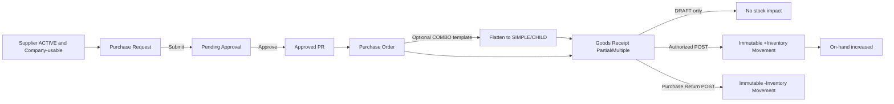
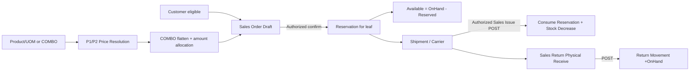
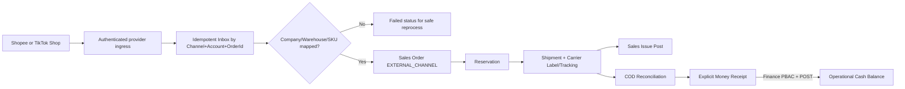
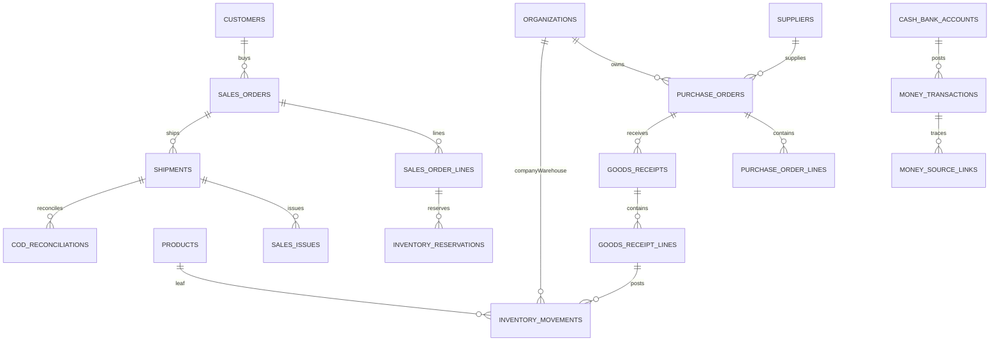
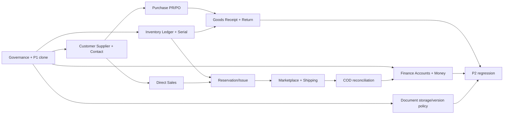

# DinkERP — P2 Operational ERP | MASTER HANDBOOK v1.0.0

> Comprehensive standalone Markdown consolidation. `BASELINE-UR` source excerpts are exact; technical DB/API/UI are `P2-DRAFT` and not implemented in P1 v1.9.0.


---

<!-- BEGIN docs/01_P2_USER_REQUIREMENTS_BASELINE.md -->

# 01 — User Requirements độc lập P2 (trích xuất nguyên văn)

> **DinkERP P2 Documentation v1.0.0** · Ngày 2026-10-28 · **Status:** BASELINE-UR: phần 30 UR trích nguyên văn; phần phụ lục giải thích nguồn
> **Authority:** 30 P2 UR trạng thái `BASELINE` trong `00_User_Requirements_v1.0.15.md` (SHA-256 `97894e35dbf6c5f641f56574af947cafbc45122a87b9fb189ee7426503448144`).
> **Code authority:** `erp_v1.9.0.zip` = P1 CLOSED BASELINE, chưa có nghiệp vụ P2. Các bảng/API/màn hình P2 trong bộ này là **đề xuất thiết kế**, không phải code đã chạy, trừ khi ghi rõ `P1-EXISTS`.

## Phạm vi và tiêu chí toàn vẹn

Bản trích tách **toàn bộ 30 User Requirements có `Target phase: P2`**, gồm tiêu đề, Priority, Status, mô tả, ví dụ, lifecycle, công thức và Acceptance criteria. Nội dung thân mỗi UR giữ nguyên theo văn bản gốc, không chuẩn hóa câu chữ hoặc cập nhật acceptance không được duyệt. Các section ngoài UR được thêm riêng như các ràng buộc liên pha, không trộn vào nguyên văn.

- Số UR: **30**, Acceptance Criteria dạng bullet: **147**.
- Phase P1 / P3 không được đưa thành phạm vi triển khai P2 nếu không có một yêu cầu P2/changelog tương ứng.
- **Sự thật quan trọng:** `BASELINE` của UR chỉ phê duyệt requirement, không chứng minh code đã tồn tại.

## Bảng tra cứu

| Nhóm | UR ID | Yêu cầu |
|---|---|---|
| DOC | `UR-DOC-001` | Attachment theo đối tượng nghiệp vụ |
| DOC | `UR-DOC-002` | Tìm kiếm và version tài liệu |
| CUS | `UR-CUS-001` | Customer Master |
| CUS | `UR-CUS-002` | Customer History |
| PRC | `UR-PRC-002` | Promotion |
| SUP | `UR-SUP-001` | Supplier Master |
| SUP | `UR-SUP-002` | Supplier History |
| PUR | `UR-PUR-001` | Purchase Request |
| PUR | `UR-PUR-002` | Purchase Order |
| PUR | `UR-PUR-003` | Goods Receipt |
| PUR | `UR-PUR-004` | Purchase Return |
| INV | `UR-INV-001` | Inventory Balance |
| INV | `UR-INV-002` | Inventory Movement |
| INV | `UR-INV-003` | Warehouse Transfer |
| INV | `UR-INV-004` | Stock Count và Adjustment |
| INV | `UR-INV-005` | Serial Inventory & Transaction Traceability |
| INV | `UR-INV-006` | Inventory Reservation |
| SAL | `UR-SAL-001` | Sales Order |
| SAL | `UR-SAL-002` | Shopee Integration |
| SAL | `UR-SAL-003` | TikTok Shop Integration |
| SAL | `UR-SAL-004` | Inventory dùng chung cho đa kênh |
| SAL | `UR-SAL-005` | Shipment và Carrier |
| SAL | `UR-SAL-006` | COD Reconciliation |
| SAL | `UR-SAL-007` | Sales Return |
| SAL | `UR-SAL-008` | Marketplace Account Mapping & Order Idempotency |
| FIN | `UR-FIN-001` | Ghi nhận Thu/Chi |
| FIN | `UR-FIN-002` | Danh mục Thu/Chi |
| FIN | `UR-FIN-003` | Cash và Bank Account |
| FIN | `UR-FIN-004` | Tổng hợp Thu/Chi |
| FIN | `UR-FIN-005` | Liên kết nguồn giao dịch |

---

## Toàn văn nguyên gốc 30 yêu cầu P2

### UR-DOC-001 - Attachment theo đối tượng nghiệp vụ
**Priority:** MUST
**Target phase:** P2
**Status:** BASELINE

Cho phép đính kèm file vào:
- Product
- Customer
- Supplier
- Employee
- Purchase
- Sales
- Inventory
- Finance
- Payroll

**Acceptance criteria**
- File xác định được đối tượng nghiệp vụ liên quan.
- Quyền truy cập file tuân theo quyền đối tượng nghiệp vụ.

### UR-DOC-002 - Tìm kiếm và version tài liệu
**Priority:** SHOULD
**Target phase:** P2
**Status:** BASELINE

Hỗ trợ:
- Upload/Download
- Search
- Tag/Category
- Version
- Uploaded By/At

**Acceptance criteria**
- Có thể xem version hiện tại và version trước.
- Tài liệu bị thay thế không làm mất lịch sử.


---

### UR-CUS-001 - Customer Master
**Priority:** MUST
**Target phase:** P2
**Status:** BASELINE

Customer là Group Master dùng chung trong Group.

Thông tin tối thiểu:
- Customer Code
- Tên
- Loại/nhóm Customer
- Điện thoại
- Email
- Tax Code
- Địa chỉ chi tiết
- Province/City Code
- Ward/Commune Code
- Shipping Address chi tiết
- Shipping Province/City Code
- Shipping Ward/Commune Code
- Contact Person
- Company Usage Scope hoặc `All Companies`
- Status

**Acceptance criteria**
- Customer Code là duy nhất trong Group.
- Customer có thể cấu hình `All Companies` hoặc danh sách Company được phép sử dụng.
- Company ngoài Customer Usage Scope không được dùng Customer cho giao dịch mới.
- Khi triển khai Customer ở P2, Customer có thể sử dụng Shared Contact Management để quản lý nhiều Contact; không tạo capability Contact riêng chỉ vì là Customer.
- Customer inactive không được chọn cho giao dịch mới nhưng lịch sử giao dịch/liên hệ vẫn tra cứu được.

### UR-CUS-002 - Customer History
**Priority:** MUST
**Target phase:** P2
**Status:** BASELINE

CRM baseline chỉ cần hồ sơ Customer và lịch sử giao dịch/liên hệ.

**Acceptance criteria**
- Lưu được note/lịch sử liên hệ.
- Xem được Sales Order/Shipment/Sales Return/Thu tiền liên quan trong phạm vi quyền.
- Không yêu cầu Lead Management hoặc Opportunity Pipeline.


---

### UR-PRC-002 - Promotion
**Priority:** MUST
**Target phase:** P2
**Status:** BASELINE

Hỗ trợ promotion cơ bản:
- Giảm %
- Giảm số tiền
- Giá đặc biệt (Special Price)
- Quantity-based discount
- Tặng Product
- Coupon

Mỗi Promotion có tối thiểu:
- Effective Period
- Priority
- Eligibility/condition
- `Combinable = true/false`

Baseline **không cho stacking tự do**. Thứ tự xử lý canonical:
1. Xác định Special Price đủ điều kiện khi có.
2. Xử lý Discount/Promotion theo Priority.
3. Coupon chỉ được kết hợp nếu rule và `Combinable` cho phép.

**Acceptance criteria**
- Promotion chỉ áp dụng trong thời gian hiệu lực và khi đủ điều kiện.
- Sales Order lưu được promotion/coupon đã áp dụng.
- Special Price được xử lý trước Discount/Promotion khác.
- Promotion được evaluate theo Priority và không được tạo stacking tùy ý ngoài rule đã cấu hình.
- Promotion có `Combinable=false` không được kết hợp với Promotion/Coupon khác trái với rule.
- Nếu các Promotion cùng Priority và scope có thể tạo kết quả không xác định, cấu hình phải bị từ chối hoặc được điều chỉnh trước khi active.


---

### UR-SUP-001 - Supplier Master
**Priority:** MUST
**Target phase:** P2
**Status:** BASELINE

Supplier là Group Master dùng chung trong Group.

Thông tin tối thiểu:
- Supplier Code
- Tên
- Nhóm
- Contact
- Điện thoại/Email
- Địa chỉ chi tiết
- Province/City Code
- Ward/Commune Code
- Tax Code
- Bank Account
- Payment Term
- Company Usage Scope hoặc `All Companies`
- Status

**Acceptance criteria**
- Supplier Code là duy nhất trong Group.
- Supplier có thể cấu hình `All Companies` hoặc danh sách Company được phép sử dụng.
- Company ngoài Supplier Usage Scope không được dùng Supplier cho giao dịch mới.
- Khi triển khai Supplier ở P2, Supplier có thể sử dụng Shared Contact Management để quản lý nhiều Contact; không tạo capability Contact riêng chỉ vì là Supplier.
- Supplier inactive không được chọn cho giao dịch mới nhưng lịch sử vẫn tra cứu được.

### UR-SUP-002 - Supplier History
**Priority:** MUST
**Target phase:** P2
**Status:** BASELINE

Từ Supplier có thể xem lịch sử:
- Purchase Order
- Goods Receipt
- Purchase Return
- Chi/Thanh toán liên quan

**Acceptance criteria**
- Chỉ hiển thị lịch sử thuộc Company nằm trong authorization scope của User.
- Có thể điều hướng từ Supplier tới chứng từ nguồn liên quan khi User có quyền VIEW chứng từ đó.
- Lịch sử vẫn tra cứu được khi Supplier đã inactive.


---

### UR-PUR-001 - Purchase Request
**Priority:** MUST
**Target phase:** P2
**Status:** BASELINE

Cho phép tạo Purchase Request.

Lifecycle cơ bản:
- DRAFT
- PENDING_APPROVAL
- APPROVED
- REJECTED
- CANCELLED

**Acceptance criteria**
- PR có thể Submit/Approve/Reject theo PBAC.
- PR Approved có thể dùng để tạo Purchase Order.

### UR-PUR-002 - Purchase Order
**Priority:** MUST
**Target phase:** P2
**Status:** BASELINE

PO gồm tối thiểu:
- Company
- Supplier
- Product
- UOM
- Quantity
- Base Quantity quy đổi khi áp dụng
- Unit Price
- Discount
- Tax khi áp dụng
- Expected Receipt Date
- Receiving Warehouse
- Payment Term
- Status

**Acceptance criteria**
- PO tuân theo PBAC theo Company/Resource/State/Action.
- UOM phải hợp lệ cho Product; Quantity phải có thể quy đổi về Base UOM khi sử dụng Alternate UOM của SIMPLE/CHILD.
- COMBO có thể được chọn như template để nhập nhanh Purchase line, nhưng trước receiving/inventory/cost operational processing phải expand về SIMPLE/CHILD; COMBO selling-price allocation không được tự dùng làm purchase-price allocation.
- Purchase price/cost của các leaf sau expansion phải được xác định theo nghiệp vụ Purchase tương ứng, không suy từ COMBO selling price nếu chưa có requirement riêng.
- PO giữ lịch sử phê duyệt và thay đổi quan trọng.

### UR-PUR-003 - Goods Receipt
**Priority:** MUST
**Target phase:** P2
**Status:** BASELINE

Cho phép nhận hàng một phần hoặc nhiều lần bằng chứng từ **Goods Receipt**. `Receiving` được dùng để mô tả process; tên chứng từ canonical là Goods Receipt.

**Acceptance criteria**
- Chỉ Goods Receipt đã đạt posting state của module (`POSTED` hoặc trạng thái `CONFIRMED` được định nghĩa tương đương posting) mới làm tăng On-hand Inventory.
- Goods Receipt cập nhật Received Quantity của Purchase Order nguồn.
- Product serial-managed bắt buộc ghi Serial khi Goods Receipt được post.
- Không nhận vào Warehouse thuộc Company khác Purchase Order.
- Goods Receipt đã post không được delete/edit trực tiếp các dữ liệu làm thay đổi stock; correction phải qua reversal hoặc Inventory Adjustment phù hợp.

### UR-PUR-004 - Purchase Return
**Priority:** MUST
**Target phase:** P2
**Status:** BASELINE

Cho phép trả hàng Supplier.

**Acceptance criteria**
- Chỉ Purchase Return đã đạt posting state mới làm giảm On-hand Inventory.
- Serial-managed item phải xác định đúng Serial trả.
- Có thể truy về Goods Receipt/Purchase Order nguồn.
- Purchase Return đã post không được delete/edit trực tiếp làm thay đổi stock history; correction phải qua reversal/adjustment phù hợp.


---

### UR-INV-001 - Inventory Balance
**Priority:** MUST
**Target phase:** P2
**Status:** BASELINE

Theo dõi tồn theo:

**Company + Warehouse + Product**

và Serial khi áp dụng. Inventory balance canonical được hiểu theo Base UOM của Product; giao dịch có thể nhập bằng source UOM hợp lệ và quy đổi về Base UOM.

Các quantity vận hành tối thiểu:
- On-hand Qty
- Reserved Qty
- Available Qty = On-hand Qty - Reserved Qty

**Acceptance criteria**
- Có thể xem On-hand, Reserved và Available theo từng Warehouse.
- Inventory balance chỉ tồn tại cho SIMPLE/CHILD leaf; COMBO không có On-hand/Reserved/Available riêng.
- On-hand chỉ phản ánh stock movement đã được post/confirm theo posting rule.
- Có thể xem tồn Group bằng tổng hợp Company được phép.
- Không trộn tồn giữa các Company.

### UR-INV-002 - Inventory Movement
**Priority:** MUST
**Target phase:** P2
**Status:** BASELINE

Hỗ trợ:
- Goods Receipt
- Sales Issue
- Transfer
- Adjustment
- Purchase Return
- Sales Return
- Reversal khi áp dụng

Mỗi movement lưu:
- Company
- Warehouse
- Product
- Source UOM
- Source Quantity
- Base Quantity quy đổi
- Serial khi áp dụng
- Source Document
- User
- Timestamp
- Posting Status

**Acceptance criteria**
- Chỉ movement ở posting state (`POSTED` hoặc module-defined `CONFIRMED` tương đương posting) mới làm thay đổi On-hand Qty.
- Inventory movement chỉ post SIMPLE/CHILD leaf; nếu source document sử dụng COMBO thì phải flatten trước khi tạo/post stock movement.
- Draft/Pending movement không làm thay đổi On-hand Qty.
- Movement đã post không được delete hoặc sửa trực tiếp quantity/product/warehouse làm thay đổi stock history.
- Correction sau posting phải được thực hiện bằng reversal hoặc Inventory Adjustment có traceability.
- Mỗi posted movement truy được Source Document, User và Timestamp.

### UR-INV-003 - Warehouse Transfer
**Priority:** MUST
**Target phase:** P2
**Status:** BASELINE

Cho phép chuyển hàng giữa Warehouse trong cùng Company.

**Acceptance criteria**
- Source và destination Warehouse phải cùng Company.
- Cross-Company movement không được xử lý như internal warehouse transfer.
- Chỉ Transfer đã đạt posting state mới làm thay đổi stock location/balance.
- Posted Transfer phải giữ trace giữa source và destination movement.

### UR-INV-004 - Stock Count và Adjustment
**Priority:** MUST
**Target phase:** P2
**Status:** BASELINE

Hỗ trợ:
- Tạo Stock Count
- Ghi nhận actual quantity
- So sánh system quantity
- Xác nhận variance
- Tạo Inventory Adjustment

**Acceptance criteria**
- Adjustment chỉ được ghi nhận theo PBAC.
- Adjustment chỉ làm thay đổi On-hand khi đạt posting state.
- Có thể truy từ Adjustment về Stock Count và người xác nhận.
- Posted Adjustment không được delete/edit trực tiếp làm thay đổi stock history.


---

### UR-INV-005 - Serial Inventory & Transaction Traceability
**Priority:** MUST
**Target phase:** P2
**Status:** BASELINE

Đối với Product được cấu hình quản lý Serial, Inventory phải theo dõi Serial xuyên suốt các giao dịch vận hành.

**Acceptance criteria**
- Serial xác định được Product, Company, Warehouse hiện tại và trạng thái.
- Serial truy được Goods Receipt, Sales Issue, transfer, purchase return và sales return liên quan.
- Một Serial không thể đồng thời tồn tại ở nhiều Warehouse.
- Goods Receipt của Product serial-managed phải ghi nhận Serial trước khi posting.
- Sales Issue của Product serial-managed phải xác định Serial xuất.
- Warehouse Transfer phải chuyển trạng thái/location của đúng Serial.
- Purchase Return và Sales Return phải tham chiếu đúng Serial khi áp dụng.

### UR-INV-006 - Inventory Reservation
**Priority:** MUST
**Target phase:** P2
**Status:** BASELINE

Inventory Reservation giữ một phần Available Qty cho Sales Order đã được xác nhận mà chưa được consume thành Sales Issue.

Invariant:

**Available Qty = On-hand Qty - Reserved Qty**

Lifecycle cơ bản:

**Reserve -> Release / Consume**

**Acceptance criteria**
- Reservation xác định Company, Warehouse, Product, Reserved Quantity và Source Sales Order/Order Line.
- Reservation chỉ giữ quantity của SIMPLE/CHILD leaf; COMBO phải được flatten trước reservation.
- Reservation được tạo khi Sales Order đạt trạng thái xác nhận vận hành theo lifecycle của module.
- Cancel Order hoặc giảm quantity phải release phần reservation không còn cần.
- Partial shipment/Sales Issue consume phần reservation tương ứng và giữ reservation cho phần chưa xử lý.
- Khi Sales Issue được post, phần reservation được consume đồng thời với stock issue liên quan.
- Reservation không tự làm thay đổi On-hand Qty.
- Baseline không cho reservation mới làm Available Qty âm; trường hợp overselling cần requirement/change request riêng.
- Với Product serial-managed, baseline reserve theo quantity; Serial cụ thể được chọn và validate khi Sales Issue được post.

### UR-SAL-001 - Sales Order
**Priority:** MUST
**Target phase:** P2
**Status:** BASELINE

Sales Order gồm:
- Company
- Customer khi áp dụng
- Sales Channel
- Product
- UOM
- Quantity
- Base Quantity quy đổi khi áp dụng
- Price
- Promotion/Discount
- Price Source
- Shipping Fee
- Warehouse
- Delivery Address chi tiết
- Delivery Province/City Code
- Delivery Ward/Commune Code
- Payment Method
- Status

`Price Source` baseline gồm:
- `EXTERNAL_CHANNEL`
- `PRICE_LIST_COMPANY`
- `PRICE_LIST_GROUP`
- `PRODUCT_DEFAULT`

**Acceptance criteria**
- Direct/Internal Sales sử dụng Price Resolution theo Product + UOM + Company + Effective Time; Sales Order lưu giá cuối cùng, UOM và Price Source `PRICE_LIST_COMPANY`, `PRICE_LIST_GROUP` hoặc `PRODUCT_DEFAULT`.
- Direct/Internal Sales cho phép chọn COMBO như template. Khi chọn COMBO, hệ thống resolve giá root COMBO, flatten về SIMPLE/CHILD, phân bổ selling amount và aggregate leaf theo UR-PRD-006 trước các bước Reservation/Inventory/Serial/Costing/Posting.
- Sales Order phải giữ đủ traceability giữa leaf line và COMBO nguồn khi COMBO được dùng để tạo nhanh line.
- Marketplace Sales từ Shopee/TikTok Shop sử dụng external channel price/discount authoritative và lưu Price Source `EXTERNAL_CHANNEL`.
- Sales Order có Price Source `EXTERNAL_CHANNEL` không bị ERP Price Resolution/Promotion recompute lại giá marketplace.
- Sales Order lưu được nguồn giá, UOM và promotion/discount reference phù hợp với loại order.
- Delivery address sử dụng Province/City Code và Ward/Commune Code khi áp dụng.
- Sales Order tuân theo PBAC theo Company/Resource/State/Action.

### UR-SAL-002 - Shopee Integration
**Priority:** MUST
**Target phase:** P2
**Status:** BASELINE

Hệ thống nhận và quản lý đơn từ Shopee.

**Acceptance criteria**
- Lưu Shopee Order ID và Shop/Account source.
- Mapping SKU/Product.
- Shop/Account phải resolve được Company và fulfillment Warehouse theo UR-SAL-008 trước khi tạo ERP Sales Order.
- Tạo hoặc liên kết ERP Sales Order theo idempotency rule của UR-SAL-008.
- Giá/discount từ Shopee là external authoritative price và được lưu với Price Source `EXTERNAL_CHANNEL`.
- Đồng bộ trạng thái cần thiết.
- Lỗi mapping/sync phải được ghi nhận để xử lý/retry mà không tạo duplicate Sales Order.

### UR-SAL-003 - TikTok Shop Integration
**Priority:** MUST
**Target phase:** P2
**Status:** BASELINE

Hệ thống nhận và quản lý đơn từ TikTok Shop.

**Acceptance criteria**
- Lưu TikTok Shop Order ID và Shop/Account source.
- Mapping SKU/Product.
- Shop/Account phải resolve được Company và fulfillment Warehouse theo UR-SAL-008 trước khi tạo ERP Sales Order.
- Tạo hoặc liên kết ERP Sales Order theo idempotency rule của UR-SAL-008.
- Giá/discount từ TikTok Shop là external authoritative price và được lưu với Price Source `EXTERNAL_CHANNEL`.
- Đồng bộ trạng thái cần thiết.
- Lỗi mapping/sync phải được ghi nhận để xử lý/retry mà không tạo duplicate Sales Order.

### UR-SAL-004 - Inventory dùng chung cho đa kênh
**Priority:** MUST
**Target phase:** P2
**Status:** BASELINE

Shopee và TikTok Shop sử dụng Inventory của ERP làm nguồn tồn vận hành.

**Acceptance criteria**
- Không tạo kho logic riêng cạnh tranh chỉ vì khác sales channel.
- Order phải kiểm tra Available Qty theo Company/Warehouse phù hợp.
- Order được xác nhận phải reserve stock vào Inventory chung theo UR-INV-006.
- Release/consume reservation phải phản ánh vào Inventory chung.
- Sales Issue đã post làm giảm On-hand theo stock posting rule.

### UR-SAL-005 - Shipment và Carrier
**Priority:** MUST
**Target phase:** P2
**Status:** BASELINE

Shipment quản lý:
- Company
- Warehouse/Fulfillment source
- Carrier
- Service
- Tracking Number
- Shipping Fee
- COD Amount
- Delivery Status

Carrier integration hỗ trợ:
- Lấy phí giao hàng
- Tạo vận đơn
- Nhận tracking number
- In label
- Tracking status
- Hủy vận đơn
- Nhận delivery status
- Nhận COD status/data khi carrier hỗ trợ

**Acceptance criteria**
- Shipment thuộc cùng Company với Sales Order nguồn.
- Shipment truy được Sales Order và Warehouse fulfillment liên quan.
- Tracking Number và delivery status được lưu khi carrier trả về.
- Hủy vận đơn không tự xóa Shipment hoặc lịch sử carrier interaction.
- Shipping Fee và COD Amount được lưu để phục vụ COD Reconciliation khi áp dụng.
- Carrier integration error phải được ghi nhận để retry/xử lý.

### UR-SAL-006 - COD Reconciliation
**Priority:** MUST
**Target phase:** P2
**Status:** BASELINE

Theo từng Shipment xác định:
- COD phải thu
- COD carrier báo đã thu
- Shipping fee
- Other fee
- Net amount carrier phải chuyển
- Amount thực nhận
- Difference
- Reconciliation status

**Acceptance criteria**
- Có thể lọc các shipment chưa đối soát.
- Chênh lệch phải xác định được amount và trạng thái xử lý.
- Khoản COD đã đối soát có thể tạo/liên kết Money Receipt.

### UR-SAL-007 - Sales Return
**Priority:** MUST
**Target phase:** P2
**Status:** BASELINE

Hỗ trợ:
- Return Request
- Receive Returned Goods
- Serial validation khi áp dụng
- Inventory update
- Refund/Thu-Chi reference khi áp dụng

**Acceptance criteria**
- Sales Return truy được Sales Order/Shipment nguồn khi có.
- Returned goods chỉ làm tăng On-hand khi inventory return movement được post/confirm theo posting rule.
- Product serial-managed phải validate đúng Serial trả lại.
- Refund hoặc giao dịch Thu/Chi liên quan được reference, không tự tạo double-entry accounting.
- Return đã post không được xóa/sửa trực tiếp làm thay đổi stock history.

### UR-SAL-008 - Marketplace Account Mapping & Order Idempotency
**Priority:** MUST
**Target phase:** P2
**Status:** BASELINE

Marketplace Shop/Account là identity nguồn để map đơn hàng ngoài vào đúng Company và fulfillment context của ERP.

Unique business key của marketplace order:

**Sales Channel + Shop/Account + External Order ID**

**Acceptance criteria**
- Mỗi Shop/Account xác định được Sales Channel/Platform.
- Mỗi Shop/Account map đúng một Company tại một thời điểm hiệu lực.
- Shop/Account có fulfillment Warehouse mặc định hoặc mapping Warehouse rõ ràng trước khi tạo Sales Order.
- `Sales Channel + Shop/Account + External Order ID` là unique business key.
- Retry/sync lại cùng external order không được tạo duplicate ERP Sales Order.
- Sync/retry phải idempotent đối với create/link order.
- Mapping Company/Warehouse phải hoàn tất trước khi ERP Sales Order được tạo.
- Lỗi mapping hoặc sync được giữ trạng thái/lý do để reprocess.

---

### UR-FIN-001 - Ghi nhận Thu/Chi
**Priority:** MUST
**Target phase:** P2
**Status:** BASELINE

Finance dùng thuật ngữ **Money Receipt** cho giao dịch Thu và **Money Expense** cho giao dịch Chi để phân biệt với Goods Receipt.

Mỗi giao dịch gồm:
- Company
- Date
- Money Receipt/Money Expense Type
- Amount
- Cash/Bank Account
- Related Customer/Supplier/Employee khi có
- Description
- Source Reference
- Attachment
- Recorded By
- Posting Status

**Acceptance criteria**
- Mỗi Money Receipt/Money Expense thuộc đúng một Company.
- Amount phải lớn hơn 0.
- Account sử dụng phải thuộc cùng Company với transaction.
- Chỉ transaction đã `POSTED` mới tham gia operational balance.
- Transaction đã post không được xóa/sửa trực tiếp amount/account làm thay đổi history; correction phải qua reversal/adjustment có traceability.

### UR-FIN-002 - Danh mục Thu/Chi
**Priority:** MUST
**Target phase:** P2
**Status:** BASELINE

Cho phép cấu hình category như:
- Thu bán hàng
- Thu COD
- Thu khác
- Thanh toán Supplier
- Chi vận chuyển
- Chi lương
- Chi văn phòng
- Chi khác

**Acceptance criteria**
- Category xác định được loại `RECEIPT` hoặc `EXPENSE`.
- Category inactive không dùng cho giao dịch mới nhưng lịch sử vẫn tra cứu được.
- Có thể lọc/tổng hợp Thu/Chi theo category.

### UR-FIN-003 - Cash và Bank Account
**Priority:** MUST
**Target phase:** P2
**Status:** BASELINE

Quản lý danh sách:
- Cash Fund
- Bank Account

Mỗi account có tối thiểu:
- Company
- Opening Balance
- Opening Date
- Status

**Acceptance criteria**
- Mỗi account thuộc một Company.
- Opening Balance và Opening Date được xác định trước khi tính operational balance từ thời điểm đó.
- User chỉ thao tác account trong PBAC scope.
- Account inactive không dùng cho giao dịch mới nhưng lịch sử vẫn tra cứu được.

### UR-FIN-004 - Tổng hợp Thu/Chi
**Priority:** MUST
**Target phase:** P2
**Status:** BASELINE

Operational Balance được tính theo công thức:

**Balance(t) = Opening Balance + Sum(Posted Money Receipts) - Sum(Posted Money Expenses)**

trong khoảng từ Opening Date đến thời điểm `t`.

Báo cáo:
- Total Money Receipt
- Total Money Expense
- Receipt - Expense
- Opening Balance
- Closing Balance

Filter:
- Company
- Date Range
- Category
- Cash/Bank Account
- Customer
- Supplier

**Acceptance criteria**
- Chỉ posted Money Receipt/Money Expense được tính vào operational balance.
- Opening/Closing Balance không suy diễn từ General Ledger.
- Có thể tính balance theo từng Cash/Bank Account và tổng hợp các account trong Company theo filter.
- Report theo nhiều Company chỉ tổng hợp Company User có quyền xem.
- Operational Balance không được mô tả như bank reconciliation hoặc statutory accounting balance.

### UR-FIN-005 - Liên kết nguồn giao dịch
**Priority:** MUST
**Target phase:** P2
**Status:** BASELINE

Thu/Chi có thể liên kết với:
- Sales Order
- Shipment/COD
- Purchase Order
- Supplier
- Customer
- Payroll

Liên kết phục vụ traceability/tổng hợp, không tạo double-entry accounting.

**Acceptance criteria**
- Có thể truy từ Money Receipt/Money Expense về Source Reference khi nguồn còn tồn tại và User có quyền.
- Một source reference không tự tạo double-entry journal.
- COD đã reconciliation có thể tạo/liên kết Money Receipt mà vẫn giữ Shipment/COD reference.
- Payroll payment có thể liên kết Money Expense theo đúng Company.


---

---

## Phụ lục A — Những ràng buộc P1 áp dụng khi thực hiện P2

Phụ lục dưới đây là **bản tổng hợp bằng lời khác** của các UR P1 liên quan, không thay thế nguyên văn 30 P2 UR bên trên. Chi tiết nghiệp vụ bắt buộc của P2 được triển khai nhất quán với các nguyên tắc này:

- Một Group root, nhiều Company; mọi business transaction thuộc **đúng một Company**. Product/UOM/Product Group shared Group, Customer/Supplier shared Group nhưng có usage scope Company riêng ở P2.
- Organization context `GROUP/COMPANY/BRANCH/PLANT/WAREHOUSE`, warehouse phải resolve đúng Company; existing target lấy authorization context từ persisted target; client context mismatch phải reject.
- Shield User → Employee → effective assignments; PBAC dùng Base Permission `resource.action` + Policy; không có sysadmin bypass, không tạo resource instance permission, không tạo customer-specific PBAC condition engine.
- Trong từng policy lane: `ABSOLUTE_DENY > ALLOW > DENY > NO_MATCH`; Base Permission vắng mặt luôn DENY; ABSOLUTE_DENY được propagate trước multi-lane intersection; assignment ancestor/group kế thừa; sibling/cross-company không kế thừa.
- P1 Product Model V2: SIMPLE/CHILD là leaf transactionable; PARENT không selectable; COMBO selectable template phải recursive flatten về SIMPLE/CHILD trước stock/serial/cost/posting, graph acyclic. COMBO root selling amount được phân bổ deterministic theo `leaf qty × leaf default Base-UOM price`, residual bảo toàn amount; nested combo không resolve price lại.
- SIMPLE/CHILD có Alternate UOM trực tiếp về Base UOM, usage PURCHASE/SALES/BOTH; COMBO chỉ Base UOM. Transaction giữ source UOM và base quantity. Không dùng client display rounding cho calculation.
- Core Pricing P1: `Product+UOM+Company+EffectiveTime`, Company matching item → Group matching item → UOM default. Tie-break `priority DESC -> effective_from DESC -> id ASC`; effective interval `[from,to)`.
- Workflow/Lifecycle transition hợp lệ là kiểm tra riêng với Authorization; baseline single-step approval, không tự thêm multi-level maker/checker/amount approval.
- Auto Numbering theo Resource Type, generation scope Group/Company/Organization, counter atomic cùng transaction; không tự reuse committed identifier, không dùng `id` làm business number.
- Import P1 chỉ explicit enabled `PRODUCT`; bất kỳ import target P2 nào cũng phải có requirement/design, catalog action `<resource>.import`, template, per-row validation, PBAC và job/row result.
- `vi/en` language negotiation và Display Settings chỉ presentation; business date theo Company timezone, decimal API canonical, VND-only baseline, UTC instant storage theo implementation contract được review.
- Mutable master/config và posting actions phải có actor/timestamp; view/export khác quyền; list/sort/pagination phải thực hiện sau PBAC SQL scope; không được giả định frontend guard là security enforcement.

## Phụ lục B — P2 cross-section trích nguồn theo chủ đề

**Phân kỳ:** P2 bao gồm Document, Customer & CRM, Pricing context mở rộng (Customer/Group/Channel), Promotion, Supplier, Purchase, Inventory/Reservation, Sales đa kênh, marketplace mapping/idempotency, Carrier/COD, vận hành Thu/Chi và import P2 explicit enabled.

**Luồng Purchase:** `Supplier -> Purchase Request -> Purchase Order -> (COMBO expansion khi có) -> Goods Receipt -> Inventory -> Money Expense khi phát sinh`.

**Marketplace Sales:** `Shopee/TikTok -> External Price/Discount -> Sales Order(EXTERNAL_CHANNEL) -> Reservation -> Shipment -> Sales Issue -> Carrier/Delivery -> COD -> COD Reconciliation -> Money Receipt`.

**Direct Sales:** `Customer -> Sales Order -> Price Resolution/Promotion -> COMBO flatten+allocation+leaf aggregation -> Reservation -> Shipment -> Sales Issue -> Money Receipt`.

**Inventory:** `Goods Receipt -> On-hand -> Reservation/Transfer/Adjustment -> Sales Issue -> Return/Reversal`.

**Extended Pricing P2 trong UR-PRC-001 (Target P1, đoạn hướng P2):** thêm Sales Channel, Customer Group, Customer-specific condition. Giữ UOM dimension và thứ tự Company trước Group; trong scope, specificity **có thể** mở rộng `Customer -> Customer Group -> Sales Channel`, sau đó Priority/EffectiveFrom/ID. Persistence chính xác phải thiết kế P2; không tự tạo generic conditions table trong P1.

**Ngoài P2:** multi-company transaction, multi-currency, GL/double-entry, enterprise approval designer, full CRM pipeline, advanced manufacturing, HR/Payroll và BOM P3, universal import, resource instance PBAC; các phần này không ngầm mở bằng P2.

## Phụ lục C — Nguồn và tính độc lập

Bản gốc cung cấp ở `reference/00_User_Requirements_v1.0.15.md` chỉ để đối chiếu và truy nguyên. Có thể review/triển khai P2 bằng chính tài liệu này mà không cần truy cập tệp P1/P3; nội dung thông tin kế thừa P1 đã được lồng rõ trong Phụ lục A và các tài liệu thiết kế P2.

## Phụ lục D — Các đoạn P2 liên chương trích NGUYÊN VĂN

Ba đoạn dưới đây được sao chép nguyên văn từ file requirements cùng SHA-256, không bỏ qua các quyết định P2 rải trong phần P1 và phần end-to-end. Phụ lục A/B trước đó là bản tóm tắt diễn giải; Phụ lục D là bằng chứng đối chiếu trực tiếp.

### Phase P2 - Operational ERP

### P2 - Operational ERP

P2 triển khai các module vận hành còn lại, ngoại trừ BOM và HCM/Payroll:
- Document
- Customer & CRM
- Pricing context mở rộng theo Customer, Customer Group và Sales Channel
- Promotion
- Supplier
- Purchase
- Inventory, bao gồm Inventory Reservation
- Sales đa kênh
- Shopee
- TikTok Shop
- Marketplace Account Mapping & Order Idempotency
- Carrier, Tracking và COD Reconciliation
- Vận hành tài chính Thu/Chi
- Import cho các master P2

### P2 - Extended Pricing Context (embedded in UR-PRC-001 / P1)

**P2 - Extended Pricing Context**
- Sales Channel condition.
- Customer Group condition.
- Customer-specific condition.

Khi P2 bổ sung các condition này, UOM vẫn là dimension bắt buộc và Company scope vẫn được ưu tiên trước Group scope. Trong cùng scope, specificity có thể mở rộng theo thứ tự:

**Customer condition -> Customer Group condition -> Sales Channel condition**

sau đó mới dùng Priority/Effective From/ID để tie-break. Exact persistence của P2 condition phải được thiết kế ở P2, không tạo generic pricing condition table trong P1.

### P2 end-to-end operational flows

### 19.1 Purchase
Supplier
-> Purchase Request
-> Purchase Order / optional COMBO selection template
-> COMBO expansion to SIMPLE/CHILD when applicable
-> Goods Receipt
-> Inventory
-> Money Expense khi phát sinh

### 19.2 Marketplace Sales
Shopee / TikTok Shop
-> External Price/Discount
-> ERP Sales Order (`Price Source = EXTERNAL_CHANNEL`)
-> Inventory Reservation
-> Shipment
-> Sales Issue
-> Carrier
-> Delivery
-> COD
-> COD Reconciliation
-> Money Receipt

### 19.3 Direct/Internal Sales
Customer
-> Sales Order / optional COMBO selection
-> Price Resolution / Promotion theo rule áp dụng
-> COMBO flatten + selling amount allocation + leaf aggregation trước operational downstream khi có COMBO
-> Inventory Reservation
-> Shipment
-> Sales Issue
-> Money Receipt

### 19.4 Inventory
Goods Receipt
-> On-hand
-> Reservation / Transfer / Adjustment
-> Sales Issue
-> Return / Reversal khi áp dụng

<!-- END docs/01_P2_USER_REQUIREMENTS_BASELINE.md -->

---

<!-- BEGIN docs/02_P2_SCOPE_AND_P1_CONTRACT.md -->

# 02 — P2 Scope, Business Invariants & P1 Dependency Contract

> **DinkERP P2 Documentation v1.0.0** · Ngày 2026-10-28 · **Status:** DRAFT — P2 design; chưa được phê duyệt
> **Authority:** 30 P2 UR trạng thái `BASELINE` trong `00_User_Requirements_v1.0.15.md` (SHA-256 `97894e35dbf6c5f641f56574af947cafbc45122a87b9fb189ee7426503448144`).
> **Code authority:** `erp_v1.9.0.zip` = P1 CLOSED BASELINE, chưa có nghiệp vụ P2. Các bảng/API/màn hình P2 trong bộ này là **đề xuất thiết kế**, không phải code đã chạy, trừ khi ghi rõ `P1-EXISTS`.

## Quy tắc đọc độc lập

1. `BASELINE-UR`: nội dung được phê duyệt từ User Requirements, không được đổi nghĩa bằng thiết kế.
2. `P1-EXISTS`: có trong source v1.9.0, chỉ nêu những gì đã kiểm tra bằng source; không thay nghiệm thu live.
3. `P2-DRAFT`: lựa chọn thiết kế đề xuất để triển khai P2, cần duyệt trước khi migrate/implement.
4. `OPEN-DECISION`: dữ liệu nguồn chưa xác định; không tự gán thành cam kết.
5. `NOT-IMPLEMENTED`: các resource/API/bảng P2 đề xuất hiện không nằm trong P1 source.

## 1. Định nghĩa Phase P2

**P2 = Operational ERP**, gồm: Document, Customer/CRM History, P2 Pricing conditions, Promotion, Supplier, Purchase (PR/PO/GR/Return), Inventory/Serial/Transfer/Adjustment/Reservation, Sales (Direct/Internal & Shopee/TikTok Shop), Marketplace Account Mapping/Idempotency, Carrier/Shipment/COD, Finance operational Money Receipt/Expense & reporting, và import Resource P2 khi có quyết định enable riêng.

**Không thuộc P2:** HCM/Payroll/Attendance/Leave/Overtime/BOM (P3), multi-currency, GL/double-entry, enterprise multi-level approval, generic manufacturing, advanced CRM lead/opportunity, arbitrary PBAC condition, Resource Instance Authorization. P2 không tự cho phép intercompany transfer/cross-company owner.

Các 30 UR `Target phase:P2` được giữ nguyên đầy đủ tại `01_P2_USER_REQUIREMENTS_BASELINE.md`; mỗi Criterion có FR+Test ID. Ngoài ra các đoạn P1 nhắc P2 (như Pricing extension, Contacts, Import) được kế thừa **chỉ ở mức P2 thực sự được nêu**, không nâng thành yêu cầu mới không có nguồn.

## 2. Source of truth và thứ tự áp dụng

1. **Approved UR v1.0.15**: baseline business scope/acceptance; không được design thay đổi và tuyên bố đã approve.
2. **P1 v1.9.0 code**: chính xác kỹ thuật đang hiện hữu. Backend CI4 Modules/Services, Vue TS frontend, MariaDB migrations 000001..000022, OpenAPI 3.1; các tính năng M11 Notifications là phần thực tế có trong ZIP.
3. **P2 documents v1.0.0**: `DRAFT` decisions for design; chưa có trong source, phải được duyệt và version hóa trước code.
4. **Live DB/HTTP/runtime**: không trong ZIP, phải test riêng tại DEV clone; documentation/code inspection không chứng minh production state.

## 3. Kế thừa nguyên tắc P1 bắt buộc (Normative dependency)

### 3.1 Company ownership, Organization hierarchy và master scope

- Một Group root, các Company trong Group. Business transaction P2 thuộc **đúng một Company**, không dùng GROUP làm owner; warehouse thuộc ancestor path của Company, không được mix branch khác Company.
- Organization types canonical: `GROUP`, `COMPANY`, `BRANCH`, `PLANT`, `WAREHOUSE`; parent matrix: `GROUP→COMPANY`, `COMPANY→BRANCH/PLANT/WAREHOUSE`, `BRANCH→PLANT/WAREHOUSE`, `PLANT→WAREHOUSE`; không nested cùng type, no cycles.
- Product/UOM/Product Group là Group Master shared mọi Company và **không có Product Company Usage Scope** trong P1/P2 vì đã khóa P1; Customer và Supplier có scope All Companies/allowlist riêng tại P2.
- Existing record evaluation organization phải derive từ persisted target; Create từ owner/parent/scope canonical. Client `company_id` hoặc `evaluation_organization_id` không thể override persisted authority.

### 3.2 Identity, PBAC, workflow

- Shield identity mapping, User+Employee+effective assignments; Base Permission `resource.action`; Policy restriction dimension Organization/Resource/Workflow/Participant/Action; final decision runtime, no system admin bypass.
- Assignment GROUP ancestor applies all descendants; assignment Company/Branch không leak sang sibling/Company khác. Evaluate P2 transaction at authoritative Company/Organization; no Base Permission => deny.
- QT1 lane precedence: `ABSOLUTE_DENY > ALLOW > DENY > NO_MATCH`, `NO_MATCH => ALLOW` khi Base Permission có. Multi-lane denied-set intersection only after inheritance and applicable ABSOLUTE_DENY propagation.
- Lifecycle legality and PBAC are independent checks. P1 approval single-step, không tự mở enterprise routing/maker-checker/amount-based PBAC. Posting stock/finance occurs only on documented posting state.
- Every new P2 Resource/Action must be added via the Resource Catalog/Seeder and included in PBAC tests; no implicit permission because user belongs privileged group.

### 3.3 Product/COMBO/UOM and pricing

| Product role | Source select | Inventory/Serial/Costing/Posting leaf | Rule |
|---|---|---|---|
| SIMPLE | yes | yes | STANDARD root no child |
| CHILD | yes | yes | STANDARD child depth ≤1; full name derived |
| PARENT | no | no | grouping only |
| COMBO | yes as template | **no** | recursively flatten to SIMPLE/CHILD, acyclic |

- Source UOM + qty and converted Base UOM qty must be preserved for stock operational audit. Alternate UOM direct to Base UOM for SIMPLE/CHILD; COMBO only Base UOM. Alternate SALES default price independent of conversion ratio.
- Root COMBO selling total resolved once; nested COMBO and leaf Price Lists not re-resolved for allocation. Weight = leaf qty × leaf default BaseUOM price, reject total weight 0, deterministic residual, aggregate same leaf by sum qty and sum allocated amount.
- P1 price resolution Company→Group→default exact UOM with deterministic candidate tie-break and `[from,to)`; P2 specificity only additional context, not altered fallback ordering.
- Marketplace Sales `EXTERNAL_CHANNEL` must store external price/discount and not ERP recalculate it.

### 3.4 Numbering, import, time, audit, UI

- Auto Number resource-specific, organization scoped, atomic issuance; committed identifiers no reuse. Status inactive/cancelled does not free document number.
- P1 Import Framework only PRODUCT explicitly enabled. In P2, other master import requires approved UR scope, `resource.import` and separate template/validation/row-level authorization. No implicit import all masters.
- VND only. Date/time presentation timezone != Company Business Timezone. `DATE` derives from Company timezone of Evaluation Instant; API DECIMAL string, display formatting not calc authority.
- `view`,`edit`,`post`,`export` are distinct actions. Mutable masters need actor/time; stock/finance posted immutable with source + reversal/audit.
- Searches filter authorized dataset before pagination; SQL sort only allowlisted columns, stable ID tie-break; frontend cannot bypass backend scope.
- Frontend vi/en, stable `error.code`, pagination, lookup scope, accessible form state and generated client from OpenAPI.

## 4. Ownership and source-derived business rules matrix

| P2 entity type | Scope | Authority for existing target | Critical validation |
|---|---|---|---|
| Customer/Supplier | Group master; usage Company | existing master + user authorized scope | active, all_companies/allowlist, status |
| Document | Polymorphic owner | owner resource persisted Company/Group | view owner + attachment; file version auth |
| Price List extended context | P1 price_list org scope | P1 price_list.organization_id | match UOM; Company→Group fallback |
| PR/PO/GR/PurchaseReturn | Company + Warehouse | persisted business document → Company | same Company, posting-only stock |
| Inventory Balance/Movement/Serial | Company+Warehouse | persisted ledger/balance | SIMPLE/CHILD, no cross-company |
| Reservation | Company+Warehouse/SO | linked persisted Sales Order | available nonnegative, post consume |
| Sales Order/Issue/Return | Company; Warehouse; Sales Channel | persisted SO→Company | external/internal price authority, posting |
| Marketplace account/order | shop mapping → Company+Warehouse | persisted account effective mapping | idempotent source key |
| Shipment/COD | Sales Order Company | persisted Shipment→SO→Company | tracking and receipt mapping |
| Money Receipt/Expense | Company+Account | persisted money doc→Company | account same Company, POSTED-only balance |

## 5. Critical boundaries and anti-goals

- **Do not create** new `product_company_usages`, `variants`, `profiles`, independent permission storage, generic `conditions` as a P1 rewrite.
- Do not use external source order price and then call ERP internal price resolution; do not repost stock on webhook update.
- Do not implement cross-Company warehouse transfer using a single `warehouse_transfer` record without a separately approved intercompany process.
- Do not promote COD reconciliation into automatic money journal; explicit Money Receipt creation/posting with finance PBAC is mandatory.
- Do not expose import UI/API for any Resource until `import` action/target explicitly approved.
- Do not manually adjust `inventory_balances` as a substitute for posted movement/reversal; all stock corrections must be traceable.

## 6. Dependency on existing source / no-source evidence

Source contains `backend/app/Modules/{Access,Contact,Identity,Import,Locations,Notifications,Numbering,Organization,People,Pricing,Product,Settings,Workflow}`. It has no `Purchase`, `Inventory`, `Sales`, `Supplier`, `Customer`, or `Finance` module directories. P2 docs describe **future** modules. The P1 ZIP is not proof of a live backup or implemented P2 SQL tables.

## 7. Change control

- Start P2 with formal approval of architecture/DB/API/PBAC per wave. Baseline UR retains original IDs; when scope differs, create a Change ID, version P2 UR/FRS, and update all linked docs+test map rather than edit original P1 snapshot.
- Unresolved decisions logged with blocking gates in `14_P2_OPEN_DECISIONS_AND_GAP_AUDIT.md`.
- Acceptance every UR uses `P2-AT-*`, with runtime evidence on clone (and production smoke if approved), not just documentation completeness.

<!-- END docs/02_P2_SCOPE_AND_P1_CONTRACT.md -->

---

<!-- BEGIN docs/03_P2_FUNCTIONAL_REQUIREMENTS.md -->

# 03 — Functional Requirements Specification P2 (FRS)

> **DinkERP P2 Documentation v1.0.0** · Ngày 2026-10-28 · **Status:** DRAFT — P2 design; chưa được phê duyệt
> **Authority:** 30 P2 UR trạng thái `BASELINE` trong `00_User_Requirements_v1.0.15.md` (SHA-256 `97894e35dbf6c5f641f56574af947cafbc45122a87b9fb189ee7426503448144`).
> **Code authority:** `erp_v1.9.0.zip` = P1 CLOSED BASELINE, chưa có nghiệp vụ P2. Các bảng/API/màn hình P2 trong bộ này là **đề xuất thiết kế**, không phải code đã chạy, trừ khi ghi rõ `P1-EXISTS`.

## Quy tắc đọc độc lập

1. `BASELINE-UR`: nội dung được phê duyệt từ User Requirements, không được đổi nghĩa bằng thiết kế.
2. `P1-EXISTS`: có trong source v1.9.0, chỉ nêu những gì đã kiểm tra bằng source; không thay nghiệm thu live.
3. `P2-DRAFT`: lựa chọn thiết kế đề xuất để triển khai P2, cần duyệt trước khi migrate/implement.
4. `OPEN-DECISION`: dữ liệu nguồn chưa xác định; không tự gán thành cam kết.
5. `NOT-IMPLEMENTED`: các resource/API/bảng P2 đề xuất hiện không nằm trong P1 source.

## Chất lượng FRS

- Mỗi `P2-FR-*` gắn **một Acceptance Criterion nguyên văn** và `P2-AT-*` làm test ID; ma trận bao phủ 147/147 tiêu chí, không nén/loại bỏ case khó.
- Functional behavior mô tả ở UR nguyên văn và trong các chương đặc tả nghiệp vụ/dữ liệu/API. Không tự suy FRS cho capability không có UR P2.
- `P2-DRAFT` là quy tắc triển khai/thiết kế mở rộng, không override UR. Quyết định chưa được khóa được theo dõi trong Open Decisions.
- Mọi create/update/post/replay/import được PBAC tại **server**; 409 concurrency và idempotency phải có regression.

## Quy ước scenario nghiệm thu

`Given` dữ liệu hợp lệ và User có đúng Base Permission + PBAC tại Company/Evaluation Organization; `When` gọi action tương ứng qua API/UI; `Then` kết quả match nguyên văn criterion, có DB evidence hoặc downstream effect. Cần thêm negative cases: thiếu quyền, cross-Company, bad state, concurrent retry, rollback, malformed payload và unknown refs. `P2-AT-*` phải được triển khai thành test thực tế ở Gate tương ứng.

## DOC — Document & Attachment

**Business objective:** Attachment polymorphic theo resource; file version immutable; download và search tuân owner PBAC.

### UR-DOC-001 — Attachment theo đối tượng nghiệp vụ

**Priority:** MUST · **Source status:** BASELINE · **P2 implementation:** NOT_IMPLEMENTED · **Master spec:** `01_P2_USER_REQUIREMENTS_BASELINE.md`

- **P2-FR-DOC-001-01** — File xác định được đối tượng nghiệp vụ liên quan.
  - Evidence: `P2-AT-DOC-001-01`; xác minh trên persisted state/response/UI as applicable.
- **P2-FR-DOC-001-02** — Quyền truy cập file tuân theo quyền đối tượng nghiệp vụ.
  - Evidence: `P2-AT-DOC-001-02`; xác minh trên persisted state/response/UI as applicable.

### UR-DOC-002 — Tìm kiếm và version tài liệu

**Priority:** SHOULD · **Source status:** BASELINE · **P2 implementation:** NOT_IMPLEMENTED · **Master spec:** `01_P2_USER_REQUIREMENTS_BASELINE.md`

- **P2-FR-DOC-002-01** — Có thể xem version hiện tại và version trước.
  - Evidence: `P2-AT-DOC-002-01`; xác minh trên persisted state/response/UI as applicable.
- **P2-FR-DOC-002-02** — Tài liệu bị thay thế không làm mất lịch sử.
  - Evidence: `P2-AT-DOC-002-02`; xác minh trên persisted state/response/UI as applicable.

## CUS — Customer & CRM History

**Business objective:** Group-shared Customer; scope All Companies hoặc allowlist; lịch sử note và business documents trong authorized Company.

### UR-CUS-001 — Customer Master

**Priority:** MUST · **Source status:** BASELINE · **P2 implementation:** NOT_IMPLEMENTED · **Master spec:** `01_P2_USER_REQUIREMENTS_BASELINE.md`

- **P2-FR-CUS-001-01** — Customer Code là duy nhất trong Group.
  - Evidence: `P2-AT-CUS-001-01`; xác minh trên persisted state/response/UI as applicable.
- **P2-FR-CUS-001-02** — Customer có thể cấu hình `All Companies` hoặc danh sách Company được phép sử dụng.
  - Evidence: `P2-AT-CUS-001-02`; xác minh trên persisted state/response/UI as applicable.
- **P2-FR-CUS-001-03** — Company ngoài Customer Usage Scope không được dùng Customer cho giao dịch mới.
  - Evidence: `P2-AT-CUS-001-03`; xác minh trên persisted state/response/UI as applicable.
- **P2-FR-CUS-001-04** — Khi triển khai Customer ở P2, Customer có thể sử dụng Shared Contact Management để quản lý nhiều Contact; không tạo capability Contact riêng chỉ vì là Customer.
  - Evidence: `P2-AT-CUS-001-04`; xác minh trên persisted state/response/UI as applicable.
- **P2-FR-CUS-001-05** — Customer inactive không được chọn cho giao dịch mới nhưng lịch sử giao dịch/liên hệ vẫn tra cứu được.
  - Evidence: `P2-AT-CUS-001-05`; xác minh trên persisted state/response/UI as applicable.

### UR-CUS-002 — Customer History

**Priority:** MUST · **Source status:** BASELINE · **P2 implementation:** NOT_IMPLEMENTED · **Master spec:** `01_P2_USER_REQUIREMENTS_BASELINE.md`

- **P2-FR-CUS-002-01** — Lưu được note/lịch sử liên hệ.
  - Evidence: `P2-AT-CUS-002-01`; xác minh trên persisted state/response/UI as applicable.
- **P2-FR-CUS-002-02** — Xem được Sales Order/Shipment/Sales Return/Thu tiền liên quan trong phạm vi quyền.
  - Evidence: `P2-AT-CUS-002-02`; xác minh trên persisted state/response/UI as applicable.
- **P2-FR-CUS-002-03** — Không yêu cầu Lead Management hoặc Opportunity Pipeline.
  - Evidence: `P2-AT-CUS-002-03`; xác minh trên persisted state/response/UI as applicable.

## PRC — Promotion & Extended Pricing

**Business objective:** Pricing P1 bất biến, P2 thêm điều kiện Customer/Group/Channel; promotion deterministic, không stacking tùy ý.

### UR-PRC-002 — Promotion

**Priority:** MUST · **Source status:** BASELINE · **P2 implementation:** NOT_IMPLEMENTED · **Master spec:** `01_P2_USER_REQUIREMENTS_BASELINE.md`

- **P2-FR-PRC-002-01** — Promotion chỉ áp dụng trong thời gian hiệu lực và khi đủ điều kiện.
  - Evidence: `P2-AT-PRC-002-01`; xác minh trên persisted state/response/UI as applicable.
- **P2-FR-PRC-002-02** — Sales Order lưu được promotion/coupon đã áp dụng.
  - Evidence: `P2-AT-PRC-002-02`; xác minh trên persisted state/response/UI as applicable.
- **P2-FR-PRC-002-03** — Special Price được xử lý trước Discount/Promotion khác.
  - Evidence: `P2-AT-PRC-002-03`; xác minh trên persisted state/response/UI as applicable.
- **P2-FR-PRC-002-04** — Promotion được evaluate theo Priority và không được tạo stacking tùy ý ngoài rule đã cấu hình.
  - Evidence: `P2-AT-PRC-002-04`; xác minh trên persisted state/response/UI as applicable.
- **P2-FR-PRC-002-05** — Promotion có `Combinable=false` không được kết hợp với Promotion/Coupon khác trái với rule.
  - Evidence: `P2-AT-PRC-002-05`; xác minh trên persisted state/response/UI as applicable.
- **P2-FR-PRC-002-06** — Nếu các Promotion cùng Priority và scope có thể tạo kết quả không xác định, cấu hình phải bị từ chối hoặc được điều chỉnh trước khi active.
  - Evidence: `P2-AT-PRC-002-06`; xác minh trên persisted state/response/UI as applicable.

## SUP — Supplier & History

**Business objective:** Group-shared Supplier; Company Usage Scope; shared contacts; history qua Purchase và payments.

### UR-SUP-001 — Supplier Master

**Priority:** MUST · **Source status:** BASELINE · **P2 implementation:** NOT_IMPLEMENTED · **Master spec:** `01_P2_USER_REQUIREMENTS_BASELINE.md`

- **P2-FR-SUP-001-01** — Supplier Code là duy nhất trong Group.
  - Evidence: `P2-AT-SUP-001-01`; xác minh trên persisted state/response/UI as applicable.
- **P2-FR-SUP-001-02** — Supplier có thể cấu hình `All Companies` hoặc danh sách Company được phép sử dụng.
  - Evidence: `P2-AT-SUP-001-02`; xác minh trên persisted state/response/UI as applicable.
- **P2-FR-SUP-001-03** — Company ngoài Supplier Usage Scope không được dùng Supplier cho giao dịch mới.
  - Evidence: `P2-AT-SUP-001-03`; xác minh trên persisted state/response/UI as applicable.
- **P2-FR-SUP-001-04** — Khi triển khai Supplier ở P2, Supplier có thể sử dụng Shared Contact Management để quản lý nhiều Contact; không tạo capability Contact riêng chỉ vì là Supplier.
  - Evidence: `P2-AT-SUP-001-04`; xác minh trên persisted state/response/UI as applicable.
- **P2-FR-SUP-001-05** — Supplier inactive không được chọn cho giao dịch mới nhưng lịch sử vẫn tra cứu được.
  - Evidence: `P2-AT-SUP-001-05`; xác minh trên persisted state/response/UI as applicable.

### UR-SUP-002 — Supplier History

**Priority:** MUST · **Source status:** BASELINE · **P2 implementation:** NOT_IMPLEMENTED · **Master spec:** `01_P2_USER_REQUIREMENTS_BASELINE.md`

- **P2-FR-SUP-002-01** — Chỉ hiển thị lịch sử thuộc Company nằm trong authorization scope của User.
  - Evidence: `P2-AT-SUP-002-01`; xác minh trên persisted state/response/UI as applicable.
- **P2-FR-SUP-002-02** — Có thể điều hướng từ Supplier tới chứng từ nguồn liên quan khi User có quyền VIEW chứng từ đó.
  - Evidence: `P2-AT-SUP-002-02`; xác minh trên persisted state/response/UI as applicable.
- **P2-FR-SUP-002-03** — Lịch sử vẫn tra cứu được khi Supplier đã inactive.
  - Evidence: `P2-AT-SUP-002-03`; xác minh trên persisted state/response/UI as applicable.

## PUR — Purchase to Receipt/Return

**Business objective:** Single-Company PR/PO; post Goods Receipt mới tăng stock; return post mới giảm; PO trace không bị phá.

### UR-PUR-001 — Purchase Request

**Priority:** MUST · **Source status:** BASELINE · **P2 implementation:** NOT_IMPLEMENTED · **Master spec:** `01_P2_USER_REQUIREMENTS_BASELINE.md`

- **P2-FR-PUR-001-01** — PR có thể Submit/Approve/Reject theo PBAC.
  - Evidence: `P2-AT-PUR-001-01`; xác minh trên persisted state/response/UI as applicable.
- **P2-FR-PUR-001-02** — PR Approved có thể dùng để tạo Purchase Order.
  - Evidence: `P2-AT-PUR-001-02`; xác minh trên persisted state/response/UI as applicable.

### UR-PUR-002 — Purchase Order

**Priority:** MUST · **Source status:** BASELINE · **P2 implementation:** NOT_IMPLEMENTED · **Master spec:** `01_P2_USER_REQUIREMENTS_BASELINE.md`

- **P2-FR-PUR-002-01** — PO tuân theo PBAC theo Company/Resource/State/Action.
  - Evidence: `P2-AT-PUR-002-01`; xác minh trên persisted state/response/UI as applicable.
- **P2-FR-PUR-002-02** — UOM phải hợp lệ cho Product; Quantity phải có thể quy đổi về Base UOM khi sử dụng Alternate UOM của SIMPLE/CHILD.
  - Evidence: `P2-AT-PUR-002-02`; xác minh trên persisted state/response/UI as applicable.
- **P2-FR-PUR-002-03** — COMBO có thể được chọn như template để nhập nhanh Purchase line, nhưng trước receiving/inventory/cost operational processing phải expand về SIMPLE/CHILD; COMBO selling-price allocation không được tự dùng làm purchase-price allocation.
  - Evidence: `P2-AT-PUR-002-03`; xác minh trên persisted state/response/UI as applicable.
- **P2-FR-PUR-002-04** — Purchase price/cost của các leaf sau expansion phải được xác định theo nghiệp vụ Purchase tương ứng, không suy từ COMBO selling price nếu chưa có requirement riêng.
  - Evidence: `P2-AT-PUR-002-04`; xác minh trên persisted state/response/UI as applicable.
- **P2-FR-PUR-002-05** — PO giữ lịch sử phê duyệt và thay đổi quan trọng.
  - Evidence: `P2-AT-PUR-002-05`; xác minh trên persisted state/response/UI as applicable.

### UR-PUR-003 — Goods Receipt

**Priority:** MUST · **Source status:** BASELINE · **P2 implementation:** NOT_IMPLEMENTED · **Master spec:** `01_P2_USER_REQUIREMENTS_BASELINE.md`

- **P2-FR-PUR-003-01** — Chỉ Goods Receipt đã đạt posting state của module (`POSTED` hoặc trạng thái `CONFIRMED` được định nghĩa tương đương posting) mới làm tăng On-hand Inventory.
  - Evidence: `P2-AT-PUR-003-01`; xác minh trên persisted state/response/UI as applicable.
- **P2-FR-PUR-003-02** — Goods Receipt cập nhật Received Quantity của Purchase Order nguồn.
  - Evidence: `P2-AT-PUR-003-02`; xác minh trên persisted state/response/UI as applicable.
- **P2-FR-PUR-003-03** — Product serial-managed bắt buộc ghi Serial khi Goods Receipt được post.
  - Evidence: `P2-AT-PUR-003-03`; xác minh trên persisted state/response/UI as applicable.
- **P2-FR-PUR-003-04** — Không nhận vào Warehouse thuộc Company khác Purchase Order.
  - Evidence: `P2-AT-PUR-003-04`; xác minh trên persisted state/response/UI as applicable.
- **P2-FR-PUR-003-05** — Goods Receipt đã post không được delete/edit trực tiếp các dữ liệu làm thay đổi stock; correction phải qua reversal hoặc Inventory Adjustment phù hợp.
  - Evidence: `P2-AT-PUR-003-05`; xác minh trên persisted state/response/UI as applicable.

### UR-PUR-004 — Purchase Return

**Priority:** MUST · **Source status:** BASELINE · **P2 implementation:** NOT_IMPLEMENTED · **Master spec:** `01_P2_USER_REQUIREMENTS_BASELINE.md`

- **P2-FR-PUR-004-01** — Chỉ Purchase Return đã đạt posting state mới làm giảm On-hand Inventory.
  - Evidence: `P2-AT-PUR-004-01`; xác minh trên persisted state/response/UI as applicable.
- **P2-FR-PUR-004-02** — Serial-managed item phải xác định đúng Serial trả.
  - Evidence: `P2-AT-PUR-004-02`; xác minh trên persisted state/response/UI as applicable.
- **P2-FR-PUR-004-03** — Có thể truy về Goods Receipt/Purchase Order nguồn.
  - Evidence: `P2-AT-PUR-004-03`; xác minh trên persisted state/response/UI as applicable.
- **P2-FR-PUR-004-04** — Purchase Return đã post không được delete/edit trực tiếp làm thay đổi stock history; correction phải qua reversal/adjustment phù hợp.
  - Evidence: `P2-AT-PUR-004-04`; xác minh trên persisted state/response/UI as applicable.

## INV — Inventory, Serial, Reservation

**Business objective:** Stock ledger post-only, quantity SIMPLE/CHILD base UOM; reserved != on-hand; serial đơn nhất; Company isolation.

### UR-INV-001 — Inventory Balance

**Priority:** MUST · **Source status:** BASELINE · **P2 implementation:** NOT_IMPLEMENTED · **Master spec:** `01_P2_USER_REQUIREMENTS_BASELINE.md`

- **P2-FR-INV-001-01** — Có thể xem On-hand, Reserved và Available theo từng Warehouse.
  - Evidence: `P2-AT-INV-001-01`; xác minh trên persisted state/response/UI as applicable.
- **P2-FR-INV-001-02** — Inventory balance chỉ tồn tại cho SIMPLE/CHILD leaf; COMBO không có On-hand/Reserved/Available riêng.
  - Evidence: `P2-AT-INV-001-02`; xác minh trên persisted state/response/UI as applicable.
- **P2-FR-INV-001-03** — On-hand chỉ phản ánh stock movement đã được post/confirm theo posting rule.
  - Evidence: `P2-AT-INV-001-03`; xác minh trên persisted state/response/UI as applicable.
- **P2-FR-INV-001-04** — Có thể xem tồn Group bằng tổng hợp Company được phép.
  - Evidence: `P2-AT-INV-001-04`; xác minh trên persisted state/response/UI as applicable.
- **P2-FR-INV-001-05** — Không trộn tồn giữa các Company.
  - Evidence: `P2-AT-INV-001-05`; xác minh trên persisted state/response/UI as applicable.

### UR-INV-002 — Inventory Movement

**Priority:** MUST · **Source status:** BASELINE · **P2 implementation:** NOT_IMPLEMENTED · **Master spec:** `01_P2_USER_REQUIREMENTS_BASELINE.md`

- **P2-FR-INV-002-01** — Chỉ movement ở posting state (`POSTED` hoặc module-defined `CONFIRMED` tương đương posting) mới làm thay đổi On-hand Qty.
  - Evidence: `P2-AT-INV-002-01`; xác minh trên persisted state/response/UI as applicable.
- **P2-FR-INV-002-02** — Inventory movement chỉ post SIMPLE/CHILD leaf; nếu source document sử dụng COMBO thì phải flatten trước khi tạo/post stock movement.
  - Evidence: `P2-AT-INV-002-02`; xác minh trên persisted state/response/UI as applicable.
- **P2-FR-INV-002-03** — Draft/Pending movement không làm thay đổi On-hand Qty.
  - Evidence: `P2-AT-INV-002-03`; xác minh trên persisted state/response/UI as applicable.
- **P2-FR-INV-002-04** — Movement đã post không được delete hoặc sửa trực tiếp quantity/product/warehouse làm thay đổi stock history.
  - Evidence: `P2-AT-INV-002-04`; xác minh trên persisted state/response/UI as applicable.
- **P2-FR-INV-002-05** — Correction sau posting phải được thực hiện bằng reversal hoặc Inventory Adjustment có traceability.
  - Evidence: `P2-AT-INV-002-05`; xác minh trên persisted state/response/UI as applicable.
- **P2-FR-INV-002-06** — Mỗi posted movement truy được Source Document, User và Timestamp.
  - Evidence: `P2-AT-INV-002-06`; xác minh trên persisted state/response/UI as applicable.

### UR-INV-003 — Warehouse Transfer

**Priority:** MUST · **Source status:** BASELINE · **P2 implementation:** NOT_IMPLEMENTED · **Master spec:** `01_P2_USER_REQUIREMENTS_BASELINE.md`

- **P2-FR-INV-003-01** — Source và destination Warehouse phải cùng Company.
  - Evidence: `P2-AT-INV-003-01`; xác minh trên persisted state/response/UI as applicable.
- **P2-FR-INV-003-02** — Cross-Company movement không được xử lý như internal warehouse transfer.
  - Evidence: `P2-AT-INV-003-02`; xác minh trên persisted state/response/UI as applicable.
- **P2-FR-INV-003-03** — Chỉ Transfer đã đạt posting state mới làm thay đổi stock location/balance.
  - Evidence: `P2-AT-INV-003-03`; xác minh trên persisted state/response/UI as applicable.
- **P2-FR-INV-003-04** — Posted Transfer phải giữ trace giữa source và destination movement.
  - Evidence: `P2-AT-INV-003-04`; xác minh trên persisted state/response/UI as applicable.

### UR-INV-004 — Stock Count và Adjustment

**Priority:** MUST · **Source status:** BASELINE · **P2 implementation:** NOT_IMPLEMENTED · **Master spec:** `01_P2_USER_REQUIREMENTS_BASELINE.md`

- **P2-FR-INV-004-01** — Adjustment chỉ được ghi nhận theo PBAC.
  - Evidence: `P2-AT-INV-004-01`; xác minh trên persisted state/response/UI as applicable.
- **P2-FR-INV-004-02** — Adjustment chỉ làm thay đổi On-hand khi đạt posting state.
  - Evidence: `P2-AT-INV-004-02`; xác minh trên persisted state/response/UI as applicable.
- **P2-FR-INV-004-03** — Có thể truy từ Adjustment về Stock Count và người xác nhận.
  - Evidence: `P2-AT-INV-004-03`; xác minh trên persisted state/response/UI as applicable.
- **P2-FR-INV-004-04** — Posted Adjustment không được delete/edit trực tiếp làm thay đổi stock history.
  - Evidence: `P2-AT-INV-004-04`; xác minh trên persisted state/response/UI as applicable.

### UR-INV-005 — Serial Inventory & Transaction Traceability

**Priority:** MUST · **Source status:** BASELINE · **P2 implementation:** NOT_IMPLEMENTED · **Master spec:** `01_P2_USER_REQUIREMENTS_BASELINE.md`

- **P2-FR-INV-005-01** — Serial xác định được Product, Company, Warehouse hiện tại và trạng thái.
  - Evidence: `P2-AT-INV-005-01`; xác minh trên persisted state/response/UI as applicable.
- **P2-FR-INV-005-02** — Serial truy được Goods Receipt, Sales Issue, transfer, purchase return và sales return liên quan.
  - Evidence: `P2-AT-INV-005-02`; xác minh trên persisted state/response/UI as applicable.
- **P2-FR-INV-005-03** — Một Serial không thể đồng thời tồn tại ở nhiều Warehouse.
  - Evidence: `P2-AT-INV-005-03`; xác minh trên persisted state/response/UI as applicable.
- **P2-FR-INV-005-04** — Goods Receipt của Product serial-managed phải ghi nhận Serial trước khi posting.
  - Evidence: `P2-AT-INV-005-04`; xác minh trên persisted state/response/UI as applicable.
- **P2-FR-INV-005-05** — Sales Issue của Product serial-managed phải xác định Serial xuất.
  - Evidence: `P2-AT-INV-005-05`; xác minh trên persisted state/response/UI as applicable.
- **P2-FR-INV-005-06** — Warehouse Transfer phải chuyển trạng thái/location của đúng Serial.
  - Evidence: `P2-AT-INV-005-06`; xác minh trên persisted state/response/UI as applicable.
- **P2-FR-INV-005-07** — Purchase Return và Sales Return phải tham chiếu đúng Serial khi áp dụng.
  - Evidence: `P2-AT-INV-005-07`; xác minh trên persisted state/response/UI as applicable.

### UR-INV-006 — Inventory Reservation

**Priority:** MUST · **Source status:** BASELINE · **P2 implementation:** NOT_IMPLEMENTED · **Master spec:** `01_P2_USER_REQUIREMENTS_BASELINE.md`

- **P2-FR-INV-006-01** — Reservation xác định Company, Warehouse, Product, Reserved Quantity và Source Sales Order/Order Line.
  - Evidence: `P2-AT-INV-006-01`; xác minh trên persisted state/response/UI as applicable.
- **P2-FR-INV-006-02** — Reservation chỉ giữ quantity của SIMPLE/CHILD leaf; COMBO phải được flatten trước reservation.
  - Evidence: `P2-AT-INV-006-02`; xác minh trên persisted state/response/UI as applicable.
- **P2-FR-INV-006-03** — Reservation được tạo khi Sales Order đạt trạng thái xác nhận vận hành theo lifecycle của module.
  - Evidence: `P2-AT-INV-006-03`; xác minh trên persisted state/response/UI as applicable.
- **P2-FR-INV-006-04** — Cancel Order hoặc giảm quantity phải release phần reservation không còn cần.
  - Evidence: `P2-AT-INV-006-04`; xác minh trên persisted state/response/UI as applicable.
- **P2-FR-INV-006-05** — Partial shipment/Sales Issue consume phần reservation tương ứng và giữ reservation cho phần chưa xử lý.
  - Evidence: `P2-AT-INV-006-05`; xác minh trên persisted state/response/UI as applicable.
- **P2-FR-INV-006-06** — Khi Sales Issue được post, phần reservation được consume đồng thời với stock issue liên quan.
  - Evidence: `P2-AT-INV-006-06`; xác minh trên persisted state/response/UI as applicable.
- **P2-FR-INV-006-07** — Reservation không tự làm thay đổi On-hand Qty.
  - Evidence: `P2-AT-INV-006-07`; xác minh trên persisted state/response/UI as applicable.
- **P2-FR-INV-006-08** — Baseline không cho reservation mới làm Available Qty âm; trường hợp overselling cần requirement/change request riêng.
  - Evidence: `P2-AT-INV-006-08`; xác minh trên persisted state/response/UI as applicable.
- **P2-FR-INV-006-09** — Với Product serial-managed, baseline reserve theo quantity; Serial cụ thể được chọn và validate khi Sales Issue được post.
  - Evidence: `P2-AT-INV-006-09`; xác minh trên persisted state/response/UI as applicable.

## SAL — Sales, Marketplace & Shipping

**Business objective:** Sales price source external/internal, inventory reservation, marketplace idempotency, carrier, COD và sales return.

### UR-SAL-001 — Sales Order

**Priority:** MUST · **Source status:** BASELINE · **P2 implementation:** NOT_IMPLEMENTED · **Master spec:** `01_P2_USER_REQUIREMENTS_BASELINE.md`

- **P2-FR-SAL-001-01** — Direct/Internal Sales sử dụng Price Resolution theo Product + UOM + Company + Effective Time; Sales Order lưu giá cuối cùng, UOM và Price Source `PRICE_LIST_COMPANY`, `PRICE_LIST_GROUP` hoặc `PRODUCT_DEFAULT`.
  - Evidence: `P2-AT-SAL-001-01`; xác minh trên persisted state/response/UI as applicable.
- **P2-FR-SAL-001-02** — Direct/Internal Sales cho phép chọn COMBO như template. Khi chọn COMBO, hệ thống resolve giá root COMBO, flatten về SIMPLE/CHILD, phân bổ selling amount và aggregate leaf theo UR-PRD-006 trước các bước Reservation/Inventory/Serial/Costing/Posting.
  - Evidence: `P2-AT-SAL-001-02`; xác minh trên persisted state/response/UI as applicable.
- **P2-FR-SAL-001-03** — Sales Order phải giữ đủ traceability giữa leaf line và COMBO nguồn khi COMBO được dùng để tạo nhanh line.
  - Evidence: `P2-AT-SAL-001-03`; xác minh trên persisted state/response/UI as applicable.
- **P2-FR-SAL-001-04** — Marketplace Sales từ Shopee/TikTok Shop sử dụng external channel price/discount authoritative và lưu Price Source `EXTERNAL_CHANNEL`.
  - Evidence: `P2-AT-SAL-001-04`; xác minh trên persisted state/response/UI as applicable.
- **P2-FR-SAL-001-05** — Sales Order có Price Source `EXTERNAL_CHANNEL` không bị ERP Price Resolution/Promotion recompute lại giá marketplace.
  - Evidence: `P2-AT-SAL-001-05`; xác minh trên persisted state/response/UI as applicable.
- **P2-FR-SAL-001-06** — Sales Order lưu được nguồn giá, UOM và promotion/discount reference phù hợp với loại order.
  - Evidence: `P2-AT-SAL-001-06`; xác minh trên persisted state/response/UI as applicable.
- **P2-FR-SAL-001-07** — Delivery address sử dụng Province/City Code và Ward/Commune Code khi áp dụng.
  - Evidence: `P2-AT-SAL-001-07`; xác minh trên persisted state/response/UI as applicable.
- **P2-FR-SAL-001-08** — Sales Order tuân theo PBAC theo Company/Resource/State/Action.
  - Evidence: `P2-AT-SAL-001-08`; xác minh trên persisted state/response/UI as applicable.

### UR-SAL-002 — Shopee Integration

**Priority:** MUST · **Source status:** BASELINE · **P2 implementation:** NOT_IMPLEMENTED · **Master spec:** `01_P2_USER_REQUIREMENTS_BASELINE.md`

- **P2-FR-SAL-002-01** — Lưu Shopee Order ID và Shop/Account source.
  - Evidence: `P2-AT-SAL-002-01`; xác minh trên persisted state/response/UI as applicable.
- **P2-FR-SAL-002-02** — Mapping SKU/Product.
  - Evidence: `P2-AT-SAL-002-02`; xác minh trên persisted state/response/UI as applicable.
- **P2-FR-SAL-002-03** — Shop/Account phải resolve được Company và fulfillment Warehouse theo UR-SAL-008 trước khi tạo ERP Sales Order.
  - Evidence: `P2-AT-SAL-002-03`; xác minh trên persisted state/response/UI as applicable.
- **P2-FR-SAL-002-04** — Tạo hoặc liên kết ERP Sales Order theo idempotency rule của UR-SAL-008.
  - Evidence: `P2-AT-SAL-002-04`; xác minh trên persisted state/response/UI as applicable.
- **P2-FR-SAL-002-05** — Giá/discount từ Shopee là external authoritative price và được lưu với Price Source `EXTERNAL_CHANNEL`.
  - Evidence: `P2-AT-SAL-002-05`; xác minh trên persisted state/response/UI as applicable.
- **P2-FR-SAL-002-06** — Đồng bộ trạng thái cần thiết.
  - Evidence: `P2-AT-SAL-002-06`; xác minh trên persisted state/response/UI as applicable.
- **P2-FR-SAL-002-07** — Lỗi mapping/sync phải được ghi nhận để xử lý/retry mà không tạo duplicate Sales Order.
  - Evidence: `P2-AT-SAL-002-07`; xác minh trên persisted state/response/UI as applicable.

### UR-SAL-003 — TikTok Shop Integration

**Priority:** MUST · **Source status:** BASELINE · **P2 implementation:** NOT_IMPLEMENTED · **Master spec:** `01_P2_USER_REQUIREMENTS_BASELINE.md`

- **P2-FR-SAL-003-01** — Lưu TikTok Shop Order ID và Shop/Account source.
  - Evidence: `P2-AT-SAL-003-01`; xác minh trên persisted state/response/UI as applicable.
- **P2-FR-SAL-003-02** — Mapping SKU/Product.
  - Evidence: `P2-AT-SAL-003-02`; xác minh trên persisted state/response/UI as applicable.
- **P2-FR-SAL-003-03** — Shop/Account phải resolve được Company và fulfillment Warehouse theo UR-SAL-008 trước khi tạo ERP Sales Order.
  - Evidence: `P2-AT-SAL-003-03`; xác minh trên persisted state/response/UI as applicable.
- **P2-FR-SAL-003-04** — Tạo hoặc liên kết ERP Sales Order theo idempotency rule của UR-SAL-008.
  - Evidence: `P2-AT-SAL-003-04`; xác minh trên persisted state/response/UI as applicable.
- **P2-FR-SAL-003-05** — Giá/discount từ TikTok Shop là external authoritative price và được lưu với Price Source `EXTERNAL_CHANNEL`.
  - Evidence: `P2-AT-SAL-003-05`; xác minh trên persisted state/response/UI as applicable.
- **P2-FR-SAL-003-06** — Đồng bộ trạng thái cần thiết.
  - Evidence: `P2-AT-SAL-003-06`; xác minh trên persisted state/response/UI as applicable.
- **P2-FR-SAL-003-07** — Lỗi mapping/sync phải được ghi nhận để xử lý/retry mà không tạo duplicate Sales Order.
  - Evidence: `P2-AT-SAL-003-07`; xác minh trên persisted state/response/UI as applicable.

### UR-SAL-004 — Inventory dùng chung cho đa kênh

**Priority:** MUST · **Source status:** BASELINE · **P2 implementation:** NOT_IMPLEMENTED · **Master spec:** `01_P2_USER_REQUIREMENTS_BASELINE.md`

- **P2-FR-SAL-004-01** — Không tạo kho logic riêng cạnh tranh chỉ vì khác sales channel.
  - Evidence: `P2-AT-SAL-004-01`; xác minh trên persisted state/response/UI as applicable.
- **P2-FR-SAL-004-02** — Order phải kiểm tra Available Qty theo Company/Warehouse phù hợp.
  - Evidence: `P2-AT-SAL-004-02`; xác minh trên persisted state/response/UI as applicable.
- **P2-FR-SAL-004-03** — Order được xác nhận phải reserve stock vào Inventory chung theo UR-INV-006.
  - Evidence: `P2-AT-SAL-004-03`; xác minh trên persisted state/response/UI as applicable.
- **P2-FR-SAL-004-04** — Release/consume reservation phải phản ánh vào Inventory chung.
  - Evidence: `P2-AT-SAL-004-04`; xác minh trên persisted state/response/UI as applicable.
- **P2-FR-SAL-004-05** — Sales Issue đã post làm giảm On-hand theo stock posting rule.
  - Evidence: `P2-AT-SAL-004-05`; xác minh trên persisted state/response/UI as applicable.

### UR-SAL-005 — Shipment và Carrier

**Priority:** MUST · **Source status:** BASELINE · **P2 implementation:** NOT_IMPLEMENTED · **Master spec:** `01_P2_USER_REQUIREMENTS_BASELINE.md`

- **P2-FR-SAL-005-01** — Shipment thuộc cùng Company với Sales Order nguồn.
  - Evidence: `P2-AT-SAL-005-01`; xác minh trên persisted state/response/UI as applicable.
- **P2-FR-SAL-005-02** — Shipment truy được Sales Order và Warehouse fulfillment liên quan.
  - Evidence: `P2-AT-SAL-005-02`; xác minh trên persisted state/response/UI as applicable.
- **P2-FR-SAL-005-03** — Tracking Number và delivery status được lưu khi carrier trả về.
  - Evidence: `P2-AT-SAL-005-03`; xác minh trên persisted state/response/UI as applicable.
- **P2-FR-SAL-005-04** — Hủy vận đơn không tự xóa Shipment hoặc lịch sử carrier interaction.
  - Evidence: `P2-AT-SAL-005-04`; xác minh trên persisted state/response/UI as applicable.
- **P2-FR-SAL-005-05** — Shipping Fee và COD Amount được lưu để phục vụ COD Reconciliation khi áp dụng.
  - Evidence: `P2-AT-SAL-005-05`; xác minh trên persisted state/response/UI as applicable.
- **P2-FR-SAL-005-06** — Carrier integration error phải được ghi nhận để retry/xử lý.
  - Evidence: `P2-AT-SAL-005-06`; xác minh trên persisted state/response/UI as applicable.

### UR-SAL-006 — COD Reconciliation

**Priority:** MUST · **Source status:** BASELINE · **P2 implementation:** NOT_IMPLEMENTED · **Master spec:** `01_P2_USER_REQUIREMENTS_BASELINE.md`

- **P2-FR-SAL-006-01** — Có thể lọc các shipment chưa đối soát.
  - Evidence: `P2-AT-SAL-006-01`; xác minh trên persisted state/response/UI as applicable.
- **P2-FR-SAL-006-02** — Chênh lệch phải xác định được amount và trạng thái xử lý.
  - Evidence: `P2-AT-SAL-006-02`; xác minh trên persisted state/response/UI as applicable.
- **P2-FR-SAL-006-03** — Khoản COD đã đối soát có thể tạo/liên kết Money Receipt.
  - Evidence: `P2-AT-SAL-006-03`; xác minh trên persisted state/response/UI as applicable.

### UR-SAL-007 — Sales Return

**Priority:** MUST · **Source status:** BASELINE · **P2 implementation:** NOT_IMPLEMENTED · **Master spec:** `01_P2_USER_REQUIREMENTS_BASELINE.md`

- **P2-FR-SAL-007-01** — Sales Return truy được Sales Order/Shipment nguồn khi có.
  - Evidence: `P2-AT-SAL-007-01`; xác minh trên persisted state/response/UI as applicable.
- **P2-FR-SAL-007-02** — Returned goods chỉ làm tăng On-hand khi inventory return movement được post/confirm theo posting rule.
  - Evidence: `P2-AT-SAL-007-02`; xác minh trên persisted state/response/UI as applicable.
- **P2-FR-SAL-007-03** — Product serial-managed phải validate đúng Serial trả lại.
  - Evidence: `P2-AT-SAL-007-03`; xác minh trên persisted state/response/UI as applicable.
- **P2-FR-SAL-007-04** — Refund hoặc giao dịch Thu/Chi liên quan được reference, không tự tạo double-entry accounting.
  - Evidence: `P2-AT-SAL-007-04`; xác minh trên persisted state/response/UI as applicable.
- **P2-FR-SAL-007-05** — Return đã post không được xóa/sửa trực tiếp làm thay đổi stock history.
  - Evidence: `P2-AT-SAL-007-05`; xác minh trên persisted state/response/UI as applicable.

### UR-SAL-008 — Marketplace Account Mapping & Order Idempotency

**Priority:** MUST · **Source status:** BASELINE · **P2 implementation:** NOT_IMPLEMENTED · **Master spec:** `01_P2_USER_REQUIREMENTS_BASELINE.md`

- **P2-FR-SAL-008-01** — Mỗi Shop/Account xác định được Sales Channel/Platform.
  - Evidence: `P2-AT-SAL-008-01`; xác minh trên persisted state/response/UI as applicable.
- **P2-FR-SAL-008-02** — Mỗi Shop/Account map đúng một Company tại một thời điểm hiệu lực.
  - Evidence: `P2-AT-SAL-008-02`; xác minh trên persisted state/response/UI as applicable.
- **P2-FR-SAL-008-03** — Shop/Account có fulfillment Warehouse mặc định hoặc mapping Warehouse rõ ràng trước khi tạo Sales Order.
  - Evidence: `P2-AT-SAL-008-03`; xác minh trên persisted state/response/UI as applicable.
- **P2-FR-SAL-008-04** — `Sales Channel + Shop/Account + External Order ID` là unique business key.
  - Evidence: `P2-AT-SAL-008-04`; xác minh trên persisted state/response/UI as applicable.
- **P2-FR-SAL-008-05** — Retry/sync lại cùng external order không được tạo duplicate ERP Sales Order.
  - Evidence: `P2-AT-SAL-008-05`; xác minh trên persisted state/response/UI as applicable.
- **P2-FR-SAL-008-06** — Sync/retry phải idempotent đối với create/link order.
  - Evidence: `P2-AT-SAL-008-06`; xác minh trên persisted state/response/UI as applicable.
- **P2-FR-SAL-008-07** — Mapping Company/Warehouse phải hoàn tất trước khi ERP Sales Order được tạo.
  - Evidence: `P2-AT-SAL-008-07`; xác minh trên persisted state/response/UI as applicable.
- **P2-FR-SAL-008-08** — Lỗi mapping hoặc sync được giữ trạng thái/lý do để reprocess.
  - Evidence: `P2-AT-SAL-008-08`; xác minh trên persisted state/response/UI as applicable.

## FIN — Operational Finance

**Business objective:** Money Receipt/Expense từng Company; posted-only balance; không phải GL/double-entry/accounting.

### UR-FIN-001 — Ghi nhận Thu/Chi

**Priority:** MUST · **Source status:** BASELINE · **P2 implementation:** NOT_IMPLEMENTED · **Master spec:** `01_P2_USER_REQUIREMENTS_BASELINE.md`

- **P2-FR-FIN-001-01** — Mỗi Money Receipt/Money Expense thuộc đúng một Company.
  - Evidence: `P2-AT-FIN-001-01`; xác minh trên persisted state/response/UI as applicable.
- **P2-FR-FIN-001-02** — Amount phải lớn hơn 0.
  - Evidence: `P2-AT-FIN-001-02`; xác minh trên persisted state/response/UI as applicable.
- **P2-FR-FIN-001-03** — Account sử dụng phải thuộc cùng Company với transaction.
  - Evidence: `P2-AT-FIN-001-03`; xác minh trên persisted state/response/UI as applicable.
- **P2-FR-FIN-001-04** — Chỉ transaction đã `POSTED` mới tham gia operational balance.
  - Evidence: `P2-AT-FIN-001-04`; xác minh trên persisted state/response/UI as applicable.
- **P2-FR-FIN-001-05** — Transaction đã post không được xóa/sửa trực tiếp amount/account làm thay đổi history; correction phải qua reversal/adjustment có traceability.
  - Evidence: `P2-AT-FIN-001-05`; xác minh trên persisted state/response/UI as applicable.

### UR-FIN-002 — Danh mục Thu/Chi

**Priority:** MUST · **Source status:** BASELINE · **P2 implementation:** NOT_IMPLEMENTED · **Master spec:** `01_P2_USER_REQUIREMENTS_BASELINE.md`

- **P2-FR-FIN-002-01** — Category xác định được loại `RECEIPT` hoặc `EXPENSE`.
  - Evidence: `P2-AT-FIN-002-01`; xác minh trên persisted state/response/UI as applicable.
- **P2-FR-FIN-002-02** — Category inactive không dùng cho giao dịch mới nhưng lịch sử vẫn tra cứu được.
  - Evidence: `P2-AT-FIN-002-02`; xác minh trên persisted state/response/UI as applicable.
- **P2-FR-FIN-002-03** — Có thể lọc/tổng hợp Thu/Chi theo category.
  - Evidence: `P2-AT-FIN-002-03`; xác minh trên persisted state/response/UI as applicable.

### UR-FIN-003 — Cash và Bank Account

**Priority:** MUST · **Source status:** BASELINE · **P2 implementation:** NOT_IMPLEMENTED · **Master spec:** `01_P2_USER_REQUIREMENTS_BASELINE.md`

- **P2-FR-FIN-003-01** — Mỗi account thuộc một Company.
  - Evidence: `P2-AT-FIN-003-01`; xác minh trên persisted state/response/UI as applicable.
- **P2-FR-FIN-003-02** — Opening Balance và Opening Date được xác định trước khi tính operational balance từ thời điểm đó.
  - Evidence: `P2-AT-FIN-003-02`; xác minh trên persisted state/response/UI as applicable.
- **P2-FR-FIN-003-03** — User chỉ thao tác account trong PBAC scope.
  - Evidence: `P2-AT-FIN-003-03`; xác minh trên persisted state/response/UI as applicable.
- **P2-FR-FIN-003-04** — Account inactive không dùng cho giao dịch mới nhưng lịch sử vẫn tra cứu được.
  - Evidence: `P2-AT-FIN-003-04`; xác minh trên persisted state/response/UI as applicable.

### UR-FIN-004 — Tổng hợp Thu/Chi

**Priority:** MUST · **Source status:** BASELINE · **P2 implementation:** NOT_IMPLEMENTED · **Master spec:** `01_P2_USER_REQUIREMENTS_BASELINE.md`

- **P2-FR-FIN-004-01** — Chỉ posted Money Receipt/Money Expense được tính vào operational balance.
  - Evidence: `P2-AT-FIN-004-01`; xác minh trên persisted state/response/UI as applicable.
- **P2-FR-FIN-004-02** — Opening/Closing Balance không suy diễn từ General Ledger.
  - Evidence: `P2-AT-FIN-004-02`; xác minh trên persisted state/response/UI as applicable.
- **P2-FR-FIN-004-03** — Có thể tính balance theo từng Cash/Bank Account và tổng hợp các account trong Company theo filter.
  - Evidence: `P2-AT-FIN-004-03`; xác minh trên persisted state/response/UI as applicable.
- **P2-FR-FIN-004-04** — Report theo nhiều Company chỉ tổng hợp Company User có quyền xem.
  - Evidence: `P2-AT-FIN-004-04`; xác minh trên persisted state/response/UI as applicable.
- **P2-FR-FIN-004-05** — Operational Balance không được mô tả như bank reconciliation hoặc statutory accounting balance.
  - Evidence: `P2-AT-FIN-004-05`; xác minh trên persisted state/response/UI as applicable.

### UR-FIN-005 — Liên kết nguồn giao dịch

**Priority:** MUST · **Source status:** BASELINE · **P2 implementation:** NOT_IMPLEMENTED · **Master spec:** `01_P2_USER_REQUIREMENTS_BASELINE.md`

- **P2-FR-FIN-005-01** — Có thể truy từ Money Receipt/Money Expense về Source Reference khi nguồn còn tồn tại và User có quyền.
  - Evidence: `P2-AT-FIN-005-01`; xác minh trên persisted state/response/UI as applicable.
- **P2-FR-FIN-005-02** — Một source reference không tự tạo double-entry journal.
  - Evidence: `P2-AT-FIN-005-02`; xác minh trên persisted state/response/UI as applicable.
- **P2-FR-FIN-005-03** — COD đã reconciliation có thể tạo/liên kết Money Receipt mà vẫn giữ Shipment/COD reference.
  - Evidence: `P2-AT-FIN-005-03`; xác minh trên persisted state/response/UI as applicable.
- **P2-FR-FIN-005-04** — Payroll payment có thể liên kết Money Expense theo đúng Company.
  - Evidence: `P2-AT-FIN-005-04`; xác minh trên persisted state/response/UI as applicable.

## Quy tắc nghiệm thu liên module bắt buộc

| Invariant | Điểm bắt buộc kiểm tra | Negative/regression |
|---|---|---|
| Company ownership | PR/PO/GR, transfer, sales, shipment, money | cross-company references → reject trước mutation |
| COMBO leaf stock | sales/purchase order → leaf movement/serial | không được có inventory ledger row cho COMBO |
| Price authority | Internal sales P1 resolution, marketplace EXTERNAL_CHANNEL | không tự recompute external order, không dùng leaf Price List làm allocation weight |
| Posting-only | GR, return, issue, adjustment, money | draft/pending không đổi số dư, posted edit không ghi đè |
| Reservation | confirm → reserve; cancel → release; post issue → consume | không âm available; partial consume idempotent |
| ID/Mapping | channel + account + external_order_id | duplicate/retry không tạo Sales Order thứ hai |
| Authorization | P2 resource/action, actor assignments, SQL scope | no Base Permission → deny; sibling/cross-company không lọt |
| Lifecycle | legal transition + PBAC đều pass | permission có nhưng transition sai vẫn reject |
| Import | resource explicit enable mới mở | Job import không bypass create/edit/setstate per row |
| Observability | outbox/retry/COD/stock reconciliation | replay không double post/issue/receive |

## Definition of DONE cho một P2-FR

1. API và schema đã được phê duyệt, version hóa; migration forward-only và backup DEV clone.
2. Unit/Integration/HTTP E2E test cho `P2-AT-*` PASS; test âm cho permission, validation, state và idempotency nếu liên quan.
3. UI responsive vi/en, display formatting presentation-only; no hidden backend behavior.
4. Có log actor/correlation/exception; không lộ payload PII/token; dashboards/reconciliation theo module.
5. Mapping UR→FR→DB/API/UI/Test cập nhật; release note/rollback và runbook đồng bộ.

<!-- END docs/03_P2_FUNCTIONAL_REQUIREMENTS.md -->

---

<!-- BEGIN docs/04_P2_BUSINESS_FLOWS_AND_LIFECYCLES.md -->

# 04 — P2 End-to-End Processes, States & Transaction Boundary

> **DinkERP P2 Documentation v1.0.0** · Ngày 2026-10-28 · **Status:** DRAFT — P2 design; chưa được phê duyệt
> **Authority:** 30 P2 UR trạng thái `BASELINE` trong `00_User_Requirements_v1.0.15.md` (SHA-256 `97894e35dbf6c5f641f56574af947cafbc45122a87b9fb189ee7426503448144`).
> **Code authority:** `erp_v1.9.0.zip` = P1 CLOSED BASELINE, chưa có nghiệp vụ P2. Các bảng/API/màn hình P2 trong bộ này là **đề xuất thiết kế**, không phải code đã chạy, trừ khi ghi rõ `P1-EXISTS`.

## Quy tắc đọc độc lập

1. `BASELINE-UR`: nội dung được phê duyệt từ User Requirements, không được đổi nghĩa bằng thiết kế.
2. `P1-EXISTS`: có trong source v1.9.0, chỉ nêu những gì đã kiểm tra bằng source; không thay nghiệm thu live.
3. `P2-DRAFT`: lựa chọn thiết kế đề xuất để triển khai P2, cần duyệt trước khi migrate/implement.
4. `OPEN-DECISION`: dữ liệu nguồn chưa xác định; không tự gán thành cam kết.
5. `NOT-IMPLEMENTED`: các resource/API/bảng P2 đề xuất hiện không nằm trong P1 source.

## 1. Lifecycle và state authority

- P1 đã khóa: `Lifecycle+FromState+Action` resolve chính xác một destination; `Policy/Permission` trả quyền nhưng không tạo transition. Các module có state riêng theo nghĩa nghiệp vụ.
- `UR-PUR-001` **explicit** Purchase Request lifecycle: `DRAFT→PENDING_APPROVAL→APPROVED/REJECTED`, `CANCELLED` khi hợp lệ. Những trạng thái đề xuất khác (GoodsReceipt POSTED, SalesOrder CONFIRMED, Money POSTED) phải qua lifecycle design review, không tự coi là đã khóa transition graph.
- Chỉ `POSTED` hoặc module-defined `CONFIRMED` tương đương posting mới gây stock/finance impact, theo từng UR. `CONFIRMED` của **Sales Order** tạo reservation, không tự issue stock.

## 2. Purchase Request → Purchase Order → Goods Receipt → Inventory



**Acceptance:** PR approved only can source PO; same Company for PO, GR, warehouse; product source UOM/base quantity retained, Serial required at GR post, posted documents immutable. Partial receipt updates cumulative PO `received_qty`. Source does **not** define purchase allocation for COMBO leaf cost; block unresolved instead of using selling allocation.

**Transaction boundary:** `postGR`: lock GR+PO+stock+serial, check remaining/Company/policy/state, insert unique movement key and update balance, GR posted and cumulative received in one transaction; retry no double increase.

## 3. Direct/Internal Sales → Reservation → Issue → Returns



**Key invariants:** Internal price from Company→Group→default (P2 condition only after approved); root COMBO allocation amounts conserved; no stock to PARENT/COMBO; confirm reserve cannot push Available negative; partial Issue consumes partial reservation with matching stock decrement and chosen serial.

**Concurrency:** Two confirmed SOs compete for same SKU, reservation transaction uses atomic lock/conditional update; duplicate POST action idempotent. Cancelled SO releases, but cannot release already-consumed reservation.

## 4. Marketplace → Shipping → COD → Operational Money Receipt



Marketplace external unit price, discounts and source identifiers are immutable authoritative input; no ERP recompute. Duplicate external order after parallel retry returns existing ERP order. Failed mapping does not produce partial SO. Provider status updates should be stored as events and not re-run confirmed stock issue by implicit coupling.

Carrier may provide rate, create label/tracking, cancel label, delivery updates and COD data. Cancelling label does **not** erase ERP shipment. COD difference must be explainable: source collected minus approved fees minus actual received; exact formula for net payout needs signed decision if provider fees vary.

## 5. Inventory balance & Serial lifecycle

```text
Confirmed SO -> Reservation (reserved_qty increases; on_hand unchanged)
Cancelled / reduced SO -> Reservation Release (reserved_qty decreases)
Posted Sales Issue -> Reservation Consume + Stock Movement (-base_qty)
Posted Goods Receipt -> Stock Movement (+base_qty)
Posted Warehouse Transfer -> paired Stock Movements (-from,+to), same Company
Confirmed Stock Count -> variance calculation only
Posted Adjustment -> Stock Movement (+/-variance)
Posted Sales/Purchase Return -> Stock Movement (+/- respectively)
```

Serial-managed leaf: unique Product+Serial, location changes via posting, never two active warehouses; capture serial at GR/Issue/Transfer/Returns, not at reservation. Reversal/Correction must preserve source and serial history.

## 6. Finance operational balance

```text
Cash/BankAccount: Company + OpeningBalance + OpeningDate
Draft Money Receipt/Expense -> no balance impact
POSTED Receipt -> +amount
POSTED Expense -> -amount
Balance(t) = OpeningBalance + SUM(posted receipts) - SUM(posted expenses)
```

`Money Receipt` avoids confusion with `Goods Receipt`; account belongs same Company; source refs (SalesOrder, Shipment/COD, PurchaseOrder, Payroll P3) are trace-only. Posted money correction by reversal/adjustment only. No GL, Chart of Accounts, double-entry or statutory reconciliation.

## 7. State catalog proposal (not approved)

| Resource | Suggested states | Transition checkpoint | Side effect | Authority |
|---|---|---|---|---|
| Purchase Request | DRAFT, PENDING_APPROVAL, APPROVED, REJECTED, CANCELLED | submit/approve/reject/cancel | none | P2 UR explicitly lifecycle |
| Purchase Order | DRAFT, PENDING_APPROVAL, APPROVED, CANCELLED, CLOSED | final approval before receipt | none | Draft state graph |
| Goods Receipt | DRAFT, POSTED, CANCELLED | post | stock +; PO received + | P2 UR posting rule; exact graph draft |
| Purchase Return | DRAFT, POSTED, CANCELLED | post | stock - | P2 UR posting rule; graph draft |
| Warehouse Transfer | DRAFT, POSTED, CANCELLED | post | atomic stock -/+ | P2 UR posting rule; graph draft |
| Stock Count | DRAFT, PENDING_APPROVAL, APPROVED, CANCELLED | approve/confirm | no immediate stock | Draft |
| Inventory Adjustment | DRAFT, POSTED, CANCELLED | post | stock delta | P2 UR posting rule; graph draft |
| Sales Order | DRAFT, CONFIRMED, CANCELLED, COMPLETED | confirm/cancel | reserve/release, not on-hand | P2 UR reservation trigger; graph draft |
| Shipment | DRAFT, BOOKED, IN_TRANSIT, DELIVERED, CANCELLED | provider status mapping | no direct stock impact | Draft |
| Sales Issue | DRAFT, POSTED | post | consume reserve + stock - | P2 UR posting rule; graph draft |
| Sales Return | REQUESTED, RECEIVED, POSTED, CANCELLED | post | stock + | P2 UR posting rule; graph draft |
| COD Reconciliation | OPEN, MATCHED, DIFFERENCE, CLOSED | reconcile | no money posting | Draft |
| Money Receipt/Expense | DRAFT, POSTED, CANCELLED/REVERSED | post/reverse | cash balance (+/-) | P2 UR posting rule; graph draft |

**Approval requirement:** Before implementing, each state transition must be registered in P1 Workflow/Lifecycle, with unique `(lifecycle,from_state,action) → to_state`, PBAC action and effect gate. Avoid state/action name mismatch with existing P1 Workflow code.

## 8. Reconciliation and rollback scenarios

| Scenario | Expected behavior |
|---|---|
| GR already POSTED + repeat POST | No duplicate inventory movement |
| Sales confirm races with other confirm | At most available quantity reserved; loser fails cleanly |
| Issue network times out after commit | Retry finds same posting key, returns existing result |
| Shipment provider cancels while Issue posted | Preserve stock/Issue source; separate return/reversal policy required |
| Marketplace order fails Company mapping | Durable error, 0 ERP SO created; replay after mapping |
| Payment/COD webhooks duplicate | Idempotent receipt linkage; never duplicate cash balance |
| Product turned inactive with history | Historical records/ledger readable, new transactions blocked appropriately |
| Stock Count edits after new movement | Detect stale snapshot/collision; reconcile action policy required |
| Issue line COMBO enters stock movement | Reject; inspect flattening/mapping bug |

<!-- END docs/04_P2_BUSINESS_FLOWS_AND_LIFECYCLES.md -->

---

<!-- BEGIN docs/05_P2_DATABASE_DESIGN.md -->

# 05 — Database Design P2 / Entity Dictionary

> **DinkERP P2 Documentation v1.0.0** · Ngày 2026-10-28 · **Status:** DRAFT — P2 design; chưa được phê duyệt
> **Authority:** 30 P2 UR trạng thái `BASELINE` trong `00_User_Requirements_v1.0.15.md` (SHA-256 `97894e35dbf6c5f641f56574af947cafbc45122a87b9fb189ee7426503448144`).
> **Code authority:** `erp_v1.9.0.zip` = P1 CLOSED BASELINE, chưa có nghiệp vụ P2. Các bảng/API/màn hình P2 trong bộ này là **đề xuất thiết kế**, không phải code đã chạy, trừ khi ghi rõ `P1-EXISTS`.

## Quy tắc đọc độc lập

1. `BASELINE-UR`: nội dung được phê duyệt từ User Requirements, không được đổi nghĩa bằng thiết kế.
2. `P1-EXISTS`: có trong source v1.9.0, chỉ nêu những gì đã kiểm tra bằng source; không thay nghiệm thu live.
3. `P2-DRAFT`: lựa chọn thiết kế đề xuất để triển khai P2, cần duyệt trước khi migrate/implement.
4. `OPEN-DECISION`: dữ liệu nguồn chưa xác định; không tự gán thành cam kết.
5. `NOT-IMPLEMENTED`: các resource/API/bảng P2 đề xuất hiện không nằm trong P1 source.

## 1. Ghi nhận hiện trạng P1 (P1-EXISTS)

- CI4 migrations sử dụng tên bảng logic **không prefix** trong migration code; `dinktech_` có thể đến từ runtime DB prefix. Không tự gắn prefix cứng trong code/migrations.
- Các bảng P1 cần reuse thay vì nhân bản: `organizations`, `employees`, `products`, `product_uoms`, `product_uom_conversions`, `product_combo_items`, `product_groups`, `price_lists`, `product_price_list_items`, `contacts`, `resources`, `resource_actions`, `policies`, `workflow_states`, `lifecycles`, `lifecycle_transitions`, `auto_numbering_series`, `auto_numbering_counters`, `import_jobs`, `import_job_rows` và Shield identity tables.
- Source v1.9.0 có migration tới `2026-10-26-000022_CreateNotificationPushTables.php`; mọi migration P2 phải là **additive sau baseline**, không sửa file P1 migration đã áp dụng. Phải đối chiếu live `migrations` table trước khi chọn version numbering.
- Không có migration P2 thực sự trong source P1. Toàn bộ catalog dưới đây là **đề xuất logical/physical DRAFT**, được giữ riêng để DBA review. Đây **không** phải executable DDL và chưa được áp vào DB.

## 2. Các quy ước được đề xuất (P2-DRAFT)

| Chủ đề | Contract đề xuất | Mức authority |
|---|---|---|
| Primary key | `BIGINT UNSIGNED AUTO_INCREMENT`; FK đối chiếu đúng type P1 | P2-DRAFT; nhất quán P1 |
| Tenant | `company_id` FK → `organizations.id`, kiểm tra type `COMPANY`; warehouse FK về Organization type `WAREHOUSE` và same-company | P1-UR invariant |
| Số tiền | `DECIMAL(18,2)` theo P1 price list, API dùng decimal **string**; VND base/transaction currency | P1 VND; precision P2-DRAFT |
| Số lượng | `DECIMAL(18,6)` source/base; conversion theo product rules, không dùng JS float để tính toán final | P2-DRAFT precision |
| Thời gian | timestamp instant/canonical UTC, business DATE derive bằng timezone Company (không phải Display timezone) | P1-UR invariant; storage convention review |
| Approval/Posting | `status` canonical theo Lifecycle; `posted_at/by` set 1 lần trong transaction | P1/P2-UR invariant |
| Audit | `created_by/at`,`updated_by/at` ở mutable masters; immutable posting/append-only history | P1/P2-UR invariant |
| Refs polymorphic | `source_type + source_id` và document owner validated app-layer, không fake FK đa bảng | P2-DRAFT; P1 Contact precedent |
| Index | theo Company+status/time, source link, unique external keys; avoid ambiguous nullable UNIQUE | P2-DRAFT |
| Soft/inactive | status không xóa history; no hard-delete posted rows | P2-UR invariant |

**Chuẩn hóa tiền/quantity**: giới hạn numeric, scale, rounding mode, proration tax, discount và final unit_price cần một decision thống nhất trước khi tạo migration chính thức; chỉ `DECIMAL` storage không tự giải quyết làm tròn.

## 3. Toàn bộ entity / proposed tables

### 3.1 — DOC (5 entities)

#### `documents` — Document logical identity

**Trạng thái:** P2-DRAFT · **Columns:** `id:BIGINT PK; code:VARCHAR(50); title:VARCHAR(255); category_code:VARCHAR(50) NULL; status:VARCHAR(20); current_version_id:BIGINT NULL; created_by:BIGINT; created_at:DATETIME`.

**Unique / indexes / validation:** UNIQUE(code); index(status,category_code). **FK/refs:** document_versions via current_version_id (circular FK deferred).

**Behavior:** Không lưu binary trong SQL; metadata của document tồn tại ngay cả khi version bị thay thế.

#### `document_versions` — Immutable uploaded versions

**Trạng thái:** P2-DRAFT · **Columns:** `id:BIGINT PK; document_id:BIGINT; version_no:INT; storage_key:VARCHAR(255); original_name:VARCHAR(255); mime_type:VARCHAR(150); size_bytes:BIGINT; content_sha256:CHAR(64); uploaded_by:BIGINT; uploaded_at:DATETIME`.

**Unique / indexes / validation:** UNIQUE(document_id,version_no); index(content_sha256). **FK/refs:** documents.id.

**Behavior:** Version sau immutable; tải qua authorized download, không public storage URL.

#### `document_links` — Polymorphic resource ownership

**Trạng thái:** P2-DRAFT · **Columns:** `id:BIGINT PK; document_id:BIGINT; owner_type:VARCHAR(60); owner_id:BIGINT; linked_at:DATETIME; linked_by:BIGINT`.

**Unique / indexes / validation:** UNIQUE(document_id,owner_type,owner_id); INDEX(owner_type,owner_id). **FK/refs:** documents.id; owner polymorphic app-layer.

**Behavior:** Owner authorization check tại từng download và link create, tuyệt đối không tin client owner_id để bypass.

#### `document_tags` — Reusable document tags

**Trạng thái:** P2-DRAFT · **Columns:** `id:BIGINT PK; code:VARCHAR(50); name:VARCHAR(120); status:VARCHAR(20)`.

**Unique / indexes / validation:** UNIQUE(code). **FK/refs:** none.

**Behavior:** Tag/search SHOULD từ UR-DOC-002; nếu postpone phải ghi acceptance waiver.

#### `document_tag_links` — Document-tag join

**Trạng thái:** P2-DRAFT · **Columns:** `document_id:BIGINT; tag_id:BIGINT`.

**Unique / indexes / validation:** UNIQUE(document_id,tag_id). **FK/refs:** documents.id; document_tags.id.

**Behavior:** Không mở rộng quyền access từ tag.

### 3.2 — CUS (4 entities)

#### `customers` — Shared customer master

**Trạng thái:** P2-DRAFT · **Columns:** `id:BIGINT PK; customer_code:VARCHAR(50); name:VARCHAR(255); customer_group_id:BIGINT NULL; phone:VARCHAR(50) NULL; email:VARCHAR(255) NULL; tax_code:VARCHAR(50) NULL; address:TEXT NULL; province_id:BIGINT NULL; ward_id:BIGINT NULL; shipping_address:TEXT NULL; shipping_province_id:BIGINT NULL; shipping_ward_id:BIGINT NULL; all_companies:BOOLEAN; status:VARCHAR(20); created_by:BIGINT; created_at:DATETIME; updated_by:BIGINT NULL; updated_at:DATETIME NULL`.

**Unique / indexes / validation:** UNIQUE(customer_code); INDEX(status,all_companies). **FK/refs:** customer_groups; provinces; wards.

**Behavior:** Group shared identity, Company usage filter trước chọn trong order.

#### `customer_groups` — Customer grouping for P2 pricing

**Trạng thái:** P2-DRAFT · **Columns:** `id:BIGINT PK; group_code:VARCHAR(50); name:VARCHAR(255); status:VARCHAR(20)`.

**Unique / indexes / validation:** UNIQUE(group_code). **FK/refs:** none.

**Behavior:** Phạm vi Customer Group được nhắc trong UR-PRC-001; taxonomy chi tiết OPEN-DECISION.

#### `customer_company_usages` — Customer company allowlist

**Trạng thái:** P2-DRAFT · **Columns:** `customer_id:BIGINT; company_organization_id:BIGINT; status:VARCHAR(20)`.

**Unique / indexes / validation:** UNIQUE(customer_id,company_organization_id). **FK/refs:** customers.id; organizations.id type COMPANY.

**Behavior:** all_companies false phải có ít nhất một Company hợp lệ trước khi dùng transaction.

#### `customer_notes` — CRM contact/note history

**Trạng thái:** P2-DRAFT · **Columns:** `id:BIGINT PK; customer_id:BIGINT; company_organization_id:BIGINT NULL; content:TEXT; happened_at:DATETIME; created_by:BIGINT; created_at:DATETIME`.

**Unique / indexes / validation:** INDEX(customer_id,happened_at); INDEX(company_organization_id). **FK/refs:** customers.id; organizations.id.

**Behavior:** Note Company-scoped bị lọc theo PBAC, không leak vào Group-wide read.

### 3.3 — SUP (3 entities)

#### `suppliers` — Shared supplier master

**Trạng thái:** P2-DRAFT · **Columns:** `id:BIGINT PK; supplier_code:VARCHAR(50); name:VARCHAR(255); supplier_group:VARCHAR(80) NULL; phone:VARCHAR(50) NULL; email:VARCHAR(255) NULL; tax_code:VARCHAR(50) NULL; address:TEXT NULL; province_id:BIGINT NULL; ward_id:BIGINT NULL; bank_account_info:TEXT NULL; payment_term_code:VARCHAR(80) NULL; all_companies:BOOLEAN; status:VARCHAR(20); created_by:BIGINT; created_at:DATETIME`.

**Unique / indexes / validation:** UNIQUE(supplier_code); INDEX(status,all_companies). **FK/refs:** provinces; wards.

**Behavior:** Không log bank account raw; field-level masking không thuộc P1 UR, quyền resource/action vẫn bắt buộc.

#### `supplier_company_usages` — Supplier company allowlist

**Trạng thái:** P2-DRAFT · **Columns:** `supplier_id:BIGINT; company_organization_id:BIGINT; status:VARCHAR(20)`.

**Unique / indexes / validation:** UNIQUE(supplier_id,company_organization_id). **FK/refs:** suppliers.id; organizations.id COMPANY.

**Behavior:** PO Company phải nằm trong Usage scope của Supplier.

#### `supplier_notes` — Supplier history note

**Trạng thái:** P2-DRAFT · **Columns:** `id:BIGINT PK; supplier_id:BIGINT; company_organization_id:BIGINT NULL; content:TEXT; happened_at:DATETIME; created_by:BIGINT`.

**Unique / indexes / validation:** INDEX(supplier_id,happened_at). **FK/refs:** suppliers.id.

**Behavior:** Không dùng note để thay nguồn PO/receipt history.

### 3.4 — PRC (5 entities)

#### `product_price_list_item_contexts` — Explicit P2 pricing criteria on P1 items

**Trạng thái:** P2-DRAFT · **Columns:** `id:BIGINT PK; price_list_item_id:BIGINT; customer_id:BIGINT NULL; customer_group_id:BIGINT NULL; sales_channel_id:BIGINT NULL; status:VARCHAR(20)`.

**Unique / indexes / validation:** INDEX(price_list_item_id,customer_id,customer_group_id,sales_channel_id). **FK/refs:** product_price_list_items.id; customers.id; customer_groups.id; sales_channels.id.

**Behavior:** Không phá Product+UOM; specificity phải được duyệt, NULL canonical hóa khi unique.

#### `promotions` — Promotion master

**Trạng thái:** P2-DRAFT · **Columns:** `id:BIGINT PK; promo_code:VARCHAR(50); name:VARCHAR(255); promo_type:VARCHAR(40); priority:INT; effective_from:DATETIME; effective_to:DATETIME NULL; combinable:BOOLEAN; status:VARCHAR(20); created_by:BIGINT; created_at:DATETIME`.

**Unique / indexes / validation:** UNIQUE(promo_code); INDEX(status,effective_from,effective_to,priority). **FK/refs:** none.

**Behavior:** Types %/amount/special/quantity/gift/coupon; promotions tie conflict phải reject hoặc deterministic trước active.

#### `promotion_rules` — Explicit eligible targets and rule values

**Trạng thái:** P2-DRAFT · **Columns:** `id:BIGINT PK; promotion_id:BIGINT; product_id:BIGINT NULL; product_group_id:BIGINT NULL; customer_id:BIGINT NULL; customer_group_id:BIGINT NULL; sales_channel_id:BIGINT NULL; threshold_qty:DECIMAL(18,6) NULL; discount_rate:DECIMAL(9,6) NULL; discount_amount:DECIMAL(18,2) NULL; gift_product_id:BIGINT NULL`.

**Unique / indexes / validation:** INDEX(promotion_id). **FK/refs:** promotions.id; products; product_groups; customers; customer_groups; sales_channels.

**Behavior:** Không arbitrary condition execution; schema cần review từng promo type.

#### `coupons` — Coupon issuance and usage policy

**Trạng thái:** P2-DRAFT · **Columns:** `id:BIGINT PK; coupon_code:VARCHAR(80); promotion_id:BIGINT; status:VARCHAR(20); max_uses:INT NULL; used_count:INT`.

**Unique / indexes / validation:** UNIQUE(coupon_code); CHECK used_count<=max_uses if max_uses not null. **FK/refs:** promotions.id.

**Behavior:** Concurrency lock coupon issuance/usage; eligibility còn OPEN-DECISION.

#### `sales_order_promotions` — Promotion/coupon application snapshot

**Trạng thái:** P2-DRAFT · **Columns:** `id:BIGINT PK; sales_order_id:BIGINT; promotion_id:BIGINT; coupon_id:BIGINT NULL; applied_amount:DECIMAL(18,2); calculation_snapshot:TEXT; applied_at:DATETIME`.

**Unique / indexes / validation:** INDEX(sales_order_id). **FK/refs:** sales_orders; promotions; coupons.

**Behavior:** Promotions applied deterministic; snapshot re-pricing not on external price.

### 3.5 — PUR (9 entities)

#### `purchase_requests` — Purchase Request header

**Trạng thái:** P2-DRAFT · **Columns:** `id:BIGINT PK; request_number:VARCHAR(60); company_id:BIGINT; warehouse_id:BIGINT NULL; status:VARCHAR(30); requested_by:BIGINT; created_by:BIGINT; created_at:DATETIME; updated_at:DATETIME NULL`.

**Unique / indexes / validation:** UNIQUE(company_id,request_number); INDEX(company_id,status). **FK/refs:** organizations.id COMPANY and WAREHOUSE.

**Behavior:** State DRAFT/PENDING_APPROVAL/APPROVED/REJECTED/CANCELLED.

#### `purchase_request_lines` — PR requested leaves

**Trạng thái:** P2-DRAFT · **Columns:** `id:BIGINT PK; purchase_request_id:BIGINT; line_no:INT; product_id:BIGINT; source_uom_id:BIGINT; source_qty:DECIMAL(18,6); base_qty:DECIMAL(18,6)`.

**Unique / indexes / validation:** UNIQUE(purchase_request_id,line_no). **FK/refs:** purchase_requests.id; products; product_uoms.

**Behavior:** Combo template expansion trước downstream; lưu source trace.

#### `purchase_orders` — PO header

**Trạng thái:** P2-DRAFT · **Columns:** `id:BIGINT PK; po_number:VARCHAR(60); company_id:BIGINT; supplier_id:BIGINT; receiving_warehouse_id:BIGINT; payment_term_code:VARCHAR(80) NULL; expected_receipt_date:DATE NULL; status:VARCHAR(30); created_by:BIGINT; created_at:DATETIME; updated_at:DATETIME NULL`.

**Unique / indexes / validation:** UNIQUE(company_id,po_number); INDEX(company_id,status,supplier_id). **FK/refs:** organizations.id; suppliers.id.

**Behavior:** PO Company=receiving Warehouse Company; Supplier usable.

#### `purchase_order_lines` — PO line

**Trạng thái:** P2-DRAFT · **Columns:** `id:BIGINT PK; purchase_order_id:BIGINT; line_no:INT; product_id:BIGINT; source_uom_id:BIGINT; source_qty:DECIMAL(18,6); base_qty:DECIMAL(18,6); unit_price:DECIMAL(18,2); discount_amount:DECIMAL(18,2); tax_amount:DECIMAL(18,2) NULL; received_base_qty:DECIMAL(18,6)`.

**Unique / indexes / validation:** UNIQUE(purchase_order_id,line_no). **FK/refs:** purchase_orders.id; products; product_uoms.

**Behavior:** Partial receiving <= ordered; rounding/cost method OPEN-DECISION.

#### `purchase_request_po_links` — PR to PO trace

**Trạng thái:** P2-DRAFT · **Columns:** `purchase_request_line_id:BIGINT; purchase_order_line_id:BIGINT; linked_base_qty:DECIMAL(18,6)`.

**Unique / indexes / validation:** UNIQUE(purchase_request_line_id,purchase_order_line_id). **FK/refs:** purchase_request_lines.id; purchase_order_lines.id.

**Behavior:** Approved PR only.

#### `goods_receipts` — Goods Receipt header

**Trạng thái:** P2-DRAFT · **Columns:** `id:BIGINT PK; gr_number:VARCHAR(60); company_id:BIGINT; purchase_order_id:BIGINT; warehouse_id:BIGINT; status:VARCHAR(30); posted_at:DATETIME NULL; posted_by:BIGINT NULL; created_by:BIGINT; created_at:DATETIME`.

**Unique / indexes / validation:** UNIQUE(company_id,gr_number); INDEX(company_id,status). **FK/refs:** purchase_orders.id; organizations.id.

**Behavior:** On-hand chỉ thay đổi sau posting transaction.

#### `goods_receipt_lines` — Goods Receipt line

**Trạng thái:** P2-DRAFT · **Columns:** `id:BIGINT PK; goods_receipt_id:BIGINT; purchase_order_line_id:BIGINT; product_id:BIGINT; source_uom_id:BIGINT; received_qty:DECIMAL(18,6); received_base_qty:DECIMAL(18,6)`.

**Unique / indexes / validation:** INDEX(goods_receipt_id,purchase_order_line_id). **FK/refs:** goods_receipts; purchase_order_lines; products.

**Behavior:** Serial per movement nếu quản lý Serial.

#### `purchase_returns` — Purchase Return header

**Trạng thái:** P2-DRAFT · **Columns:** `id:BIGINT PK; return_number:VARCHAR(60); company_id:BIGINT; supplier_id:BIGINT; goods_receipt_id:BIGINT NULL; status:VARCHAR(30); posted_at:DATETIME NULL; created_by:BIGINT; created_at:DATETIME`.

**Unique / indexes / validation:** UNIQUE(company_id,return_number). **FK/refs:** suppliers; goods_receipts.

**Behavior:** Posted return giảm stock, no destructive edit.

#### `purchase_return_lines` — Purchase Return lines

**Trạng thái:** P2-DRAFT · **Columns:** `id:BIGINT PK; purchase_return_id:BIGINT; goods_receipt_line_id:BIGINT NULL; product_id:BIGINT; return_base_qty:DECIMAL(18,6)`.

**Unique / indexes / validation:** INDEX(purchase_return_id). **FK/refs:** purchase_returns; goods_receipt_lines; products.

**Behavior:** No serial mismatch or excess return.

### 3.6 — INV (11 entities)

#### `inventory_movements` — Immutable stock ledger when POSTED

**Trạng thái:** P2-DRAFT · **Columns:** `id:BIGINT PK; posting_key:VARCHAR(160); company_id:BIGINT; warehouse_id:BIGINT; product_id:BIGINT; source_uom_id:BIGINT; source_qty:DECIMAL(18,6); base_qty_delta:DECIMAL(18,6); movement_type:VARCHAR(40); source_type:VARCHAR(50); source_id:BIGINT; source_line_id:BIGINT NULL; posted_at:DATETIME; posted_by:BIGINT; reversal_of_id:BIGINT NULL`.

**Unique / indexes / validation:** UNIQUE(posting_key); INDEX(company_id,warehouse_id,product_id,posted_at). **FK/refs:** organizations; products; product_uoms; self.

**Behavior:** Only SIMPLE/CHILD; immutable posted rows; correction by reversal/adjustment.

#### `inventory_balances` — Materialized stock by Company Warehouse Product

**Trạng thái:** P2-DRAFT · **Columns:** `company_id:BIGINT; warehouse_id:BIGINT; product_id:BIGINT; on_hand_qty:DECIMAL(18,6); reserved_qty:DECIMAL(18,6); updated_at:DATETIME`.

**Unique / indexes / validation:** UNIQUE(company_id,warehouse_id,product_id). **FK/refs:** organizations; products.

**Behavior:** Available=on_hand-reserved; mutated atomically with posting/reservation, rebuildable from ledger.

#### `inventory_serials` — Serial state & current location

**Trạng thái:** P2-DRAFT · **Columns:** `id:BIGINT PK; product_id:BIGINT; serial_code:VARCHAR(120); company_id:BIGINT; warehouse_id:BIGINT NULL; status:VARCHAR(30); last_movement_id:BIGINT NULL`.

**Unique / indexes / validation:** UNIQUE(product_id,serial_code); INDEX(company_id,warehouse_id,status). **FK/refs:** products; organizations; inventory_movements.

**Behavior:** Serial không đồng thời ở nhiều warehouse; unique per Product.

#### `inventory_movement_serials` — Serial movement trace

**Trạng thái:** P2-DRAFT · **Columns:** `inventory_movement_id:BIGINT; serial_id:BIGINT; direction:VARCHAR(20)`.

**Unique / indexes / validation:** UNIQUE(inventory_movement_id,serial_id). **FK/refs:** inventory_movements; inventory_serials.

**Behavior:** Trace serial thru receipt/issue/transfer/return.

#### `inventory_reservations` — Leaf reservation from confirmed SO

**Trạng thái:** P2-DRAFT · **Columns:** `id:BIGINT PK; reservation_key:VARCHAR(160); company_id:BIGINT; warehouse_id:BIGINT; product_id:BIGINT; sales_order_line_id:BIGINT; reserved_qty:DECIMAL(18,6); consumed_qty:DECIMAL(18,6); released_qty:DECIMAL(18,6); status:VARCHAR(30); created_at:DATETIME`.

**Unique / indexes / validation:** UNIQUE(reservation_key); INDEX(company_id,warehouse_id,product_id,status). **FK/refs:** sales_order_lines; products; organizations.

**Behavior:** Active remaining=reserved-consumed-released>=0; no overselling.

#### `warehouse_transfers` — Warehouse Transfer document

**Trạng thái:** P2-DRAFT · **Columns:** `id:BIGINT PK; transfer_number:VARCHAR(60); company_id:BIGINT; source_warehouse_id:BIGINT; destination_warehouse_id:BIGINT; status:VARCHAR(30); posted_at:DATETIME NULL`.

**Unique / indexes / validation:** UNIQUE(company_id,transfer_number). **FK/refs:** organizations warehouse.

**Behavior:** Both warehouses same Company; single atomic post out/in.

#### `warehouse_transfer_lines` — Transfer line

**Trạng thái:** P2-DRAFT · **Columns:** `id:BIGINT PK; transfer_id:BIGINT; product_id:BIGINT; base_qty:DECIMAL(18,6)`.

**Unique / indexes / validation:** INDEX(transfer_id). **FK/refs:** warehouse_transfers; products.

**Behavior:** serial selected when transfer posted.

#### `stock_counts` — Stock Count header

**Trạng thái:** P2-DRAFT · **Columns:** `id:BIGINT PK; count_number:VARCHAR(60); company_id:BIGINT; warehouse_id:BIGINT; status:VARCHAR(30); snapshot_at:DATETIME; confirmed_by:BIGINT NULL`.

**Unique / indexes / validation:** UNIQUE(company_id,count_number). **FK/refs:** organizations.

**Behavior:** Snapshot vs actual; variance confirmation authorization.

#### `stock_count_lines` — Stock Count line

**Trạng thái:** P2-DRAFT · **Columns:** `id:BIGINT PK; stock_count_id:BIGINT; product_id:BIGINT; system_base_qty:DECIMAL(18,6); actual_base_qty:DECIMAL(18,6); variance_base_qty:DECIMAL(18,6)`.

**Unique / indexes / validation:** UNIQUE(stock_count_id,product_id). **FK/refs:** stock_counts; products.

**Behavior:** Variance calc actual-system, not UI floats.

#### `inventory_adjustments` — Stock adjustment header

**Trạng thái:** P2-DRAFT · **Columns:** `id:BIGINT PK; adjustment_number:VARCHAR(60); company_id:BIGINT; warehouse_id:BIGINT; stock_count_id:BIGINT NULL; status:VARCHAR(30); posted_at:DATETIME NULL`.

**Unique / indexes / validation:** UNIQUE(company_id,adjustment_number). **FK/refs:** organizations; stock_counts.

**Behavior:** Post-only delta and trace to Stock Count.

#### `inventory_adjustment_lines` — Adjustment line

**Trạng thái:** P2-DRAFT · **Columns:** `id:BIGINT PK; adjustment_id:BIGINT; product_id:BIGINT; base_qty_delta:DECIMAL(18,6); reason_code:VARCHAR(50)`.

**Unique / indexes / validation:** INDEX(adjustment_id). **FK/refs:** inventory_adjustments; products.

**Behavior:** No posted update.

### 3.7 — SAL (19 entities)

#### `sales_channels` — Canonical internal/marketplace channel identity

**Trạng thái:** P2-DRAFT · **Columns:** `id:BIGINT PK; code:VARCHAR(40); name:VARCHAR(120); platform:VARCHAR(30) NULL; status:VARCHAR(20)`.

**Unique / indexes / validation:** UNIQUE(code). **FK/refs:** none.

**Behavior:** Cần phân biệt DIRECT/SHOPEE/TIKTOK; source chưa khóa enum channel.

#### `sales_orders` — Single-Company sales order

**Trạng thái:** P2-DRAFT · **Columns:** `id:BIGINT PK; sales_order_number:VARCHAR(60); company_id:BIGINT; customer_id:BIGINT NULL; sales_channel_id:BIGINT; warehouse_id:BIGINT; price_source:VARCHAR(30); status:VARCHAR(30); delivery_address:TEXT NULL; delivery_province_id:BIGINT NULL; delivery_ward_id:BIGINT NULL; shipping_fee:DECIMAL(18,2) NULL; created_at:DATETIME; created_by:BIGINT`.

**Unique / indexes / validation:** UNIQUE(company_id,sales_order_number); INDEX(company_id,status,sales_channel_id). **FK/refs:** customers; sales_channels; organizations.

**Behavior:** External price authoritative; stored price snapshots; confirmed creates reservation.

#### `sales_order_lines` — Operational leaf line

**Trạng thái:** P2-DRAFT · **Columns:** `id:BIGINT PK; sales_order_id:BIGINT; line_no:INT; product_id:BIGINT; source_uom_id:BIGINT; source_qty:DECIMAL(18,6); base_qty:DECIMAL(18,6); unit_price:DECIMAL(18,2); amount:DECIMAL(18,2); price_source:VARCHAR(30); price_list_id:BIGINT NULL`.

**Unique / indexes / validation:** UNIQUE(sales_order_id,line_no). **FK/refs:** sales_orders; products; product_uoms; price_lists.

**Behavior:** COMBO flattened leaves; preserve origin linking; amounts exact.

#### `sales_order_combo_origins` — Root COMBO selection trace

**Trạng thái:** P2-DRAFT · **Columns:** `id:BIGINT PK; sales_order_id:BIGINT; root_combo_product_id:BIGINT; root_combo_qty:DECIMAL(18,6); root_price:DECIMAL(18,2); root_total_amount:DECIMAL(18,2)`.

**Unique / indexes / validation:** INDEX(sales_order_id). **FK/refs:** sales_orders; products.

**Behavior:** Store selected root and allocated summary without creating stock COMBO.

#### `sales_order_combo_allocations` — Leaf allocations from combo root

**Trạng thái:** P2-DRAFT · **Columns:** `combo_origin_id:BIGINT; sales_order_line_id:BIGINT; allocated_qty:DECIMAL(18,6); allocated_amount:DECIMAL(18,2)`.

**Unique / indexes / validation:** UNIQUE(combo_origin_id,sales_order_line_id). **FK/refs:** sales_order_combo_origins; sales_order_lines.

**Behavior:** SUM allocated amount = root amount; same leaf weighted avg.

#### `marketplace_accounts` — Source shop/account → Company and warehouse mapping

**Trạng thái:** P2-DRAFT · **Columns:** `id:BIGINT PK; sales_channel_id:BIGINT; external_account_id:VARCHAR(160); company_id:BIGINT; warehouse_id:BIGINT; effective_from:DATETIME; effective_to:DATETIME NULL; status:VARCHAR(20); credentials_ref:VARCHAR(255) NULL`.

**Unique / indexes / validation:** INDEX(sales_channel_id,external_account_id,effective_from). **FK/refs:** sales_channels; organizations.

**Behavior:** One effective Company at time; secrets not returned to UI.

#### `marketplace_order_inbox` — Raw external order reference and safe digest

**Trạng thái:** P2-DRAFT · **Columns:** `id:BIGINT PK; sales_channel_id:BIGINT; marketplace_account_id:BIGINT; external_order_id:VARCHAR(160); payload_sha256:CHAR(64); received_at:DATETIME; sync_status:VARCHAR(30); error_code:VARCHAR(80) NULL; payload_storage_ref:VARCHAR(255) NULL`.

**Unique / indexes / validation:** UNIQUE(sales_channel_id,marketplace_account_id,external_order_id). **FK/refs:** marketplace_accounts; sales_channels.

**Behavior:** Idempotent first ingest; retry updates same row, no duplicate SO.

#### `marketplace_order_links` — External business key to ERP SO

**Trạng thái:** P2-DRAFT · **Columns:** `id:BIGINT PK; marketplace_order_id:BIGINT; sales_order_id:BIGINT; created_at:DATETIME`.

**Unique / indexes / validation:** UNIQUE(marketplace_order_id); UNIQUE(sales_order_id) conditional if no multi-origin. **FK/refs:** marketplace_order_inbox; sales_orders.

**Behavior:** Create/link transaction atomic; no duplicate SO.

#### `marketplace_sync_attempts` — Marketplace sync errors/retry trace

**Trạng thái:** P2-DRAFT · **Columns:** `id:BIGINT PK; marketplace_order_id:BIGINT; attempted_at:DATETIME; status:VARCHAR(25); error_code:VARCHAR(80) NULL; retry_after:DATETIME NULL`.

**Unique / indexes / validation:** INDEX(marketplace_order_id,attempted_at). **FK/refs:** marketplace_order_inbox.

**Behavior:** Do not log raw secret/PII; bounded retries.

#### `shipments` — Shipment and carrier metadata

**Trạng thái:** P2-DRAFT · **Columns:** `id:BIGINT PK; shipment_number:VARCHAR(60); company_id:BIGINT; sales_order_id:BIGINT; warehouse_id:BIGINT; carrier_account_id:BIGINT NULL; tracking_number:VARCHAR(120) NULL; shipping_fee:DECIMAL(18,2) NULL; cod_amount:DECIMAL(18,2) NULL; delivery_status:VARCHAR(30); status:VARCHAR(30)`.

**Unique / indexes / validation:** UNIQUE(company_id,shipment_number); INDEX(company_id,tracking_number). **FK/refs:** sales_orders; organizations; carrier_accounts.

**Behavior:** Company alignment; cancel carrier label != delete shipment.

#### `shipment_lines` — Shipment partial fulfillment

**Trạng thái:** P2-DRAFT · **Columns:** `id:BIGINT PK; shipment_id:BIGINT; sales_order_line_id:BIGINT; base_qty:DECIMAL(18,6)`.

**Unique / indexes / validation:** INDEX(shipment_id). **FK/refs:** shipments; sales_order_lines.

**Behavior:** Partial shipment <= remaining qty.

#### `carrier_accounts` — Carrier integration connection

**Trạng thái:** P2-DRAFT · **Columns:** `id:BIGINT PK; carrier_code:VARCHAR(40); company_id:BIGINT; credential_ref:VARCHAR(255); status:VARCHAR(20)`.

**Unique / indexes / validation:** INDEX(company_id,carrier_code). **FK/refs:** organizations.

**Behavior:** Credentials only secret store; no plaintext API.

#### `carrier_interactions` — Label/fee/tracking/cancel attempts

**Trạng thái:** P2-DRAFT · **Columns:** `id:BIGINT PK; shipment_id:BIGINT; operation:VARCHAR(40); request_key:VARCHAR(160); provider_ref:VARCHAR(160) NULL; attempted_at:DATETIME; result_status:VARCHAR(30); error_code:VARCHAR(80) NULL`.

**Unique / indexes / validation:** UNIQUE(request_key); INDEX(shipment_id,attempted_at). **FK/refs:** shipments.

**Behavior:** Provider retry idempotent where supported; reconciliation log.

#### `carrier_tracking_events` — Deduped carrier event timeline

**Trạng thái:** P2-DRAFT · **Columns:** `id:BIGINT PK; shipment_id:BIGINT; provider_event_id:VARCHAR(160) NULL; payload_sha256:CHAR(64); event_code:VARCHAR(60); event_at:DATETIME; received_at:DATETIME`.

**Unique / indexes / validation:** UNIQUE(shipment_id,provider_event_id) if provider id exists; INDEX(shipment_id,event_at). **FK/refs:** shipments.

**Behavior:** Out-of-order event handling, anti-replay, mapping decision OPEN.

#### `sales_issues` — Sales Issue header (inventory post source)

**Trạng thái:** P2-DRAFT · **Columns:** `id:BIGINT PK; issue_number:VARCHAR(60); company_id:BIGINT; shipment_id:BIGINT; warehouse_id:BIGINT; status:VARCHAR(30); posted_at:DATETIME NULL`.

**Unique / indexes / validation:** UNIQUE(company_id,issue_number). **FK/refs:** shipments; organizations.

**Behavior:** Post consumes reservation + reduces on-hand together.

#### `sales_issue_lines` — Sales Issue leaf posted quantities

**Trạng thái:** P2-DRAFT · **Columns:** `id:BIGINT PK; sales_issue_id:BIGINT; sales_order_line_id:BIGINT; base_qty:DECIMAL(18,6)`.

**Unique / indexes / validation:** INDEX(sales_issue_id). **FK/refs:** sales_issues; sales_order_lines.

**Behavior:** Serial-specific allocation on post.

#### `cod_reconciliations` — COD carrier versus actual receipts

**Trạng thái:** P2-DRAFT · **Columns:** `id:BIGINT PK; company_id:BIGINT; shipment_id:BIGINT; carrier_report_ref:VARCHAR(160) NULL; cod_due:DECIMAL(18,2); carrier_collected:DECIMAL(18,2); shipping_fee:DECIMAL(18,2); other_fee:DECIMAL(18,2); net_due:DECIMAL(18,2); actual_received:DECIMAL(18,2); difference:DECIMAL(18,2); status:VARCHAR(30)`.

**Unique / indexes / validation:** INDEX(company_id,status); INDEX(shipment_id). **FK/refs:** shipments.

**Behavior:** Only posted Money Receipt changes finance balance; reconciliation should not post money implicitly.

#### `sales_returns` — Sales Return header

**Trạng thái:** P2-DRAFT · **Columns:** `id:BIGINT PK; return_number:VARCHAR(60); company_id:BIGINT; sales_order_id:BIGINT NULL; shipment_id:BIGINT NULL; status:VARCHAR(30); posted_at:DATETIME NULL`.

**Unique / indexes / validation:** UNIQUE(company_id,return_number). **FK/refs:** sales_orders; shipments.

**Behavior:** Physical return only increases stock on posted return movement.

#### `sales_return_lines` — Sales Return lines

**Trạng thái:** P2-DRAFT · **Columns:** `id:BIGINT PK; sales_return_id:BIGINT; product_id:BIGINT; sales_order_line_id:BIGINT NULL; returned_base_qty:DECIMAL(18,6)`.

**Unique / indexes / validation:** INDEX(sales_return_id). **FK/refs:** sales_returns; products; sales_order_lines.

**Behavior:** No serial validation bypass.

### 3.8 — FIN (4 entities)

#### `cash_bank_accounts` — Cash Fund and Bank Account master

**Trạng thái:** P2-DRAFT · **Columns:** `id:BIGINT PK; account_code:VARCHAR(50); company_id:BIGINT; account_type:VARCHAR(20); name:VARCHAR(255); opening_balance:DECIMAL(18,2); opening_date:DATE; status:VARCHAR(20)`.

**Unique / indexes / validation:** UNIQUE(company_id,account_code). **FK/refs:** organizations.

**Behavior:** Account Company immutable after financial transactions; opening date authoritative.

#### `money_categories` — Operational receipt/expense categories

**Trạng thái:** P2-DRAFT · **Columns:** `id:BIGINT PK; category_code:VARCHAR(50); category_type:VARCHAR(20); name:VARCHAR(255); status:VARCHAR(20)`.

**Unique / indexes / validation:** UNIQUE(category_code). **FK/refs:** none.

**Behavior:** RECEIPT or EXPENSE, inactive not for new transactions.

#### `money_transactions` — Money Receipt/Expense immutable post

**Trạng thái:** P2-DRAFT · **Columns:** `id:BIGINT PK; transaction_number:VARCHAR(60); company_id:BIGINT; account_id:BIGINT; category_id:BIGINT; direction:VARCHAR(20); business_date:DATE; amount:DECIMAL(18,2); status:VARCHAR(30); description:TEXT NULL; recorded_by:BIGINT; created_at:DATETIME; posted_at:DATETIME NULL; posted_by:BIGINT NULL; reversal_of_id:BIGINT NULL`.

**Unique / indexes / validation:** UNIQUE(company_id,transaction_number); INDEX(company_id,account_id,business_date,status). **FK/refs:** cash_bank_accounts; money_categories; organizations.

**Behavior:** Posted only adds/subtracts balance; no double-entry.

#### `money_source_links` — Finance source references

**Trạng thái:** P2-DRAFT · **Columns:** `id:BIGINT PK; money_transaction_id:BIGINT; source_type:VARCHAR(50); source_id:BIGINT; linked_amount:DECIMAL(18,2) NULL`.

**Unique / indexes / validation:** INDEX(source_type,source_id); INDEX(money_transaction_id). **FK/refs:** money_transactions; polymorphic source app-layer.

**Behavior:** Account/company match and source visibility; avoid false GL posting.

### 3.9 — SHARED (2 entities)

#### `p2_outbox_events` — Transactional outbox for integration notifications (optional design)

**Trạng thái:** P2-DRAFT · **Columns:** `id:BIGINT PK; event_key:VARCHAR(160); company_id:BIGINT NULL; aggregate_type:VARCHAR(80); aggregate_id:BIGINT; event_name:VARCHAR(80); payload_ref:VARCHAR(255) NULL; status:VARCHAR(20); available_at:DATETIME; created_at:DATETIME`.

**Unique / indexes / validation:** UNIQUE(event_key); INDEX(status,available_at). **FK/refs:** none.

**Behavior:** Optional proposed infrastructure, no P2 UR expressly mandates a generic outbox.

#### `p2_external_event_dedup` — Webhook event anti-replay (optional design)

**Trạng thái:** P2-DRAFT · **Columns:** `id:BIGINT PK; provider:VARCHAR(60); event_uid:VARCHAR(160); payload_hash:CHAR(64); received_at:DATETIME; status:VARCHAR(20)`.

**Unique / indexes / validation:** UNIQUE(provider,event_uid). **FK/refs:** none.

**Behavior:** Provider webhook auth/retention OPEN-DECISION.

## 4. Mô hình quan hệ quan trọng



Tên entity dạng uppercase trong sơ đồ là ký hiệu khái niệm, không phải tên bảng case-sensitive trong database.

## 5. Concurrency, invariants transaction và ledger integrity

1. **Posting keys**: mọi nguồn stock (`GoodsReceiptLine`, `SalesIssueLine`, ReturnLine, TransferLeg, AdjustmentLine) có `posting_key` deterministic và unique. Retry phải return already-posted result hoặc safe conflict, không ghi 2 movement.
2. **Stock serial lock**: transaction lấy lock theo thứ tự canonical `(company_id,warehouse_id,product_id)` và serial; lock reservation/issue/transfer nhất quán, không cho On-hand hoặc Available âm khi baseline cấm.
3. **Balance update**: `stock movement insert + balance delta + serial state + source status POSTED` commit/rollback cùng transaction. Cached `inventory_balances` phải reconcile được từ immutable movement ledger.
4. **Sales Issue**: `reservation.consume + inventory movement(-) + serial location + SalesIssue POSTED` trong một DB transaction; kết quả kiểm tra đủ available/allocated serial; không double deduct khi carrier webhook replay.
5. **Transfer**: một posting pair signed deltas (-source,+dest) **cùng Company** commit atomically, preserve pair source document.
6. **Financial post**: transaction `money_transactions` status POSTED là authority. COD `RECONCILED` không tạo một money posting ngầm; liên kết Money Receipt phải rõ và không duplicate.
7. **External idempotency**: Unique `(channel,account,external_order_id)` trong inbox, link unique, tất cả create/link sales order atomic; parallel requests do not duplicate.
8. **Cross-company**: foreign keys đơn lẻ không chứng minh Company match; service/query phải assert Company across dependent tables. List SQL scope lọc trước limit/offset.
9. **Edit**: immutable posted amount/qty/warehouse/product; correction uses reversal/adjustment. `status` alone without posted transaction is not ledger mutation.
10. **Serialization**: chỉ cho SIMPLE/CHILD movements, serial uniqueness `(product_id,serial_code)` và hiện diện một location; stock count variance serial cần quyết định chi tiết.

## 6. Migration / seeder planning (additive, P2-DRAFT)

| Wave | Objects | Guard/rollback |
|---|---|---|
| DB-P2-01 | Customers, groups, usages, notes; suppliers, usages, notes; documents/versions/links | Reusable Contacts; no destructive existing migration |
| DB-P2-02 | Promotions, explicit P2 pricing contexts, Sales Channels | Preserve `product_price_list_items` unique; do not backfill prices without approved migration |
| DB-P2-03 | PR/PO/Receipt/Return + inventory movement/balance/serial/reservation/count/transfer/adjustment | Preflight product/warehouse scope, non-negative check, additive indexes |
| DB-P2-04 | Sales orders/lines/COMBO allocations, marketplace accounts/inbox/links, Shipment/Issue/Return/COD | Business key unique & replay fixture |
| DB-P2-05 | Cash/Bank, categories, money transactions/links; optional P2 integrations outbox | No GL accounting, posted immutable |

Run migrations only after DBA preflight on disposable DEV clone and automatic backup. Backout of a posted-state migration requires compatible forward fix/compensating migration, not destructive schema rollback in production.

## 7. Điểm chưa được UR xác định và phải quyết định

- Scope của Customer Group, Sales Channel catalog và loại quan hệ giữa Promotion/Price List (đề xuất source separate).
- Storage backend, MIME/size, antivirus, file version ordering, retention/legal hold; attachment owner delete/inactivation rules.
- PO/GR allowed over-receipt tolerance, tax/proration/rounding, return constraints, price/cost after COMBO purchase expansion.
- Inventory negative on-hand khi adjustment/return đảo chiều, serial correction, inventory snapshot concurrency.
- Shipment multiple per order, partial delivery/carrier state mapping; COD payout split/aggregation and chargeback.
- Money correction (reversal reference), account opening changes after posting, finance date backdating policy.
- Data retention for webhook and audit, sharding/high-volume archival, indexes and exact DB naming.

Chi tiết source-only facts và hồ sơ quyết định nằm ở `14_P2_OPEN_DECISIONS_AND_GAP_AUDIT.md`.

<!-- END docs/05_P2_DATABASE_DESIGN.md -->

---

<!-- BEGIN docs/06_P2_API_DESIGN.md -->

# 06 — P2 REST API Design & OpenAPI Draft

> **DinkERP P2 Documentation v1.0.0** · Ngày 2026-10-28 · **Status:** DRAFT — P2 design; chưa được phê duyệt
> **Authority:** 30 P2 UR trạng thái `BASELINE` trong `00_User_Requirements_v1.0.15.md` (SHA-256 `97894e35dbf6c5f641f56574af947cafbc45122a87b9fb189ee7426503448144`).
> **Code authority:** `erp_v1.9.0.zip` = P1 CLOSED BASELINE, chưa có nghiệp vụ P2. Các bảng/API/màn hình P2 trong bộ này là **đề xuất thiết kế**, không phải code đã chạy, trừ khi ghi rõ `P1-EXISTS`.

## Quy tắc đọc độc lập

1. `BASELINE-UR`: nội dung được phê duyệt từ User Requirements, không được đổi nghĩa bằng thiết kế.
2. `P1-EXISTS`: có trong source v1.9.0, chỉ nêu những gì đã kiểm tra bằng source; không thay nghiệm thu live.
3. `P2-DRAFT`: lựa chọn thiết kế đề xuất để triển khai P2, cần duyệt trước khi migrate/implement.
4. `OPEN-DECISION`: dữ liệu nguồn chưa xác định; không tự gán thành cam kết.
5. `NOT-IMPLEMENTED`: các resource/API/bảng P2 đề xuất hiện không nằm trong P1 source.

## 1. API authority và trạng thái

- P1 có `contracts/openapi/openapi.yaml` (OpenAPI 3.1.0), `/api/v1`, Shield session + CSRF mutation, vi/en language negotiation; **P2 endpoints dưới đây chưa có trong baseline**.
- File machine-readable đi kèm: `contracts/openapi/p2.draft.openapi.yaml` là **separate draft**, không replace/merge P1 source contract.
- `P2-DRAFT` cho tên path/method/action/schema, không phải `APPROVED` hay `IMPLEMENTED`. Schema auto-generated từ Data Dictionary để hỗ trợ review; một số action-specific body hiện chỉ là candidate và phải qua ADR.
- Không sử dụng placeholder server `https://example.invalid` khi triển khai thật.

## 2. Canonical HTTP rules kế thừa P1

- Query paging, allowlisted sort, field filters và authorized SQL-scope **trước** LIMIT/OFFSET; stable tie-break `id`.
- Response `error.code` ổn định theo máy, `message` negotiate vi/en; không parse message; 401/403/404 chống leak.
- IDs as string to prevent JS integer loss; DECIMAL as string; timestamps ISO 8601; business DATE `YYYY-MM-DD` theo Company timezone. `Accept-Language`, request/correlation ID, session cookie & CSRF apply as P1.
- Mutation use server-owned Company context and `expected_revision`/idempotency where approved; status/action cannot be arbitrarily PATCH-ed to bypass transition.
- List `EXPORT` là permission độc lập; không suy từ `view`.
- Webhook operations **không** dùng session browser; sign/verify provider event, anti-replay to restricted inbox only; authenticated service-side business mutation requires separate approved design (P1 service account not automatically authorized).
- Routes grouping final must merge through `backend/app/Config/Routes.php` with `setAutoRoute(false)`, align OpenAPI generator; `frontend/src/api/generated` must be regenerated, not hand edited.

## 3. Proposed endpoint catalog (each path is NOT IMPLEMENTED)

| HTTP | Path | Resource.Action candidate | Entity | Purpose |
|---|---|---|---|---|
| GET | `/api/v1/documents` | `document.view` | `documents` | List filtered, authorized and paginated |
| GET | `/api/v1/documents/{id}` | `document.view` | `documents` | Fetch detail with authoritative persisted organization |
| POST | `/api/v1/documents` | `document.create` | `documents` | Create transaction/master; check PBAC+validation in same boundary |
| PATCH | `/api/v1/documents/{id}` | `document.edit` | `documents` | Update mutable fields only, never posted ledger fields |
| GET | `/api/v1/document-tags` | `document.view` | `document_tags` | List filtered, authorized and paginated |
| GET | `/api/v1/document-tags/{id}` | `document.view` | `document_tags` | Fetch detail with authoritative persisted organization |
| POST | `/api/v1/document-tags` | `document.create` | `document_tags` | Create transaction/master; check PBAC+validation in same boundary |
| PATCH | `/api/v1/document-tags/{id}` | `document.edit` | `document_tags` | Update mutable fields only, never posted ledger fields |
| POST | `/api/v1/document-tags/{id}/actions/set-state` | `document.setstate` | `document_tags` | Lifecycle/business action; server PBAC and state guard, no double commit |
| GET | `/api/v1/customers` | `customer.view` | `customers` | List filtered, authorized and paginated |
| GET | `/api/v1/customers/{id}` | `customer.view` | `customers` | Fetch detail with authoritative persisted organization |
| POST | `/api/v1/customers` | `customer.create` | `customers` | Create transaction/master; check PBAC+validation in same boundary |
| PATCH | `/api/v1/customers/{id}` | `customer.edit` | `customers` | Update mutable fields only, never posted ledger fields |
| POST | `/api/v1/customers/{id}/actions/set-state` | `customer.setstate` | `customers` | Lifecycle/business action; server PBAC and state guard, no double commit |
| GET | `/api/v1/customer-groups` | `customer.view` | `customer_groups` | List filtered, authorized and paginated |
| GET | `/api/v1/customer-groups/{id}` | `customer.view` | `customer_groups` | Fetch detail with authoritative persisted organization |
| POST | `/api/v1/customer-groups` | `customer.create` | `customer_groups` | Create transaction/master; check PBAC+validation in same boundary |
| PATCH | `/api/v1/customer-groups/{id}` | `customer.edit` | `customer_groups` | Update mutable fields only, never posted ledger fields |
| POST | `/api/v1/customer-groups/{id}/actions/set-state` | `customer.setstate` | `customer_groups` | Lifecycle/business action; server PBAC and state guard, no double commit |
| GET | `/api/v1/suppliers` | `supplier.view` | `suppliers` | List filtered, authorized and paginated |
| GET | `/api/v1/suppliers/{id}` | `supplier.view` | `suppliers` | Fetch detail with authoritative persisted organization |
| POST | `/api/v1/suppliers` | `supplier.create` | `suppliers` | Create transaction/master; check PBAC+validation in same boundary |
| PATCH | `/api/v1/suppliers/{id}` | `supplier.edit` | `suppliers` | Update mutable fields only, never posted ledger fields |
| POST | `/api/v1/suppliers/{id}/actions/set-state` | `supplier.setstate` | `suppliers` | Lifecycle/business action; server PBAC and state guard, no double commit |
| GET | `/api/v1/promotions` | `promotion.view` | `promotions` | List filtered, authorized and paginated |
| GET | `/api/v1/promotions/{id}` | `promotion.view` | `promotions` | Fetch detail with authoritative persisted organization |
| POST | `/api/v1/promotions` | `promotion.create` | `promotions` | Create transaction/master; check PBAC+validation in same boundary |
| PATCH | `/api/v1/promotions/{id}` | `promotion.edit` | `promotions` | Update mutable fields only, never posted ledger fields |
| POST | `/api/v1/promotions/{id}/actions/set-state` | `promotion.setstate` | `promotions` | Lifecycle/business action; server PBAC and state guard, no double commit |
| GET | `/api/v1/coupons` | `promotion.view` | `coupons` | List filtered, authorized and paginated |
| GET | `/api/v1/coupons/{id}` | `promotion.view` | `coupons` | Fetch detail with authoritative persisted organization |
| POST | `/api/v1/coupons` | `promotion.create` | `coupons` | Create transaction/master; check PBAC+validation in same boundary |
| PATCH | `/api/v1/coupons/{id}` | `promotion.edit` | `coupons` | Update mutable fields only, never posted ledger fields |
| POST | `/api/v1/coupons/{id}/actions/set-state` | `promotion.setstate` | `coupons` | Lifecycle/business action; server PBAC and state guard, no double commit |
| GET | `/api/v1/sales-channels` | `sales_channel.view` | `sales_channels` | List filtered, authorized and paginated |
| GET | `/api/v1/sales-channels/{id}` | `sales_channel.view` | `sales_channels` | Fetch detail with authoritative persisted organization |
| POST | `/api/v1/sales-channels` | `sales_channel.create` | `sales_channels` | Create transaction/master; check PBAC+validation in same boundary |
| PATCH | `/api/v1/sales-channels/{id}` | `sales_channel.edit` | `sales_channels` | Update mutable fields only, never posted ledger fields |
| POST | `/api/v1/sales-channels/{id}/actions/set-state` | `sales_channel.setstate` | `sales_channels` | Lifecycle/business action; server PBAC and state guard, no double commit |
| GET | `/api/v1/purchase-requests` | `purchase_request.view` | `purchase_requests` | List filtered, authorized and paginated |
| GET | `/api/v1/purchase-requests/{id}` | `purchase_request.view` | `purchase_requests` | Fetch detail with authoritative persisted organization |
| POST | `/api/v1/purchase-requests` | `purchase_request.create` | `purchase_requests` | Create transaction/master; check PBAC+validation in same boundary |
| PATCH | `/api/v1/purchase-requests/{id}` | `purchase_request.edit` | `purchase_requests` | Update mutable fields only, never posted ledger fields |
| POST | `/api/v1/purchase-requests/{id}/actions/submit` | `purchase_request.submit` | `purchase_requests` | Lifecycle/business action; server PBAC and state guard, no double commit |
| POST | `/api/v1/purchase-requests/{id}/actions/approve` | `purchase_request.approve` | `purchase_requests` | Lifecycle/business action; server PBAC and state guard, no double commit |
| POST | `/api/v1/purchase-requests/{id}/actions/reject` | `purchase_request.reject` | `purchase_requests` | Lifecycle/business action; server PBAC and state guard, no double commit |
| POST | `/api/v1/purchase-requests/{id}/actions/cancel` | `purchase_request.cancel` | `purchase_requests` | Lifecycle/business action; server PBAC and state guard, no double commit |
| GET | `/api/v1/purchase-orders` | `purchase_order.view` | `purchase_orders` | List filtered, authorized and paginated |
| GET | `/api/v1/purchase-orders/{id}` | `purchase_order.view` | `purchase_orders` | Fetch detail with authoritative persisted organization |
| POST | `/api/v1/purchase-orders` | `purchase_order.create` | `purchase_orders` | Create transaction/master; check PBAC+validation in same boundary |
| PATCH | `/api/v1/purchase-orders/{id}` | `purchase_order.edit` | `purchase_orders` | Update mutable fields only, never posted ledger fields |
| POST | `/api/v1/purchase-orders/{id}/actions/submit` | `purchase_order.submit` | `purchase_orders` | Lifecycle/business action; server PBAC and state guard, no double commit |
| POST | `/api/v1/purchase-orders/{id}/actions/approve` | `purchase_order.approve` | `purchase_orders` | Lifecycle/business action; server PBAC and state guard, no double commit |
| POST | `/api/v1/purchase-orders/{id}/actions/reject` | `purchase_order.reject` | `purchase_orders` | Lifecycle/business action; server PBAC and state guard, no double commit |
| POST | `/api/v1/purchase-orders/{id}/actions/cancel` | `purchase_order.cancel` | `purchase_orders` | Lifecycle/business action; server PBAC and state guard, no double commit |
| GET | `/api/v1/goods-receipts` | `goods_receipt.view` | `goods_receipts` | List filtered, authorized and paginated |
| GET | `/api/v1/goods-receipts/{id}` | `goods_receipt.view` | `goods_receipts` | Fetch detail with authoritative persisted organization |
| POST | `/api/v1/goods-receipts` | `goods_receipt.create` | `goods_receipts` | Create transaction/master; check PBAC+validation in same boundary |
| PATCH | `/api/v1/goods-receipts/{id}` | `goods_receipt.edit` | `goods_receipts` | Update mutable fields only, never posted ledger fields |
| POST | `/api/v1/goods-receipts/{id}/actions/post` | `goods_receipt.post` | `goods_receipts` | Lifecycle/business action; server PBAC and state guard, no double commit |
| POST | `/api/v1/goods-receipts/{id}/actions/cancel` | `goods_receipt.cancel` | `goods_receipts` | Lifecycle/business action; server PBAC and state guard, no double commit |
| GET | `/api/v1/purchase-returns` | `purchase_return.view` | `purchase_returns` | List filtered, authorized and paginated |
| GET | `/api/v1/purchase-returns/{id}` | `purchase_return.view` | `purchase_returns` | Fetch detail with authoritative persisted organization |
| POST | `/api/v1/purchase-returns` | `purchase_return.create` | `purchase_returns` | Create transaction/master; check PBAC+validation in same boundary |
| PATCH | `/api/v1/purchase-returns/{id}` | `purchase_return.edit` | `purchase_returns` | Update mutable fields only, never posted ledger fields |
| POST | `/api/v1/purchase-returns/{id}/actions/post` | `purchase_return.post` | `purchase_returns` | Lifecycle/business action; server PBAC and state guard, no double commit |
| POST | `/api/v1/purchase-returns/{id}/actions/cancel` | `purchase_return.cancel` | `purchase_returns` | Lifecycle/business action; server PBAC and state guard, no double commit |
| GET | `/api/v1/inventory-balances` | `inventory_balance.view` | `inventory_balances` | List filtered, authorized and paginated |
| GET | `/api/v1/inventory-balances/{id}` | `inventory_balance.view` | `inventory_balances` | Fetch detail with authoritative persisted organization |
| GET | `/api/v1/inventory-movements` | `inventory_movement.view` | `inventory_movements` | List filtered, authorized and paginated |
| GET | `/api/v1/inventory-movements/{id}` | `inventory_movement.view` | `inventory_movements` | Fetch detail with authoritative persisted organization |
| GET | `/api/v1/inventory-serials` | `inventory_serial.view` | `inventory_serials` | List filtered, authorized and paginated |
| GET | `/api/v1/inventory-serials/{id}` | `inventory_serial.view` | `inventory_serials` | Fetch detail with authoritative persisted organization |
| GET | `/api/v1/inventory-reservations` | `inventory_reservation.view` | `inventory_reservations` | List filtered, authorized and paginated |
| GET | `/api/v1/inventory-reservations/{id}` | `inventory_reservation.view` | `inventory_reservations` | Fetch detail with authoritative persisted organization |
| GET | `/api/v1/warehouse-transfers` | `warehouse_transfer.view` | `warehouse_transfers` | List filtered, authorized and paginated |
| GET | `/api/v1/warehouse-transfers/{id}` | `warehouse_transfer.view` | `warehouse_transfers` | Fetch detail with authoritative persisted organization |
| POST | `/api/v1/warehouse-transfers` | `warehouse_transfer.create` | `warehouse_transfers` | Create transaction/master; check PBAC+validation in same boundary |
| PATCH | `/api/v1/warehouse-transfers/{id}` | `warehouse_transfer.edit` | `warehouse_transfers` | Update mutable fields only, never posted ledger fields |
| POST | `/api/v1/warehouse-transfers/{id}/actions/post` | `warehouse_transfer.post` | `warehouse_transfers` | Lifecycle/business action; server PBAC and state guard, no double commit |
| POST | `/api/v1/warehouse-transfers/{id}/actions/cancel` | `warehouse_transfer.cancel` | `warehouse_transfers` | Lifecycle/business action; server PBAC and state guard, no double commit |
| GET | `/api/v1/stock-counts` | `stock_count.view` | `stock_counts` | List filtered, authorized and paginated |
| GET | `/api/v1/stock-counts/{id}` | `stock_count.view` | `stock_counts` | Fetch detail with authoritative persisted organization |
| POST | `/api/v1/stock-counts` | `stock_count.create` | `stock_counts` | Create transaction/master; check PBAC+validation in same boundary |
| PATCH | `/api/v1/stock-counts/{id}` | `stock_count.edit` | `stock_counts` | Update mutable fields only, never posted ledger fields |
| POST | `/api/v1/stock-counts/{id}/actions/submit` | `stock_count.submit` | `stock_counts` | Lifecycle/business action; server PBAC and state guard, no double commit |
| POST | `/api/v1/stock-counts/{id}/actions/approve` | `stock_count.approve` | `stock_counts` | Lifecycle/business action; server PBAC and state guard, no double commit |
| POST | `/api/v1/stock-counts/{id}/actions/cancel` | `stock_count.cancel` | `stock_counts` | Lifecycle/business action; server PBAC and state guard, no double commit |
| GET | `/api/v1/inventory-adjustments` | `inventory_adjustment.view` | `inventory_adjustments` | List filtered, authorized and paginated |
| GET | `/api/v1/inventory-adjustments/{id}` | `inventory_adjustment.view` | `inventory_adjustments` | Fetch detail with authoritative persisted organization |
| POST | `/api/v1/inventory-adjustments` | `inventory_adjustment.create` | `inventory_adjustments` | Create transaction/master; check PBAC+validation in same boundary |
| PATCH | `/api/v1/inventory-adjustments/{id}` | `inventory_adjustment.edit` | `inventory_adjustments` | Update mutable fields only, never posted ledger fields |
| POST | `/api/v1/inventory-adjustments/{id}/actions/post` | `inventory_adjustment.post` | `inventory_adjustments` | Lifecycle/business action; server PBAC and state guard, no double commit |
| POST | `/api/v1/inventory-adjustments/{id}/actions/cancel` | `inventory_adjustment.cancel` | `inventory_adjustments` | Lifecycle/business action; server PBAC and state guard, no double commit |
| GET | `/api/v1/sales-orders` | `sales_order.view` | `sales_orders` | List filtered, authorized and paginated |
| GET | `/api/v1/sales-orders/{id}` | `sales_order.view` | `sales_orders` | Fetch detail with authoritative persisted organization |
| POST | `/api/v1/sales-orders` | `sales_order.create` | `sales_orders` | Create transaction/master; check PBAC+validation in same boundary |
| PATCH | `/api/v1/sales-orders/{id}` | `sales_order.edit` | `sales_orders` | Update mutable fields only, never posted ledger fields |
| POST | `/api/v1/sales-orders/{id}/actions/submit` | `sales_order.submit` | `sales_orders` | Lifecycle/business action; server PBAC and state guard, no double commit |
| POST | `/api/v1/sales-orders/{id}/actions/confirm` | `sales_order.setstate` | `sales_orders` | Lifecycle/business action; server PBAC and state guard, no double commit |
| POST | `/api/v1/sales-orders/{id}/actions/cancel` | `sales_order.cancel` | `sales_orders` | Lifecycle/business action; server PBAC and state guard, no double commit |
| GET | `/api/v1/marketplace-accounts` | `marketplace_account.view` | `marketplace_accounts` | List filtered, authorized and paginated |
| GET | `/api/v1/marketplace-accounts/{id}` | `marketplace_account.view` | `marketplace_accounts` | Fetch detail with authoritative persisted organization |
| POST | `/api/v1/marketplace-accounts` | `marketplace_account.create` | `marketplace_accounts` | Create transaction/master; check PBAC+validation in same boundary |
| PATCH | `/api/v1/marketplace-accounts/{id}` | `marketplace_account.edit` | `marketplace_accounts` | Update mutable fields only, never posted ledger fields |
| POST | `/api/v1/marketplace-accounts/{id}/actions/set-state` | `marketplace_account.setstate` | `marketplace_accounts` | Lifecycle/business action; server PBAC and state guard, no double commit |
| GET | `/api/v1/marketplace-orders` | `marketplace_sync.view` | `marketplace_order_inbox` | List filtered, authorized and paginated |
| GET | `/api/v1/marketplace-orders/{id}` | `marketplace_sync.view` | `marketplace_order_inbox` | Fetch detail with authoritative persisted organization |
| POST | `/api/v1/marketplace-orders/{id}/actions/reprocess` | `marketplace_sync.reprocess` | `marketplace_order_inbox` | Lifecycle/business action; server PBAC and state guard, no double commit |
| GET | `/api/v1/shipments` | `shipment.view` | `shipments` | List filtered, authorized and paginated |
| GET | `/api/v1/shipments/{id}` | `shipment.view` | `shipments` | Fetch detail with authoritative persisted organization |
| POST | `/api/v1/shipments` | `shipment.create` | `shipments` | Create transaction/master; check PBAC+validation in same boundary |
| PATCH | `/api/v1/shipments/{id}` | `shipment.edit` | `shipments` | Update mutable fields only, never posted ledger fields |
| POST | `/api/v1/shipments/{id}/actions/book-label` | `shipment.post` | `shipments` | Lifecycle/business action; server PBAC and state guard, no double commit |
| POST | `/api/v1/shipments/{id}/actions/cancel-label` | `shipment.cancel` | `shipments` | Lifecycle/business action; server PBAC and state guard, no double commit |
| GET | `/api/v1/carrier-accounts` | `carrier_account.view` | `carrier_accounts` | List filtered, authorized and paginated |
| GET | `/api/v1/carrier-accounts/{id}` | `carrier_account.view` | `carrier_accounts` | Fetch detail with authoritative persisted organization |
| POST | `/api/v1/carrier-accounts` | `carrier_account.create` | `carrier_accounts` | Create transaction/master; check PBAC+validation in same boundary |
| PATCH | `/api/v1/carrier-accounts/{id}` | `carrier_account.edit` | `carrier_accounts` | Update mutable fields only, never posted ledger fields |
| POST | `/api/v1/carrier-accounts/{id}/actions/set-state` | `carrier_account.setstate` | `carrier_accounts` | Lifecycle/business action; server PBAC and state guard, no double commit |
| GET | `/api/v1/sales-issues` | `sales_issue.view` | `sales_issues` | List filtered, authorized and paginated |
| GET | `/api/v1/sales-issues/{id}` | `sales_issue.view` | `sales_issues` | Fetch detail with authoritative persisted organization |
| POST | `/api/v1/sales-issues` | `sales_issue.create` | `sales_issues` | Create transaction/master; check PBAC+validation in same boundary |
| PATCH | `/api/v1/sales-issues/{id}` | `sales_issue.edit` | `sales_issues` | Update mutable fields only, never posted ledger fields |
| POST | `/api/v1/sales-issues/{id}/actions/post` | `sales_issue.post` | `sales_issues` | Lifecycle/business action; server PBAC and state guard, no double commit |
| GET | `/api/v1/cod-reconciliations` | `cod_reconciliation.view` | `cod_reconciliations` | List filtered, authorized and paginated |
| GET | `/api/v1/cod-reconciliations/{id}` | `cod_reconciliation.view` | `cod_reconciliations` | Fetch detail with authoritative persisted organization |
| POST | `/api/v1/cod-reconciliations` | `cod_reconciliation.create` | `cod_reconciliations` | Create transaction/master; check PBAC+validation in same boundary |
| PATCH | `/api/v1/cod-reconciliations/{id}` | `cod_reconciliation.edit` | `cod_reconciliations` | Update mutable fields only, never posted ledger fields |
| POST | `/api/v1/cod-reconciliations/{id}/actions/reconcile` | `cod_reconciliation.reconcile` | `cod_reconciliations` | Lifecycle/business action; server PBAC and state guard, no double commit |
| GET | `/api/v1/sales-returns` | `sales_return.view` | `sales_returns` | List filtered, authorized and paginated |
| GET | `/api/v1/sales-returns/{id}` | `sales_return.view` | `sales_returns` | Fetch detail with authoritative persisted organization |
| POST | `/api/v1/sales-returns` | `sales_return.create` | `sales_returns` | Create transaction/master; check PBAC+validation in same boundary |
| PATCH | `/api/v1/sales-returns/{id}` | `sales_return.edit` | `sales_returns` | Update mutable fields only, never posted ledger fields |
| POST | `/api/v1/sales-returns/{id}/actions/post` | `sales_return.post` | `sales_returns` | Lifecycle/business action; server PBAC and state guard, no double commit |
| POST | `/api/v1/sales-returns/{id}/actions/cancel` | `sales_return.cancel` | `sales_returns` | Lifecycle/business action; server PBAC and state guard, no double commit |
| GET | `/api/v1/money-accounts` | `money_account.view` | `cash_bank_accounts` | List filtered, authorized and paginated |
| GET | `/api/v1/money-accounts/{id}` | `money_account.view` | `cash_bank_accounts` | Fetch detail with authoritative persisted organization |
| POST | `/api/v1/money-accounts` | `money_account.create` | `cash_bank_accounts` | Create transaction/master; check PBAC+validation in same boundary |
| PATCH | `/api/v1/money-accounts/{id}` | `money_account.edit` | `cash_bank_accounts` | Update mutable fields only, never posted ledger fields |
| POST | `/api/v1/money-accounts/{id}/actions/set-state` | `money_account.setstate` | `cash_bank_accounts` | Lifecycle/business action; server PBAC and state guard, no double commit |
| GET | `/api/v1/money-categories` | `money_category.view` | `money_categories` | List filtered, authorized and paginated |
| GET | `/api/v1/money-categories/{id}` | `money_category.view` | `money_categories` | Fetch detail with authoritative persisted organization |
| POST | `/api/v1/money-categories` | `money_category.create` | `money_categories` | Create transaction/master; check PBAC+validation in same boundary |
| PATCH | `/api/v1/money-categories/{id}` | `money_category.edit` | `money_categories` | Update mutable fields only, never posted ledger fields |
| POST | `/api/v1/money-categories/{id}/actions/set-state` | `money_category.setstate` | `money_categories` | Lifecycle/business action; server PBAC and state guard, no double commit |
| GET | `/api/v1/money-receipts` | `money_receipt.view` | `money_transactions` | List filtered, authorized and paginated |
| GET | `/api/v1/money-receipts/{id}` | `money_receipt.view` | `money_transactions` | Fetch detail with authoritative persisted organization |
| POST | `/api/v1/money-receipts` | `money_receipt.create` | `money_transactions` | Create transaction/master; check PBAC+validation in same boundary |
| PATCH | `/api/v1/money-receipts/{id}` | `money_receipt.edit` | `money_transactions` | Update mutable fields only, never posted ledger fields |
| POST | `/api/v1/money-receipts/{id}/actions/post` | `money_receipt.post` | `money_transactions` | Lifecycle/business action; server PBAC and state guard, no double commit |
| POST | `/api/v1/money-receipts/{id}/actions/reverse` | `money_receipt.reverse` | `money_transactions` | Lifecycle/business action; server PBAC and state guard, no double commit |
| GET | `/api/v1/money-expenses` | `money_expense.view` | `money_transactions` | List filtered, authorized and paginated |
| GET | `/api/v1/money-expenses/{id}` | `money_expense.view` | `money_transactions` | Fetch detail with authoritative persisted organization |
| POST | `/api/v1/money-expenses` | `money_expense.create` | `money_transactions` | Create transaction/master; check PBAC+validation in same boundary |
| PATCH | `/api/v1/money-expenses/{id}` | `money_expense.edit` | `money_transactions` | Update mutable fields only, never posted ledger fields |
| POST | `/api/v1/money-expenses/{id}/actions/post` | `money_expense.post` | `money_transactions` | Lifecycle/business action; server PBAC and state guard, no double commit |
| POST | `/api/v1/money-expenses/{id}/actions/reverse` | `money_expense.reverse` | `money_transactions` | Lifecycle/business action; server PBAC and state guard, no double commit |
| GET | `/api/v1/documents/{id}/versions` | `document.view` | `document_versions` | Version list |
| POST | `/api/v1/documents/{id}/versions` | `document.edit` | `document_versions` | Upload version + content hash + safe storage |
| GET | `/api/v1/documents/{id}/download` | `document.view` | `document_versions` | Authorized current version file streaming |
| GET | `/api/v1/documents/{id}/links` | `document.view` | `document_links` | List permitted owners only |
| POST | `/api/v1/documents/{id}/links` | `document.edit` | `document_links` | Link owner after PBAC owner check |
| DELETE | `/api/v1/documents/{id}/links/{linkId}` | `document.edit` | `document_links` | Unlink only; keep version history |
| GET | `/api/v1/customers/{id}/history` | `customer.view` | `customer_notes` | Authorized Company history |
| POST | `/api/v1/customers/{id}/notes` | `customer.edit` | `customer_notes` | Append note with actor and Company |
| GET | `/api/v1/customers/{id}/company-usages` | `customer.view` | `customer_company_usages` | Company allowlist snapshot |
| PUT | `/api/v1/customers/{id}/company-usages` | `customer.edit` | `customer_company_usages` | Replace explicit Company Usage Scope transactionally |
| GET | `/api/v1/suppliers/{id}/history` | `supplier.view` | `supplier_notes` | Authorized Purchase/Payment history |
| POST | `/api/v1/suppliers/{id}/notes` | `supplier.edit` | `supplier_notes` | Append note, avoid cross-company leak |
| GET | `/api/v1/suppliers/{id}/company-usages` | `supplier.view` | `supplier_company_usages` | Company allowlist snapshot |
| PUT | `/api/v1/suppliers/{id}/company-usages` | `supplier.edit` | `supplier_company_usages` | Replace explicit Company Usage Scope |
| GET | `/api/v1/price-lists/{id}/items/{itemId}/contexts` | `price_list.view` | `product_price_list_item_contexts` | P2 context conditions on P1 price item |
| PUT | `/api/v1/price-lists/{id}/items/{itemId}/contexts` | `price_list.edit` | `product_price_list_item_contexts` | Replace deterministic P2 conditions; do not alter P1 item key |
| POST | `/api/v1/pricing/resolve-p2` | `price_list.view` | `product_price_list_item_contexts` | P2 pricing preview no write |
| POST | `/api/v1/promotions/evaluate` | `promotion.view` | `promotion_rules` | Preview eligible promo and conflict resolution |
| GET | `/api/v1/purchase-orders/{id}/receipts` | `purchase_order.view` | `goods_receipts` | Partial receipts/received quantity |
| GET | `/api/v1/inventory-balances/reconciliation` | `inventory_balance.view` | `inventory_balances` | Reconcile immutable movements to balance; read-only |
| POST | `/api/v1/sales-orders/price-preview` | `sales_order.view` | `sales_order_lines` | Resolve internal sales/COMBO without persisting |
| GET | `/api/v1/sales-orders/{id}/reservations` | `sales_order.view` | `inventory_reservations` | Read reservation states for order |
| GET | `/api/v1/shipments/{id}/tracking` | `shipment.view` | `carrier_tracking_events` | Carrier tracking read |
| POST | `/api/v1/shipments/{id}/actions/refresh-tracking` | `shipment.edit` | `carrier_interactions` | Provider API refresh requires retry rate limit |
| GET | `/api/v1/finance/cod-outstanding` | `cod_reconciliation.view` | `cod_reconciliations` | COD unmatched report scoped by Company |
| GET | `/api/v1/money-reports/balance` | `money_report.view` | `money_transactions` | Opening + posted receipts - posted expenses |
| GET | `/api/v1/money-reports/transactions` | `money_report.view` | `money_transactions` | Authorized operational transaction aggregates |
| POST | `/api/v1/integrations/marketplaces/{provider}/webhooks` | `integration_webhook.receive` | `marketplace_order_inbox` | Signed provider callback; not sessionAuth; only durable inbox ingestion |
| POST | `/api/v1/integrations/carriers/{provider}/webhooks` | `integration_webhook.receive` | `carrier_tracking_events` | Signed provider callback; not sessionAuth; no direct stock/finance mutation |

## 4. Detailed request/response examples (P2-DRAFT)

### 4.1 Create Purchase Order — Company ownership

```http
POST /api/v1/purchase-orders
Content-Type: application/json
Accept-Language: vi

{
  "company_id": "2", "supplier_id": "19", "receiving_warehouse_id": "34",
  "expected_receipt_date": "2026-11-10", "lines": [
    {"product_id":"101", "uom_id":"5", "quantity":"12.000000", "unit_price":"150000.00"}
  ]
}
```

**Validation:** Company is Organization type COMPANY; Warehouse ancestor Company = PO Company; Supplier active and usable; product SIMPLE/CHILD leaf after optional COMBO expansion; Base UOM/qty validated; PO number issued server-side from Numbering config if configured. Caller cannot override authoritative organization via `evaluation_organization_id`.

### 4.2 Confirm Sales Order — pricing versus marketplace

`POST /api/v1/sales-orders/{id}/actions/confirm` proposes action `sales_order.setstate` (approval of exact transition required). Internal sales resolve Company→Group→default and COMBO allocation; Marketplace uses stored `EXTERNAL_CHANNEL` price snapshots and must not reprice. Confirm must create reservations atomically, no Available<0.

### 4.3 Post Sales Issue — idempotent reserve consume and inventory ledger

```http
POST /api/v1/sales-issues/777/actions/post
Idempotency-Key: so-42-issue-777

{"expected_revision":"3"}
```

**Expected:** single transaction: validate legal lifecycle + PBAC + serial, consume reservation, insert negative immutable stock movement(s), update stock balance/serial and change issue status. Retry with same key cannot double-decrease stock; conflict of different payload with same key must error.

### 4.4 Money Receipt — no double-entry

`POST /api/v1/money-receipts/{id}/actions/post`: verify Company/Account/Category and amount>0; post only on valid state, account active; same ID cannot post twice. `GET /api/v1/money-reports/balance` only includes posted Money Receipt/Expense, opening balance, filter and allowed Company set.

## 5. Stable error catalog — proposed, not baseline codes

| HTTP | `error.code` candidate | Trigger |
|---:|---|---|
| 403 | `P2_PBAC_DENIED` | No effective permission in authoritative context |
| 409 | `P2_COMPANY_SCOPE_MISMATCH` | Source/warehouse/transaction Company mismatch |
| 409 | `P2_DUPLICATE_EXTERNAL_ORDER` | Existing `(channel,shop,external_order_id)` conflict with unequal identity |
| 409 | `P2_ALREADY_POSTED` | Duplicate posting or immutable change |
| 409 | `P2_REVISION_CONFLICT` | Lost update detected |
| 422 | `P2_INSUFFICIENT_AVAILABLE_QTY` | Reservation/issue would make Available negative |
| 422 | `P2_INVALID_SERIAL_LOCATION` | Serial not at expected warehouse/state |
| 422 | `P2_INVALID_PRODUCT_ROLE` | PARENT or COMBO directly posted as stock leaf |
| 422 | `P2_NO_PROMOTION_DETERMINISM` | Equal-priority conflicting offers without declared winner |
| 422 | `P2_INVALID_LIFECYCLE_TRANSITION` | State transition illegal even when permission exists |
| 422 | `P2_REFERENCE_NOT_USABLE` | Inactive / invalid Company usage master for new transaction |
| 503 | `P2_PROVIDER_TEMPORARY_FAILURE` | Carrier/marketplace external failure; retry logged, no duplicate |

Before coding, map proposed errors to existing P1 error taxonomy and OpenAPI response envelope. A code above is **not** claimed present in v1.9.0.

## 6. Gates for contract freeze

1. Freeze resource catalog & authorization per action, webhook/service identity boundary, Company resolution source.
2. Freeze lifecycle state/action, expected_revision / Idempotency-Key policy per action, stable error codes.
3. Replace generic action-body placeholders with typed schemas, enumerate validation constraints and list filters (including max page size).
4. Align P2 Draft with P1 OpenAPI without breaking existing operation IDs; run spec lint, generate TS, check drift.
5. Integration HTTP tests cover every endpoint + permission, cross-company, malformed refs, race and rollback before marking `APPROVED`/`IMPLEMENTED`.

<!-- END docs/06_P2_API_DESIGN.md -->

---

<!-- BEGIN docs/07_P2_UI_UX_DESIGN.md -->

# 07 — P2 UI/UX Design & Frontend Contracts

> **DinkERP P2 Documentation v1.0.0** · Ngày 2026-10-28 · **Status:** DRAFT — P2 design; chưa được phê duyệt
> **Authority:** 30 P2 UR trạng thái `BASELINE` trong `00_User_Requirements_v1.0.15.md` (SHA-256 `97894e35dbf6c5f641f56574af947cafbc45122a87b9fb189ee7426503448144`).
> **Code authority:** `erp_v1.9.0.zip` = P1 CLOSED BASELINE, chưa có nghiệp vụ P2. Các bảng/API/màn hình P2 trong bộ này là **đề xuất thiết kế**, không phải code đã chạy, trừ khi ghi rõ `P1-EXISTS`.

## Quy tắc đọc độc lập

1. `BASELINE-UR`: nội dung được phê duyệt từ User Requirements, không được đổi nghĩa bằng thiết kế.
2. `P1-EXISTS`: có trong source v1.9.0, chỉ nêu những gì đã kiểm tra bằng source; không thay nghiệm thu live.
3. `P2-DRAFT`: lựa chọn thiết kế đề xuất để triển khai P2, cần duyệt trước khi migrate/implement.
4. `OPEN-DECISION`: dữ liệu nguồn chưa xác định; không tự gán thành cam kết.
5. `NOT-IMPLEMENTED`: các resource/API/bảng P2 đề xuất hiện không nằm trong P1 source.

## 1. Dùng lại frontend P1

- Vue 3 + TypeScript + Pinia, page/feature boundaries, application shell, i18n `vi/en` default `vi`, Organization context, backend-provided PBAC hints và generated API client.
- Settings trình bày Date/Time/Number/Money chỉ là format; mọi POST giữ canonical ISO/decimal string.
- Table-first: server side search/filter/sort/pagination on authorized data; deterministic sort and clear empty/loading/error/permission state.
- Mỗi screen dưới đây là **P2-DRAFT**, chưa nằm trong P1 source; path FE là đề xuất, khác path REST `/api/v1`.

## 2. Screens và behavioral contract

| Screen | FE path draft | Backend Resource | Required UI capability | Negative/QA |
|---|---|---|---|---|
| `P2-UI-DOC-01` — Documents & Versions | `/documents` | `document` | Documents search, tags, linked entity selector, versions, upload/download | owner RBAC + MIME, file size, file version, denied download |
| `P2-UI-CUS-01` — Customer Master & History | `/customers` | `customer` | Group master, Company scope, notes/history and shared Contacts | history filtered Company, inactive no new order |
| `P2-UI-CUS-02` — Customer Groups | `/customer-groups` | `customer` | Group catalog for pricing context | code uniqueness, no pricing bypass |
| `P2-UI-SUP-01` — Supplier Master & History | `/suppliers` | `supplier` | Group master, Company scope, notes, Purchase and finance history | Company ownership + bank sensitive content |
| `P2-UI-PRC-01` — Promotion & Coupons | `/promotions` | `promotion` | Type, priority, effective dates, combinability, eligibility, simulation | duplicate priority conflicts cannot activate |
| `P2-UI-PRC-02` — Pricing Context P2 | `/pricing/contexts` | `price_list` | Customer/Group/Channel price-specificity preview | P1 price-list resolution remains canonical |
| `P2-UI-PUR-01` — Purchase Requests | `/purchase/requests` | `purchase_request` | Draft/submit/approve/reject, lines, Company, requester | no approve without state+PBAC |
| `P2-UI-PUR-02` — Purchase Orders | `/purchase/orders` | `purchase_order` | Supplier, prices, UOM, warehouse, link to PR, partial receipts | supplier usage and warehouse Company match |
| `P2-UI-PUR-03` — Goods Receipts | `/purchase/goods-receipts` | `goods_receipt` | Partial receive, serial capture, post status | no on-hand before post, retry no double stock |
| `P2-UI-PUR-04` — Purchase Returns | `/purchase/returns` | `purchase_return` | Return from GR/PO, serial selection, post | cannot return wrong serial or over-return |
| `P2-UI-INV-01` — Inventory Balance | `/inventory/balances` | `inventory_balance` | On-hand/Reserved/Available by warehouse and product | no cross Company, no COMBO row |
| `P2-UI-INV-02` — Movement Ledger | `/inventory/movements` | `inventory_movement` | Source transaction, posting, reversal trail | immutable posting; export independent permission |
| `P2-UI-INV-03` — Serial Trace | `/inventory/serials` | `inventory_serial` | Current company/warehouse/status and movement trail | same serial never two warehouses |
| `P2-UI-INV-04` — Reservation Ledger | `/inventory/reservations` | `inventory_reservation` | Reserve/release/consume quantities and source SO | available nonnegative, no reserve COMBO |
| `P2-UI-INV-05` — Warehouse Transfers | `/inventory/transfers` | `warehouse_transfer` | Two warehouses, leaves, serial list, post | same Company and atomic two-leg movement |
| `P2-UI-INV-06` — Stock Counts | `/inventory/stock-counts` | `stock_count` | Snapshot system qty, actual qty, variance, confirm | approval + snapshot/recount conflicts |
| `P2-UI-INV-07` — Stock Adjustments | `/inventory/adjustments` | `inventory_adjustment` | Adjustment based on Count or reason, post | cannot edit posted, link count |
| `P2-UI-SAL-01` — Sales Orders | `/sales/orders` | `sales_order` | Direct vs marketplace price source, COMBO origins, lifecycle, reservation | external price immutable, company scope |
| `P2-UI-SAL-02` — Sales Pricing/COMBO Preview | `/sales/price-preview` | `sales_order` | Price source, root combo allocation, leaf grouping and rounding | sum leaf amount equals root amount |
| `P2-UI-SAL-03` — Sales Issues | `/sales/issues` | `sales_issue` | Shipment issue posting, serial pick, reservation consumption | atomic consume + stock decrement |
| `P2-UI-SAL-04` — Sales Returns | `/sales/returns` | `sales_return` | Return Request, physical receive, serial verify, refund link | only posted return increases on-hand |
| `P2-UI-MKT-01` — Marketplace Accounts | `/integrations/marketplace-accounts` | `marketplace_account` | Shop/Account, Company/warehouse mapping, effective dates, provider | one Company per effective time; secrets not displayed |
| `P2-UI-MKT-02` — Marketplace Sync Monitor | `/integrations/marketplace-orders` | `marketplace_sync` | External key, sync state, mappings, retry and reason | reprocess no duplicate Sales Order |
| `P2-UI-SHP-01` — Shipments & Tracking | `/shipping/shipments` | `shipment` | Carrier rate, label, tracking, cancel, COD amount | carrier cancel not delete shipment |
| `P2-UI-SHP-02` — Carrier Accounts | `/shipping/carrier-accounts` | `carrier_account` | Company Carrier config, integration health | secrets protected, PBAC |
| `P2-UI-COD-01` — COD Reconciliation | `/shipping/cod` | `cod_reconciliation` | Due/carrier collected/fees/net/actual/difference, source receipt | no money posting from status alone |
| `P2-UI-FIN-01` — Cash & Bank Accounts | `/finance/accounts` | `money_account` | Cash Fund/Bank Account opening date/balance | no account cross-company |
| `P2-UI-FIN-02` — Money Categories | `/finance/categories` | `money_category` | RECEIPT/EXPENSE catalog | inactive cannot use new |
| `P2-UI-FIN-03` — Money Receipts | `/finance/receipts` | `money_receipt` | Company/account/category/source/amount/post/correction | only posted counts balance |
| `P2-UI-FIN-04` — Money Expenses | `/finance/expenses` | `money_expense` | Company/account/category/source/amount/post/correction | only posted counts balance |
| `P2-UI-FIN-05` — Operational Cash Flow Reports | `/finance/reports` | `money_report` | Opening+Receipts-Expenses, filtered company/date/account | only authorized Company aggregated |

## 3. UX shared states và editor policy

| State | UI contract | Backend authority |
|---|---|---|
| `LOADING` | Skeleton / loading rows, disable duplicate submit | none |
| `EMPTY` | Show no-record in **authorized** scope, clear filters | SQL-PBAC filtered |
| `403` | Permission-denied page/row, do not show guessed data | final PBAC |
| `404` | Not-found without revealing out-of-scope existence | canonical owner lookup |
| `409` | Preserve full draft, show conflict, provide explicit reload/reconcile | idempotency/CAS |
| `422` | Field-level validation mapped to stable code | server validation |
| `FAILED_PROVIDER` | Retriable status with history; do not submit twice blindly | provider gateway/inbox |
| `POSTED` | Read-only posting fields, show reversal/adjustment action if permitted | immutable ledger |
| `INACTIVE` | Historical reference readable; unavailable for new selection | resource status/Company usage |

**Form design:** List → detail/drawer → editor; use explicit save and guarded lifecycle actions. Before submit, clear user feedback about derived Base Qty, Company/Warehouse scope, Price Source and any COMBO root/leaf effect. After 409, never discard entered lines or re-create the order.

## 4. Cross-module interaction flows

- **Purchase:** PO editor picks active Supplier usable in Company; Warehouse options narrowed to same Company; show source UOM→base qty. Receipt editor displays `ordered vs received vs remaining`, partial acceptance and serial entry. Only separate **Post** button creates stock impact.
- **Inventory:** Balance view presents On-hand/Reserved/Available; reserved rows link to Sales Orders. Serial view shows current location, movement chronology. Transfer editor validates same Company and stock before posting.
- **Sales:** Direct order editor previews Core Price/Promotion and COMBO leaf allocation; Marketplace order detail shows External Price Source and disables ERP recalculation. Confirm shows reservation preview; Issue screens require serial selection for serial-managed leaves.
- **Shipment/COD:** Shipping view includes carrier status and attempts, label/tracking, cancellation; COD shows Due/Collected/Fee/Net/Actual/Difference with link to posted Money Receipt (not a silent posting event).
- **Finance:** Separate Receipt and Expense views; Account opening date/balance; summary by Company/account/date/category, only posted transactions. Corrections via explicit reversal and source trace.
- **Document:** Attachment panel can be embedded into Product/Employee (P1) and P2 transaction details, but owner authorization governs each download; file version metadata visible, no raw storage URL.

## 5. Permissions in UI

- Hiding create/post/reconcile controls from menu is only a convenience. Server validates `resource.action` final PBAC, Workflow State and Company on every request. `view` does not confer `export`; `edit` not `post`.
- Row actions must be based on server-side effective actions where available; no homemade frontend predicate overriding PBAC.
- URL direct access cannot bypass Organization; selected Company filter is only a filter and never an authority for existing target.

## 6. Performance, accessibility, i18n and resilience

- Pagination on server, lazy detail/attachments/serial timelines; avoid unbounded fetching of inventory transaction history.
- Label every input with accessible text, keyboard navigation in complex tables, time displays with timezone indicator when necessary; missing translation key is release blocker.
- Large list uses stable `id`, abort stale requests on filter change, display approximate freshness of stock/reconciliation without treating it as transactional truth.
- `v-model` numeric display must not be used as business calculation input; parse canonical decimal strings in service/domain layer; do not round at display precision.
- Two independent concurrent sessions: test optimistic conflict and preservation of draft; one must not post or confirm twice.

## 7. Frontend acceptance checklist

1. Every P2-UI screen has loading/empty/not-authorized/not-found/409/422/5xx states; vi/en text resource-based.
2. Deep-link guards + permission-aware navigation (no accidental resource data leak on restricted initial request).
3. Critical flows screenshot/E2E proof: GR partial POST; serial transfer; confirm/reserve; issue/consume; marketplace duplicate; COD vs money; balance report.
4. DOM does not render raw bank secrets/webhook payload/password, file signed URL, insecure HTML.
5. Existing P1 screens and generated client pass regression after adding routes; no `pnpm` generated-client hand edits.

<!-- END docs/07_P2_UI_UX_DESIGN.md -->

---

<!-- BEGIN docs/08_P2_AUTHORIZATION_AND_AUDIT.md -->

# 08 — P2 Authorization, Company Scope, Audit & Threat Model

> **DinkERP P2 Documentation v1.0.0** · Ngày 2026-10-28 · **Status:** DRAFT — P2 design; chưa được phê duyệt
> **Authority:** 30 P2 UR trạng thái `BASELINE` trong `00_User_Requirements_v1.0.15.md` (SHA-256 `97894e35dbf6c5f641f56574af947cafbc45122a87b9fb189ee7426503448144`).
> **Code authority:** `erp_v1.9.0.zip` = P1 CLOSED BASELINE, chưa có nghiệp vụ P2. Các bảng/API/màn hình P2 trong bộ này là **đề xuất thiết kế**, không phải code đã chạy, trừ khi ghi rõ `P1-EXISTS`.

## Quy tắc đọc độc lập

1. `BASELINE-UR`: nội dung được phê duyệt từ User Requirements, không được đổi nghĩa bằng thiết kế.
2. `P1-EXISTS`: có trong source v1.9.0, chỉ nêu những gì đã kiểm tra bằng source; không thay nghiệm thu live.
3. `P2-DRAFT`: lựa chọn thiết kế đề xuất để triển khai P2, cần duyệt trước khi migrate/implement.
4. `OPEN-DECISION`: dữ liệu nguồn chưa xác định; không tự gán thành cam kết.
5. `NOT-IMPLEMENTED`: các resource/API/bảng P2 đề xuất hiện không nằm trong P1 source.

## 1. Baseline PBAC semantics (P1 normative)

Canonical chain: `Shield User → Employee mapping → Employee Assignment(s) → Effective Profile(Base Permission union) → Resource.Action → Policy Rule → final authorization`. System Admin is **not** a bypass. Authentication status must permit business operation. Direct permission addition is allow-only; Policy does not create Base Permission. 

**PBAC precedence** per lane: `ABSOLUTE_DENY > ALLOW > DENY > NO_MATCH`. `NO_MATCH => ALLOW` only after Base Permission. Policy inheritance along exact GROUP→...→Evaluation Organization scope path; propagate applicable ABSOLUTE_DENY into every lane before denied-set intersection. Assignment from sibling branch or different Company does not apply. No row-instance authorization or arbitrary amount-condition engine in P1.

**Action guard**: It is not enough to have `view` for `edit/export/approve/post`. Server must separately validate legal Lifecycle transition, Company ownership, active refs and idempotency. Frontend menu/row action are hints, not authority.

## 2. P2 Resource.Action registry proposal

**State: P2-DRAFT**, not currently registered by P1 ResourceActionSeeder. Existing P1 `price_list` used for extended price item contexts is `P1-EXISTS`, but any new action must be reviewed. Proposed resource action assignments follow:

| P2 Resource | Actions suggested by proposed API | Business owner/context |
|---|---|---|
| `carrier_account` | `create`, `edit`, `setstate`, `view` | Company integration config |
| `cod_reconciliation` | `create`, `edit`, `reconcile`, `view` | Shipment Company; owner Company / Group scope per canonical resource |
| `customer` | `create`, `edit`, `setstate`, `view` | Group master; Group master; scoped history by company; owner Company / Group scope per canonical resource |
| `document` | `create`, `edit`, `setstate`, `view` | owner Company / Group scope per canonical resource; owner-based resource; owner-based resource, polymorphic |
| `goods_receipt` | `cancel`, `create`, `edit`, `post`, `view` | persisted Company+Warehouse |
| `integration_webhook` | `receive` | resource/owner authoritative; webhook special signed ingress |
| `inventory_adjustment` | `cancel`, `create`, `edit`, `post`, `view` | persisted Company+Warehouse |
| `inventory_balance` | `view` | owner Company / Group scope per canonical resource; persisted Company+Warehouse |
| `inventory_movement` | `view` | persisted Company+Warehouse |
| `inventory_reservation` | `view` | persisted Company+Warehouse |
| `inventory_serial` | `view` | persisted Company+Warehouse |
| `marketplace_account` | `create`, `edit`, `setstate`, `view` | Company mapping in persisted target |
| `marketplace_sync` | `reprocess`, `view` | source Shop/Account Company mapping; worker auth open decision |
| `money_account` | `create`, `edit`, `setstate`, `view` | persisted Company owner |
| `money_category` | `create`, `edit`, `setstate`, `view` | Group catalog; finance type |
| `money_expense` | `create`, `edit`, `post`, `reverse`, `view` | persisted Company/account |
| `money_receipt` | `create`, `edit`, `post`, `reverse`, `view` | persisted Company/account |
| `money_report` | `view` | owner Company / Group scope per canonical resource |
| `price_list` | `edit`, `view` | owner Company / Group scope per canonical resource |
| `promotion` | `create`, `edit`, `setstate`, `view` | Group/Company applicability to be approved; applicable promotion scope; owner Company / Group scope per ... |
| `purchase_order` | `approve`, `cancel`, `create`, `edit`, `reject`, `submit`, `view` | owner Company / Group scope per canonical resource; persisted Company owner |
| `purchase_request` | `approve`, `cancel`, `create`, `edit`, `reject`, `submit`, `view` | persisted Company owner |
| `purchase_return` | `cancel`, `create`, `edit`, `post`, `view` | persisted Company+Warehouse |
| `sales_channel` | `create`, `edit`, `setstate`, `view` | Group catalog |
| `sales_issue` | `create`, `edit`, `post`, `view` | Shipment Company |
| `sales_order` | `cancel`, `create`, `edit`, `setstate`, `submit`, `view` | owner Company / Group scope per canonical resource; persisted Company+Warehouse |
| `sales_return` | `cancel`, `create`, `edit`, `post`, `view` | Sales Order/Shipment Company |
| `shipment` | `cancel`, `create`, `edit`, `post`, `view` | owner Company / Group scope per canonical resource; sales order Company |
| `stock_count` | `approve`, `cancel`, `create`, `edit`, `submit`, `view` | persisted Company+Warehouse |
| `supplier` | `create`, `edit`, `setstate`, `view` | Group master; scoped history by company; owner Company / Group scope per canonical resource |
| `warehouse_transfer` | `cancel`, `create`, `edit`, `post`, `view` | same Company source+destination warehouses |

`P2-DRAFT` action additions needing explicit approval include e.g. `marketplace_sync.reprocess`, `cod_reconciliation.reconcile`, `integration_webhook.receive`. For `SalesOrder.confirm` API proposal, suggested P1-style permission is `sales_order.setstate`; do not create a new `confirm` resource action without reviewing approved catalog semantics. If an action is a service-only automation, its identity/authorization boundary must also be approved — do not infer a System Admin superuser or service-account bypass.

## 3. Evaluation Organization rules by operation

| Operation | Evaluation Organization derive from | Reject |
|---|---|---|
| Customer/Supplier create/edit | Group shared master scope GROUP; Company usage list as secondary validation | client Company override of Group master permission |
| Contact for Customer/Supplier | owner master authoritative; Group/Company context per owner-specific design | owner type spoofing, unauthenticated polymorphic record |
| Document link/download | linked owner persisted target; verify caller view on owner and document | leaked file through generic attachment ID |
| Promotion / extended Price List | price_list persisted `organization_id`, Group or Company; promotion applicability scope approved | product/UOM mismatch, wrong Company masquerade |
| Purchase Request/Order/GR/Return | create payload owner Company, existing persisted document Company | Warehouse in another Company; Supplier unusable |
| Inventory balance/movement/reservation | persisted Company/Warehouse, from source business doc | count/list query without authorized SQL Company predicate |
| Sales Order/Issue/Return | Sales Order persisted Company; Issue via Shipment/SO | client-controlled evaluation org on existing ID |
| Marketplace Account | account Company+Warehouse effective mapping | cross-company shop use, overlap mapping |
| Shipment/Carrier/COD | Shipment→persisted Sales Order Company | service callback changing owner |
| Money receipt/expense | persisted money document Company+Account; create via Company owner | Account Company mismatch, source link leak |

**All-company report** = aggregate only subset of Companies actor is authorized to view, not necessarily every Company in business Group.

## 4. SQL-scope BEFORE pagination/aggregation

```sql
-- PSEUDOCODE, not executable SQL, emphasizes required order.
SELECT x.*
FROM <p2_company_owned_table> x
WHERE x.company_id IN (<actor_authorized_company_ids_from_PBAC>)
  AND <validated filters>
ORDER BY <allowlisted column> ASC, x.id ASC
LIMIT :limit OFFSET :offset;
```

Never interpolate raw order-by/sort into SQL. Count and data queries must use the **same scoped predicate**. If exact owner is a Warehouse Organization, resolve Company by canonical ancestor path. Existing target must not rely on `company_id` supplied by client on `GET /{id}`.

## 5. Data protection and audit

- **At rest:** vendor credentials encrypted via approved secrets store; database row only credential reference. Do not include raw supplier bank account, customer address or full marketplace webhook in debug logs, response errors, analytics or exception traces.
- **Attachments:** check owner permission on every download; forbid public URL leakage, unsafe MIME/path traversal; upload quotas/retention policy is open decision.
- **Auditable actions:** create/edit/setstate, submit/approve/reject, GR Issue/Transfer/Return posting, reservation consume/release, marketplace replay, carrier label/cancel, COD reconcile, financial post/reversal. Capture actor, Company, source, action, request id, timestamp, reason and old/new state where appropriate. No secret values.
- **Immutable history:** stock movement, serial trace, money posting, carrier provider interaction, marketplace inbox and document version cannot be erased just because master becomes inactive.
- **Service-to-service:** provider callbacks authenticate at ingress, validate replay, store inbox only. Background business mutation must use separately approved identity/authorization execution design — a service cannot gain blanket permission by hardcoding privileged username.
- **CSRF:** any session-based mutation/HTTP POST uses P1 CSRF/session protection; webhook with signature is a different trust boundary.

## 6. Negative security test matrix

| Test ID | Scenario | Expected |
|---|---|---|
| P2-SEC-01 | User without Base Permission but has matching ALLOW Policy | DENY |
| P2-SEC-02 | ABSOLUTE_DENY at Group with allow at child Department | DENY |
| P2-SEC-03 | Assignment at Company A attempts Company B stock | DENY / zero rows |
| P2-SEC-04 | Existing Order Company A + client evaluation org Company B | 403/409; unchanged persisted Company |
| P2-SEC-05 | `view` granted, `export` absent | Export forbidden |
| P2-SEC-06 | `view` granted, `post` absent | Posting forbidden, no stock/finance change |
| P2-SEC-07 | Direct download document ID without owner access | Deny even if attachment ID guessed |
| P2-SEC-08 | P1 System Admin user without required resource permission | Deny as regular user |
| P2-SEC-09 | Replay provider webhook with bad signature/stale event | No durable business mutation |
| P2-SEC-10 | P2 report query filters after offset/limit | Test fails; must scope first |
| P2-SEC-11 | Supplier bank or provider secret appears in error payload | Test fails; redact |
| P2-SEC-12 | Draft sales transaction uses disabled Company/Warehouse | Reject business operation |

## 7. Resource/Action seeding governance

Do not repurpose P1 `ResourceActionSeeder` entries; make an additive and repeatable P2 seeder with semantic Resource Types and explicit action list, including domain `MASTER/ORGANIZATION/SYSTEM` determined by authority. Duplicates safe; existing domain/status conflict must BLOCK, not silently rewrite. Then verify `GroupPermission`/effective profile, Policy restrictions and actor assignment ancestor paths on DEV clone. Seed ownership, not seed root bypass.

<!-- END docs/08_P2_AUTHORIZATION_AND_AUDIT.md -->

---

<!-- BEGIN docs/09_P2_INTEGRATIONS_AND_IDEMPOTENCY.md -->

# 09 — P2 Marketplace, Carrier, Webhook, Retry and Idempotency Architecture

> **DinkERP P2 Documentation v1.0.0** · Ngày 2026-10-28 · **Status:** DRAFT — P2 design; chưa được phê duyệt
> **Authority:** 30 P2 UR trạng thái `BASELINE` trong `00_User_Requirements_v1.0.15.md` (SHA-256 `97894e35dbf6c5f641f56574af947cafbc45122a87b9fb189ee7426503448144`).
> **Code authority:** `erp_v1.9.0.zip` = P1 CLOSED BASELINE, chưa có nghiệp vụ P2. Các bảng/API/màn hình P2 trong bộ này là **đề xuất thiết kế**, không phải code đã chạy, trừ khi ghi rõ `P1-EXISTS`.

## Quy tắc đọc độc lập

1. `BASELINE-UR`: nội dung được phê duyệt từ User Requirements, không được đổi nghĩa bằng thiết kế.
2. `P1-EXISTS`: có trong source v1.9.0, chỉ nêu những gì đã kiểm tra bằng source; không thay nghiệm thu live.
3. `P2-DRAFT`: lựa chọn thiết kế đề xuất để triển khai P2, cần duyệt trước khi migrate/implement.
4. `OPEN-DECISION`: dữ liệu nguồn chưa xác định; không tự gán thành cam kết.
5. `NOT-IMPLEMENTED`: các resource/API/bảng P2 đề xuất hiện không nằm trong P1 source.

## 1. Scope and provider-adapter boundary

P2 explicitly includes Shopee and TikTok Shop order ingestion and status sync, marketplace account mapping/idempotency, carriers for quotes/labels/tracking/cancellation/delivery/COD, and COD reconciliation. Exact provider API endpoints, webhook payload, HMAC signing and OAuth permissions are **not** specified by source UR and are not asserted as verified. Do not invent provider-specific URL, callback secrets, signatures, TTL, rate-limit guarantees or settlement formulas.

The following is a robust P2-DRAFT adapter design and an approval checklist; each provider needs a separate signed integration contract/fixture.

## 2. Marketplace account and external order identity

**Canonical unique business key (BASELINE-UR):** `Sales Channel + Shop/Account + External Order ID`. Each effective Shop/Account maps one Company and a fulfillment Warehouse (or approved explicit Warehouse mapping), BEFORE ERP Sales Order creation. Account Company cannot be inferred from external buyer address or selected UI Company filter.

```text
ShopperOrderRaw(provider, shop, externalOrderId)
 -> Verify provider signature and timestamp/nonces (provider-specific)
 -> Canonicalize provider identity and safe schema
 -> Durable inbox with UNIQUE(channel, account, orderId)
 -> Resolve approved account→Company+Warehouse at event effective time
 -> Validate SKU/Product mapping; missing mapping -> retained failed state
 -> Create/link ERP SO idempotently with EXTERNAL_CHANNEL external price snapshot
 -> Return only existing/new ERP order identity; safe retries
```

**Two identical parallel notifications:** one inbox business identity, one sales_order link, at most one ERP SO. **Different shop/account with same external_order_id:** allowed as separate business identity. **One external order with changed payload:** do not blindly overwrite prices/qty; version/event processing policy and conflict rules require provider-specific approval.

## 3. Event intake versus business mutation authorization

External HTTP webhooks should perform signature/nonce verification, deduplication and durable inbox recording only. They must not automatically bypass PBAC or call business creation under privileged root/System Admin. Define approved system integration principal/technical authorization pipeline and actor attribution before turning on worker processing. P1 v1.0.15 says service-account business access requires additive design decision.

## 4. Marketplace source price & state

- Store source order ID, account/channel identity, external unit price/discount, original line mapping, Price Source `EXTERNAL_CHANNEL`; these are authoritative in marketplace Sales Order.
- ERP internal Price List/Promotion is **not** invoked to overwrite marketplace price. Source amounts should survive data correction/replay with immutable/audited source event log.
- Mapping failures must persist codes and allow authorized retry; unknown SKU/Company/Warehouse must result in **no ERP order**.
- Provider update statuses may drive module lifecycle only through explicit allowed mappings; do not infer that `DELIVERED` means inventory issue/finance receipt/return already posted.

## 5. Carrier integration adapter contract

| Command/query | Inputs | Outputs & audit | Failure approach |
|---|---|---|---|
| `QuoteRate` | Company/warehouse, delivery address, parcel weight/dimensions | amount/currency, provider method, timestamp | cache policy TBD, quote not shipment |
| `CreateLabel` | approved shipment, service, recipient, COD | provider shipment ID, tracking, label ref | provider idempotency key or reconcile before retry |
| `GetTracking` | carrier account, provider shipment ID | list events, latest mapped status | store raw event safe digest, process dedup/out-of-order |
| `CancelLabel` | shipment, provider reference | provider cancel result | never delete ERP shipment or reverse stock implicitly |
| `GetCodSettlement` | provider/account/time window | collected, fees, payout ref, net | reconciled against shipment, not auto-post finance |

External response data must be mapped to provider-independent internal DTO; unknown provider status preserved as `UNKNOWN`/unmapped and flagged for review instead of guessed `DELIVERED`.

## 6. COD reconciliation versus finance

Per Shipment: COD Due, Collected by Carrier, Shipping Fee, Other Fee, expected Net Transfer, Actual Received, Difference and Status. Formula `net_due = carrier_collected - shipping_fee - other_fee` is **proposed**, subject to payer/fee allocation terms in provider contracts; do not freeze until approved.

A COD reconciliation `MATCHED` may create/link a Money Receipt as user-approved action; Money Receipt POSTED is what changes Cash/Bank Account operational balance. A single carrier settlement may cover multiple Shipments: P2 UR does not specify the allocation mechanism, so settlement-to-shipment cardinality is an OPEN decision. Retain proof of source settlement IDs and retry dedup.

## 7. Retry, backoff, dedup and observability

- `event_uid/provider`, `payload_sha256`, `received_at`, processing status and attempt history; distinguish transient 429/5xx/timeout vs permanent invalid mapping/schema/signature.
- Bounded exponential backoff + jitter, documented max attempts/dead-letter queue, manual authorized reprocess; policies require approval and must not cause duplicate Sales Order, Label, Stock Issue or Money Receipt.
- Outbox recommended for write-then-notify sync events; if integration fails after committed business transaction, retry side effect only, never rerun original stock posting.
- Keep audit/correlation: provider, account, external business key, ERP source ID, attempt/result, logical error code, sanitized payload digest. Never log access token, full credentials, customer PII or raw card/bank information.
- Monitor ingestion lag, mapping failures, rate limit, stale outstanding COD, repeated event rejects, missing tracking, unposted Sales Issues and reconciliation differences. Health probe should show `UNKNOWN` when telemetry absent rather than silent green.

## 8. Provider acceptance fixtures required before implementation (OPEN)

For each **Shopee** and **TikTok Shop**: approved versioned event fixtures for new order, cancel, paid, partial order, repeat event, signature bad, stale timestamp, unknown SKU, unmapped Shop, shop rebind, provider error, out-of-order update, webhook delivery after API ingestion. For each Carrier: rate, label success/timeout-success ambiguity, tracking out-of-order, cancel after label, delivered/cancelled conflict, COD split settlement and fee variance.

## 9. Integration security and emergency procedures

1. Compromised webhook secret: disable ingress, rotate secret, reject stale signatures, preserve inbox for reprocessing; no direct SQL delete of ERP SO.
2. Provider outage: stop replay worker or throttle; business transactions remain consistent, no posting twice.
3. Wrong Shop→Company mapping: suspend account, isolate affected orders, investigate exact source keys; correcting persisted orders requires approved source-preserving repair with audit, not bulk UPDATE Company IDs.
4. Duplicate delivery / retry confusion: query inbox and linkage unique keys first, reconcile before issuing another command.
5. COD discrepancy: quarantine unsettled batch, compare provider payout data and posted Money Receipts; never insert compensating money silently.

<!-- END docs/09_P2_INTEGRATIONS_AND_IDEMPOTENCY.md -->

---

<!-- BEGIN docs/10_P2_IMPLEMENTATION_CONTRACT.md -->

# 10 — P2 Implementation Architecture & Development Contract

> **DinkERP P2 Documentation v1.0.0** · Ngày 2026-10-28 · **Status:** DRAFT — P2 design; chưa được phê duyệt
> **Authority:** 30 P2 UR trạng thái `BASELINE` trong `00_User_Requirements_v1.0.15.md` (SHA-256 `97894e35dbf6c5f641f56574af947cafbc45122a87b9fb189ee7426503448144`).
> **Code authority:** `erp_v1.9.0.zip` = P1 CLOSED BASELINE, chưa có nghiệp vụ P2. Các bảng/API/màn hình P2 trong bộ này là **đề xuất thiết kế**, không phải code đã chạy, trừ khi ghi rõ `P1-EXISTS`.

## Quy tắc đọc độc lập

1. `BASELINE-UR`: nội dung được phê duyệt từ User Requirements, không được đổi nghĩa bằng thiết kế.
2. `P1-EXISTS`: có trong source v1.9.0, chỉ nêu những gì đã kiểm tra bằng source; không thay nghiệm thu live.
3. `P2-DRAFT`: lựa chọn thiết kế đề xuất để triển khai P2, cần duyệt trước khi migrate/implement.
4. `OPEN-DECISION`: dữ liệu nguồn chưa xác định; không tự gán thành cam kết.
5. `NOT-IMPLEMENTED`: các resource/API/bảng P2 đề xuất hiện không nằm trong P1 source.

## 1. Baseline components to reuse; never fork P1 business authorities

- Backend: CodeIgniter 4 `backend/app/Modules/{Access,Contact,Identity,Import,Locations,Numbering,Organization,People,Pricing,Product,Settings,Workflow}`. P1 migrations preserve physical semantics; edit/add through additive migration.
- Frontend: Vue 3 + TypeScript + Pinia, `frontend/src/features`, `frontend/src/services`, `frontend/src/router`, `frontend/src/i18n` and `frontend/src/api/generated`. Generated client derives from source-controlled OpenAPI.
- MariaDB/InnoDB, resource/action catalog and PBAC evaluation via existing Access service. No new identity, policy or permission table.
- M11 Notifications exists and can be integrated by **approved** domain events, but lack of email/push delivery must not rollback posting or allow duplicate business event replay. P2 cannot rely on M11 as an implicit order/warehouse state engine.

## 2. Proposed backend module structure (P2-DRAFT)

```text
backend/app/Modules/
  Document/{Controller,Application,Domain,Persistence,Storage}/
  Customer/{Controller,Application,Domain,Persistence}/
  Supplier/{Controller,Application,Domain,Persistence}/
  Promotions/{Controller,Application,Domain,Persistence}/
  Purchase/{Requests,Orders,Receipts,Returns}/
  Inventory/{Ledger,Balances,Serials,Reservation,Transfer,Counts,Adjustment}/
  Sales/{Orders,Pricing,Issues,Returns}/
  Integrations/{Marketplace,Carrier,Webhook,Retries}/
  Finance/{Accounts,Categories,Transactions,Reports}/
```

Folder names are suggestions; actual module naming must align architecture review. Every HTTP endpoint routes to a Controller that validates & delegates to Application Service; Domain rules and Persistence are testable separately. Do not create one mega-service doing Sales+Inventory+Finance side effects without explicit transaction boundary.

## 3. Responsibilities and ownership

| Module | Commands it owns | Reads / event dependencies | Must NOT own |
|---|---|---|---|
| Document | Version upload, link/unlink, authorized download | owner resource permission and identity | owner-specific bypass of PBAC |
| Customer/Supplier | master mutations, usage scope, notes | P1 Contact adapter, Organization | copy per-Company master identities |
| Promotions/Pricing | contextual internal prices and promotion evaluation | P1 price list/product/Company time | recompute marketplace external price |
| Purchase | PR/PO, GR and Purchase Return lifecycle/post command | Inventory posting command, supplier, product/UOM | direct write inventory balance outside Inventory boundary |
| Inventory | single source ledger, reservation, serial, transfer, adjustment | Product leaf, Organization, source transaction | treating shipment delivery as implicit issue |
| Sales | SO/COMBO origin/price, confirm, Sales Issue/Return | Pricing, Inventory reserve/post commands | carrier credential handling or unrestricted money post |
| Integrations | inbox/webhook/reprocess, provider adapters | Sales command under approved technical principal | PBAC bypass / direct business table mutation |
| Finance | accounts, categories, money documents/post/reverse, balance report | COD links, source documents | General Ledger / automatically book settlement |

## 4. Application transaction boundaries

**All business mutation paths (UI/API/import/worker)** must call same canonical service and validation; never let import/background bypass rules.

```text
COMMAND PostSalesIssue(actor, issueId, idempotencyKey):
  authenticate(actor); load issue+shipment+salesOrder from persisted owner
  authorize(actor, 'sales_issue.post', evaluationOrganization=sourceCompany)
  require legal Transition(DRAFT, 'post', POSTED)
  DB.transaction:
    lock issue for update; if posted with same key => return prior result
    lock reservations/stock rows in canonical order
    validate remaining qty, serial presence/location, warehouse Company
    insert UNIQUE movement rows for each SIMPLE/CHILD leaf
    atomically consume reservation and update balances/serial locations
    set SalesIssue POSTED, posted_by/at, append immutable audit
  COMMIT
  emit outbox event only if approved (never resend original posting)
```

For `PostGoodsReceipt`: positive movement + PO cumulative received in same transaction. For `Transfer`: two signed movements same Company in one transaction. For MoneyReceipt/Expense: amount>0, Account same Company; source POSTED only once; reversal is separate signed adjustment/event, not `UPDATE amount`.

**Source preflight:** implement feature flags for initially disabled actions only as technical gate, not privilege escalation; all migrations must be forward-compatible with P1 reads during rollout.

## 5. API-first contract / revision discipline

1. Review normative 30 UR + 147 AC and Open Decisions for module.
2. Draft concrete Resource/Action, state transitions, DTO input/output, validation errors, SQL scope, indexes and idempotency keys.
3. Approve additive migration plan and OpenAPI diff; use named operationIds, schema constraints, examples and error taxonomy.
4. Generate TS client and frontend services; type-check, OpenAPI lint and `openapi:generate:check`.
5. Implement in small, reversible commits: schema + persistence + domain rules + app service + controller/routes + API integration tests → frontend → E2E.
6. Record cross-module effect ownership (Purchase calls Inventory command, never mutates balance ad hoc).

## 6. Domain contracts / invariants by layer

| Layer | Required guard | Evidence |
|---|---|---|
| HTTP Controller | session/CSRF, body types, machine code, limit/offset allowlists | endpoint negative tests |
| Application Service | authoritative owner context, final PBAC, lifecycle, idempotency | service integration tests |
| Domain | Product Role/UOM, pricing snapshot, amounts, serial/location, reservation algebra | pure unit tests/property tests |
| Persistence | unique business keys, FK+Company invariants in code, row lock/order, transaction rollback | MariaDB concurrency tests |
| Integration adapter | signature, rate-limit, PII masking, provider timeout/retry | vendor fixtures and sandbox tests |
| UI/Client | vi/en, decimal string, loading/conflict, permission hints | component/E2E tests |
| Operations | audit, reconciliation, backup, replay safety and detection | runbook drill and smoke |

## 7. Migration, seeding & data ports

- P1 22 migrations are immutable. Create P2 migrations after current version; code table naming uses unprefixed logical names and respects CI4 database prefix setting.
- Build schema in dependency order: catalog→master→header/lines→ledger/reservation/serial→integration links→finance; use indexes supporting Company-scoped filters and idempotency.
- Seed `resources/resource_actions` additively. Do not rewrite existing resource domains or status silently; seed workflow states/lifecycles only after state graph approved; numbering series explicit per Resource Type.
- Never migrate production without preflight live schema and backup; test read/write compatibility on DEV clone, then controlled production deploy. No destructive down migrations as routine rollback for posted transactions.

## 8. Decimal, datetime, and money policy

- API decimal values strings, no JS floating arithmetic for money; store Decimal precision consistent with approved MariaDB schema. Proposal `DECIMAL(18,2)` money and `DECIMAL(18,6)` quantity requires approval.
- Product/UOM conversion to base quantity must preserve sufficient precision; posting must never overissue due to representation.
- COMBO total selling amount conserved after rounding; deterministic residual/tie-break, same leaf weighted by amount/qty, not average unit price.
- Business DATE from Company timezone; presentation Display timezone cannot change evaluation instant, pricing, numbering reset, date ownership.

## 9. Performance and maintainability

- SQL scope joins and `ORDER BY` allowlists inside repository, not controller concatenated strings; indexes for `(company, warehouse, product)`, `(status,time)`, unique `(channel,account,externalOrderId)`, source posting keys.
- Cursor/offset strategy per route to be approved; stable total count from authorized subset; large inventory ledger and webhook history must have bounded retention/archiving policy.
- Common outbox/retry adapter can be optional; must not be introduced as unapproved transactional authority. Logs/correlation link to source ID and actor, never raw PII/credentials.
- For every new module include `MODULE.md` with resources, owned tables, events, route files, contracts and tests; deprecation/migration note for future P3.

<!-- END docs/10_P2_IMPLEMENTATION_CONTRACT.md -->

---

<!-- BEGIN docs/11_P2_DELIVERY_PLAN_AND_GATES.md -->

# 11 — P2 Delivery Plan, Dependencies, Gates & Rollout

> **DinkERP P2 Documentation v1.0.0** · Ngày 2026-10-28 · **Status:** DRAFT — P2 design; chưa được phê duyệt
> **Authority:** 30 P2 UR trạng thái `BASELINE` trong `00_User_Requirements_v1.0.15.md` (SHA-256 `97894e35dbf6c5f641f56574af947cafbc45122a87b9fb189ee7426503448144`).
> **Code authority:** `erp_v1.9.0.zip` = P1 CLOSED BASELINE, chưa có nghiệp vụ P2. Các bảng/API/màn hình P2 trong bộ này là **đề xuất thiết kế**, không phải code đã chạy, trừ khi ghi rõ `P1-EXISTS`.

## Quy tắc đọc độc lập

1. `BASELINE-UR`: nội dung được phê duyệt từ User Requirements, không được đổi nghĩa bằng thiết kế.
2. `P1-EXISTS`: có trong source v1.9.0, chỉ nêu những gì đã kiểm tra bằng source; không thay nghiệm thu live.
3. `P2-DRAFT`: lựa chọn thiết kế đề xuất để triển khai P2, cần duyệt trước khi migrate/implement.
4. `OPEN-DECISION`: dữ liệu nguồn chưa xác định; không tự gán thành cam kết.
5. `NOT-IMPLEMENTED`: các resource/API/bảng P2 đề xuất hiện không nằm trong P1 source.

## 1. Governance before development

**G0/Entry:** P1 v1.9.0 designated immutable source baseline; do not infer completed P2 capabilities. Review 30 P2 UR, 147 AC, and Open Decisions; approve P2 FRS, logical DB and Resource/Action matrix, API/OpenAPI and new integration trust model. Build DEV clone with DB, CI4, frontend deps and reproducible fixtures. Establish actual MySQL/MariaDB schema/collation/timezone/transaction isolation and preflight indexes.

No status will be marked DONE purely because a design document exists. Each Gate closes only with runtime evidence from isolated environment and reviewed changeset.

## 2. Suggested waves (P2-DRAFT sequencing)

| Gate | Scope / module(s) | P1/P2 dependencies | Deliverables & exit evidence |
|---|---|---|---|
| G0 | Approvals, security/Company rules, fixture and test environment | P1 source + DB clone; PBAC and project owner | Signed ADRs, FRS freeze, API draft review, baseline test results |
| G1 | Customer, Supplier, Contacts extension, Document versions, catalogs | P1 Organization/Contacts, Identity, file storage plan | Master APIs/UI, Company usage negative tests, attachment owner auth, immutable versions |
| G2 | Inventory ledger/balance/Serial and Purchase PR/PO/GR/Return | G1 Supplier + P1 Product/UOM/Workflow/Numbering | Posting atomicity, serial, cumulative receipt, partial return/reversal, stock reconcile |
| G3 | P2 pricing/promotion, Sales direct/COMBO, reservation/issue/returns | G2 inventory, G1 Customer, P1 Price List/COMBO | Price snapshots, allocated amounts conservation, reservation nonnegative, issue atomic/rollback |
| G4 | Shopee/TikTok, Shop mapping, Carrier/Shipment/COD, Finance Thu/Chi | G3 Sales/Inventory, G1 Customer, Company master, technical principal ADR | Unique external key race, provider fixtures, COD trace, posted-only finance balance |
| G5 | Approved P2 import targets, hardening, release & audit | Explicit import target acceptance, all previous gates | 147 AC results, PBAC negative matrix, E2E, backup/recovery, monitoring and deployment sign-off |

G4 Finance may be decomposed earlier as soon as Accounts and Company scoping are frozen, but **COD→Money Receipt** integration waits for both Finance and COD contracts. Shipping must precede issue in the standard Sales end-to-end process, with lifecycle rules approved for partial shipment.

## 3. Gate acceptance artifact list

Every Gate must submit:

1. Versioned migration/upgrades and preflight SQL with indexes/uniques; snapshot + restore drill and forward-fix plan.
2. Approved domain Resource/Action/Policy matrix with test actor profiles and Company A/B ancestors, including `ABSOLUTE_DENY`.
3. OpenAPI request/response contract with machine error codes, authenticated HTTP tests, generated TypeScript client diff.
4. Vue screens with i18n and backend permission hints, loading/error/draft-preservation states.
5. Unit/domain/DB integration/concurrency/E2E tests mapped to relevant `P2-AT-*` IDs and real results.
6. Observability and runbook for retry/replay/error correction; no exposure of raw external tokens or sensitive data.
7. Signed review for unresolved decisions, acceptance waivers, backward compatibility, and release notes.

## 4. Dependencies (critical path)



The diagram shows logical prerequisites, not estimates or firm delivery commitments; no time promises without sizing/team capacity.

## 5. QA & release staging

- **DEV clone:** migration smoke, create fixture Group/CompanyA/CompanyB/WarehouseA/B, P1 Price List/Combo, employees/assignments/PBAC. Seed only approved new resource/action data.
- **Integration sandbox:** provider mock/real sandbox where available, signed callback cases, retry/out-of-order; no production credential in test logs.
- **UAT:** owner-signed 30 UR / 147 AC, accepted exclusions and high-risk flows; require proof that no P1 capability regressed.
- **Production:** backup verified; additive schema; no bulk data rewrite without approved script; read-only probes; gradual enable; issue/GR/money posting can be turned off separately through operational gate, not permission bypass.
- **Recovery:** suspend ingress/worker safely; reconcile before retry. For posted business records, use forward correction or reversal rather than destructive DB rollback.

## 6. Definition of exit — P2 completion

`P2 COMPLETED` may only be declared if every MUST UR in scope has signed acceptance or explicit approved waiver/change, all 147 criterion IDs have PASS/WAIVER/FAILED evidence, no unresolved critical security/stock/finance defects, migrations and docs/API/SDK match source, and operational recovery drills pass. `SHOULD` UR status must be visible, never silently omitted.

<!-- END docs/11_P2_DELIVERY_PLAN_AND_GATES.md -->

---

<!-- BEGIN docs/12_P2_TEST_STRATEGY_AND_UAT.md -->

# 12 — P2 Test Strategy, UAT Matrix & Evidence Requirements

> **DinkERP P2 Documentation v1.0.0** · Ngày 2026-10-28 · **Status:** DRAFT — P2 design; chưa được phê duyệt
> **Authority:** 30 P2 UR trạng thái `BASELINE` trong `00_User_Requirements_v1.0.15.md` (SHA-256 `97894e35dbf6c5f641f56574af947cafbc45122a87b9fb189ee7426503448144`).
> **Code authority:** `erp_v1.9.0.zip` = P1 CLOSED BASELINE, chưa có nghiệp vụ P2. Các bảng/API/màn hình P2 trong bộ này là **đề xuất thiết kế**, không phải code đã chạy, trừ khi ghi rõ `P1-EXISTS`.

## Quy tắc đọc độc lập

1. `BASELINE-UR`: nội dung được phê duyệt từ User Requirements, không được đổi nghĩa bằng thiết kế.
2. `P1-EXISTS`: có trong source v1.9.0, chỉ nêu những gì đã kiểm tra bằng source; không thay nghiệm thu live.
3. `P2-DRAFT`: lựa chọn thiết kế đề xuất để triển khai P2, cần duyệt trước khi migrate/implement.
4. `OPEN-DECISION`: dữ liệu nguồn chưa xác định; không tự gán thành cam kết.
5. `NOT-IMPLEMENTED`: các resource/API/bảng P2 đề xuất hiện không nằm trong P1 source.

## 1. Coverage scope and testing status

- **147/147** P2 source Acceptance Criteria indexed with `P2-AT-*`, each mapping one `P2-FR-*` and a proposed DB/API/UI component. **None of these P2 tests has been executed** on v1.9.0 because no P2 implementation is in the source.
- Additional defense-in-depth negative/concurrency cases `P2-NEG-*` are **proposed engineering tests**, not newly approved business UR.
- Test layers: pure domain unit, MariaDB integration with real transactions, HTTP+PBAC/CSRF/OpenAPI contract, Vue component/E2E, partner sandbox event fixtures, recoverability/backup and UAT.
- P1 regression is mandatory: Product, Pricing, COMBO, Numbering, PBAC, Workflow, Settings, Import, Contacts. P1 pure tests alone never replace P2 live integration.

## 2. Standard fixtures (DRAFT, no real database altered)

| Fixture | Purpose |
|---|---|
| Group G, Company A+B and Warehouses A1+A2+B1 | authorized Company scope and cross-Company negative |
| User U1 with active Group Assignment and Company A Department; User U2 in Company B | PBAC inheritance, same Company multi-role |
| User U3 with Base Permission but Group ABSOLUTE_DENY | cannot bypass with role/privileged group |
| Product SIMPLE P1 + CHILD P2, PARENT P0, COMBO C1→C2→P1 with repeated leaf | UOM/price/leaf/serial and Combo allocation |
| Alternate UOM `BOX -> PCS`, independent price; serial leaf S1/S2 | price and conversion correctness |
| Customer C_A usable only Company A, C_ALL usable all; Supplier S_A only A | Company usage tests |
| Price List Company A and Group with overlapping period/UOM | deterministic fallback/priority |
| External Shop shopee-A, shopee-B, TikTok-T; duplicate order ID | unique business key test |
| Carrier settlement with 2 shipments and variable fees | COD allocation and finance trace |
| Opening Cash A account and posted/draft receipts/expenses | balance and operational finance |

## 3. Gate-specific test plan

| Gate | Mandatory tests | Evidence |
|---|---|---|
| G1 | Customer/Supplier duplicate global code, usage, inactive, Contacts owner; Document links/version/download auth | DB snapshots + HTTP permission log + UI screenshots |
| G2 | PR approval, PO Company scope, partial receipt/return, serial uniqueness, warehouse transfer pair, ledger equality | MariaDB locking/concurrency + posting-key evidence |
| G3 | Price List UOM/context, Promo stacking, COMBO allocation/residual, confirm/reserve, partial issue/consume | Pure + DB transaction + E2E sequence |
| G4 | Marketplace duplicate parallel events, provider auth, mapping errors, Carrier label retry, COD vs posted Finance | signed provider fixture + reconciliation ledger |
| G5 | Every source AC, all high-risk negative, full P1 regression, migration backup/restore and on-call drill | UAT signed matrix and release checklist |

## 4. Concurrency and failure injection must-pass cases

- Duplicate GR/Issue/Return POST with same posting key; one physical effect only; simulated failure after partial row mutation must rollback entire transaction.
- Two Sales Orders confirm when `OnHand=10`, `Reserved=0`, each requires 7: at most one reserves 7; no oversell. Simultaneous release+issue preserves `reserved-consumed-released≥0`.
- Same Shopee `(channel,shop,externalOrderId)` ingested twice concurrently; exactly one ERP SO, one link and durable error/correlation history. Different Shops with same ID may be distinct.
- Serial Product code S1 cannot be posted to Warehouse B if currently in A without transfer; transfer pair atomic and latest location matches ledger.
- Finance posted Receipt and Expense double-click vs same source → no double increment/decrement, reversal only separate document.
- Unauthorized SQL counts/sort/pagination never include out-of-scope Company rows; field enumeration cannot leak bank/provider credentials.
- Provider webhook unknown signature, replay, expired timestamp, malformed JSON, out-of-order status, provider timeout; all contain safe status without stock/finance mutation.

## 5. Per-criterion acceptance ledger

**Evidence rule:** set `implementation_status` to `WRITTEN` only after checked-in test code; set `execution_status=PASS` only with run log, environment, schema version, commit SHA, actor and assertion outputs. `NOT_RUN` ≠ `PASS`; if blocked, use `BLOCKED` plus decision ID; if accepted waiver, link signed Change ID.

| Acceptance ID | UR | Original acceptance criterion | Evidence |
|---|---|---|---|
| `P2-AT-DOC-001-01` | `UR-DOC-001` | File xác định được đối tượng nghiệp vụ liên quan. | NOT_RUN |
| `P2-AT-DOC-001-02` | `UR-DOC-001` | Quyền truy cập file tuân theo quyền đối tượng nghiệp vụ. | NOT_RUN |
| `P2-AT-DOC-002-01` | `UR-DOC-002` | Có thể xem version hiện tại và version trước. | NOT_RUN |
| `P2-AT-DOC-002-02` | `UR-DOC-002` | Tài liệu bị thay thế không làm mất lịch sử. | NOT_RUN |
| `P2-AT-CUS-001-01` | `UR-CUS-001` | Customer Code là duy nhất trong Group. | NOT_RUN |
| `P2-AT-CUS-001-02` | `UR-CUS-001` | Customer có thể cấu hình `All Companies` hoặc danh sách Company được phép sử dụng. | NOT_RUN |
| `P2-AT-CUS-001-03` | `UR-CUS-001` | Company ngoài Customer Usage Scope không được dùng Customer cho giao dịch mới. | NOT_RUN |
| `P2-AT-CUS-001-04` | `UR-CUS-001` | Khi triển khai Customer ở P2, Customer có thể sử dụng Shared Contact Management để quản lý nhiều Contact; không tạo capability Contact riêng chỉ vì là Customer. | NOT_RUN |
| `P2-AT-CUS-001-05` | `UR-CUS-001` | Customer inactive không được chọn cho giao dịch mới nhưng lịch sử giao dịch/liên hệ vẫn tra cứu được. | NOT_RUN |
| `P2-AT-CUS-002-01` | `UR-CUS-002` | Lưu được note/lịch sử liên hệ. | NOT_RUN |
| `P2-AT-CUS-002-02` | `UR-CUS-002` | Xem được Sales Order/Shipment/Sales Return/Thu tiền liên quan trong phạm vi quyền. | NOT_RUN |
| `P2-AT-CUS-002-03` | `UR-CUS-002` | Không yêu cầu Lead Management hoặc Opportunity Pipeline. | NOT_RUN |
| `P2-AT-PRC-002-01` | `UR-PRC-002` | Promotion chỉ áp dụng trong thời gian hiệu lực và khi đủ điều kiện. | NOT_RUN |
| `P2-AT-PRC-002-02` | `UR-PRC-002` | Sales Order lưu được promotion/coupon đã áp dụng. | NOT_RUN |
| `P2-AT-PRC-002-03` | `UR-PRC-002` | Special Price được xử lý trước Discount/Promotion khác. | NOT_RUN |
| `P2-AT-PRC-002-04` | `UR-PRC-002` | Promotion được evaluate theo Priority và không được tạo stacking tùy ý ngoài rule đã cấu hình. | NOT_RUN |
| `P2-AT-PRC-002-05` | `UR-PRC-002` | Promotion có `Combinable=false` không được kết hợp với Promotion/Coupon khác trái với rule. | NOT_RUN |
| `P2-AT-PRC-002-06` | `UR-PRC-002` | Nếu các Promotion cùng Priority và scope có thể tạo kết quả không xác định, cấu hình phải bị từ chối hoặc được điều chỉnh trước khi active. | NOT_RUN |
| `P2-AT-SUP-001-01` | `UR-SUP-001` | Supplier Code là duy nhất trong Group. | NOT_RUN |
| `P2-AT-SUP-001-02` | `UR-SUP-001` | Supplier có thể cấu hình `All Companies` hoặc danh sách Company được phép sử dụng. | NOT_RUN |
| `P2-AT-SUP-001-03` | `UR-SUP-001` | Company ngoài Supplier Usage Scope không được dùng Supplier cho giao dịch mới. | NOT_RUN |
| `P2-AT-SUP-001-04` | `UR-SUP-001` | Khi triển khai Supplier ở P2, Supplier có thể sử dụng Shared Contact Management để quản lý nhiều Contact; không tạo capability Contact riêng chỉ vì là Supplier. | NOT_RUN |
| `P2-AT-SUP-001-05` | `UR-SUP-001` | Supplier inactive không được chọn cho giao dịch mới nhưng lịch sử vẫn tra cứu được. | NOT_RUN |
| `P2-AT-SUP-002-01` | `UR-SUP-002` | Chỉ hiển thị lịch sử thuộc Company nằm trong authorization scope của User. | NOT_RUN |
| `P2-AT-SUP-002-02` | `UR-SUP-002` | Có thể điều hướng từ Supplier tới chứng từ nguồn liên quan khi User có quyền VIEW chứng từ đó. | NOT_RUN |
| `P2-AT-SUP-002-03` | `UR-SUP-002` | Lịch sử vẫn tra cứu được khi Supplier đã inactive. | NOT_RUN |
| `P2-AT-PUR-001-01` | `UR-PUR-001` | PR có thể Submit/Approve/Reject theo PBAC. | NOT_RUN |
| `P2-AT-PUR-001-02` | `UR-PUR-001` | PR Approved có thể dùng để tạo Purchase Order. | NOT_RUN |
| `P2-AT-PUR-002-01` | `UR-PUR-002` | PO tuân theo PBAC theo Company/Resource/State/Action. | NOT_RUN |
| `P2-AT-PUR-002-02` | `UR-PUR-002` | UOM phải hợp lệ cho Product; Quantity phải có thể quy đổi về Base UOM khi sử dụng Alternate UOM của SIMPLE/CHILD. | NOT_RUN |
| `P2-AT-PUR-002-03` | `UR-PUR-002` | COMBO có thể được chọn như template để nhập nhanh Purchase line, nhưng trước receiving/inventory/cost operational processing phải expand về SIMPLE/CHILD; COMBO selling-price allocation không được tự dùng làm purchase-price allocation. | NOT_RUN |
| `P2-AT-PUR-002-04` | `UR-PUR-002` | Purchase price/cost của các leaf sau expansion phải được xác định theo nghiệp vụ Purchase tương ứng, không suy từ COMBO selling price nếu chưa có requirement riêng. | NOT_RUN |
| `P2-AT-PUR-002-05` | `UR-PUR-002` | PO giữ lịch sử phê duyệt và thay đổi quan trọng. | NOT_RUN |
| `P2-AT-PUR-003-01` | `UR-PUR-003` | Chỉ Goods Receipt đã đạt posting state của module (`POSTED` hoặc trạng thái `CONFIRMED` được định nghĩa tương đương posting) mới làm tăng On-hand Inventory. | NOT_RUN |
| `P2-AT-PUR-003-02` | `UR-PUR-003` | Goods Receipt cập nhật Received Quantity của Purchase Order nguồn. | NOT_RUN |
| `P2-AT-PUR-003-03` | `UR-PUR-003` | Product serial-managed bắt buộc ghi Serial khi Goods Receipt được post. | NOT_RUN |
| `P2-AT-PUR-003-04` | `UR-PUR-003` | Không nhận vào Warehouse thuộc Company khác Purchase Order. | NOT_RUN |
| `P2-AT-PUR-003-05` | `UR-PUR-003` | Goods Receipt đã post không được delete/edit trực tiếp các dữ liệu làm thay đổi stock; correction phải qua reversal hoặc Inventory Adjustment phù hợp. | NOT_RUN |
| `P2-AT-PUR-004-01` | `UR-PUR-004` | Chỉ Purchase Return đã đạt posting state mới làm giảm On-hand Inventory. | NOT_RUN |
| `P2-AT-PUR-004-02` | `UR-PUR-004` | Serial-managed item phải xác định đúng Serial trả. | NOT_RUN |
| `P2-AT-PUR-004-03` | `UR-PUR-004` | Có thể truy về Goods Receipt/Purchase Order nguồn. | NOT_RUN |
| `P2-AT-PUR-004-04` | `UR-PUR-004` | Purchase Return đã post không được delete/edit trực tiếp làm thay đổi stock history; correction phải qua reversal/adjustment phù hợp. | NOT_RUN |
| `P2-AT-INV-001-01` | `UR-INV-001` | Có thể xem On-hand, Reserved và Available theo từng Warehouse. | NOT_RUN |
| `P2-AT-INV-001-02` | `UR-INV-001` | Inventory balance chỉ tồn tại cho SIMPLE/CHILD leaf; COMBO không có On-hand/Reserved/Available riêng. | NOT_RUN |
| `P2-AT-INV-001-03` | `UR-INV-001` | On-hand chỉ phản ánh stock movement đã được post/confirm theo posting rule. | NOT_RUN |
| `P2-AT-INV-001-04` | `UR-INV-001` | Có thể xem tồn Group bằng tổng hợp Company được phép. | NOT_RUN |
| `P2-AT-INV-001-05` | `UR-INV-001` | Không trộn tồn giữa các Company. | NOT_RUN |
| `P2-AT-INV-002-01` | `UR-INV-002` | Chỉ movement ở posting state (`POSTED` hoặc module-defined `CONFIRMED` tương đương posting) mới làm thay đổi On-hand Qty. | NOT_RUN |
| `P2-AT-INV-002-02` | `UR-INV-002` | Inventory movement chỉ post SIMPLE/CHILD leaf; nếu source document sử dụng COMBO thì phải flatten trước khi tạo/post stock movement. | NOT_RUN |
| `P2-AT-INV-002-03` | `UR-INV-002` | Draft/Pending movement không làm thay đổi On-hand Qty. | NOT_RUN |
| `P2-AT-INV-002-04` | `UR-INV-002` | Movement đã post không được delete hoặc sửa trực tiếp quantity/product/warehouse làm thay đổi stock history. | NOT_RUN |
| `P2-AT-INV-002-05` | `UR-INV-002` | Correction sau posting phải được thực hiện bằng reversal hoặc Inventory Adjustment có traceability. | NOT_RUN |
| `P2-AT-INV-002-06` | `UR-INV-002` | Mỗi posted movement truy được Source Document, User và Timestamp. | NOT_RUN |
| `P2-AT-INV-003-01` | `UR-INV-003` | Source và destination Warehouse phải cùng Company. | NOT_RUN |
| `P2-AT-INV-003-02` | `UR-INV-003` | Cross-Company movement không được xử lý như internal warehouse transfer. | NOT_RUN |
| `P2-AT-INV-003-03` | `UR-INV-003` | Chỉ Transfer đã đạt posting state mới làm thay đổi stock location/balance. | NOT_RUN |
| `P2-AT-INV-003-04` | `UR-INV-003` | Posted Transfer phải giữ trace giữa source và destination movement. | NOT_RUN |
| `P2-AT-INV-004-01` | `UR-INV-004` | Adjustment chỉ được ghi nhận theo PBAC. | NOT_RUN |
| `P2-AT-INV-004-02` | `UR-INV-004` | Adjustment chỉ làm thay đổi On-hand khi đạt posting state. | NOT_RUN |
| `P2-AT-INV-004-03` | `UR-INV-004` | Có thể truy từ Adjustment về Stock Count và người xác nhận. | NOT_RUN |
| `P2-AT-INV-004-04` | `UR-INV-004` | Posted Adjustment không được delete/edit trực tiếp làm thay đổi stock history. | NOT_RUN |
| `P2-AT-INV-005-01` | `UR-INV-005` | Serial xác định được Product, Company, Warehouse hiện tại và trạng thái. | NOT_RUN |
| `P2-AT-INV-005-02` | `UR-INV-005` | Serial truy được Goods Receipt, Sales Issue, transfer, purchase return và sales return liên quan. | NOT_RUN |
| `P2-AT-INV-005-03` | `UR-INV-005` | Một Serial không thể đồng thời tồn tại ở nhiều Warehouse. | NOT_RUN |
| `P2-AT-INV-005-04` | `UR-INV-005` | Goods Receipt của Product serial-managed phải ghi nhận Serial trước khi posting. | NOT_RUN |
| `P2-AT-INV-005-05` | `UR-INV-005` | Sales Issue của Product serial-managed phải xác định Serial xuất. | NOT_RUN |
| `P2-AT-INV-005-06` | `UR-INV-005` | Warehouse Transfer phải chuyển trạng thái/location của đúng Serial. | NOT_RUN |
| `P2-AT-INV-005-07` | `UR-INV-005` | Purchase Return và Sales Return phải tham chiếu đúng Serial khi áp dụng. | NOT_RUN |
| `P2-AT-INV-006-01` | `UR-INV-006` | Reservation xác định Company, Warehouse, Product, Reserved Quantity và Source Sales Order/Order Line. | NOT_RUN |
| `P2-AT-INV-006-02` | `UR-INV-006` | Reservation chỉ giữ quantity của SIMPLE/CHILD leaf; COMBO phải được flatten trước reservation. | NOT_RUN |
| `P2-AT-INV-006-03` | `UR-INV-006` | Reservation được tạo khi Sales Order đạt trạng thái xác nhận vận hành theo lifecycle của module. | NOT_RUN |
| `P2-AT-INV-006-04` | `UR-INV-006` | Cancel Order hoặc giảm quantity phải release phần reservation không còn cần. | NOT_RUN |
| `P2-AT-INV-006-05` | `UR-INV-006` | Partial shipment/Sales Issue consume phần reservation tương ứng và giữ reservation cho phần chưa xử lý. | NOT_RUN |
| `P2-AT-INV-006-06` | `UR-INV-006` | Khi Sales Issue được post, phần reservation được consume đồng thời với stock issue liên quan. | NOT_RUN |
| `P2-AT-INV-006-07` | `UR-INV-006` | Reservation không tự làm thay đổi On-hand Qty. | NOT_RUN |
| `P2-AT-INV-006-08` | `UR-INV-006` | Baseline không cho reservation mới làm Available Qty âm; trường hợp overselling cần requirement/change request riêng. | NOT_RUN |
| `P2-AT-INV-006-09` | `UR-INV-006` | Với Product serial-managed, baseline reserve theo quantity; Serial cụ thể được chọn và validate khi Sales Issue được post. | NOT_RUN |
| `P2-AT-SAL-001-01` | `UR-SAL-001` | Direct/Internal Sales sử dụng Price Resolution theo Product + UOM + Company + Effective Time; Sales Order lưu giá cuối cùng, UOM và Price Source `PRICE_LIST_COMPANY`, `PRICE_LIST_GROUP` hoặc `PRODUCT_DEFAULT`. | NOT_RUN |
| `P2-AT-SAL-001-02` | `UR-SAL-001` | Direct/Internal Sales cho phép chọn COMBO như template. Khi chọn COMBO, hệ thống resolve giá root COMBO, flatten về SIMPLE/CHILD, phân bổ selling amount và aggregate leaf theo UR-PRD-006 trước các bước Reservation/Inventory/Serial/Costing/Posting. | NOT_RUN |
| `P2-AT-SAL-001-03` | `UR-SAL-001` | Sales Order phải giữ đủ traceability giữa leaf line và COMBO nguồn khi COMBO được dùng để tạo nhanh line. | NOT_RUN |
| `P2-AT-SAL-001-04` | `UR-SAL-001` | Marketplace Sales từ Shopee/TikTok Shop sử dụng external channel price/discount authoritative và lưu Price Source `EXTERNAL_CHANNEL`. | NOT_RUN |
| `P2-AT-SAL-001-05` | `UR-SAL-001` | Sales Order có Price Source `EXTERNAL_CHANNEL` không bị ERP Price Resolution/Promotion recompute lại giá marketplace. | NOT_RUN |
| `P2-AT-SAL-001-06` | `UR-SAL-001` | Sales Order lưu được nguồn giá, UOM và promotion/discount reference phù hợp với loại order. | NOT_RUN |
| `P2-AT-SAL-001-07` | `UR-SAL-001` | Delivery address sử dụng Province/City Code và Ward/Commune Code khi áp dụng. | NOT_RUN |
| `P2-AT-SAL-001-08` | `UR-SAL-001` | Sales Order tuân theo PBAC theo Company/Resource/State/Action. | NOT_RUN |
| `P2-AT-SAL-002-01` | `UR-SAL-002` | Lưu Shopee Order ID và Shop/Account source. | NOT_RUN |
| `P2-AT-SAL-002-02` | `UR-SAL-002` | Mapping SKU/Product. | NOT_RUN |
| `P2-AT-SAL-002-03` | `UR-SAL-002` | Shop/Account phải resolve được Company và fulfillment Warehouse theo UR-SAL-008 trước khi tạo ERP Sales Order. | NOT_RUN |
| `P2-AT-SAL-002-04` | `UR-SAL-002` | Tạo hoặc liên kết ERP Sales Order theo idempotency rule của UR-SAL-008. | NOT_RUN |
| `P2-AT-SAL-002-05` | `UR-SAL-002` | Giá/discount từ Shopee là external authoritative price và được lưu với Price Source `EXTERNAL_CHANNEL`. | NOT_RUN |
| `P2-AT-SAL-002-06` | `UR-SAL-002` | Đồng bộ trạng thái cần thiết. | NOT_RUN |
| `P2-AT-SAL-002-07` | `UR-SAL-002` | Lỗi mapping/sync phải được ghi nhận để xử lý/retry mà không tạo duplicate Sales Order. | NOT_RUN |
| `P2-AT-SAL-003-01` | `UR-SAL-003` | Lưu TikTok Shop Order ID và Shop/Account source. | NOT_RUN |
| `P2-AT-SAL-003-02` | `UR-SAL-003` | Mapping SKU/Product. | NOT_RUN |
| `P2-AT-SAL-003-03` | `UR-SAL-003` | Shop/Account phải resolve được Company và fulfillment Warehouse theo UR-SAL-008 trước khi tạo ERP Sales Order. | NOT_RUN |
| `P2-AT-SAL-003-04` | `UR-SAL-003` | Tạo hoặc liên kết ERP Sales Order theo idempotency rule của UR-SAL-008. | NOT_RUN |
| `P2-AT-SAL-003-05` | `UR-SAL-003` | Giá/discount từ TikTok Shop là external authoritative price và được lưu với Price Source `EXTERNAL_CHANNEL`. | NOT_RUN |
| `P2-AT-SAL-003-06` | `UR-SAL-003` | Đồng bộ trạng thái cần thiết. | NOT_RUN |
| `P2-AT-SAL-003-07` | `UR-SAL-003` | Lỗi mapping/sync phải được ghi nhận để xử lý/retry mà không tạo duplicate Sales Order. | NOT_RUN |
| `P2-AT-SAL-004-01` | `UR-SAL-004` | Không tạo kho logic riêng cạnh tranh chỉ vì khác sales channel. | NOT_RUN |
| `P2-AT-SAL-004-02` | `UR-SAL-004` | Order phải kiểm tra Available Qty theo Company/Warehouse phù hợp. | NOT_RUN |
| `P2-AT-SAL-004-03` | `UR-SAL-004` | Order được xác nhận phải reserve stock vào Inventory chung theo UR-INV-006. | NOT_RUN |
| `P2-AT-SAL-004-04` | `UR-SAL-004` | Release/consume reservation phải phản ánh vào Inventory chung. | NOT_RUN |
| `P2-AT-SAL-004-05` | `UR-SAL-004` | Sales Issue đã post làm giảm On-hand theo stock posting rule. | NOT_RUN |
| `P2-AT-SAL-005-01` | `UR-SAL-005` | Shipment thuộc cùng Company với Sales Order nguồn. | NOT_RUN |
| `P2-AT-SAL-005-02` | `UR-SAL-005` | Shipment truy được Sales Order và Warehouse fulfillment liên quan. | NOT_RUN |
| `P2-AT-SAL-005-03` | `UR-SAL-005` | Tracking Number và delivery status được lưu khi carrier trả về. | NOT_RUN |
| `P2-AT-SAL-005-04` | `UR-SAL-005` | Hủy vận đơn không tự xóa Shipment hoặc lịch sử carrier interaction. | NOT_RUN |
| `P2-AT-SAL-005-05` | `UR-SAL-005` | Shipping Fee và COD Amount được lưu để phục vụ COD Reconciliation khi áp dụng. | NOT_RUN |
| `P2-AT-SAL-005-06` | `UR-SAL-005` | Carrier integration error phải được ghi nhận để retry/xử lý. | NOT_RUN |
| `P2-AT-SAL-006-01` | `UR-SAL-006` | Có thể lọc các shipment chưa đối soát. | NOT_RUN |
| `P2-AT-SAL-006-02` | `UR-SAL-006` | Chênh lệch phải xác định được amount và trạng thái xử lý. | NOT_RUN |
| `P2-AT-SAL-006-03` | `UR-SAL-006` | Khoản COD đã đối soát có thể tạo/liên kết Money Receipt. | NOT_RUN |
| `P2-AT-SAL-007-01` | `UR-SAL-007` | Sales Return truy được Sales Order/Shipment nguồn khi có. | NOT_RUN |
| `P2-AT-SAL-007-02` | `UR-SAL-007` | Returned goods chỉ làm tăng On-hand khi inventory return movement được post/confirm theo posting rule. | NOT_RUN |
| `P2-AT-SAL-007-03` | `UR-SAL-007` | Product serial-managed phải validate đúng Serial trả lại. | NOT_RUN |
| `P2-AT-SAL-007-04` | `UR-SAL-007` | Refund hoặc giao dịch Thu/Chi liên quan được reference, không tự tạo double-entry accounting. | NOT_RUN |
| `P2-AT-SAL-007-05` | `UR-SAL-007` | Return đã post không được xóa/sửa trực tiếp làm thay đổi stock history. | NOT_RUN |
| `P2-AT-SAL-008-01` | `UR-SAL-008` | Mỗi Shop/Account xác định được Sales Channel/Platform. | NOT_RUN |
| `P2-AT-SAL-008-02` | `UR-SAL-008` | Mỗi Shop/Account map đúng một Company tại một thời điểm hiệu lực. | NOT_RUN |
| `P2-AT-SAL-008-03` | `UR-SAL-008` | Shop/Account có fulfillment Warehouse mặc định hoặc mapping Warehouse rõ ràng trước khi tạo Sales Order. | NOT_RUN |
| `P2-AT-SAL-008-04` | `UR-SAL-008` | `Sales Channel + Shop/Account + External Order ID` là unique business key. | NOT_RUN |
| `P2-AT-SAL-008-05` | `UR-SAL-008` | Retry/sync lại cùng external order không được tạo duplicate ERP Sales Order. | NOT_RUN |
| `P2-AT-SAL-008-06` | `UR-SAL-008` | Sync/retry phải idempotent đối với create/link order. | NOT_RUN |
| `P2-AT-SAL-008-07` | `UR-SAL-008` | Mapping Company/Warehouse phải hoàn tất trước khi ERP Sales Order được tạo. | NOT_RUN |
| `P2-AT-SAL-008-08` | `UR-SAL-008` | Lỗi mapping hoặc sync được giữ trạng thái/lý do để reprocess. | NOT_RUN |
| `P2-AT-FIN-001-01` | `UR-FIN-001` | Mỗi Money Receipt/Money Expense thuộc đúng một Company. | NOT_RUN |
| `P2-AT-FIN-001-02` | `UR-FIN-001` | Amount phải lớn hơn 0. | NOT_RUN |
| `P2-AT-FIN-001-03` | `UR-FIN-001` | Account sử dụng phải thuộc cùng Company với transaction. | NOT_RUN |
| `P2-AT-FIN-001-04` | `UR-FIN-001` | Chỉ transaction đã `POSTED` mới tham gia operational balance. | NOT_RUN |
| `P2-AT-FIN-001-05` | `UR-FIN-001` | Transaction đã post không được xóa/sửa trực tiếp amount/account làm thay đổi history; correction phải qua reversal/adjustment có traceability. | NOT_RUN |
| `P2-AT-FIN-002-01` | `UR-FIN-002` | Category xác định được loại `RECEIPT` hoặc `EXPENSE`. | NOT_RUN |
| `P2-AT-FIN-002-02` | `UR-FIN-002` | Category inactive không dùng cho giao dịch mới nhưng lịch sử vẫn tra cứu được. | NOT_RUN |
| `P2-AT-FIN-002-03` | `UR-FIN-002` | Có thể lọc/tổng hợp Thu/Chi theo category. | NOT_RUN |
| `P2-AT-FIN-003-01` | `UR-FIN-003` | Mỗi account thuộc một Company. | NOT_RUN |
| `P2-AT-FIN-003-02` | `UR-FIN-003` | Opening Balance và Opening Date được xác định trước khi tính operational balance từ thời điểm đó. | NOT_RUN |
| `P2-AT-FIN-003-03` | `UR-FIN-003` | User chỉ thao tác account trong PBAC scope. | NOT_RUN |
| `P2-AT-FIN-003-04` | `UR-FIN-003` | Account inactive không dùng cho giao dịch mới nhưng lịch sử vẫn tra cứu được. | NOT_RUN |
| `P2-AT-FIN-004-01` | `UR-FIN-004` | Chỉ posted Money Receipt/Money Expense được tính vào operational balance. | NOT_RUN |
| `P2-AT-FIN-004-02` | `UR-FIN-004` | Opening/Closing Balance không suy diễn từ General Ledger. | NOT_RUN |
| `P2-AT-FIN-004-03` | `UR-FIN-004` | Có thể tính balance theo từng Cash/Bank Account và tổng hợp các account trong Company theo filter. | NOT_RUN |
| `P2-AT-FIN-004-04` | `UR-FIN-004` | Report theo nhiều Company chỉ tổng hợp Company User có quyền xem. | NOT_RUN |
| `P2-AT-FIN-004-05` | `UR-FIN-004` | Operational Balance không được mô tả như bank reconciliation hoặc statutory accounting balance. | NOT_RUN |
| `P2-AT-FIN-005-01` | `UR-FIN-005` | Có thể truy từ Money Receipt/Money Expense về Source Reference khi nguồn còn tồn tại và User có quyền. | NOT_RUN |
| `P2-AT-FIN-005-02` | `UR-FIN-005` | Một source reference không tự tạo double-entry journal. | NOT_RUN |
| `P2-AT-FIN-005-03` | `UR-FIN-005` | COD đã reconciliation có thể tạo/liên kết Money Receipt mà vẫn giữ Shipment/COD reference. | NOT_RUN |
| `P2-AT-FIN-005-04` | `UR-FIN-005` | Payroll payment có thể liên kết Money Expense theo đúng Company. | NOT_RUN |

## 6. Additional engineering negative tests (non-UR derived)

| Test | Domain | When | Expected |
|---|---|---|---|
| `P2-NEG-001` | PBAC | Actor no Base Permission -> any P2 data mutation | DENY; no business write |
| `P2-NEG-002` | PBAC | Group ABSOLUTE_DENY vs assignment ALLOW | DENY |
| `P2-NEG-003` | PBAC | Company A user query Company B balances | 0 B rows; authorized count only |
| `P2-NEG-004` | PBAC | Client evaluation_organization_id mismatches persisted target | DENY or structured mismatch; no override |
| `P2-NEG-005` | PBAC | VIEW granted but EXPORT absent | 403 export |
| `P2-NEG-006` | DOC | Guessed attachment id but owner inaccessible | deny download and metadata |
| `P2-NEG-007` | DOC | New file version upload succeeds but DB write fails | orphan object cleanup; current pointer unchanged |
| `P2-NEG-008` | CUS | Inactive customer used on new SO | reject; historic history readable |
| `P2-NEG-009` | CUS | Customer all_companies=false but Company not included | reject new SO |
| `P2-NEG-010` | SUP | Supplier Company A scope but PO Company B | reject before writing |
| `P2-NEG-011` | PRC | Company exact UOM item missing, Group item exists | fallback Group; not Company wrong UOM |
| `P2-NEG-012` | PRC | Conflicting same-scope same-priority promo combinations | reject config or deterministic approved choice |
| `P2-NEG-013` | PRC | COMBO zero allocation weight | validation reject |
| `P2-NEG-014` | PRC | Nested COMBO leaf price list re-priced | reject test, single root price only |
| `P2-NEG-015` | PUR | Two concurrent GR posts exceed PO remaining | one fails, received consistent |
| `P2-NEG-016` | PUR | GR posting fails after stock movement insert | rollback all including PO received |
| `P2-NEG-017` | PUR | PO receiving Warehouse belongs another Company | reject |
| `P2-NEG-018` | PUR | Purchase COMBO leaf purchase cost undefined | reject path until ADR |
| `P2-NEG-019` | INV | SalesOrder A+B simultaneous reserve same limited stock | no negative available; loser fails |
| `P2-NEG-020` | INV | Retry Posted GoodsReceipt | single movement key |
| `P2-NEG-021` | INV | Transfer between different Company warehouses | reject |
| `P2-NEG-022` | INV | Transfer write source movement success dest failure | rollback both |
| `P2-NEG-023` | INV | Serial issued from wrong warehouse | reject and no ledger update |
| `P2-NEG-024` | INV | Count stale snapshot then adjust without rule | reject/recount according to approved policy |
| `P2-NEG-025` | INV | POSTED movement product/qty PATCH | reject immutable |
| `P2-NEG-026` | INV | COMBO appears in inventory ledger | reject invariant |
| `P2-NEG-027` | SAL | Repeat identical external order in same Shop | one ERP SO |
| `P2-NEG-028` | SAL | Same external ID across different shops | distinct legitimate orders |
| `P2-NEG-029` | SAL | Unmapped Shop/Company or SKU | failed inbox, no ERP SO |
| `P2-NEG-030` | SAL | Marketplace EXTERNAL_CHANNEL price re-resolved via P1 | reject; source price preserved |
| `P2-NEG-031` | SAL | Cancel carrier label after issue posted | retain shipment and stock trace |
| `P2-NEG-032` | SAL | Sales Issue posted twice via retry | one reservation consume and stock decrement |
| `P2-NEG-033` | SAL | Wrong returned Serial | reject and no stock increase |
| `P2-NEG-034` | SAL | COD reconciliation marked matched without Money Receipt posting | no cash balance change |
| `P2-NEG-035` | FIN | Draft Money Receipt in cash flow report | excluded |
| `P2-NEG-036` | FIN | Money Account Company B selected on Company A receipt | reject |
| `P2-NEG-037` | FIN | Posted money amount PATCH | reject; reversal required |
| `P2-NEG-038` | FIN | Duplicate source COD receipt post | idempotent source link |
| `P2-NEG-039` | INTEGRATION | Bad HMAC/signature webhook | reject before inbox/business mutation |
| `P2-NEG-040` | INTEGRATION | Provider label times out after remote success | inspect provider ref before second label |
| `P2-NEG-041` | INTEGRATION | Out-of-order carrier delivery event | retain timeline, no rollback stock automatically |
| `P2-NEG-042` | OPERATIONS | No DB backup/restore proof before migration | block release |

## 7. Accept/reject and signoff

- UR `MUST`: all criteria PASS or documented formal approved waiver/change. UR `SHOULD` (`UR-DOC-002`): still tracked and explicitly decided, not omitted.
- Failure in PBAC Company separation, duplicate stock/money posting, serial uniqueness, reservation negative balance, external order duplication, credential leak or inability to recover is release BLOCKER.
- Attach QA run manifests: source commit, DB schema/preflight state, actor identities anonymized, fixtures, test command, timestamp+timezone, report/log, actual results, defect links and sign-off date.
- A UI screenshot or source function is **not sufficient** to certify transaction correctness; use DB+HTTP evidence with concurrency where needed.

<!-- END docs/12_P2_TEST_STRATEGY_AND_UAT.md -->

---

<!-- BEGIN docs/13_P2_OPERATIONS_AND_MAINTENANCE_RUNBOOK.md -->

# 13 — P2 Operations, Maintenance, Backup & Recovery Runbook

> **DinkERP P2 Documentation v1.0.0** · Ngày 2026-10-28 · **Status:** DRAFT — P2 design; chưa được phê duyệt
> **Authority:** 30 P2 UR trạng thái `BASELINE` trong `00_User_Requirements_v1.0.15.md` (SHA-256 `97894e35dbf6c5f641f56574af947cafbc45122a87b9fb189ee7426503448144`).
> **Code authority:** `erp_v1.9.0.zip` = P1 CLOSED BASELINE, chưa có nghiệp vụ P2. Các bảng/API/màn hình P2 trong bộ này là **đề xuất thiết kế**, không phải code đã chạy, trừ khi ghi rõ `P1-EXISTS`.

## Quy tắc đọc độc lập

1. `BASELINE-UR`: nội dung được phê duyệt từ User Requirements, không được đổi nghĩa bằng thiết kế.
2. `P1-EXISTS`: có trong source v1.9.0, chỉ nêu những gì đã kiểm tra bằng source; không thay nghiệm thu live.
3. `P2-DRAFT`: lựa chọn thiết kế đề xuất để triển khai P2, cần duyệt trước khi migrate/implement.
4. `OPEN-DECISION`: dữ liệu nguồn chưa xác định; không tự gán thành cam kết.
5. `NOT-IMPLEMENTED`: các resource/API/bảng P2 đề xuất hiện không nằm trong P1 source.

## 1. Runtime boundary

P2 implementation does **not** exist in v1.9.0; commands and dashboard names below are proposed operational patterns, not working CI4 Spark commands. Current P1/M11 runbooks remain applicable to their respective modules but do not prove P2 runtime. Actual cron/queue provider choice, secrets and alerts must be approved with deployment design.

## 2. Daily operational health checklist

| Area | Signal/health question | Safe action |
|---|---|---|
| Inventory | Does sum posted movements equal materialized balance per Company/Warehouse/Product? | pause posting per affected scope; run read-only reconciliation, investigate source keys |
| Serial | Is one Serial present in only one Warehouse/state, with trace? | quarantine affected product, do not direct UPDATE serial/location |
| Reservation | Is Available = OnHand-Reserved and nonnegative for new reservations? | block new confirm if inconsistent, inspect race and partial consume history |
| Purchase | Are GR posted and PO received qty matching? | inspect posted source/serial, avoid re-posting |
| Marketplace | Inbox backlog, mapping failures, duplicate source keys and processing lag | fix mapping, replay with unique source key, no create bypass |
| Carrier | Booked labels missing tracking, 4xx/429/5xx, stale events | compare provider ref, retry only idempotent adapter command |
| COD | Unmatched shipments, expected vs actual, fee differences | compare settlement data, do not auto-post finance |
| Finance | Posted-only balance vs account opening, double receipt links | reconcile source postings, reversal if approved |
| Documents | Storage checksum/permissions, orphan versions | scan private store, owner link authorization audit |
| Authentication | CSRF/PBAC 401/403 anomaly, SQL scope regression | review audit IDs, never disable PBAC to restore service |

## 3. Reconciliation algorithms and evidence

- Inventory: group posted ledger by `(company,warehouse,product)` and compare expected OnHand to balances; compare active reservation remainder to Reserved. Read-only SQL on replica/clone first, no automatic production correction.
- Serial: cross-check latest posted serial movement with inventory_serials.current_company/warehouse/status; any mismatch blocks posting for affected serial.
- Purchase: sum posted GR and posted Return quantities vs PO received/returned; verify no PO over-receipt beyond approved tolerance.
- COD: per Shipment reconcile Due/Collected/fees/Net/Actual/Difference with carrier statement, receipt linkage and source unique IDs. Compare posted Money Receipt amount, not draft status.
- Finance: recompute each Account closing balance from OpeningBalance and posted transactions after OpeningDate by Company; compare report with query results; avoid full bank reconciliation assertions.

## 4. Incident response procedures

### 4.1 Duplicate external order / out-of-order webhook

1. Isolate account/channel and stop replay worker temporarily (do not stop existing read/UI).
2. Find inbox row by unique `(Channel, Account, ExternalOrderID)`, compare checksum, attempts, link and ERP Sales Order.
3. Check both target SO and its reservation/issue/Shipment before reprocess; if already posted, never repeat stock mutation.
4. Repair mapping or provider event normalization via approved command, not raw CREATE second order.
5. Reprocess one event with same key; verify uniqueness and no extra stock or finance rows.

### 4.2 GR / Issue posted twice suspected

1. Temporarily disable posting entry point for affected resource, preserve state and logs.
2. Query unique posting keys, source document IDs, ledger rows, balances and serials; avoid deleting rows.
3. Check whether second event is duplicate or legitimate partial receipt/issue.
4. If erroneous stock impact committed, create reviewed reversal/adjustment with source link and authorized actor; then reconcile all projections.
5. Add concurrency/idempotency regression case and run on DB clone before re-enable.

### 4.3 Incorrect Company / Supplier / Warehouse mapping

Quarantine affected documents, stop new mutation, compute blast radius across dependent docs, verify persisted owner and ancestor Company, use approved compensating business records when posted; never rewrite `company_id` on historical ledger with an UPDATE.

### 4.4 COD/finance difference or double receipt

Lock further money posting for affected source, locate provider payout statement + reconciliation and posted receipt links, compare amount/source/currency; if double-posted use approved reversal, keep both original and reversal audit; no deleting posted Money Receipt.

### 4.5 File storage corruption / unauthorized download

Suspend download/ingest as needed, preserve storage integrity hashes and access logs, revoke compromised signed URLs, restore versions from approved object backup to private storage, re-validate checksum before pointer restoration; investigate PBAC owner link.

## 5. Backup and recovery

- **DB:** consistent MariaDB backup with binlog/point-in-time strategy; verify restore on independent DEV clone; preserve external source keys, immutable posting/serial/correlation IDs, resource/action policies, workflow state and numbering counters.
- **Files:** private attachment binaries and metadata should be recovered together at compatible point; verify `content_sha256`, avoid accidental public exposure.
- **Secrets:** provider OAuth/HMAC keys, SMTP/Push keys and DB secrets outside ZIP/source, managed by deployment secret store; after restore rotate only as controlled change.
- **Application:** rebuild versioned source from SCM/artifacts, run migration preflight, API client version check; source rollback must remain schema/posted-data compatible.
- **Test:** run failure drills: DB crash at GR post, repeat webhook, double click confirm, partial issue, provider timeout after label created, lost attachment file, wrong company mapping.

## 6. Release/change hygiene

- Before each release: check P1 baseline regressions, P2 UR change IDs, migration diff and backups, PBAC seed diff, OpenAPI generated TS diff, workflow transitions and rollback plan.
- After: read-only health, one controlled canary case for new modules, compare stock and money projections, inspect retry queue and error budgets, capture evidence.
- **Do not** run ad hoc SQL to mark posted/confirmed or manipulate stock balances; operations must flow through authenticated canonical services.

<!-- END docs/13_P2_OPERATIONS_AND_MAINTENANCE_RUNBOOK.md -->

---

<!-- BEGIN docs/14_P2_GAPS_AND_OPEN_DECISIONS.md -->

# 14 — P2 Source Gap Audit & Open Decision Register

> **DinkERP P2 Documentation v1.0.0** · Ngày 2026-10-28 · **Status:** DRAFT — P2 design; chưa được phê duyệt
> **Authority:** 30 P2 UR trạng thái `BASELINE` trong `00_User_Requirements_v1.0.15.md` (SHA-256 `97894e35dbf6c5f641f56574af947cafbc45122a87b9fb189ee7426503448144`).
> **Code authority:** `erp_v1.9.0.zip` = P1 CLOSED BASELINE, chưa có nghiệp vụ P2. Các bảng/API/màn hình P2 trong bộ này là **đề xuất thiết kế**, không phải code đã chạy, trừ khi ghi rõ `P1-EXISTS`.

## Quy tắc đọc độc lập

1. `BASELINE-UR`: nội dung được phê duyệt từ User Requirements, không được đổi nghĩa bằng thiết kế.
2. `P1-EXISTS`: có trong source v1.9.0, chỉ nêu những gì đã kiểm tra bằng source; không thay nghiệm thu live.
3. `P2-DRAFT`: lựa chọn thiết kế đề xuất để triển khai P2, cần duyệt trước khi migrate/implement.
4. `OPEN-DECISION`: dữ liệu nguồn chưa xác định; không tự gán thành cam kết.
5. `NOT-IMPLEMENTED`: các resource/API/bảng P2 đề xuất hiện không nằm trong P1 source.

## 1. Đã kiểm tra những gì

**Source requirements** `00_User_Requirements_v1.0.15.md`: 83 UR = P1 40, P2 30, P3 13. P2 30 UR (`29 MUST`, `1 SHOULD`) có 147 acceptance bullet. UR của P2 đã được tách nguyên văn; FRS map mỗi criterion tới một test ID. P2 pricing extension vẫn được giữ theo P1 UR-PRC-001, P2 imports chỉ explicit enable.

**Source code** `erp_v1.9.0.zip`: backend CI4 Modules P1 + Notifications, Vue frontend, 22 CodeIgniter migrations and P1 OpenAPI 169 operations (syntax matches existing route declarations in prior audit). Chưa thấy P2 implementation modules `Customer`, `Supplier`, `Purchase`, `Inventory`, `Sales`, `Finance`; không được xem `P2-API-*` và proposed table là đã deploy.

**Source documentation**: ZIP chứa bộ kiến trúc/QA của P1 và M11; không có một tập **approved FRS/DB/API/UI/Implementation Plan P2 standalone** đáp ứng đủ 30 UR và 147 AC. Vì vậy bộ hiện tại là **reconstructed P2 requirements + full proposed downstream design**, chưa phải downstream approved baseline. Những chi tiết mà User Requirements không nêu đã được log OPEN chứ không tự phê duyệt.

## 2. Review outcomes / finding matrix

| Finding | Severity | Finding | Resolution in this package | Remaining action |
|---|---|---|---|---|
| P2-F001 | High | P2 UR rải ở nhiều chương, xen P1/P3 | 30 nguyên văn P2 UR vào doc 01; 147 tests | Product Owner verify extraction |
| P2-F002 | High | P2 kế thừa nhiều P1 invariant không được lặp trong UR P2 | P1 contract doc 02 and module docs | Confirm no P1 change |
| P2-F003 | High | Không có approved downstream DB/API/UI P2 trong source | 62 entity + 187 proposed API op + 31 UI screen draft | Approve architecture/G0 |
| P2-F004 | Critical | External provider worker/Service Account authorization undefined by P1 | signed inbox/no bypass + explicit decision | Security/Product approval |
| P2-F005 | Critical | Stock quantity, serial, reservations, posting concurrency sensitive | Ledger & idempotency architecture/QA | MariaDB runtime concurrency proof |
| P2-F006 | High | COMBO purchase cost not defined; selling allocation explicitly not reusable | Block unsupported path until approved | Purchase cost ADR |
| P2-F007 | High | Pricing specificity P2, Promotion conflicts missing exact persistence/algorithm | Proposed normalized context/rules + decision | Pricing/Promotion ADR |
| P2-F008 | Critical | Marketplace idempotency, COD→Finance could double count | durable inbox unique + explicit Money post | Provider and DB acceptance |
| P2-F009 | High | P2 import targets not specified | No default new import actions | Approve target per Resource |
| P2-F010 | High | Production DB/certificate/SMTP/provider credentials absent from ZIP | Environment/runbook gate, no live claim | DEV clone runtime |

## 3. Decision register (not approved)

Each decision has a proposed resolution (non-binding), owner suggestion and blocking Gate. `OPEN` must be changed to `APPROVED`, `REJECTED`, or `DEFERRED-WAIVER` via signed change control; document recommendation is **not** sign-off.

| ID | Severity | Gate | Domain | Decision needed | Proposed approach |
|---|---|---|---|---|---|
| `P2-DEC-001` | BLOCKER | G0 | IAM | P2 service/webhook worker authorization is not part of P1 service-account baseline | Use signed ingress to inbox, explicitly approved technical principal / policy for business processing |
| `P2-DEC-002` | BLOCKER | G0 | IAM | Whether new P2 resource actions/domains and special actions are allowed | Approve per-resource action matrix and effective Organization context before route exposure |
| `P2-DEC-003` | BLOCKER | G0 | API | P2 error envelope, API action body, CAS and idempotency header final shape | Freeze contract with current P1 error schema and exact mutation semantics |
| `P2-DEC-004` | BLOCKER | G0 | DB | Monetary/quantity scale and rounding/tax allocation policy | Recommend DECIMAL(18,2) money, DECIMAL(18,6) qty; approved deterministic rounding function |
| `P2-DEC-005` | BLOCKER | G1 | DOC | Document storage class, MIME/size/AV/checksum and retention | Private file store + immutable version hash, scan, owner permission |
| `P2-DEC-006` | BLOCKER | G1 | DOC | Polymorphic Document authorization and unlink/delete policy | Authoritative owner PBAC check each upload/download; no public key |
| `P2-DEC-007` | BLOCKER | G1 | CUS | Customer Groups catalog/scope/codes for P2 Pricing | Group-shared customer_groups master; exact canonical ID and status rules |
| `P2-DEC-008` | REVIEW | G1 | CUS | Customer Company Usage effective-dated vs current snapshot | Current All Companies or explicit current allowlist; preserve historic transactions |
| `P2-DEC-009` | BLOCKER | G1 | CUS | Customer Contact owner support in existing Contact capability | Extend P1 polymorphic owner with CUSTOMER and source-authority resolver |
| `P2-DEC-010` | REVIEW | G1 | SUP | Supplier group and payment term definitions | Approved catalog and validation; do not create AP ledger |
| `P2-DEC-011` | BLOCKER | G1 | SUP | Supplier Contact owner support, bank field protection | Extend owner with SUPPLIER, choose bank info encryption and access |
| `P2-DEC-012` | BLOCKER | G3 | PRC | Price List Customer/Group/Channel specificity and NULL tie-break | Company before Group; within scope Customer>Group>Channel then priority/time/id; null canonical |
| `P2-DEC-013` | BLOCKER | G3 | PRC | Promotion combinability, conflict equal priority and coupon usage | Reject overlapping undetermined candidates on activation; snapshot applied promo |
| `P2-DEC-014` | BLOCKER | G3 | PRC | Special Price, discount, tax, gifts and returns proration | Approved calculation policy and residual/tax roundtrip test |
| `P2-DEC-015` | BLOCKER | G2 | PUR | PO lifecycle, single-step approvals and edit/freeze points | Separate workflow state from PBAC, explicit allowed-from/to matrix |
| `P2-DEC-016` | BLOCKER | G2 | PUR | Purchase COMBO flatten leaf purchase cost/price behavior | Block COMBO purchase until approved leaf purchase cost algorithm |
| `P2-DEC-017` | BLOCKER | G2 | PUR | GR partial tolerance, over-receipt, PO close and return limits | Default no over-receipt unless approved; approved correction/reversal strategy |
| `P2-DEC-018` | BLOCKER | G2 | INV | Opening inventory and historical stock migration method | Approved opening inventory document/posting with full trace |
| `P2-DEC-019` | BLOCKER | G2 | INV | Negative stock handling on adjustments and initial stock | New reservation cannot make available negative; stock movement policy separate |
| `P2-DEC-020` | BLOCKER | G2 | INV | Serial status machine/normalization and correction | Unique(product,serial), one warehouse, append-only trace |
| `P2-DEC-021` | BLOCKER | G2 | INV | Stock Count snapshot consistency under concurrent movement | Version/stock lock/recount procedure, no silent post stale difference |
| `P2-DEC-022` | BLOCKER | G3 | INV | Reservation identity and partial shipment/return linkage | Reserve each leaf order line, consume per Issue, release remainder |
| `P2-DEC-023` | BLOCKER | G3 | SAL | Sales Order confirmation/cancellation exact transition graph | Confirmed triggers reserve; POST Issue triggers stock decrease |
| `P2-DEC-024` | BLOCKER | G4 | SAL | Shipment partial fulfillment and issue sequencing/status reconciliation | Shipment before Issue in canonical flow; issue per shipment partial lines |
| `P2-DEC-025` | BLOCKER | G4 | SAL | Marketplace account effective mapping overlaps and shop credential storage | At most one Company at effective time, explicit Warehouse; secrets external |
| `P2-DEC-026` | BLOCKER | G4 | SAL | Shopee/TikTok current provider API contract and signature/version fixtures | Obtain approved sandbox samples; never assume provider payload fields |
| `P2-DEC-027` | BLOCKER | G4 | SAL | Provider external price/discount corrections and cancellation mapping | Snapshot original external price; audited event version strategy |
| `P2-DEC-028` | BLOCKER | G4 | SAL | Carrier label idempotency, returns of ambiguous timeouts and status taxonomy | Idempotent label request key and inspect-before-retry provider lookup |
| `P2-DEC-029` | BLOCKER | G4 | SAL | COD payout many Shipments and fee treatment/rounding | Provider statement ID + settlement allocation, recon net/difference formula |
| `P2-DEC-030` | BLOCKER | G4 | FIN | Money account opening balance changes and backdate rules | Opening immutable after post, correction as audited adjustment |
| `P2-DEC-031` | BLOCKER | G4 | FIN | Money Posted reversal, negative balances and refund mapping | Reversal linked to source and Company, no destructive posted update |
| `P2-DEC-032` | REVIEW | G4 | FIN | Bank account field encryption/redaction policy | Restrict by Resource.Action and approved secret field representation |
| `P2-DEC-033` | BLOCKER | G5 | ALL | P2 target resources that may be imported | Require new signed per-resource import target/template/action and per-row PBAC |
| `P2-DEC-034` | REVIEW | G5 | ALL | Event retention, audit trail archival, RPO/RTO backup SLAs | Approve retention, restore drills, monitoring thresholds per resource |
| `P2-DEC-035` | REVIEW | G1 | ALL | UI locale translations and date formatting locale requirements | Follow existing vi/en, Display presentation-only |

## 4. Pre-implementation sign-off procedure

1. Product Owner confirms no content omitted/altered in 30 P2 UR and locks success criteria/priority.
2. Architecture Lead signs Company, PBAC/service worker, data ownership and transaction boundaries.
3. DBA signs schema fields/types/keys/indexes + migration/preflight/retention; replaces placeholder SQL design with final executable migrations.
4. API/Frontend Leads sign request/response schemas, action names, status machine, generated client and UI flows.
5. Integration Lead signs actual provider API/event fixtures, secrets, mapping/retry and COD payout handling.
6. QA signs a mapping 147 source AC to executable tests and test data; Operations signs backup, monitoring and incident recovery.

**G0 exit blocker:** Source requirements alone do not determine provider payload/signature, worker PBAC, exact P2 numeric/costing/rounding or lifecycle state map. These cannot be silently considered approved by publishing this documentation.

<!-- END docs/14_P2_GAPS_AND_OPEN_DECISIONS.md -->

---

<!-- BEGIN docs/15_P2_TRACEABILITY_MATRIX.md -->

# 15 — P2 End-to-End Traceability (UR→FR→DB→API→UI→Test)

> **DinkERP P2 Documentation v1.0.0** · Ngày 2026-10-28 · **Status:** DRAFT — P2 design; chưa được phê duyệt
> **Authority:** 30 P2 UR trạng thái `BASELINE` trong `00_User_Requirements_v1.0.15.md` (SHA-256 `97894e35dbf6c5f641f56574af947cafbc45122a87b9fb189ee7426503448144`).
> **Code authority:** `erp_v1.9.0.zip` = P1 CLOSED BASELINE, chưa có nghiệp vụ P2. Các bảng/API/màn hình P2 trong bộ này là **đề xuất thiết kế**, không phải code đã chạy, trừ khi ghi rõ `P1-EXISTS`.

## Quy tắc đọc độc lập

1. `BASELINE-UR`: nội dung được phê duyệt từ User Requirements, không được đổi nghĩa bằng thiết kế.
2. `P1-EXISTS`: có trong source v1.9.0, chỉ nêu những gì đã kiểm tra bằng source; không thay nghiệm thu live.
3. `P2-DRAFT`: lựa chọn thiết kế đề xuất để triển khai P2, cần duyệt trước khi migrate/implement.
4. `OPEN-DECISION`: dữ liệu nguồn chưa xác định; không tự gán thành cam kết.
5. `NOT-IMPLEMENTED`: các resource/API/bảng P2 đề xuất hiện không nằm trong P1 source.

## 1. Referential integrity of documentation

Authoritative P2 UR source: 30 explicit `Target phase:P2` requirements, each `BASELINE`, yielding 147 acceptance bullets. The document generator maps each criterion to `P2-FR-*` and `P2-AT-*`. Downstream DB/API/UI columns are **proposal hints, not approved designs**. The full 147-row CSV is `reference/P2_END_TO_END_TRACEABILITY.csv` (suitable for release checklists/spreadsheets), with direct status `NOT_IMPLEMENTED` and tests `NOT_RUN`.

## 2. Summary coverage

| Module | UR | AC/FR/Test | Primary dependencies |
|---|---:|---:|---|
| DOC — Document & Attachment | 2 | 4 | Attachment polymorphic theo resource; file version immutable; download và search tuân owner PBAC. |
| CUS — Customer & CRM History | 2 | 8 | Group-shared Customer; scope All Companies hoặc allowlist; lịch sử note và business documents trong authorized Company. |
| PRC — Promotion & Extended Pricing | 1 | 6 | Pricing P1 bất biến, P2 thêm điều kiện Customer/Group/Channel; promotion deterministic, không stacking tùy ý. |
| SUP — Supplier & History | 2 | 8 | Group-shared Supplier; Company Usage Scope; shared contacts; history qua Purchase và payments. |
| PUR — Purchase to Receipt/Return | 4 | 16 | Single-Company PR/PO; post Goods Receipt mới tăng stock; return post mới giảm; PO trace không bị phá. |
| INV — Inventory, Serial, Reservation | 6 | 35 | Stock ledger post-only, quantity SIMPLE/CHILD base UOM; reserved != on-hand; serial đơn nhất; Company isolation. |
| SAL — Sales, Marketplace & Shipping | 8 | 49 | Sales price source external/internal, inventory reservation, marketplace idempotency, carrier, COD và sales return. |
| FIN — Operational Finance | 5 | 21 | Money Receipt/Expense từng Company; posted-only balance; không phải GL/double-entry/accounting. |

## 3. Per-UR primary trace (representative endpoint/table/screen)

The link is **representative**, not a one-to-one assertion that one endpoint fulfills all Acceptance Criteria. Consult module doc and full API/UI catalogs for multi-step requirements.

| UR | FRS + Test range | Proposed DB | Proposed API family | Proposed UI | Stage |
|---|---|---|---|---|---|
| `UR-DOC-001` | `P2-FR-DOC-001-01`...`P2-FR-DOC-001-02` (2) | `document_links` | `/api/v1/documents/{id}/links` | `P2-UI-DOC-01` | P2-DRAFT, NOT_RUN |
| `UR-DOC-002` | `P2-FR-DOC-002-01`...`P2-FR-DOC-002-02` (2) | `document_versions` | `/api/v1/documents/{id}/versions` | `P2-UI-DOC-01` | P2-DRAFT, NOT_RUN |
| `UR-CUS-001` | `P2-FR-CUS-001-01`...`P2-FR-CUS-001-05` (5) | `customers` | `/api/v1/customers` | `P2-UI-CUS-01` | P2-DRAFT, NOT_RUN |
| `UR-CUS-002` | `P2-FR-CUS-002-01`...`P2-FR-CUS-002-03` (3) | `customer_notes` | `/api/v1/customers/{id}/history` | `P2-UI-CUS-01` | P2-DRAFT, NOT_RUN |
| `UR-PRC-002` | `P2-FR-PRC-002-01`...`P2-FR-PRC-002-06` (6) | `promotions` | `/api/v1/promotions` | `P2-UI-PRC-01` | P2-DRAFT, NOT_RUN |
| `UR-SUP-001` | `P2-FR-SUP-001-01`...`P2-FR-SUP-001-05` (5) | `suppliers` | `/api/v1/suppliers` | `P2-UI-SUP-01` | P2-DRAFT, NOT_RUN |
| `UR-SUP-002` | `P2-FR-SUP-002-01`...`P2-FR-SUP-002-03` (3) | `supplier_notes` | `/api/v1/suppliers/{id}/history` | `P2-UI-SUP-01` | P2-DRAFT, NOT_RUN |
| `UR-PUR-001` | `P2-FR-PUR-001-01`...`P2-FR-PUR-001-02` (2) | `purchase_requests` | `/api/v1/purchase-requests` | `P2-UI-PUR-01` | P2-DRAFT, NOT_RUN |
| `UR-PUR-002` | `P2-FR-PUR-002-01`...`P2-FR-PUR-002-05` (5) | `purchase_orders` | `/api/v1/purchase-orders` | `P2-UI-PUR-02` | P2-DRAFT, NOT_RUN |
| `UR-PUR-003` | `P2-FR-PUR-003-01`...`P2-FR-PUR-003-05` (5) | `goods_receipts` | `/api/v1/goods-receipts` | `P2-UI-PUR-03` | P2-DRAFT, NOT_RUN |
| `UR-PUR-004` | `P2-FR-PUR-004-01`...`P2-FR-PUR-004-04` (4) | `purchase_returns` | `/api/v1/purchase-returns` | `P2-UI-PUR-04` | P2-DRAFT, NOT_RUN |
| `UR-INV-001` | `P2-FR-INV-001-01`...`P2-FR-INV-001-05` (5) | `inventory_balances` | `/api/v1/inventory-balances` | `P2-UI-INV-01` | P2-DRAFT, NOT_RUN |
| `UR-INV-002` | `P2-FR-INV-002-01`...`P2-FR-INV-002-06` (6) | `inventory_movements` | `/api/v1/inventory-movements` | `P2-UI-INV-02` | P2-DRAFT, NOT_RUN |
| `UR-INV-003` | `P2-FR-INV-003-01`...`P2-FR-INV-003-04` (4) | `warehouse_transfers` | `/api/v1/warehouse-transfers` | `P2-UI-INV-05` | P2-DRAFT, NOT_RUN |
| `UR-INV-004` | `P2-FR-INV-004-01`...`P2-FR-INV-004-04` (4) | `stock_counts` | `/api/v1/stock-counts` | `P2-UI-INV-06` | P2-DRAFT, NOT_RUN |
| `UR-INV-005` | `P2-FR-INV-005-01`...`P2-FR-INV-005-07` (7) | `inventory_serials` | `/api/v1/inventory-serials` | `P2-UI-INV-03` | P2-DRAFT, NOT_RUN |
| `UR-INV-006` | `P2-FR-INV-006-01`...`P2-FR-INV-006-09` (9) | `inventory_reservations` | `/api/v1/inventory-reservations` | `P2-UI-INV-04` | P2-DRAFT, NOT_RUN |
| `UR-SAL-001` | `P2-FR-SAL-001-01`...`P2-FR-SAL-001-08` (8) | `sales_orders` | `/api/v1/sales-orders` | `P2-UI-SAL-01` | P2-DRAFT, NOT_RUN |
| `UR-SAL-002` | `P2-FR-SAL-002-01`...`P2-FR-SAL-002-07` (7) | `marketplace_order_inbox` | `/api/v1/marketplace-orders` | `P2-UI-MKT-02` | P2-DRAFT, NOT_RUN |
| `UR-SAL-003` | `P2-FR-SAL-003-01`...`P2-FR-SAL-003-07` (7) | `marketplace_order_inbox` | `/api/v1/marketplace-orders` | `P2-UI-MKT-02` | P2-DRAFT, NOT_RUN |
| `UR-SAL-004` | `P2-FR-SAL-004-01`...`P2-FR-SAL-004-05` (5) | `inventory_reservations` | `/api/v1/inventory-reservations` | `P2-UI-INV-04` | P2-DRAFT, NOT_RUN |
| `UR-SAL-005` | `P2-FR-SAL-005-01`...`P2-FR-SAL-005-06` (6) | `shipments` | `/api/v1/shipments` | `P2-UI-SHP-01` | P2-DRAFT, NOT_RUN |
| `UR-SAL-006` | `P2-FR-SAL-006-01`...`P2-FR-SAL-006-03` (3) | `cod_reconciliations` | `/api/v1/cod-reconciliations` | `P2-UI-COD-01` | P2-DRAFT, NOT_RUN |
| `UR-SAL-007` | `P2-FR-SAL-007-01`...`P2-FR-SAL-007-05` (5) | `sales_returns` | `/api/v1/sales-returns` | `P2-UI-SAL-04` | P2-DRAFT, NOT_RUN |
| `UR-SAL-008` | `P2-FR-SAL-008-01`...`P2-FR-SAL-008-08` (8) | `marketplace_accounts` | `/api/v1/marketplace-accounts` | `P2-UI-MKT-01` | P2-DRAFT, NOT_RUN |
| `UR-FIN-001` | `P2-FR-FIN-001-01`...`P2-FR-FIN-001-05` (5) | `money_transactions` | `/api/v1/money-receipts` | `P2-UI-FIN-03` | P2-DRAFT, NOT_RUN |
| `UR-FIN-002` | `P2-FR-FIN-002-01`...`P2-FR-FIN-002-03` (3) | `money_categories` | `/api/v1/money-categories` | `P2-UI-FIN-02` | P2-DRAFT, NOT_RUN |
| `UR-FIN-003` | `P2-FR-FIN-003-01`...`P2-FR-FIN-003-04` (4) | `cash_bank_accounts` | `/api/v1/money-accounts` | `P2-UI-FIN-01` | P2-DRAFT, NOT_RUN |
| `UR-FIN-004` | `P2-FR-FIN-004-01`...`P2-FR-FIN-004-05` (5) | `money_transactions` | `/api/v1/money-reports/balance` | `P2-UI-FIN-05` | P2-DRAFT, NOT_RUN |
| `UR-FIN-005` | `P2-FR-FIN-005-01`...`P2-FR-FIN-005-04` (4) | `money_source_links` | `/api/v1/money-receipts` | `P2-UI-FIN-03` | P2-DRAFT, NOT_RUN |

## 4. Source-controlled release maintenance

1. A change to a UR must be a new version/Change ID, never a silent rewrite of source requirements or test expected value.
2. A DB schema change updates Data Dictionary, migration/preflight plan, API response schema, UI and at least affected regression IDs.
3. A new REST operation must have resource/action, Company context, negative tests and generated client; no undocumented routes.
4. A new UI must map to API and server-scope permission; no direct access to unauthorized records.
5. Every `P2-AT` has an executable test and evidence before release sign-off; field `qa_status` changes only with evidence.
6. P1 code refactor must not alter preexisting Product/COMBO/Pricing/PBAC/Workflow/Numbering/Import semantics without approved change control.

<!-- END docs/15_P2_TRACEABILITY_MATRIX.md -->

---

<!-- BEGIN docs/16_P2_DOCUMENTATION_INTEGRITY_REPORT.md -->

# 16 — Báo cáo kiểm tra toàn vẹn & mức độ hoàn thiện bộ tài liệu P2

> **DinkERP P2 Documentation v1.0.0 · 2026-10-28**  
> Trạng thái: **đã hoàn tất trích xuất / thiết kế tài liệu để review**; **P2 implementation chưa có / QA runtime chưa chạy**. Đây là QA của **bộ tài liệu**, không phải nghiệm thu phần mềm P2.

## 1. Provenance

- Source of truth yêu cầu: `reference/00_User_Requirements_v1.0.15.md` (đính kèm nguyên văn), SHA-256 `97894e35dbf6c5f641f56574af947cafbc45122a87b9fb189ee7426503448144`.
- Codebase reference: `erp_v1.9.0.zip` (P1 CLOSED BASELINE), SHA-256 `464cfe340c4d1b8d8ada4357b48fb8e470d719985155b8371ba01a975dbdf626`.
- Trong source yêu cầu có 83 User Requirements (P1=40; P2=30; P3=13). **P2 có 30 UR, 29 MUST / 1 SHOULD, 147 bullet Acceptance Criteria**.
- Source code v1.9.0 gồm các module P1 và M11 Notifications; không có module backend P2 Business (Customer/Supplier/Purchase/Inventory/Sales/Finance) đã được triển khai trong ZIP.

## 2. Document completeness checks

| Mục kiểm tra | Target | Kết quả | Authority |
|---|---:|---|---|
| P2 UR gốc được copy nguyên văn, không chỉ lược ý | 30 | 30 | BASELINE-UR |
| Các đoạn P2 xuất hiện trong section phase, Pricing P1 extension, end-to-end flows | 3 | 3 | BASELINE source excerpts |
| P2 Acceptance Criteria được đánh số FR/test | 147 | 147 | BASELINE → ID derived |
| Đặc tả module P2 tự chứa UR gốc | 8 | 8 | P2-DRAFT design + BASELINE-UR |
| P2 database entities với fields/keys/FKs | 62 | 62 | P2-DRAFT |
| P2 API operation candidates | 187 | 187 | P2-DRAFT |
| P2 API path templates | 130 | 130 | P2-DRAFT |
| UI screen candidates | 31 | 31 | P2-DRAFT |
| OpenAPI 3.1 YAML schema references | 0 missing | 0 missing | Structural verification only |
| Test registry | 147 source AC + 42 negative | 189 | Tests NOT_RUN |
| Open decisions với gate/owner đề xuất | 35 | 35 OPEN | Chưa phê duyệt |
| Traceability 147 rows linking DB/API/UI/test | 147 | 147 | Full catalog cross-check |
| P1 / P3 riêng khỏi phạm vi P2 | yes | yes | UR phase boundary |

## 3. Phương pháp kiểm tra

- Parse sections theo heading `UR-*`, đọc `Target phase: P2`, xác nhận mỗi đoạn nguyên văn xuất hiện trong `docs/01_P2_USER_REQUIREMENTS_BASELINE.md` và spec module tương ứng.
- Extract riêng đoạn **P2 Operational ERP**, **P2 Extended Pricing Context** và bốn **P2 end-to-end flows** từ source (không dùng phần tóm tắt để giả làm verbatim). Đối chiếu SHA-256 nội dung.
- Từ mỗi acceptance bullet tạo một FR ID, một test ID; kiểm uniqueness và coverage không thiếu UR.
- Cross-check Proposed DB name / Proposed API route / Proposed UI screen trong từng dòng traceability với catalog thực tế trong gói.
- Parse OpenAPI 3.1 YAML, kiểm 187 operationIds, 130 paths, và tất cả local `$ref` schemas/components đều resolve. Bản YAML **chưa được contract lint/HTTP test** và có một số action-body placeholder cần quyết định.
- Kiểm tra internal Markdown links và SHA-256 của tất cả tệp bằng `tools/verify_p2_documentation.py`.
- Mọi `P2-AT-*` và `P2-NEG-*` hiện `NOT_RUN`. Chỉ có document integrity tests được chạy trong quá trình xây dựng gói.

## 4. Các giới hạn hiện hữu (không thể giả định hoàn thành)

1. `P2-DRAFT` về schema/API/UI/flows chưa được phê duyệt. User Requirements `BASELINE` không tự phê duyệt những chi tiết này.
2. Không có P2 executable code, migration đã triển khai, DB fixture runtime, provider API credentials/real callback, CI4 HTTP/E2E evidence trong gói.
3. Bản API YAML dùng các schema ứng viên; file upload multipart, provider webhook payload, các body action và precise validation/error contract phải được hoàn chỉnh sau quyết định ADR liên quan.
4. Các vấn đề mở có thể làm thay đổi schema/API trước code: P2 worker PBAC, Company/Shop mapping, purchase COMBO cost, promotion stacking/tax, inventory opening balance/serial, COD settlement/cardinality, Finance reversal/backdate, explicit P2 Import enablement.
5. Việc tương thích với Production DB MariaDB phải được kiểm trên DEV clone trước khi áp bất kỳ migration. Chưa có bằng chứng deploy Production cho P2.

## 5. Release/readiness verdict

- **P2 Requirements extraction:** COMPLETE / VERIFY.
- **P2 Downstream Design Draft:** COMPLETE FOR REVIEW, không phải APPROVED.
- **P2 Engineering Implementation:** NOT STARTED relative to v1.9.0.
- **P2 Functional UAT:** NOT RUN.
- **P2 go-live:** NOT READY, chặn ở G0/G1... đến khi ký duyệt thiết kế và có test bằng chứng.

Bộ tài liệu được bàn giao có thể sử dụng độc lập để review nghiệp vụ, thiết kế module, chia task, triển khai và bảo trì **sau khi được phê duyệt**. Nó không có quyền tự thay đổi P1 baseline hoặc thay thế source code/data/runtime proof.

<!-- END docs/16_P2_DOCUMENTATION_INTEGRITY_REPORT.md -->
