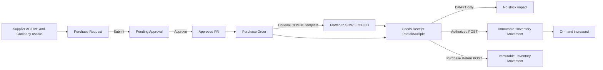
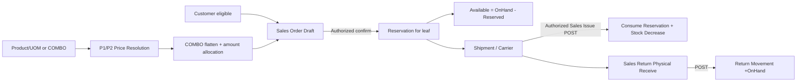
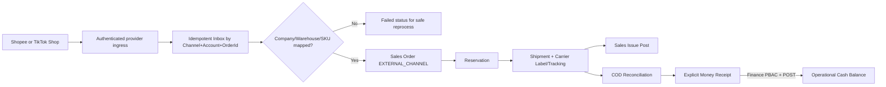

# 04 — P2 End-to-End Processes, States & Transaction Boundary

> **DinkERP P2 Documentation v1.0.0** · Ngày 2026-10-28 · **Status:** DRAFT — P2 design; chưa được phê duyệt
> **Authority:** 30 P2 UR trạng thái `BASELINE` trong `00_User_Requirements_v1.0.15.md` (SHA-256 `97894e35dbf6c5f641f56574af947cafbc45122a87b9fb189ee7426503448144`).
> **Code authority:** `erp_v1.9.0.zip` = P1 CLOSED BASELINE, chưa có nghiệp vụ P2. Các bảng/API/màn hình P2 trong bộ này là **đề xuất thiết kế**, không phải code đã chạy, trừ khi ghi rõ `P1-EXISTS`.

## Quy tắc đọc độc lập

1. `BASELINE-UR`: nội dung được phê duyệt từ User Requirements, không được đổi nghĩa bằng thiết kế.
2. `P1-EXISTS`: có trong source v1.9.0, chỉ nêu những gì đã kiểm tra bằng source; không thay nghiệm thu live.
3. `P2-DRAFT`: lựa chọn thiết kế đề xuất để triển khai P2, cần duyệt trước khi migrate/implement.
4. `OPEN-DECISION`: dữ liệu nguồn chưa xác định; không tự gán thành cam kết.
5. `NOT-IMPLEMENTED`: các resource/API/bảng P2 đề xuất hiện không nằm trong P1 source.

## 1. Lifecycle và state authority

- P1 đã khóa: `Lifecycle+FromState+Action` resolve chính xác một destination; `Policy/Permission` trả quyền nhưng không tạo transition. Các module có state riêng theo nghĩa nghiệp vụ.
- `UR-PUR-001` **explicit** Purchase Request lifecycle: `DRAFT→PENDING_APPROVAL→APPROVED/REJECTED`, `CANCELLED` khi hợp lệ. Những trạng thái đề xuất khác (GoodsReceipt POSTED, SalesOrder CONFIRMED, Money POSTED) phải qua lifecycle design review, không tự coi là đã khóa transition graph.
- Chỉ `POSTED` hoặc module-defined `CONFIRMED` tương đương posting mới gây stock/finance impact, theo từng UR. `CONFIRMED` của **Sales Order** tạo reservation, không tự issue stock.

## 2. Purchase Request → Purchase Order → Goods Receipt → Inventory



**Acceptance:** PR approved only can source PO; same Company for PO, GR, warehouse; product source UOM/base quantity retained, Serial required at GR post, posted documents immutable. Partial receipt updates cumulative PO `received_qty`. Source does **not** define purchase allocation for COMBO leaf cost; block unresolved instead of using selling allocation.

**Transaction boundary:** `postGR`: lock GR+PO+stock+serial, check remaining/Company/policy/state, insert unique movement key and update balance, GR posted and cumulative received in one transaction; retry no double increase.

## 3. Direct/Internal Sales → Reservation → Issue → Returns



**Key invariants:** Internal price from Company→Group→default (P2 condition only after approved); root COMBO allocation amounts conserved; no stock to PARENT/COMBO; confirm reserve cannot push Available negative; partial Issue consumes partial reservation with matching stock decrement and chosen serial.

**Concurrency:** Two confirmed SOs compete for same SKU, reservation transaction uses atomic lock/conditional update; duplicate POST action idempotent. Cancelled SO releases, but cannot release already-consumed reservation.

## 4. Marketplace → Shipping → COD → Operational Money Receipt



Marketplace external unit price, discounts and source identifiers are immutable authoritative input; no ERP recompute. Duplicate external order after parallel retry returns existing ERP order. Failed mapping does not produce partial SO. Provider status updates should be stored as events and not re-run confirmed stock issue by implicit coupling.

Carrier may provide rate, create label/tracking, cancel label, delivery updates and COD data. Cancelling label does **not** erase ERP shipment. COD difference must be explainable: source collected minus approved fees minus actual received; exact formula for net payout needs signed decision if provider fees vary.

## 5. Inventory balance & Serial lifecycle

```text
Confirmed SO -> Reservation (reserved_qty increases; on_hand unchanged)
Cancelled / reduced SO -> Reservation Release (reserved_qty decreases)
Posted Sales Issue -> Reservation Consume + Stock Movement (-base_qty)
Posted Goods Receipt -> Stock Movement (+base_qty)
Posted Warehouse Transfer -> paired Stock Movements (-from,+to), same Company
Confirmed Stock Count -> variance calculation only
Posted Adjustment -> Stock Movement (+/-variance)
Posted Sales/Purchase Return -> Stock Movement (+/- respectively)
```

Serial-managed leaf: unique Product+Serial, location changes via posting, never two active warehouses; capture serial at GR/Issue/Transfer/Returns, not at reservation. Reversal/Correction must preserve source and serial history.

## 6. Finance operational balance

```text
Cash/BankAccount: Company + OpeningBalance + OpeningDate
Draft Money Receipt/Expense -> no balance impact
POSTED Receipt -> +amount
POSTED Expense -> -amount
Balance(t) = OpeningBalance + SUM(posted receipts) - SUM(posted expenses)
```

`Money Receipt` avoids confusion with `Goods Receipt`; account belongs same Company; source refs (SalesOrder, Shipment/COD, PurchaseOrder, Payroll P3) are trace-only. Posted money correction by reversal/adjustment only. No GL, Chart of Accounts, double-entry or statutory reconciliation.

## 7. State catalog proposal (not approved)

| Resource | Suggested states | Transition checkpoint | Side effect | Authority |
|---|---|---|---|---|
| Purchase Request | DRAFT, PENDING_APPROVAL, APPROVED, REJECTED, CANCELLED | submit/approve/reject/cancel | none | P2 UR explicitly lifecycle |
| Purchase Order | DRAFT, PENDING_APPROVAL, APPROVED, CANCELLED, CLOSED | final approval before receipt | none | Draft state graph |
| Goods Receipt | DRAFT, POSTED, CANCELLED | post | stock +; PO received + | P2 UR posting rule; exact graph draft |
| Purchase Return | DRAFT, POSTED, CANCELLED | post | stock - | P2 UR posting rule; graph draft |
| Warehouse Transfer | DRAFT, POSTED, CANCELLED | post | atomic stock -/+ | P2 UR posting rule; graph draft |
| Stock Count | DRAFT, PENDING_APPROVAL, APPROVED, CANCELLED | approve/confirm | no immediate stock | Draft |
| Inventory Adjustment | DRAFT, POSTED, CANCELLED | post | stock delta | P2 UR posting rule; graph draft |
| Sales Order | DRAFT, CONFIRMED, CANCELLED, COMPLETED | confirm/cancel | reserve/release, not on-hand | P2 UR reservation trigger; graph draft |
| Shipment | DRAFT, BOOKED, IN_TRANSIT, DELIVERED, CANCELLED | provider status mapping | no direct stock impact | Draft |
| Sales Issue | DRAFT, POSTED | post | consume reserve + stock - | P2 UR posting rule; graph draft |
| Sales Return | REQUESTED, RECEIVED, POSTED, CANCELLED | post | stock + | P2 UR posting rule; graph draft |
| COD Reconciliation | OPEN, MATCHED, DIFFERENCE, CLOSED | reconcile | no money posting | Draft |
| Money Receipt/Expense | DRAFT, POSTED, CANCELLED/REVERSED | post/reverse | cash balance (+/-) | P2 UR posting rule; graph draft |

**Approval requirement:** Before implementing, each state transition must be registered in P1 Workflow/Lifecycle, with unique `(lifecycle,from_state,action) → to_state`, PBAC action and effect gate. Avoid state/action name mismatch with existing P1 Workflow code.

## 8. Reconciliation and rollback scenarios

| Scenario | Expected behavior |
|---|---|
| GR already POSTED + repeat POST | No duplicate inventory movement |
| Sales confirm races with other confirm | At most available quantity reserved; loser fails cleanly |
| Issue network times out after commit | Retry finds same posting key, returns existing result |
| Shipment provider cancels while Issue posted | Preserve stock/Issue source; separate return/reversal policy required |
| Marketplace order fails Company mapping | Durable error, 0 ERP SO created; replay after mapping |
| Payment/COD webhooks duplicate | Idempotent receipt linkage; never duplicate cash balance |
| Product turned inactive with history | Historical records/ledger readable, new transactions blocked appropriately |
| Stock Count edits after new movement | Detect stale snapshot/collision; reconcile action policy required |
| Issue line COMBO enters stock movement | Reject; inspect flattening/mapping bug |
