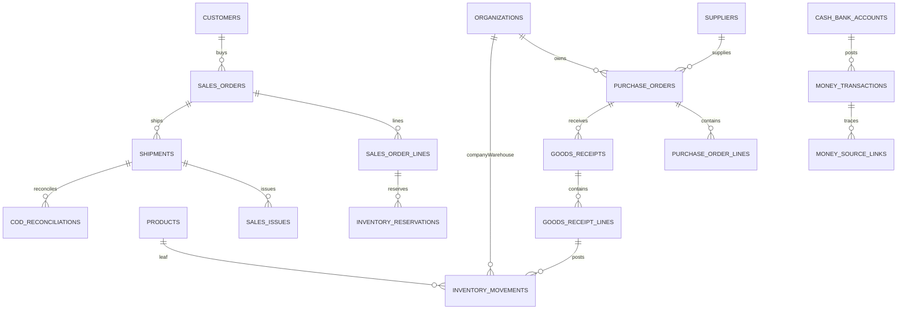

# 05 — Database Design P2 / Entity Dictionary

> **DinkERP P2 Documentation v1.0.0** · Ngày 2026-10-28 · **Status:** DRAFT — P2 design; chưa được phê duyệt
> **Authority:** 30 P2 UR trạng thái `BASELINE` trong `00_User_Requirements_v1.0.15.md` (SHA-256 `97894e35dbf6c5f641f56574af947cafbc45122a87b9fb189ee7426503448144`).
> **Code authority:** `erp_v1.9.0.zip` = P1 CLOSED BASELINE, chưa có nghiệp vụ P2. Các bảng/API/màn hình P2 trong bộ này là **đề xuất thiết kế**, không phải code đã chạy, trừ khi ghi rõ `P1-EXISTS`.

## Quy tắc đọc độc lập

1. `BASELINE-UR`: nội dung được phê duyệt từ User Requirements, không được đổi nghĩa bằng thiết kế.
2. `P1-EXISTS`: có trong source v1.9.0, chỉ nêu những gì đã kiểm tra bằng source; không thay nghiệm thu live.
3. `P2-DRAFT`: lựa chọn thiết kế đề xuất để triển khai P2, cần duyệt trước khi migrate/implement.
4. `OPEN-DECISION`: dữ liệu nguồn chưa xác định; không tự gán thành cam kết.
5. `NOT-IMPLEMENTED`: các resource/API/bảng P2 đề xuất hiện không nằm trong P1 source.

## 1. Ghi nhận hiện trạng P1 (P1-EXISTS)

- CI4 migrations sử dụng tên bảng logic **không prefix** trong migration code; `dinktech_` có thể đến từ runtime DB prefix. Không tự gắn prefix cứng trong code/migrations.
- Các bảng P1 cần reuse thay vì nhân bản: `organizations`, `employees`, `products`, `product_uoms`, `product_uom_conversions`, `product_combo_items`, `product_groups`, `price_lists`, `product_price_list_items`, `contacts`, `resources`, `resource_actions`, `policies`, `workflow_states`, `lifecycles`, `lifecycle_transitions`, `auto_numbering_series`, `auto_numbering_counters`, `import_jobs`, `import_job_rows` và Shield identity tables.
- Source v1.9.0 có migration tới `2026-10-26-000022_CreateNotificationPushTables.php`; mọi migration P2 phải là **additive sau baseline**, không sửa file P1 migration đã áp dụng. Phải đối chiếu live `migrations` table trước khi chọn version numbering.
- Không có migration P2 thực sự trong source P1. Toàn bộ catalog dưới đây là **đề xuất logical/physical DRAFT**, được giữ riêng để DBA review. Đây **không** phải executable DDL và chưa được áp vào DB.

## 2. Các quy ước được đề xuất (P2-DRAFT)

| Chủ đề | Contract đề xuất | Mức authority |
|---|---|---|
| Primary key | `BIGINT UNSIGNED AUTO_INCREMENT`; FK đối chiếu đúng type P1 | P2-DRAFT; nhất quán P1 |
| Tenant | `company_id` FK → `organizations.id`, kiểm tra type `COMPANY`; warehouse FK về Organization type `WAREHOUSE` và same-company | P1-UR invariant |
| Số tiền | `DECIMAL(18,2)` theo P1 price list, API dùng decimal **string**; VND base/transaction currency | P1 VND; precision P2-DRAFT |
| Số lượng | `DECIMAL(18,6)` source/base; conversion theo product rules, không dùng JS float để tính toán final | P2-DRAFT precision |
| Thời gian | timestamp instant/canonical UTC, business DATE derive bằng timezone Company (không phải Display timezone) | P1-UR invariant; storage convention review |
| Approval/Posting | `status` canonical theo Lifecycle; `posted_at/by` set 1 lần trong transaction | P1/P2-UR invariant |
| Audit | `created_by/at`,`updated_by/at` ở mutable masters; immutable posting/append-only history | P1/P2-UR invariant |
| Refs polymorphic | `source_type + source_id` và document owner validated app-layer, không fake FK đa bảng | P2-DRAFT; P1 Contact precedent |
| Index | theo Company+status/time, source link, unique external keys; avoid ambiguous nullable UNIQUE | P2-DRAFT |
| Soft/inactive | status không xóa history; no hard-delete posted rows | P2-UR invariant |

**Chuẩn hóa tiền/quantity**: giới hạn numeric, scale, rounding mode, proration tax, discount và final unit_price cần một decision thống nhất trước khi tạo migration chính thức; chỉ `DECIMAL` storage không tự giải quyết làm tròn.

## 3. Toàn bộ entity / proposed tables

### 3.1 — DOC (5 entities)

#### `documents` — Document logical identity

**Trạng thái:** P2-DRAFT · **Columns:** `id:BIGINT PK; code:VARCHAR(50); title:VARCHAR(255); category_code:VARCHAR(50) NULL; status:VARCHAR(20); current_version_id:BIGINT NULL; created_by:BIGINT; created_at:DATETIME`.

**Unique / indexes / validation:** UNIQUE(code); index(status,category_code). **FK/refs:** document_versions via current_version_id (circular FK deferred).

**Behavior:** Không lưu binary trong SQL; metadata của document tồn tại ngay cả khi version bị thay thế.

#### `document_versions` — Immutable uploaded versions

**Trạng thái:** P2-DRAFT · **Columns:** `id:BIGINT PK; document_id:BIGINT; version_no:INT; storage_key:VARCHAR(255); original_name:VARCHAR(255); mime_type:VARCHAR(150); size_bytes:BIGINT; content_sha256:CHAR(64); uploaded_by:BIGINT; uploaded_at:DATETIME`.

**Unique / indexes / validation:** UNIQUE(document_id,version_no); index(content_sha256). **FK/refs:** documents.id.

**Behavior:** Version sau immutable; tải qua authorized download, không public storage URL.

#### `document_links` — Polymorphic resource ownership

**Trạng thái:** P2-DRAFT · **Columns:** `id:BIGINT PK; document_id:BIGINT; owner_type:VARCHAR(60); owner_id:BIGINT; linked_at:DATETIME; linked_by:BIGINT`.

**Unique / indexes / validation:** UNIQUE(document_id,owner_type,owner_id); INDEX(owner_type,owner_id). **FK/refs:** documents.id; owner polymorphic app-layer.

**Behavior:** Owner authorization check tại từng download và link create, tuyệt đối không tin client owner_id để bypass.

#### `document_tags` — Reusable document tags

**Trạng thái:** P2-DRAFT · **Columns:** `id:BIGINT PK; code:VARCHAR(50); name:VARCHAR(120); status:VARCHAR(20)`.

**Unique / indexes / validation:** UNIQUE(code). **FK/refs:** none.

**Behavior:** Tag/search SHOULD từ UR-DOC-002; nếu postpone phải ghi acceptance waiver.

#### `document_tag_links` — Document-tag join

**Trạng thái:** P2-DRAFT · **Columns:** `document_id:BIGINT; tag_id:BIGINT`.

**Unique / indexes / validation:** UNIQUE(document_id,tag_id). **FK/refs:** documents.id; document_tags.id.

**Behavior:** Không mở rộng quyền access từ tag.

### 3.2 — CUS (4 entities)

#### `customers` — Shared customer master

**Trạng thái:** P2-DRAFT · **Columns:** `id:BIGINT PK; customer_code:VARCHAR(50); name:VARCHAR(255); customer_group_id:BIGINT NULL; phone:VARCHAR(50) NULL; email:VARCHAR(255) NULL; tax_code:VARCHAR(50) NULL; address:TEXT NULL; province_id:BIGINT NULL; ward_id:BIGINT NULL; shipping_address:TEXT NULL; shipping_province_id:BIGINT NULL; shipping_ward_id:BIGINT NULL; all_companies:BOOLEAN; status:VARCHAR(20); created_by:BIGINT; created_at:DATETIME; updated_by:BIGINT NULL; updated_at:DATETIME NULL`.

**Unique / indexes / validation:** UNIQUE(customer_code); INDEX(status,all_companies). **FK/refs:** customer_groups; provinces; wards.

**Behavior:** Group shared identity, Company usage filter trước chọn trong order.

#### `customer_groups` — Customer grouping for P2 pricing

**Trạng thái:** P2-DRAFT · **Columns:** `id:BIGINT PK; group_code:VARCHAR(50); name:VARCHAR(255); status:VARCHAR(20)`.

**Unique / indexes / validation:** UNIQUE(group_code). **FK/refs:** none.

**Behavior:** Phạm vi Customer Group được nhắc trong UR-PRC-001; taxonomy chi tiết OPEN-DECISION.

#### `customer_company_usages` — Customer company allowlist

**Trạng thái:** P2-DRAFT · **Columns:** `customer_id:BIGINT; company_organization_id:BIGINT; status:VARCHAR(20)`.

**Unique / indexes / validation:** UNIQUE(customer_id,company_organization_id). **FK/refs:** customers.id; organizations.id type COMPANY.

**Behavior:** all_companies false phải có ít nhất một Company hợp lệ trước khi dùng transaction.

#### `customer_notes` — CRM contact/note history

**Trạng thái:** P2-DRAFT · **Columns:** `id:BIGINT PK; customer_id:BIGINT; company_organization_id:BIGINT NULL; content:TEXT; happened_at:DATETIME; created_by:BIGINT; created_at:DATETIME`.

**Unique / indexes / validation:** INDEX(customer_id,happened_at); INDEX(company_organization_id). **FK/refs:** customers.id; organizations.id.

**Behavior:** Note Company-scoped bị lọc theo PBAC, không leak vào Group-wide read.

### 3.3 — SUP (3 entities)

#### `suppliers` — Shared supplier master

**Trạng thái:** P2-DRAFT · **Columns:** `id:BIGINT PK; supplier_code:VARCHAR(50); name:VARCHAR(255); supplier_group:VARCHAR(80) NULL; phone:VARCHAR(50) NULL; email:VARCHAR(255) NULL; tax_code:VARCHAR(50) NULL; address:TEXT NULL; province_id:BIGINT NULL; ward_id:BIGINT NULL; bank_account_info:TEXT NULL; payment_term_code:VARCHAR(80) NULL; all_companies:BOOLEAN; status:VARCHAR(20); created_by:BIGINT; created_at:DATETIME`.

**Unique / indexes / validation:** UNIQUE(supplier_code); INDEX(status,all_companies). **FK/refs:** provinces; wards.

**Behavior:** Không log bank account raw; field-level masking không thuộc P1 UR, quyền resource/action vẫn bắt buộc.

#### `supplier_company_usages` — Supplier company allowlist

**Trạng thái:** P2-DRAFT · **Columns:** `supplier_id:BIGINT; company_organization_id:BIGINT; status:VARCHAR(20)`.

**Unique / indexes / validation:** UNIQUE(supplier_id,company_organization_id). **FK/refs:** suppliers.id; organizations.id COMPANY.

**Behavior:** PO Company phải nằm trong Usage scope của Supplier.

#### `supplier_notes` — Supplier history note

**Trạng thái:** P2-DRAFT · **Columns:** `id:BIGINT PK; supplier_id:BIGINT; company_organization_id:BIGINT NULL; content:TEXT; happened_at:DATETIME; created_by:BIGINT`.

**Unique / indexes / validation:** INDEX(supplier_id,happened_at). **FK/refs:** suppliers.id.

**Behavior:** Không dùng note để thay nguồn PO/receipt history.

### 3.4 — PRC (5 entities)

#### `product_price_list_item_contexts` — Explicit P2 pricing criteria on P1 items

**Trạng thái:** P2-DRAFT · **Columns:** `id:BIGINT PK; price_list_item_id:BIGINT; customer_id:BIGINT NULL; customer_group_id:BIGINT NULL; sales_channel_id:BIGINT NULL; status:VARCHAR(20)`.

**Unique / indexes / validation:** INDEX(price_list_item_id,customer_id,customer_group_id,sales_channel_id). **FK/refs:** product_price_list_items.id; customers.id; customer_groups.id; sales_channels.id.

**Behavior:** Không phá Product+UOM; specificity phải được duyệt, NULL canonical hóa khi unique.

#### `promotions` — Promotion master

**Trạng thái:** P2-DRAFT · **Columns:** `id:BIGINT PK; promo_code:VARCHAR(50); name:VARCHAR(255); promo_type:VARCHAR(40); priority:INT; effective_from:DATETIME; effective_to:DATETIME NULL; combinable:BOOLEAN; status:VARCHAR(20); created_by:BIGINT; created_at:DATETIME`.

**Unique / indexes / validation:** UNIQUE(promo_code); INDEX(status,effective_from,effective_to,priority). **FK/refs:** none.

**Behavior:** Types %/amount/special/quantity/gift/coupon; promotions tie conflict phải reject hoặc deterministic trước active.

#### `promotion_rules` — Explicit eligible targets and rule values

**Trạng thái:** P2-DRAFT · **Columns:** `id:BIGINT PK; promotion_id:BIGINT; product_id:BIGINT NULL; product_group_id:BIGINT NULL; customer_id:BIGINT NULL; customer_group_id:BIGINT NULL; sales_channel_id:BIGINT NULL; threshold_qty:DECIMAL(18,6) NULL; discount_rate:DECIMAL(9,6) NULL; discount_amount:DECIMAL(18,2) NULL; gift_product_id:BIGINT NULL`.

**Unique / indexes / validation:** INDEX(promotion_id). **FK/refs:** promotions.id; products; product_groups; customers; customer_groups; sales_channels.

**Behavior:** Không arbitrary condition execution; schema cần review từng promo type.

#### `coupons` — Coupon issuance and usage policy

**Trạng thái:** P2-DRAFT · **Columns:** `id:BIGINT PK; coupon_code:VARCHAR(80); promotion_id:BIGINT; status:VARCHAR(20); max_uses:INT NULL; used_count:INT`.

**Unique / indexes / validation:** UNIQUE(coupon_code); CHECK used_count<=max_uses if max_uses not null. **FK/refs:** promotions.id.

**Behavior:** Concurrency lock coupon issuance/usage; eligibility còn OPEN-DECISION.

#### `sales_order_promotions` — Promotion/coupon application snapshot

**Trạng thái:** P2-DRAFT · **Columns:** `id:BIGINT PK; sales_order_id:BIGINT; promotion_id:BIGINT; coupon_id:BIGINT NULL; applied_amount:DECIMAL(18,2); calculation_snapshot:TEXT; applied_at:DATETIME`.

**Unique / indexes / validation:** INDEX(sales_order_id). **FK/refs:** sales_orders; promotions; coupons.

**Behavior:** Promotions applied deterministic; snapshot re-pricing not on external price.

### 3.5 — PUR (9 entities)

#### `purchase_requests` — Purchase Request header

**Trạng thái:** P2-DRAFT · **Columns:** `id:BIGINT PK; request_number:VARCHAR(60); company_id:BIGINT; warehouse_id:BIGINT NULL; status:VARCHAR(30); requested_by:BIGINT; created_by:BIGINT; created_at:DATETIME; updated_at:DATETIME NULL`.

**Unique / indexes / validation:** UNIQUE(company_id,request_number); INDEX(company_id,status). **FK/refs:** organizations.id COMPANY and WAREHOUSE.

**Behavior:** State DRAFT/PENDING_APPROVAL/APPROVED/REJECTED/CANCELLED.

#### `purchase_request_lines` — PR requested leaves

**Trạng thái:** P2-DRAFT · **Columns:** `id:BIGINT PK; purchase_request_id:BIGINT; line_no:INT; product_id:BIGINT; source_uom_id:BIGINT; source_qty:DECIMAL(18,6); base_qty:DECIMAL(18,6)`.

**Unique / indexes / validation:** UNIQUE(purchase_request_id,line_no). **FK/refs:** purchase_requests.id; products; product_uoms.

**Behavior:** Combo template expansion trước downstream; lưu source trace.

#### `purchase_orders` — PO header

**Trạng thái:** P2-DRAFT · **Columns:** `id:BIGINT PK; po_number:VARCHAR(60); company_id:BIGINT; supplier_id:BIGINT; receiving_warehouse_id:BIGINT; payment_term_code:VARCHAR(80) NULL; expected_receipt_date:DATE NULL; status:VARCHAR(30); created_by:BIGINT; created_at:DATETIME; updated_at:DATETIME NULL`.

**Unique / indexes / validation:** UNIQUE(company_id,po_number); INDEX(company_id,status,supplier_id). **FK/refs:** organizations.id; suppliers.id.

**Behavior:** PO Company=receiving Warehouse Company; Supplier usable.

#### `purchase_order_lines` — PO line

**Trạng thái:** P2-DRAFT · **Columns:** `id:BIGINT PK; purchase_order_id:BIGINT; line_no:INT; product_id:BIGINT; source_uom_id:BIGINT; source_qty:DECIMAL(18,6); base_qty:DECIMAL(18,6); unit_price:DECIMAL(18,2); discount_amount:DECIMAL(18,2); tax_amount:DECIMAL(18,2) NULL; received_base_qty:DECIMAL(18,6)`.

**Unique / indexes / validation:** UNIQUE(purchase_order_id,line_no). **FK/refs:** purchase_orders.id; products; product_uoms.

**Behavior:** Partial receiving <= ordered; rounding/cost method OPEN-DECISION.

#### `purchase_request_po_links` — PR to PO trace

**Trạng thái:** P2-DRAFT · **Columns:** `purchase_request_line_id:BIGINT; purchase_order_line_id:BIGINT; linked_base_qty:DECIMAL(18,6)`.

**Unique / indexes / validation:** UNIQUE(purchase_request_line_id,purchase_order_line_id). **FK/refs:** purchase_request_lines.id; purchase_order_lines.id.

**Behavior:** Approved PR only.

#### `goods_receipts` — Goods Receipt header

**Trạng thái:** P2-DRAFT · **Columns:** `id:BIGINT PK; gr_number:VARCHAR(60); company_id:BIGINT; purchase_order_id:BIGINT; warehouse_id:BIGINT; status:VARCHAR(30); posted_at:DATETIME NULL; posted_by:BIGINT NULL; created_by:BIGINT; created_at:DATETIME`.

**Unique / indexes / validation:** UNIQUE(company_id,gr_number); INDEX(company_id,status). **FK/refs:** purchase_orders.id; organizations.id.

**Behavior:** On-hand chỉ thay đổi sau posting transaction.

#### `goods_receipt_lines` — Goods Receipt line

**Trạng thái:** P2-DRAFT · **Columns:** `id:BIGINT PK; goods_receipt_id:BIGINT; purchase_order_line_id:BIGINT; product_id:BIGINT; source_uom_id:BIGINT; received_qty:DECIMAL(18,6); received_base_qty:DECIMAL(18,6)`.

**Unique / indexes / validation:** INDEX(goods_receipt_id,purchase_order_line_id). **FK/refs:** goods_receipts; purchase_order_lines; products.

**Behavior:** Serial per movement nếu quản lý Serial.

#### `purchase_returns` — Purchase Return header

**Trạng thái:** P2-DRAFT · **Columns:** `id:BIGINT PK; return_number:VARCHAR(60); company_id:BIGINT; supplier_id:BIGINT; goods_receipt_id:BIGINT NULL; status:VARCHAR(30); posted_at:DATETIME NULL; created_by:BIGINT; created_at:DATETIME`.

**Unique / indexes / validation:** UNIQUE(company_id,return_number). **FK/refs:** suppliers; goods_receipts.

**Behavior:** Posted return giảm stock, no destructive edit.

#### `purchase_return_lines` — Purchase Return lines

**Trạng thái:** P2-DRAFT · **Columns:** `id:BIGINT PK; purchase_return_id:BIGINT; goods_receipt_line_id:BIGINT NULL; product_id:BIGINT; return_base_qty:DECIMAL(18,6)`.

**Unique / indexes / validation:** INDEX(purchase_return_id). **FK/refs:** purchase_returns; goods_receipt_lines; products.

**Behavior:** No serial mismatch or excess return.

### 3.6 — INV (11 entities)

#### `inventory_movements` — Immutable stock ledger when POSTED

**Trạng thái:** P2-DRAFT · **Columns:** `id:BIGINT PK; posting_key:VARCHAR(160); company_id:BIGINT; warehouse_id:BIGINT; product_id:BIGINT; source_uom_id:BIGINT; source_qty:DECIMAL(18,6); base_qty_delta:DECIMAL(18,6); movement_type:VARCHAR(40); source_type:VARCHAR(50); source_id:BIGINT; source_line_id:BIGINT NULL; posted_at:DATETIME; posted_by:BIGINT; reversal_of_id:BIGINT NULL`.

**Unique / indexes / validation:** UNIQUE(posting_key); INDEX(company_id,warehouse_id,product_id,posted_at). **FK/refs:** organizations; products; product_uoms; self.

**Behavior:** Only SIMPLE/CHILD; immutable posted rows; correction by reversal/adjustment.

#### `inventory_balances` — Materialized stock by Company Warehouse Product

**Trạng thái:** P2-DRAFT · **Columns:** `company_id:BIGINT; warehouse_id:BIGINT; product_id:BIGINT; on_hand_qty:DECIMAL(18,6); reserved_qty:DECIMAL(18,6); updated_at:DATETIME`.

**Unique / indexes / validation:** UNIQUE(company_id,warehouse_id,product_id). **FK/refs:** organizations; products.

**Behavior:** Available=on_hand-reserved; mutated atomically with posting/reservation, rebuildable from ledger.

#### `inventory_serials` — Serial state & current location

**Trạng thái:** P2-DRAFT · **Columns:** `id:BIGINT PK; product_id:BIGINT; serial_code:VARCHAR(120); company_id:BIGINT; warehouse_id:BIGINT NULL; status:VARCHAR(30); last_movement_id:BIGINT NULL`.

**Unique / indexes / validation:** UNIQUE(product_id,serial_code); INDEX(company_id,warehouse_id,status). **FK/refs:** products; organizations; inventory_movements.

**Behavior:** Serial không đồng thời ở nhiều warehouse; unique per Product.

#### `inventory_movement_serials` — Serial movement trace

**Trạng thái:** P2-DRAFT · **Columns:** `inventory_movement_id:BIGINT; serial_id:BIGINT; direction:VARCHAR(20)`.

**Unique / indexes / validation:** UNIQUE(inventory_movement_id,serial_id). **FK/refs:** inventory_movements; inventory_serials.

**Behavior:** Trace serial thru receipt/issue/transfer/return.

#### `inventory_reservations` — Leaf reservation from confirmed SO

**Trạng thái:** P2-DRAFT · **Columns:** `id:BIGINT PK; reservation_key:VARCHAR(160); company_id:BIGINT; warehouse_id:BIGINT; product_id:BIGINT; sales_order_line_id:BIGINT; reserved_qty:DECIMAL(18,6); consumed_qty:DECIMAL(18,6); released_qty:DECIMAL(18,6); status:VARCHAR(30); created_at:DATETIME`.

**Unique / indexes / validation:** UNIQUE(reservation_key); INDEX(company_id,warehouse_id,product_id,status). **FK/refs:** sales_order_lines; products; organizations.

**Behavior:** Active remaining=reserved-consumed-released>=0; no overselling.

#### `warehouse_transfers` — Warehouse Transfer document

**Trạng thái:** P2-DRAFT · **Columns:** `id:BIGINT PK; transfer_number:VARCHAR(60); company_id:BIGINT; source_warehouse_id:BIGINT; destination_warehouse_id:BIGINT; status:VARCHAR(30); posted_at:DATETIME NULL`.

**Unique / indexes / validation:** UNIQUE(company_id,transfer_number). **FK/refs:** organizations warehouse.

**Behavior:** Both warehouses same Company; single atomic post out/in.

#### `warehouse_transfer_lines` — Transfer line

**Trạng thái:** P2-DRAFT · **Columns:** `id:BIGINT PK; transfer_id:BIGINT; product_id:BIGINT; base_qty:DECIMAL(18,6)`.

**Unique / indexes / validation:** INDEX(transfer_id). **FK/refs:** warehouse_transfers; products.

**Behavior:** serial selected when transfer posted.

#### `stock_counts` — Stock Count header

**Trạng thái:** P2-DRAFT · **Columns:** `id:BIGINT PK; count_number:VARCHAR(60); company_id:BIGINT; warehouse_id:BIGINT; status:VARCHAR(30); snapshot_at:DATETIME; confirmed_by:BIGINT NULL`.

**Unique / indexes / validation:** UNIQUE(company_id,count_number). **FK/refs:** organizations.

**Behavior:** Snapshot vs actual; variance confirmation authorization.

#### `stock_count_lines` — Stock Count line

**Trạng thái:** P2-DRAFT · **Columns:** `id:BIGINT PK; stock_count_id:BIGINT; product_id:BIGINT; system_base_qty:DECIMAL(18,6); actual_base_qty:DECIMAL(18,6); variance_base_qty:DECIMAL(18,6)`.

**Unique / indexes / validation:** UNIQUE(stock_count_id,product_id). **FK/refs:** stock_counts; products.

**Behavior:** Variance calc actual-system, not UI floats.

#### `inventory_adjustments` — Stock adjustment header

**Trạng thái:** P2-DRAFT · **Columns:** `id:BIGINT PK; adjustment_number:VARCHAR(60); company_id:BIGINT; warehouse_id:BIGINT; stock_count_id:BIGINT NULL; status:VARCHAR(30); posted_at:DATETIME NULL`.

**Unique / indexes / validation:** UNIQUE(company_id,adjustment_number). **FK/refs:** organizations; stock_counts.

**Behavior:** Post-only delta and trace to Stock Count.

#### `inventory_adjustment_lines` — Adjustment line

**Trạng thái:** P2-DRAFT · **Columns:** `id:BIGINT PK; adjustment_id:BIGINT; product_id:BIGINT; base_qty_delta:DECIMAL(18,6); reason_code:VARCHAR(50)`.

**Unique / indexes / validation:** INDEX(adjustment_id). **FK/refs:** inventory_adjustments; products.

**Behavior:** No posted update.

### 3.7 — SAL (19 entities)

#### `sales_channels` — Canonical internal/marketplace channel identity

**Trạng thái:** P2-DRAFT · **Columns:** `id:BIGINT PK; code:VARCHAR(40); name:VARCHAR(120); platform:VARCHAR(30) NULL; status:VARCHAR(20)`.

**Unique / indexes / validation:** UNIQUE(code). **FK/refs:** none.

**Behavior:** Cần phân biệt DIRECT/SHOPEE/TIKTOK; source chưa khóa enum channel.

#### `sales_orders` — Single-Company sales order

**Trạng thái:** P2-DRAFT · **Columns:** `id:BIGINT PK; sales_order_number:VARCHAR(60); company_id:BIGINT; customer_id:BIGINT NULL; sales_channel_id:BIGINT; warehouse_id:BIGINT; price_source:VARCHAR(30); status:VARCHAR(30); delivery_address:TEXT NULL; delivery_province_id:BIGINT NULL; delivery_ward_id:BIGINT NULL; shipping_fee:DECIMAL(18,2) NULL; created_at:DATETIME; created_by:BIGINT`.

**Unique / indexes / validation:** UNIQUE(company_id,sales_order_number); INDEX(company_id,status,sales_channel_id). **FK/refs:** customers; sales_channels; organizations.

**Behavior:** External price authoritative; stored price snapshots; confirmed creates reservation.

#### `sales_order_lines` — Operational leaf line

**Trạng thái:** P2-DRAFT · **Columns:** `id:BIGINT PK; sales_order_id:BIGINT; line_no:INT; product_id:BIGINT; source_uom_id:BIGINT; source_qty:DECIMAL(18,6); base_qty:DECIMAL(18,6); unit_price:DECIMAL(18,2); amount:DECIMAL(18,2); price_source:VARCHAR(30); price_list_id:BIGINT NULL`.

**Unique / indexes / validation:** UNIQUE(sales_order_id,line_no). **FK/refs:** sales_orders; products; product_uoms; price_lists.

**Behavior:** COMBO flattened leaves; preserve origin linking; amounts exact.

#### `sales_order_combo_origins` — Root COMBO selection trace

**Trạng thái:** P2-DRAFT · **Columns:** `id:BIGINT PK; sales_order_id:BIGINT; root_combo_product_id:BIGINT; root_combo_qty:DECIMAL(18,6); root_price:DECIMAL(18,2); root_total_amount:DECIMAL(18,2)`.

**Unique / indexes / validation:** INDEX(sales_order_id). **FK/refs:** sales_orders; products.

**Behavior:** Store selected root and allocated summary without creating stock COMBO.

#### `sales_order_combo_allocations` — Leaf allocations from combo root

**Trạng thái:** P2-DRAFT · **Columns:** `combo_origin_id:BIGINT; sales_order_line_id:BIGINT; allocated_qty:DECIMAL(18,6); allocated_amount:DECIMAL(18,2)`.

**Unique / indexes / validation:** UNIQUE(combo_origin_id,sales_order_line_id). **FK/refs:** sales_order_combo_origins; sales_order_lines.

**Behavior:** SUM allocated amount = root amount; same leaf weighted avg.

#### `marketplace_accounts` — Source shop/account → Company and warehouse mapping

**Trạng thái:** P2-DRAFT · **Columns:** `id:BIGINT PK; sales_channel_id:BIGINT; external_account_id:VARCHAR(160); company_id:BIGINT; warehouse_id:BIGINT; effective_from:DATETIME; effective_to:DATETIME NULL; status:VARCHAR(20); credentials_ref:VARCHAR(255) NULL`.

**Unique / indexes / validation:** INDEX(sales_channel_id,external_account_id,effective_from). **FK/refs:** sales_channels; organizations.

**Behavior:** One effective Company at time; secrets not returned to UI.

#### `marketplace_order_inbox` — Raw external order reference and safe digest

**Trạng thái:** P2-DRAFT · **Columns:** `id:BIGINT PK; sales_channel_id:BIGINT; marketplace_account_id:BIGINT; external_order_id:VARCHAR(160); payload_sha256:CHAR(64); received_at:DATETIME; sync_status:VARCHAR(30); error_code:VARCHAR(80) NULL; payload_storage_ref:VARCHAR(255) NULL`.

**Unique / indexes / validation:** UNIQUE(sales_channel_id,marketplace_account_id,external_order_id). **FK/refs:** marketplace_accounts; sales_channels.

**Behavior:** Idempotent first ingest; retry updates same row, no duplicate SO.

#### `marketplace_order_links` — External business key to ERP SO

**Trạng thái:** P2-DRAFT · **Columns:** `id:BIGINT PK; marketplace_order_id:BIGINT; sales_order_id:BIGINT; created_at:DATETIME`.

**Unique / indexes / validation:** UNIQUE(marketplace_order_id); UNIQUE(sales_order_id) conditional if no multi-origin. **FK/refs:** marketplace_order_inbox; sales_orders.

**Behavior:** Create/link transaction atomic; no duplicate SO.

#### `marketplace_sync_attempts` — Marketplace sync errors/retry trace

**Trạng thái:** P2-DRAFT · **Columns:** `id:BIGINT PK; marketplace_order_id:BIGINT; attempted_at:DATETIME; status:VARCHAR(25); error_code:VARCHAR(80) NULL; retry_after:DATETIME NULL`.

**Unique / indexes / validation:** INDEX(marketplace_order_id,attempted_at). **FK/refs:** marketplace_order_inbox.

**Behavior:** Do not log raw secret/PII; bounded retries.

#### `shipments` — Shipment and carrier metadata

**Trạng thái:** P2-DRAFT · **Columns:** `id:BIGINT PK; shipment_number:VARCHAR(60); company_id:BIGINT; sales_order_id:BIGINT; warehouse_id:BIGINT; carrier_account_id:BIGINT NULL; tracking_number:VARCHAR(120) NULL; shipping_fee:DECIMAL(18,2) NULL; cod_amount:DECIMAL(18,2) NULL; delivery_status:VARCHAR(30); status:VARCHAR(30)`.

**Unique / indexes / validation:** UNIQUE(company_id,shipment_number); INDEX(company_id,tracking_number). **FK/refs:** sales_orders; organizations; carrier_accounts.

**Behavior:** Company alignment; cancel carrier label != delete shipment.

#### `shipment_lines` — Shipment partial fulfillment

**Trạng thái:** P2-DRAFT · **Columns:** `id:BIGINT PK; shipment_id:BIGINT; sales_order_line_id:BIGINT; base_qty:DECIMAL(18,6)`.

**Unique / indexes / validation:** INDEX(shipment_id). **FK/refs:** shipments; sales_order_lines.

**Behavior:** Partial shipment <= remaining qty.

#### `carrier_accounts` — Carrier integration connection

**Trạng thái:** P2-DRAFT · **Columns:** `id:BIGINT PK; carrier_code:VARCHAR(40); company_id:BIGINT; credential_ref:VARCHAR(255); status:VARCHAR(20)`.

**Unique / indexes / validation:** INDEX(company_id,carrier_code). **FK/refs:** organizations.

**Behavior:** Credentials only secret store; no plaintext API.

#### `carrier_interactions` — Label/fee/tracking/cancel attempts

**Trạng thái:** P2-DRAFT · **Columns:** `id:BIGINT PK; shipment_id:BIGINT; operation:VARCHAR(40); request_key:VARCHAR(160); provider_ref:VARCHAR(160) NULL; attempted_at:DATETIME; result_status:VARCHAR(30); error_code:VARCHAR(80) NULL`.

**Unique / indexes / validation:** UNIQUE(request_key); INDEX(shipment_id,attempted_at). **FK/refs:** shipments.

**Behavior:** Provider retry idempotent where supported; reconciliation log.

#### `carrier_tracking_events` — Deduped carrier event timeline

**Trạng thái:** P2-DRAFT · **Columns:** `id:BIGINT PK; shipment_id:BIGINT; provider_event_id:VARCHAR(160) NULL; payload_sha256:CHAR(64); event_code:VARCHAR(60); event_at:DATETIME; received_at:DATETIME`.

**Unique / indexes / validation:** UNIQUE(shipment_id,provider_event_id) if provider id exists; INDEX(shipment_id,event_at). **FK/refs:** shipments.

**Behavior:** Out-of-order event handling, anti-replay, mapping decision OPEN.

#### `sales_issues` — Sales Issue header (inventory post source)

**Trạng thái:** P2-DRAFT · **Columns:** `id:BIGINT PK; issue_number:VARCHAR(60); company_id:BIGINT; shipment_id:BIGINT; warehouse_id:BIGINT; status:VARCHAR(30); posted_at:DATETIME NULL`.

**Unique / indexes / validation:** UNIQUE(company_id,issue_number). **FK/refs:** shipments; organizations.

**Behavior:** Post consumes reservation + reduces on-hand together.

#### `sales_issue_lines` — Sales Issue leaf posted quantities

**Trạng thái:** P2-DRAFT · **Columns:** `id:BIGINT PK; sales_issue_id:BIGINT; sales_order_line_id:BIGINT; base_qty:DECIMAL(18,6)`.

**Unique / indexes / validation:** INDEX(sales_issue_id). **FK/refs:** sales_issues; sales_order_lines.

**Behavior:** Serial-specific allocation on post.

#### `cod_reconciliations` — COD carrier versus actual receipts

**Trạng thái:** P2-DRAFT · **Columns:** `id:BIGINT PK; company_id:BIGINT; shipment_id:BIGINT; carrier_report_ref:VARCHAR(160) NULL; cod_due:DECIMAL(18,2); carrier_collected:DECIMAL(18,2); shipping_fee:DECIMAL(18,2); other_fee:DECIMAL(18,2); net_due:DECIMAL(18,2); actual_received:DECIMAL(18,2); difference:DECIMAL(18,2); status:VARCHAR(30)`.

**Unique / indexes / validation:** INDEX(company_id,status); INDEX(shipment_id). **FK/refs:** shipments.

**Behavior:** Only posted Money Receipt changes finance balance; reconciliation should not post money implicitly.

#### `sales_returns` — Sales Return header

**Trạng thái:** P2-DRAFT · **Columns:** `id:BIGINT PK; return_number:VARCHAR(60); company_id:BIGINT; sales_order_id:BIGINT NULL; shipment_id:BIGINT NULL; status:VARCHAR(30); posted_at:DATETIME NULL`.

**Unique / indexes / validation:** UNIQUE(company_id,return_number). **FK/refs:** sales_orders; shipments.

**Behavior:** Physical return only increases stock on posted return movement.

#### `sales_return_lines` — Sales Return lines

**Trạng thái:** P2-DRAFT · **Columns:** `id:BIGINT PK; sales_return_id:BIGINT; product_id:BIGINT; sales_order_line_id:BIGINT NULL; returned_base_qty:DECIMAL(18,6)`.

**Unique / indexes / validation:** INDEX(sales_return_id). **FK/refs:** sales_returns; products; sales_order_lines.

**Behavior:** No serial validation bypass.

### 3.8 — FIN (4 entities)

#### `cash_bank_accounts` — Cash Fund and Bank Account master

**Trạng thái:** P2-DRAFT · **Columns:** `id:BIGINT PK; account_code:VARCHAR(50); company_id:BIGINT; account_type:VARCHAR(20); name:VARCHAR(255); opening_balance:DECIMAL(18,2); opening_date:DATE; status:VARCHAR(20)`.

**Unique / indexes / validation:** UNIQUE(company_id,account_code). **FK/refs:** organizations.

**Behavior:** Account Company immutable after financial transactions; opening date authoritative.

#### `money_categories` — Operational receipt/expense categories

**Trạng thái:** P2-DRAFT · **Columns:** `id:BIGINT PK; category_code:VARCHAR(50); category_type:VARCHAR(20); name:VARCHAR(255); status:VARCHAR(20)`.

**Unique / indexes / validation:** UNIQUE(category_code). **FK/refs:** none.

**Behavior:** RECEIPT or EXPENSE, inactive not for new transactions.

#### `money_transactions` — Money Receipt/Expense immutable post

**Trạng thái:** P2-DRAFT · **Columns:** `id:BIGINT PK; transaction_number:VARCHAR(60); company_id:BIGINT; account_id:BIGINT; category_id:BIGINT; direction:VARCHAR(20); business_date:DATE; amount:DECIMAL(18,2); status:VARCHAR(30); description:TEXT NULL; recorded_by:BIGINT; created_at:DATETIME; posted_at:DATETIME NULL; posted_by:BIGINT NULL; reversal_of_id:BIGINT NULL`.

**Unique / indexes / validation:** UNIQUE(company_id,transaction_number); INDEX(company_id,account_id,business_date,status). **FK/refs:** cash_bank_accounts; money_categories; organizations.

**Behavior:** Posted only adds/subtracts balance; no double-entry.

#### `money_source_links` — Finance source references

**Trạng thái:** P2-DRAFT · **Columns:** `id:BIGINT PK; money_transaction_id:BIGINT; source_type:VARCHAR(50); source_id:BIGINT; linked_amount:DECIMAL(18,2) NULL`.

**Unique / indexes / validation:** INDEX(source_type,source_id); INDEX(money_transaction_id). **FK/refs:** money_transactions; polymorphic source app-layer.

**Behavior:** Account/company match and source visibility; avoid false GL posting.

### 3.9 — SHARED (2 entities)

#### `p2_outbox_events` — Transactional outbox for integration notifications (optional design)

**Trạng thái:** P2-DRAFT · **Columns:** `id:BIGINT PK; event_key:VARCHAR(160); company_id:BIGINT NULL; aggregate_type:VARCHAR(80); aggregate_id:BIGINT; event_name:VARCHAR(80); payload_ref:VARCHAR(255) NULL; status:VARCHAR(20); available_at:DATETIME; created_at:DATETIME`.

**Unique / indexes / validation:** UNIQUE(event_key); INDEX(status,available_at). **FK/refs:** none.

**Behavior:** Optional proposed infrastructure, no P2 UR expressly mandates a generic outbox.

#### `p2_external_event_dedup` — Webhook event anti-replay (optional design)

**Trạng thái:** P2-DRAFT · **Columns:** `id:BIGINT PK; provider:VARCHAR(60); event_uid:VARCHAR(160); payload_hash:CHAR(64); received_at:DATETIME; status:VARCHAR(20)`.

**Unique / indexes / validation:** UNIQUE(provider,event_uid). **FK/refs:** none.

**Behavior:** Provider webhook auth/retention OPEN-DECISION.

## 4. Mô hình quan hệ quan trọng

Tên entity dạng uppercase trong sơ đồ là ký hiệu khái niệm, không phải tên bảng case-sensitive trong database.

## 5. Concurrency, invariants transaction và ledger integrity

1. **Posting keys**: mọi nguồn stock (`GoodsReceiptLine`, `SalesIssueLine`, ReturnLine, TransferLeg, AdjustmentLine) có `posting_key` deterministic và unique. Retry phải return already-posted result hoặc safe conflict, không ghi 2 movement.
2. **Stock serial lock**: transaction lấy lock theo thứ tự canonical `(company_id,warehouse_id,product_id)` và serial; lock reservation/issue/transfer nhất quán, không cho On-hand hoặc Available âm khi baseline cấm.
3. **Balance update**: `stock movement insert + balance delta + serial state + source status POSTED` commit/rollback cùng transaction. Cached `inventory_balances` phải reconcile được từ immutable movement ledger.
4. **Sales Issue**: `reservation.consume + inventory movement(-) + serial location + SalesIssue POSTED` trong một DB transaction; kết quả kiểm tra đủ available/allocated serial; không double deduct khi carrier webhook replay.
5. **Transfer**: một posting pair signed deltas (-source,+dest) **cùng Company** commit atomically, preserve pair source document.
6. **Financial post**: transaction `money_transactions` status POSTED là authority. COD `RECONCILED` không tạo một money posting ngầm; liên kết Money Receipt phải rõ và không duplicate.
7. **External idempotency**: Unique `(channel,account,external_order_id)` trong inbox, link unique, tất cả create/link sales order atomic; parallel requests do not duplicate.
8. **Cross-company**: foreign keys đơn lẻ không chứng minh Company match; service/query phải assert Company across dependent tables. List SQL scope lọc trước limit/offset.
9. **Edit**: immutable posted amount/qty/warehouse/product; correction uses reversal/adjustment. `status` alone without posted transaction is not ledger mutation.
10. **Serialization**: chỉ cho SIMPLE/CHILD movements, serial uniqueness `(product_id,serial_code)` và hiện diện một location; stock count variance serial cần quyết định chi tiết.

## 6. Migration / seeder planning (additive, P2-DRAFT)

| Wave | Objects | Guard/rollback |
|---|---|---|
| DB-P2-01 | Customers, groups, usages, notes; suppliers, usages, notes; documents/versions/links | Reusable Contacts; no destructive existing migration |
| DB-P2-02 | Promotions, explicit P2 pricing contexts, Sales Channels | Preserve `product_price_list_items` unique; do not backfill prices without approved migration |
| DB-P2-03 | PR/PO/Receipt/Return + inventory movement/balance/serial/reservation/count/transfer/adjustment | Preflight product/warehouse scope, non-negative check, additive indexes |
| DB-P2-04 | Sales orders/lines/COMBO allocations, marketplace accounts/inbox/links, Shipment/Issue/Return/COD | Business key unique & replay fixture |
| DB-P2-05 | Cash/Bank, categories, money transactions/links; optional P2 integrations outbox | No GL accounting, posted immutable |

Run migrations only after DBA preflight on disposable DEV clone and automatic backup. Backout of a posted-state migration requires compatible forward fix/compensating migration, not destructive schema rollback in production.

## 7. Điểm chưa được UR xác định và phải quyết định

- Scope của Customer Group, Sales Channel catalog và loại quan hệ giữa Promotion/Price List (đề xuất source separate).
- Storage backend, MIME/size, antivirus, file version ordering, retention/legal hold; attachment owner delete/inactivation rules.
- PO/GR allowed over-receipt tolerance, tax/proration/rounding, return constraints, price/cost after COMBO purchase expansion.
- Inventory negative on-hand khi adjustment/return đảo chiều, serial correction, inventory snapshot concurrency.
- Shipment multiple per order, partial delivery/carrier state mapping; COD payout split/aggregation and chargeback.
- Money correction (reversal reference), account opening changes after posting, finance date backdating policy.
- Data retention for webhook and audit, sharding/high-volume archival, indexes and exact DB naming.

Chi tiết source-only facts và hồ sơ quyết định nằm ở `14_P2_OPEN_DECISIONS_AND_GAP_AUDIT.md`.
