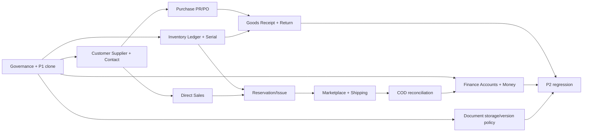

# 11 — P2 Delivery Plan, Dependencies, Gates & Rollout

> **DinkERP P2 Documentation v1.0.0** · Ngày 2026-10-28 · **Status:** DRAFT — P2 design; chưa được phê duyệt
> **Authority:** 30 P2 UR trạng thái `BASELINE` trong `00_User_Requirements_v1.0.15.md` (SHA-256 `97894e35dbf6c5f641f56574af947cafbc45122a87b9fb189ee7426503448144`).
> **Code authority:** `erp_v1.9.0.zip` = P1 CLOSED BASELINE, chưa có nghiệp vụ P2. Các bảng/API/màn hình P2 trong bộ này là **đề xuất thiết kế**, không phải code đã chạy, trừ khi ghi rõ `P1-EXISTS`.

## Quy tắc đọc độc lập

1. `BASELINE-UR`: nội dung được phê duyệt từ User Requirements, không được đổi nghĩa bằng thiết kế.
2. `P1-EXISTS`: có trong source v1.9.0, chỉ nêu những gì đã kiểm tra bằng source; không thay nghiệm thu live.
3. `P2-DRAFT`: lựa chọn thiết kế đề xuất để triển khai P2, cần duyệt trước khi migrate/implement.
4. `OPEN-DECISION`: dữ liệu nguồn chưa xác định; không tự gán thành cam kết.
5. `NOT-IMPLEMENTED`: các resource/API/bảng P2 đề xuất hiện không nằm trong P1 source.

## 1. Governance before development

**G0/Entry:** P1 v1.9.0 designated immutable source baseline; do not infer completed P2 capabilities. Review 30 P2 UR, 147 AC, and Open Decisions; approve P2 FRS, logical DB and Resource/Action matrix, API/OpenAPI and new integration trust model. Build DEV clone with DB, CI4, frontend deps and reproducible fixtures. Establish actual MySQL/MariaDB schema/collation/timezone/transaction isolation and preflight indexes.

No status will be marked DONE purely because a design document exists. Each Gate closes only with runtime evidence from isolated environment and reviewed changeset.

## 2. Suggested waves (P2-DRAFT sequencing)

| Gate | Scope / module(s) | P1/P2 dependencies | Deliverables & exit evidence |
|---|---|---|---|
| G0 | Approvals, security/Company rules, fixture and test environment | P1 source + DB clone; PBAC and project owner | Signed ADRs, FRS freeze, API draft review, baseline test results |
| G1 | Customer, Supplier, Contacts extension, Document versions, catalogs | P1 Organization/Contacts, Identity, file storage plan | Master APIs/UI, Company usage negative tests, attachment owner auth, immutable versions |
| G2 | Inventory ledger/balance/Serial and Purchase PR/PO/GR/Return | G1 Supplier + P1 Product/UOM/Workflow/Numbering | Posting atomicity, serial, cumulative receipt, partial return/reversal, stock reconcile |
| G3 | P2 pricing/promotion, Sales direct/COMBO, reservation/issue/returns | G2 inventory, G1 Customer, P1 Price List/COMBO | Price snapshots, allocated amounts conservation, reservation nonnegative, issue atomic/rollback |
| G4 | Shopee/TikTok, Shop mapping, Carrier/Shipment/COD, Finance Thu/Chi | G3 Sales/Inventory, G1 Customer, Company master, technical principal ADR | Unique external key race, provider fixtures, COD trace, posted-only finance balance |
| G5 | Approved P2 import targets, hardening, release & audit | Explicit import target acceptance, all previous gates | 147 AC results, PBAC negative matrix, E2E, backup/recovery, monitoring and deployment sign-off |

G4 Finance may be decomposed earlier as soon as Accounts and Company scoping are frozen, but **COD→Money Receipt** integration waits for both Finance and COD contracts. Shipping must precede issue in the standard Sales end-to-end process, with lifecycle rules approved for partial shipment.

## 3. Gate acceptance artifact list

Every Gate must submit:

1. Versioned migration/upgrades and preflight SQL with indexes/uniques; snapshot + restore drill and forward-fix plan.
2. Approved domain Resource/Action/Policy matrix with test actor profiles and Company A/B ancestors, including `ABSOLUTE_DENY`.
3. OpenAPI request/response contract with machine error codes, authenticated HTTP tests, generated TypeScript client diff.
4. Vue screens with i18n and backend permission hints, loading/error/draft-preservation states.
5. Unit/domain/DB integration/concurrency/E2E tests mapped to relevant `P2-AT-*` IDs and real results.
6. Observability and runbook for retry/replay/error correction; no exposure of raw external tokens or sensitive data.
7. Signed review for unresolved decisions, acceptance waivers, backward compatibility, and release notes.

## 4. Dependencies (critical path)

The diagram shows logical prerequisites, not estimates or firm delivery commitments; no time promises without sizing/team capacity.

## 5. QA & release staging

- **DEV clone:** migration smoke, create fixture Group/CompanyA/CompanyB/WarehouseA/B, P1 Price List/Combo, employees/assignments/PBAC. Seed only approved new resource/action data.
- **Integration sandbox:** provider mock/real sandbox where available, signed callback cases, retry/out-of-order; no production credential in test logs.
- **UAT:** owner-signed 30 UR / 147 AC, accepted exclusions and high-risk flows; require proof that no P1 capability regressed.
- **Production:** backup verified; additive schema; no bulk data rewrite without approved script; read-only probes; gradual enable; issue/GR/money posting can be turned off separately through operational gate, not permission bypass.
- **Recovery:** suspend ingress/worker safely; reconcile before retry. For posted business records, use forward correction or reversal rather than destructive DB rollback.

## 6. Definition of exit — P2 completion

`P2 COMPLETED` may only be declared if every MUST UR in scope has signed acceptance or explicit approved waiver/change, all 147 criterion IDs have PASS/WAIVER/FAILED evidence, no unresolved critical security/stock/finance defects, migrations and docs/API/SDK match source, and operational recovery drills pass. `SHOULD` UR status must be visible, never silently omitted.
