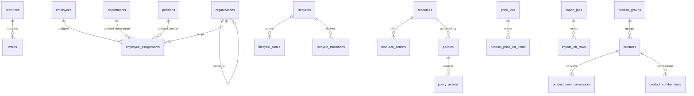

# 02 — Data Architecture & Database Design (as-built)

**Trạng thái:** [S] migration/service inspected; **chưa introspect database runtime**. Đây là mô hình schema *được code định nghĩa sau migration 000017*, không chứng nhận database thực tế đã có các cột hoặc vendor tables.

## 1. Tổng quan lưu trữ

- Backend dùng CodeIgniter Query Builder và driver **MySQLi**, charset `utf8mb4` theo [`Database.php`](../../backend/app/Config/Database.php). Có dùng các khả năng DDL của MySQL/MariaDB (generated column/index); không mặc định chạy được nguyên trạng trên PostgreSQL/SQLite.
- **17** ứng dụng migrations tạo hoặc sửa **31** bảng, **355** cột, **46** foreign keys do application migration khai báo. Danh mục cột, type, nullable, FK, unique và migration source nằm trong [DATABASE_SCHEMA.md](reference/DATABASE_SCHEMA.md).
- Shield quản lý danh tính/session/permission thông qua các bảng **vendor** (`users`, `auth_identities`, `auth_permissions_users`, `auth_groups_users` và các bảng phụ tùy phiên bản vendor). CodeIgniter Settings lưu setting vào bảng vendor `settings`. **Không cộng các bảng này vào con số 31**.
- `products.image_filename` chỉ chứa metadata liên kết; nội dung ảnh nằm trên **filesystem** dưới `WRITEPATH/uploads/product-images`. Không coi database backup đơn lẻ là backup đầy đủ.

## 2. Bản đồ 31 bảng theo bounded context

| Phân hệ | Bảng ứng dụng | Quan hệ nghiệp vụ chính |
|---|---|---|
| Địa giới & tổ chức | `provinces`, `wards`, `organizations`, `contacts` | Ward → Province; Organization → parent + geographical link; Contact → owner polymorphic theo `contact_type/contact_ref_id` |
| Nhân sự | `departments`, `positions`, `employees`, `employee_assignments` | Employee → Shield user (logic); Assignment → employee + organization + department/position |
| State machine | `lifecycles`, `workflow_states`, `lifecycle_states`, `lifecycle_transitions` | Lifecycle ↔ các states được phép; transitions điều khiển from/to + action |
| PBAC & numbering | `resources`, `resource_actions`, `groups`, `group_permissions`, `policies`, `policy_actions`, `authorization_logs`, `auto_numbering_series`, `auto_numbering_counters` | Resource → actions, policies/state; Policy → actions; Group → permissions; Series → resource và scope counter |
| Hàng hóa | `product_groups`, `product_uoms`, `products`, `product_uom_conversions`, `product_combo_items` | Product → group, base UOM, optional parent; conversion + combo → product |
| Giá | `price_lists`, `product_price_list_items` | PriceList → organizational scope; item → product/UOM/price |
| Import | `import_jobs`, `import_job_rows` | Job → row status/error, source upload và kết quả |
| Audit config | `configuration_audit_events` | Theo dõi cập nhật server display settings |

> Không phải mọi tham chiếu đều có FK vật lý: `contacts.contact_ref_id` phụ thuộc owner type, Shield user nằm trong vendor schema và một số quan hệ PBAC được enforce ở services/migration/seed. Vì thế **ERD FK-only không thể thay thế invariant nghiệp vụ**.

## 3. ERD khái quát nghiệp vụ

Đây là **sơ đồ logic rút gọn**; các đường nối không khẳng định đều là FK hay có cùng tính bắt buộc. Danh sách constraints thật xem [catalogue](reference/DATABASE_SCHEMA.md). Các quan hệ owner `contacts`, Shield, settings được nêu riêng vì FK không đại diện đủ.

## 4. Quyết định dữ liệu quan trọng đã hiện diện trong code

**ID và decimal:** hệ thống sử dụng BIGINT cho nhiều PK/FK. Transport JSON chuẩn hóa identifier dạng **string** để tránh mất độ chính xác trên JS; decimal cũng có adapter riêng. Không ép ID sang JavaScript `number` hoặc xử lý tiền bằng floating-point nếu không có quy tắc định lượng. Nguồn: [`ApiTransport.php`](../../backend/app/Infrastructure/Api/ApiTransport.php), [`PositiveId.php`](../../backend/app/Infrastructure/Id/PositiveId.php), [`Decimal.php`](../../backend/app/Infrastructure/Decimal/Decimal.php).

**Cây tổ chức / cây group:** `organizations.parent_id` và `product_groups.parent_id` phải được kiểm tra vòng lặp và phạm vi bằng service, không dựa vào UI. Product child hierarchy nằm ở `products.parent_product_id`; role `SIMPLE/PARENT/CHILD/COMBO` **là dữ liệu dẫn xuất** theo [`ProductRoleService.php`](../../backend/app/Modules/Product/Product/ProductRoleService.php), không phải cột `role` trong schema.

**Security:** `resources.domain` được ràng buộc theo miền `SYSTEM/MASTER/ORGANIZATION`; `resources.status` và `policies.status` độc lập từ **000014**. `policies.normalized_state_id` (000012) là generated column giúp uniqueness cho scope khi state NULL; kiểm tra DB engine/version hỗ trợ DDL này trước migrate. Từ **000015** hai kiểu Contact chia resource `organization_contact` và `employee_contact`; **không tạo hai bảng Contact**, các policy hạn chế cũ được chuyển có chọn lọc và legacy resource bị vô hiệu hóa. Nguồn: [`000012`](../../backend/app/Database/Migrations/2026-10-08-000012_EnforcePolicyScopeUniqueness.php), [`000014`](../../backend/app/Database/Migrations/2026-10-11-000014_AddIndependentPolicyResourceStatuses.php), [`000015`](../../backend/app/Database/Migrations/2026-10-11-000015_SplitContactAuthorizationResources.php).

**Trạng thái nghiệp vụ:** migration **000016** nới `status` lên `VARCHAR(50)` ở 11 bảng business; không đồng nghĩa tất cả đều có lifecycle. Catalog trạng thái native và mapping state ID xem [`ResourceNativeStateCatalog.php`](../../backend/app/Services/ResourceNativeStateCatalog.php), [`ResourceWorkflowStateResolver.php`](../../backend/app/Services/ResourceWorkflowStateResolver.php).

**Ảnh:** migration **000017** thêm 3 trường nullable `image_filename`, `image_mime`, `image_size_bytes` trong `products`. DB row không chứa binary; bổ sung quy trình sao lưu file, kiểm soát path và đối soát bản ghi orphan. Nguồn: [`000017`](../../backend/app/Database/Migrations/2026-10-12-000017_AddProductRepresentativeImage.php), [`ProductImageStorage.php`](../../backend/app/Services/ProductImageStorage.php).

## 5. Ledger các migration hậu P1 có tác động đối soát

| ID | Thay đổi xác thực theo migration | Rủi ro vận hành cần kiểm |
|---|---|---|
| 000009 | Thêm cây product group | Cây có cycle / parent không hợp lệ |
| 000010 | Normalize domain của Resource | Mapping quyền khi dữ liệu cũ sai domain |
| 000011 | Tạo configuration audit table | Bảng lịch sử và retention |
| 000012 | Unique policy scope kể cả NULL state | Dữ liệu policy trùng có thể chặn migrate |
| 000013 | Seed/update `user.reset_password` | Tính nhất quán action & permission |
| 000014 | `status` riêng cho policy/resource | Resource vô hiệu phải chặn cả base permission |
| 000015 | Chia PBAC Contact theo owner type | Không nhân bản grant ALLOW cũ; rollback bị chặn khi có dữ liệu |
| 000016 | Nới status code business | DB schema phải khớp định nghĩa lifecycle mới |
| 000017 | Ảnh đại diện sản phẩm | Filesystem được sao lưu cùng DB |

## 6. Quy tắc thay đổi schema

Migration phải tiến theo mã tăng dần, đảm bảo idempotency phù hợp và xác định tác động tới dữ liệu hiện hữu, rollback thực tế, downtime, seeder, service, OpenAPI/generated TS, UI, test. Với 000015, `down()` cố ý **từ chối rollback** trong trường hợp có grant/policy/audit để tránh mở lại quyền Contact quá rộng; không chạy `migrate:rollback` tùy tiện. Khi có thay đổi migration mới, phải cập nhật scanner schema ở [`tools/docs/rebuild_asbuilt_catalogs.py`](../../tools/docs/rebuild_asbuilt_catalogs.py) và kiểm chứng bằng introspection sau migrate thực.

## 7. Chỗ chưa thể xác minh

Chưa so sánh `information_schema` và `migrations` table tại môi trường cài đặt; chưa xác nhận DB engine/version/index semantics, seed order và các bảng vendor cụ thể khi cài dependency; chưa đánh giá dữ liệu được migrate có trùng/vi phạm constraint không. Kết quả cột/FK là source estimate, **không** phải kết quả `SHOW CREATE TABLE`. Xem [09](09_VERIFICATION_MATRIX.md).
