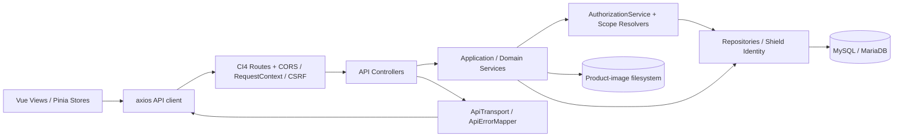

# 03 — Implementation Architecture (as-built)

**Mốc:** local code baseline `d935186...`. **Mức xác minh:** [S]. Mục đích: mô tả boundary có trong code, không áp dụng kiến trúc dự kiến của P1 nếu đã đổi.

## 1. Stack, topology và deployable units

| Khối | Source | Công nghệ khai báo | Vai trò |
|---|---|---|---|
| Browser SPA | `frontend/` | Vue 3, TypeScript, Vite 8, Vue Router 5, Pinia 4, axios | Điều hướng, form, validation/formatting, API client |
| API | `backend/` | PHP ≥8.2, CodeIgniter 4.7, Shield 1.4 | Auth/session, PBAC, nghiệp vụ, persistence |
| Data store | MySQL/MariaDB | MySQLi + migrations ứng dụng/vendor | Master data, IAM, price, import, config audit |
| File store | `WRITEPATH/uploads/product-images` | Local filesystem | Ảnh sản phẩm không public trực tiếp |
| Contract/tooling | `contracts/openapi`, `frontend/src/api/generated` | OpenAPI + @hey-api/openapi-ts | Contract và generated client; không phải code business |

Repository **không tự chứng minh** topology production, CDN, reverse proxy, backup scheduler, cache phân tán hoặc background queue. Các thành phần này cần deployment evidence bên ngoài.

## 2. Luồng xử lý HTTP và dữ liệu

Điểm vào routes: [`Routes.php`](../../backend/app/Config/Routes.php) và filters [`Filters.php`](../../backend/app/Config/Filters.php). API controller ở `backend/app/Controllers/Api/`, service ở `backend/app/Services/` và domain modules `backend/app/Modules/`, repository ở `backend/app/Repositories/`. Không ghi “mọi controller đều thin” khi chưa đo độ phức tạp từng controller.

## 3. Backend module boundaries

- **Foundation/organization/HR:** [`Api010FoundationOrganizationContactService.php`](../../backend/app/Services/Api010FoundationOrganizationContactService.php), [`OrganizationService.php`](../../backend/app/Services/OrganizationService.php), [`Api020EmployeeStructureService.php`](../../backend/app/Services/Api020EmployeeStructureService.php). Shared validation, owner-resolution và scope.
- **IAM/workflow:** [`AuthorizationService.php`](../../backend/app/Authorization/AuthorizationService.php), [`Api030AuthorizationWorkflowService.php`](../../backend/app/Services/Api030AuthorizationWorkflowService.php), [`LifecycleService.php`](../../backend/app/Services/LifecycleService.php), [`BusinessWorkflowActions.php`](../../backend/app/Services/BusinessWorkflowActions.php).
- **Product:** `backend/app/Modules/Product/{Product,ProductGroup,Uom,Combo,Import,Lookup,Integration}`, gồm role derivation, hierarchy, product lookup, upload image.
- **Pricing:** `backend/app/Modules/Pricing/{PriceList,Resolution,ComboAllocation}`, tách quản trị price list và resolver giá.
- **Infrastructure:** `backend/app/Infrastructure/{Api,Id,Decimal,Import,Lock,Mutation,Settings,Time}` bao gồm transport, conversion, query abstraction, concurrency và settings.

**Ranh giới truy cập:** mutation không được ủy quyền bằng frontend flags; backend service/authorization quyết định. Một số SQL authorized list bucket được tính bằng query để phân trang sau lọc quyền — cần bảo toàn invariant này khi tối ưu query, tránh áp limit trước authorize. Nguồn: [`SqlAuthorizedBucketListSource.php`](../../backend/app/Infrastructure/Api/SqlAuthorizedBucketListSource.php), [`EffectiveListBucketCompiler.php`](../../backend/app/Authorization/EffectiveListBucketCompiler.php).

## 4. Frontend boundaries

- **Entry:** [`main.ts`](../../frontend/src/main.ts) thiết lập app + plugin; [`router/index.ts`](../../frontend/src/router/index.ts) route guard; [`AppShell.vue`](../../frontend/src/components/AppShell.vue) điều hướng và workspace.
- **Views:** 28 màn hình được nhóm theo nghiệp vụ trong `frontend/src/features/*/pages/` và fallback `frontend/src/app/pages/`; client calls thường tập trung trong `frontend/src/services/` và các composables/components, không nên gọi API rải rác trong template mới.
- **State:** [`auth.ts`](../../frontend/src/stores/auth.ts), [`workspace.ts`](../../frontend/src/stores/workspace.ts), [`displaySettings.ts`](../../frontend/src/stores/displaySettings.ts).
- **Contract:** generated API types/SDK tại `frontend/src/api/generated/`; khi sửa OpenAPI hãy chạy generation check, không hand-edit generated output.
- **Presentation:** i18n `vi/en`, format tiền/số/ngày theo [`frontend/src/presentation`](../../frontend/src/presentation), cơ chế permission-aware UI theo `base_permissions` chỉ để ẩn/hiện action.

## 5. Session, CSRF, CORS, API transport

Trong [`frontend/src/services/api.ts`](../../frontend/src/services/api.ts), axios bật `withCredentials` và gửi `Accept-Language`, `X-Request-ID`; tất cả mutation methods (bao gồm một số POST chỉ đọc) đi qua lượt đợi CSRF token. Client bootstrap qua `/auth/csrf`, xử lý rotate token theo response và chống response cũ phá phiên mới bằng `sessionGeneration` + `csrfEpoch`. Phản hồi 401 xử lý phiên hết hạn; 403 đánh dấu `base_permissions` stale và refresh snapshot mà **không tự retry mutation bị từ chối**.

Ở backend, [`Filters.php`](../../backend/app/Config/Filters.php) đặt `cors`, `requestcontext` globals và bật CSRF/secure headers theo HTTPS/production runtime gating, không phải mọi môi trường luôn bật giống nhau. Envelope JSON thống nhất từ [`ApiTransport.php`](../../backend/app/Infrastructure/Api/ApiTransport.php); các error được map ở [`ApiErrorMapper.php`](../../backend/app/Infrastructure/Api/ApiErrorMapper.php).

## 6. Các đặc tính cần giữ khi refactor

1. Bảo toàn **PBAC scope, state, employee assignment** ở cả detail và list, nhất là hàng mà actor không được thấy.
2. Giữ ID BIGINT và giá tiền dưới biểu diễn safe; không ngầm làm tròn trong UI.
3. Không viết frontend button visibility thành lời đảm bảo an toàn server.
4. Khi thêm lifecycle, state thật phải đọc từ target persisted record; không tin `state_id` do client tự gửi để chọn policy.
5. Preserve transaction, idempotency, lock cho numbering/import/replace collection; không đổi POST import đồng bộ thành async nếu chưa có protocol mới.
6. `ProductImageStorage` ở private writable path; endpoint binary phải kiểm tra quyền trước stream.

## 7. Ranh giới chưa đo được

Chưa chạy profiling load, không có architectural integration test với deployed proxy/DB, chưa đo p95 hoặc resilience. Các con số throughput, SLA và mức độc lập giữa service **không** suy ra từ tên thư mục.
