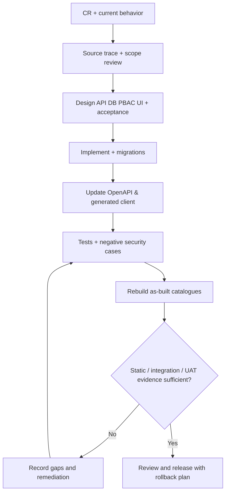

# 04 — Evolution Rules & Change Control từ baseline code

**Mục đích:** thay cách dùng P1 Implementation Plan cũ như “danh sách việc đang thiếu” bằng cơ chế quản trị nâng cấp liên tục. **Không phải kế hoạch xây lại toàn bộ ERP từ đầu.**

## 1. Chuẩn nguồn cho yêu cầu cải tiến mới

- **As-built (ASB):** source hiện có và bộ `docs/as-built/` này mô tả trạng thái thực hiện; mọi nhận định đều gắn source/evidence.
- **To-be (CR):** yêu cầu do chủ sản phẩm cung cấp; ghi riêng khỏi ASB. Không đổi ASB trước khi code triển khai.
- **P1:** `docs/architecture/` và các Change Control cũ dùng làm **historical intent**; chỉ tái dùng một quy tắc P1 nếu còn đúng với source hoặc được phê chuẩn lại.
- **Runtime:** production DB/config/deployed artifact là bằng chứng bổ sung, có thể chưa cùng phiên bản với source ZIP. Nếu source/runtime khác nhau, mở một drift issue chứ không viết “runtime đang chạy theo source” khi chưa kiểm tra.

## 2. Mẫu change record cho lần cải tiến kế tiếp

| Trường | Bắt buộc | Ý nghĩa |
|---|---|---|
| `CR-ID` / title / owner / ngày | Có | Tách scope và người chấp thuận |
| `Baseline commit` | Có | Tránh sửa nhầm snapshot |
| `Current behavior [S/T/R]` | Có | API/controller/service/UI/DB + evidence cụ thể |
| `Problem statement` | Có | Lỗi thực tế, usability, hiệu năng hay requirement mới? |
| `Expected behavior` | Có | Acceptance scenarios gồm invalid/unauthorized |
| `Proposed design / alternatives` | Có | Phân tích trade-off và backward compatibility |
| `Impact` | Có | Schema, seed, permission, API, generated SDK, UI, migration, data, tests, docs |
| `Release & rollback` | Nếu có mutation/schema | Cách nâng cấp/khôi phục và điều kiện chặn |
| `Verification evidence` | Có | Trạng thái automated/live/UAT; không ghi PASS khi chưa chạy |

## 3. Gate triển khai



**Tối thiểu khi thay đổi một API:** cập nhật route + controller + service + OpenAPI + generated SDK + client adapter + test contract. Khi thay đổi permission: thêm resource/actions/seed/migration tương ứng, đo tác động grant cũ, viết negative test không được lộ dữ liệu. Khi thêm DB cột: forward migration + converter + serializer + API + UI + backup/rollback + schema catalogue. Khi đổi workflow: kiểm tra state native/opt-in lifecycle và trạng thái các persisted targets.

## 4. Đồng bộ docs sau mỗi thay đổi

Chạy từ root:

```sh
python tools/docs/rebuild_asbuilt_catalogs.py
```

Kết quả máy đọc: [`reference/inventory.json`](reference/inventory.json); các Markdown generated: [API](reference/API_ENDPOINTS.md), [DB](reference/DATABASE_SCHEMA.md), [UI](reference/FRONTEND_ROUTES.md), [Tests](reference/TEST_FILES.md).

**Lưu ý quan trọng về công cụ:** scanner được kiểm tra với cấu trúc route vòng lặp và migration 000001–000017 của snapshot này; nó không phải PHP AST parser/migration engine. Khi thêm `Routes.php` foreach, đổi code format hoặc thêm migration sau 000017, **phải nâng scanner và cross-check**, không tin một catalogue trông có vẻ hợp lệ. So sánh count/diff không thay thế integration test.

## 5. Chính sách phiên bản tài liệu

- Tên thư mục `docs/as-built/` là baseline mới, *không* đổi tên P1 hoặc phá link lịch sử.
- Mỗi bản chốt lưu commit SHA, nguồn ZIP/remote, ngày, schema migration cuối, route + UI + test inventories.
- File narrative (00–11) được review khi code thay đổi; generated files chỉ commit cùng hash nguồn scanner đã quét.
- Trong bất đồng: code mô tả hành vi hiện tại, CR nêu hành vi mong muốn; nếu code vi phạm requirement, ghi thành **bug/CR** chứ âm thầm sửa tài liệu để hợp thức hóa bug.

## 6. Bộ gate tối thiểu đề xuất trước khi tuyên bố VERIFIED

1. Chạy backend PHP syntax/composer tooling và PHPUnit theo cấu hình dự án.
2. Chạy frontend type-check, lint, Vitest, build, Playwright với API/DB test đủ seed.
3. Kiểm tra OpenAPI schema/payload thực so với code, không chỉ method/path; regen generated client và kiểm diff.
4. Migrate một DB clone (backup an toàn), kiểm policy/grant cũ và các indexes; chạy smoke + RBAC/PBAC negative cases.
5. Kiểm tra upload/download/delete image, import các mode, vòng đời bản ghi và i18n.
6. Sign-off nghiệp vụ riêng nếu thay đổi quy trình hoặc semantics; ký duyệt docs không thay cho production deployment evidence.

Xem bảng kiểm cụ thể ở [09](09_VERIFICATION_MATRIX.md) và drift register [10](10_P1_DRIFT_REGISTER.md).

## 7. Khởi động Frontend V2 từ snapshot đã kiểm chứng

Frontend V2 chỉ được triển khai dựa trên checkpoint `FE-V2-START-2026-10-14`, không lấy P1 hoặc một nhánh GitHub chưa kiểm tra làm mốc thay thế. `pnpm run check:v2-baseline` phải PASS khi nhận source; từ thay đổi V2 đầu tiên, dùng `pnpm run diff:v2-baseline` làm nguồn chứng cứ file đổi/thêm/xóa, **không** cập nhật manifest để giữ kết quả xanh. Lưu test và review riêng cho từng feature.

Hợp đồng bảo toàn hành vi cũ (`check:refactor-baseline`) và kiểm thử trên Windows vẫn có giá trị độc lập với checkpoint hash; thất bại do một refactor có chủ đích phải được giải trình và có kiểm thử tương đương trước khi merge. External backend/OpenAPI chưa được đối chiếu nên không đưa vào baseline frontend. Xem [15](15_FRONTEND_V2_START_BASELINE.md).
