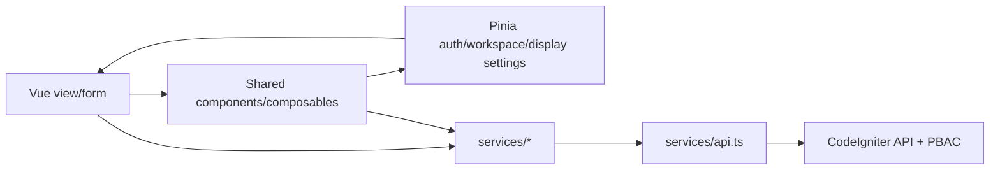

# 06 — Frontend / UI Architecture and Screen Catalogue (as-built)

**Mức chứng cứ:** [S] Vue files inspected, **chưa chạy browser/UAT**. Cấu trúc page được cập nhật theo refactor frontend v1, xem [12_FRONTEND_REFACTOR_V1.md](12_FRONTEND_REFACTOR_V1.md). Vue router có **29 named routes**, bao gồm login, dashboard, profile/setting, editor/detail và not-found; xem bảng generated [FRONTEND_ROUTES.md](reference/FRONTEND_ROUTES.md) để lấy mapping URL ↔ view chính xác.

## 1. Điều hướng và bố cục

- Root router [`index.ts`](../../frontend/src/router/index.ts) dùng `createWebHistory`; khai báo [`routes.ts`](../../frontend/src/router/routes.ts) giữ route names, path, metadata và lazy loading; `/login` là route public. Các route còn lại nằm dưới [`AppShell.vue`](../../frontend/src/components/AppShell.vue).
- `beforeEach` chờ `auth.hydrate()`, gửi user chưa đăng nhập về `/login`, user đã đăng nhập không ở `/login`, chặn điều hướng khi workspace hiện tại có dirty form qua confirm và mark clean.
- Shell tổ chức menu theo groups, breadcrumbs, tab/workspace, recently-used và favorites. Route detail/new có metadata riêng, không nhất thiết là menu item trực tiếp.
- `AppShell` chỉ hiện menu khi `hasBasePermissionKey(nav.permission)` cho những mục định nghĩa permission. **Route authenticated không đồng nghĩa backend PBAC cho phép đọc mọi record.**

## 2. Inventory màn hình theo khu vực

| Khu vực | Màn hình chính (Vue files) | Hành vi đáng chú ý |
|---|---|---|
| Account & dashboard | `LoginView`, `DashboardView`, `ProfileView`, `DisplayPreferencesView` | Session, thông tin cá nhân, sở thích trình bày |
| System | `DisplaySettingsView`, `ConnectivityView` | Quản lý system/org setting; `ConnectivityView` là component tồn tại, không thấy named route cùng tên trong inventory |
| IAM | `SecurityUsersView`, `SecurityAuthorizationGroupsView`, `SecurityResourcesView`, `SecurityPoliciesView`, `SecurityAuthorizationLogsView` | Create/edit, rights, policy management và log read |
| Workflow/numbering | `WorkflowStatesView`, `LifecyclesView`, `AutoNumberingView` | State catalog, lifecycle config, numbering series |
| Product | `ProductsView`, `ProductEditorView`, `ProductGroupsView`, `ProductUomsView`, `PriceListsView` | Tree/CRUD, editor UOM/combo/image, pricing |
| Import | `ProductImportView`, `ProductImportJobsView`, `ProductImportJobDetailView` | Upload, danh sách và row-status detail |
| Foundation | `OrganizationsView`, `LocationsView` | Org tree, location forms; location view dùng lại cho 2 routes |
| HR | `PeopleDepartmentsView`, `PeoplePositionsView`, `PeopleEmployeesView` | Department, position, employee |
| Fallback | `NotFoundView` | Lỗi route không nhận dạng |

Nguồn: [`frontend/src/features`](../../frontend/src/features), [`frontend/src/router/routes.ts`](../../frontend/src/router/routes.ts), [`frontend/src/app/pages/NotFoundView.vue`](../../frontend/src/app/pages/NotFoundView.vue). Không diễn giải file không được route thành “đã có module hoàn chỉnh”.

## 3. State, client service và contract

- **Auth:** [`stores/auth.ts`](../../frontend/src/stores/auth.ts) duy trì user, `base_permissions`, session generation, login state và expiry.
- **Workspace:** [`stores/workspace.ts`](../../frontend/src/stores/workspace.ts) quản lý tab, dirty state, pinned/recent/favorites tùy code; một số tùy chọn shell được lưu trong local browser storage.
- **Display:** [`stores/displaySettings.ts`](../../frontend/src/stores/displaySettings.ts) kết hợp runtime server settings và preference mỗi user trên trình duyệt; hệ thống tiền/số phải format theo presentation, không làm tròn dữ liệu gốc khi submit.
- **Service boundary:** các file như [`services/productCatalog.ts`](../../frontend/src/services/productCatalog.ts), [`services/productImage.ts`](../../frontend/src/services/productImage.ts), [`services/businessWorkflow.ts`](../../frontend/src/services/businessWorkflow.ts), [`services/productImport.ts`](../../frontend/src/services/productImport.ts), [`services/security.ts`](../../frontend/src/services/security.ts) điều phối API; shared axios [`services/api.ts`](../../frontend/src/services/api.ts) chịu trách nhiệm credentials/locale/CSRF/error.
- **Generated contract:** `frontend/src/api/generated/`; không viết business logic vào generated files. i18n [`frontend/src/i18n`](../../frontend/src/i18n) hỗ trợ VI/EN.

## 4. UI permission và security invariants

**Hai tầng độc lập:** `base_permissions` UI quyết định menu/action **gợi ý**, còn server kiểm tra profile + employee + organization scope + policy + persisted state trên từng request. Đừng cho `to.meta.public` hoặc menu visible quyết định authorization, và đừng coi HTTP 404 trên một record như lỗi permission snapshot.

Các hành vi quan trọng: edit form có dirty confirm; UI async thay đổi phiên phải bỏ phản hồi cũ; client xử lý 401/403 mà không retry mutation nguy hiểm; image dùng endpoint credentialed binary thay vì đường dẫn web public. Bộ test FE [TEST_FILES.md](reference/TEST_FILES.md) có coverage theo file; chưa xác minh tình huống E2E trong browser.

## 5. UX acceptance khi phát triển thêm

- **List:** searching/sort/filter trong allowlist, phân trang theo authorized total, states server metadata, empty/error/forbidden/loading; không append filtering unauthorized ở client sau pagination.
- **Detail/editor:** hiển thị role combo/child theo server-derived value, validate state, confirm các replace-list mutation; cảnh báo mất thay đổi khi rời trang.
- **Security:** action ẩn theo base permission; khi backend 403 render thông điệp không rò rỉ chi tiết record; manual negative test impersonation/scope.
- **Accessibility/i18n:** keyboard/tab, error focus, label, timezone/locale, long Vietnamese/English labels; đây là **gate đề xuất**, chưa xác thực WCAG.
- **Device/browser:** test responsive, build assets, browser history fallback ở reverse proxy; chưa có evidence deployed static hosting.

## 6. UI evidence chưa có

Không có screenshot do browser chạy thực, đo fidelity so P1, accessibility scan live, Lighthouse hoặc UAT bản này. Cần các bằng chứng đó để chuyển trạng thái từ `CODE-INSPECTED` sang `UI-RUNTIME-VERIFIED`.
