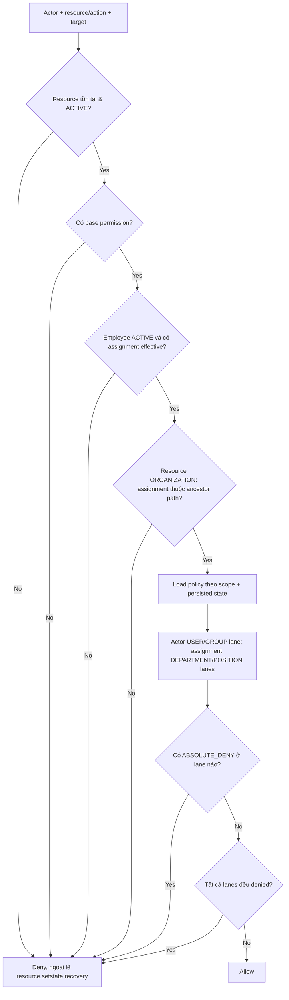

# 07 — Identity, Authorization (PBAC), Lifecycle & Audit

**Phạm vi:** implementation security + workflow tại source hiện tại; **không phải báo cáo penetration testing**. Đọc cùng [`AuthorizationService.php`](../../backend/app/Authorization/AuthorizationService.php), [`ResourceWorkflowStateResolver.php`](../../backend/app/Services/ResourceWorkflowStateResolver.php), [`LifecycleService.php`](../../backend/app/Services/LifecycleService.php).

## 1. Identity và base permission

Shield quản lý user, password/session và các identity/auth tables. `auth/me` trả `base_permissions` để FE render control. Quyền cơ sở là điều kiện **cần nhưng không đủ** cho một thao tác business. `BasePermission` tương ứng `resource.action`; nhóm nội bộ authorization group và user direct grants có thể tạo profile nhưng còn phải qua PBAC.

Migration 000013 thêm khả năng `user.reset_password` trong action registry; cập nhật user status cần tính cả Shield `active` và `status` khi ánh xạ trạng thái PBAC. Nguồn: [`Auth.php`](../../backend/app/Controllers/Api/Auth.php), [`EffectiveProfileResolver.php`](../../backend/app/Authorization/EffectiveProfileResolver.php), [`ResourceNativeStateCatalog.php`](../../backend/app/Services/ResourceNativeStateCatalog.php).

## 2. Quy trình quyết định PBAC hiện tại

**Quan trọng: DENY không luôn thắng ALLOW ở lane khác.** Trong `evaluateLane`, thứ tự nội bộ lane là `ABSOLUTE_DENY` → `ALLOW` → `DENY` → không match. Kết quả toàn cục deny khi **có ABSOLUTE_DENY ở bất cứ lane nào**, hoặc **mọi lane đều denied**. Nếu một lane không bị deny (kể cả không match), kết quả toàn cục có thể ALLOW theo implementation hiện tại. Đây là **behavior đã đọc từ code**, không tự động là security policy mong muốn; cần bổ sung explicit tests đặc biệt tình huống no matching ALLOW và policy rỗng. Nguồn: [`AuthorizationService.php`](../../backend/app/Authorization/AuthorizationService.php).

**Scope:** resource domain `ORGANIZATION` chỉ chấp nhận assignments ở cây ancestor của evaluated organization; assignment ở cấp con không grant lên ancestor/sibling. `SYSTEM/MASTER` có shared access theo group sau khi có assignment effective. State authorization của persisted record lấy từ server-side target, không từ `state_id` tùy ý do frontend gửi. `withReadOnlyBatch` chỉ dùng batch read/list, không dùng qua mutation để tránh cache IAM stale.

## 3. Participant, organization và Contact split

| Thành phần | Ý nghĩa |
|---|---|
| USER/GROUP | Actor lane: trực tiếp user + Shield/authorization group được resolve |
| ORGANIZATION | Common scoped policies áp trong context chain |
| DEPARTMENT/POSITION | Từng assignment lane theo effective assignment |
| OWNER contact | `ORGANIZATION` → `organization_contact`, `EMPLOYEE` → `employee_contact` |
| Legacy `contact` | Bị chặn rõ trong `AuthorizationService`; resource cũ inactive từ migration 000015 |

Migration **000015** không copy quyền `ALLOW` cũ sang hai resource mới; policy restrictive được chuyển theo quy tắc bảo toàn hạn chế. Đây là thay đổi migration security-sensitive, phải review dữ liệu grant/policy hiện hữu trước khi áp vào production. Source [`SplitContactAuthorizationResources.php`](../../backend/app/Database/Migrations/2026-10-11-000015_SplitContactAuthorizationResources.php), [`ContactAuthorizationRegistry.php`](../../backend/app/Authorization/ContactAuthorizationRegistry.php).

## 4. State/lifecycle semantics

- **Native-independent:** `authorization_group`, `authorization_log`, `display_setting`, `employee_assignment`, `import_job`, `lifecycle`, `policy`, `user`, `workflow_state`, `resource` **không được gắn lifecycle**; không có nghĩa mọi kiểu đều có field `status` (log/display_setting có thể stateless).
- **Business opt-in lifecycle:** province, ward, organization, owner Contact, department, position, employee, product group/UOM/product, price list... có native states khi chưa gắn lifecycle; khi gắn lifecycle phải dùng trạng thái do lifecycle cho phép.
- `workflow_states.status` là enable flag cho catalog state; `business_record.status` là business state code; policy state ID phải resolve tương ứng, không nhầm hai khái niệm này.
- `GET /business-workflow/{resource}/states` cho cấu hình hiển thị và create preview (base permission gate); `GET /{id}/options` kiểm tra VIEW target và xét action `setstate` + transition; `POST /{id}/actions/{action}` yêu cầu **lifecycle**, persisted target, `setstate` và action policy; native-only update dùng endpoint `.../actions/set-state` của resource.
- Action execute không chấp nhận table động ngoài allowlist [`BusinessWorkflowActions.php`](../../backend/app/Services/BusinessWorkflowActions.php); transition phải thuộc initial/from/current/to và state active.

## 5. Independent policy/resource status

Từ migration **000014**, policy và resource có `status ACTIVE/INACTIVE` riêng, không dùng `workflow_states` để khống chế trực tiếp. Resource inactive chặn thao tác bình thường dù user có base permission, ngoại lệ recovery `resource.setstate` cũng phải qua PBAC/eligibility. Policy inactive không được áp như policy active (xác thực chính xác repository filter trước production). Nguồn [`000014`](../../backend/app/Database/Migrations/2026-10-11-000014_AddIndependentPolicyResourceStatuses.php), [`PolicyRepository.php`](../../backend/app/Repositories/PolicyRepository.php).

## 6. Audit, logging, test bắt buộc

`authorization_logs` ghi quyết định với context/reason/matched policies; `configuration_audit_events` ghi thay đổi display config; không suy ra audit bao phủ mọi thao tác hệ thống. Dữ liệu log có thể nhạy cảm; cần áp dụng retention, privacy, tamper control theo quy định vận hành chưa có trong snapshot.

**Security regression cần chạy:** mất assignment; employee inactive; deny at ancestor; policy state mismatch; inactive resource; policy precedence across lanes; contact legacy grant cố tình rộng; list counts/cross-org detail; import privilege; product image unauthorized/binary leak; user identity deactivation and delayed client requests. Trạng thái những tests này xem [09](09_VERIFICATION_MATRIX.md); hiện không được gắn “pass” từ việc tồn tại source.
