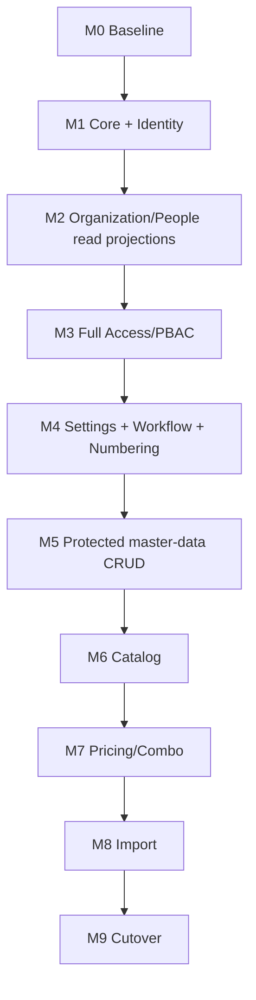

# Thứ tự phát triển đã sửa — Backend v2

**Quyết định:** Tách *build read model* và *mở API CRUD*. Phân quyền PBAC phải có dữ liệu Organization/People để tính chính xác, nhưng không được triển khai CRUD nghiệp vụ trước khi PBAC hoàn thiện và kiểm thử.

| Milestone | Cần xây dựng | Phụ thuộc trực tiếp | Kiểm tra đầu ra |
|---|---|---|---|
| M0 | Hash Frontend, OpenAPI, route mapping; database snapshot; golden HTTP fixtures (test DB) | v1.2.4 | Có nguồn baseline bất biến, đối chiếu quyền nhiều actor |
| M1 | CI4 v2, auth Shield, CSRF, CORS, JSON transport, Identity | M0 OpenAPI/API auth | Session/me/profile/remember/locale/CSRF tests pass |
| M2 | Locations schema access, Organization tree read model, People/Employee Assignment projection và thời gian hiệu lực; **chưa mở mutation routes** | M1, database clone | Cây tổ chức/assignment/validity test, không cấp quyền qua read model |
| M3 | Access: Resource/Action, base permission, PBAC evaluation, ancestor/scope, policy branches, auth logs, batch visibility | M2 | No-scope, deny, absolute deny, totals/lookup parity, decision matrix pass |
| M4 | Settings (business timezone), Workflow (state/transition) rồi Numbering (series/counters/locking) | M3, M2 | Transaction, concurrency, event-time, timezone/reset correct |
| M5 | Protected CRUD: Locations, Organization, People, Contacts | M3, M4 | Actual FE CRUD flows + record-level permissions pass |
| M6 | Catalog groups, UOM, Products, media static alias, bounded lookups | M5, M3, M4 | Product editor, image URL, selector parity |
| M7 | Combo/BOM, UOM conversions, Pricing and allocations | M6 | Decimal parity, cycles, effective price by scope |
| M8 | Product Import CSV/XLSX, per-row status/jobs/errors | M6, M7 | Mode semantics, row atomicity, concurrency |
| M9 | Golden master 150/150, Playwright E2E, database rehearsal, performance baseline, backup/rollback, cutover | All | Frontend hash unchanged; full API/PBAC/data/UX parity |

## Dependency graph

**Bất biến:** M2/M3 có thể đồng thời phát triển trong branch/module nhưng tuyệt đối không merge/mở public mutation endpoints trước khi đủ scope engine và regression test. M1 `BasePermissionReader` chỉ dùng làm ảnh chụp quyền của `/auth/me`, **không được dùng làm bộ quyết định quyền cuối** cho Organization/Product CRUD.

**Mỗi milestone:** thêm golden test đầu vào/đầu ra thực tế, permission fixtures, concurrency where applicable, FE E2E phần liên quan; không dồn test đến M9.

## Tiến độ sau M2 (2026-10-23)

- M0 baseline: source fingerprints and API snapshot available; production DB golden HTTP fixtures still pending.
- M1 runtime: user-confirmed authentication, profile, session and CSRF checks PASS.
- M2: read-only modules implemented and offline tests PASS; SQL smoke on user DB still pending.
- M3: not started; **no PBAC decisions, CRUD or list endpoints** have been opened in M2.
