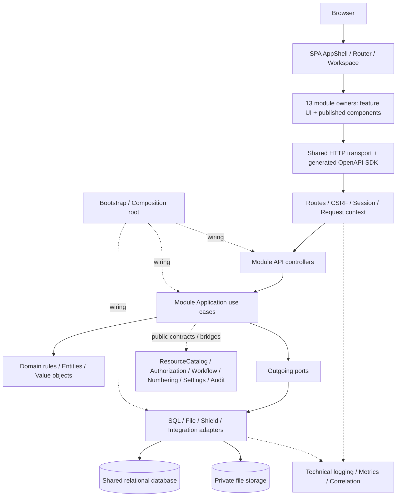

# DinkERP — Kiến trúc đích P1 sau tái cấu trúc

**Phiên bản tài liệu:** 1.0 — Đề xuất kiến trúc để phê duyệt  
**Ngày:** 19/10/2026  
**Baseline source:** `erp_v1.1.8.zip`  
**SHA-256:** `59835ace6f4dd45d207f10db4e598c1acaae3f85779e924974f8e2dbd9d0831d`  
**Phạm vi:** toàn bộ năng lực P1 hiện hữu, gồm backend, frontend, dữ liệu, hợp đồng, kiểm thử và vận hành liên quan.

## 0. Trạng thái và cách sử dụng

Tính năng P1 đã hoàn thành theo xác nhận của chủ dự án. Tài liệu này không mở lại backlog phát triển chức năng P1. Nó xác định cách tổ chức các năng lực đã có thành nền tảng dài hạn, các ranh giới cần bảo vệ và điều kiện kết thúc giai đoạn tái cấu trúc.

Phải phân biệt ba trạng thái:

- **As-is:** source v1.1.8 và evidence đính kèm archive.
- **To-be:** kiến trúc đề xuất trong tài liệu này.
- **Verified:** kết quả kiểm thử/review trên artifact và môi trường được chỉ rõ.

Không gọi kiến trúc đích là đã triển khai. Không dùng evidence Windows ngày 18/10/2026 làm kết quả kiểm thử của một patch mới. Phiên xây dựng tài liệu chỉ đọc đối chiếu source; không sửa source, không chạy lại PHPUnit/PHPStan/HTTP/DB/frontend runtime.

Những đường dẫn, contract và tên use case đích trong tài liệu là đề xuất. Endpoint được ghi dưới đây là các nhóm endpoint hiện hữu, đều có tiền tố `/api/v1`, không phải cam kết mở endpoint mới. Một quyền `export` có trong resource catalog không tự chứng minh đã có HTTP export tương ứng.

---

# 1. Quyết định kiến trúc tổng thể

## 1.1. Mô hình đích

Giữ **modular monolith**: backend triển khai như một ứng dụng, frontend như một SPA, dữ liệu ứng dụng tiếp tục dùng cơ sở dữ liệu quan hệ chung và file storage riêng. Chia module theo năng lực và quyền sở hữu dữ liệu, không chia theo số API, màn hình hay từng bảng.

Đề xuất **13 module chức năng**, ngoài ra có các **gói kỹ thuật dùng chung** không tính vào số module. Độc lập có nghĩa là có trách nhiệm, public contract, dữ liệu và test boundary rõ; không có nghĩa là không phụ thuộc nhau hoặc phải deploy riêng.

Không yêu cầu microservices, database-per-module, event sourcing, một CQRS framework, message broker hoặc DI framework mới. Chỉ tách read/write use case khi có lợi cho trách nhiệm và kiểm thử.

## 1.2. Những quyết định nền tảng

| Quyết định | Lý do |
|---|---|
| Một năng lực nghiệp vụ có một implementation chuẩn | HTTP, import và CLI không được duy trì ba bộ rule khác nhau |
| Module giao tiếp qua public contract hoặc consumer-owned port | Không nhập concrete repository/service nội bộ của module khác |
| Infrastructure phụ thuộc abstraction ở phía trong | Domain không biết CodeIgniter, SQL, request HTTP, Shield entity hay file storage |
| Bootstrap là composition root | Không tự dựng SQL repository hoặc lấy actor/time toàn cục trong canonical use case mới |
| Ownership dữ liệu tách khỏi việc dùng chung DB | Có thể giữ FK và transaction liên module mà vẫn kiểm soát nơi được ghi dữ liệu |
| Compatibility là yêu cầu được kiểm thử | Refactor nội bộ không mặc nhiên được đổi API, schema, permission hoặc UI route |
| Performance patch tách khỏi structural patch | Đo riêng tác động SQL, memory và index; dễ xác định nguyên nhân regression |
| Không chuẩn hóa bằng cách tạo abstraction trống | Template là cấu trúc trách nhiệm, không phải nghĩa vụ tạo đủ mọi thư mục/class |

## 1.3. So với baseline hiện tại

Source có 10 thư mục module cấp cao: `Foundation`, `Organization`, `Contact`, `EmployeeStructure`, `Settings`, `Numbering`, `Authorization`, `Workflow`, `Product`, `Pricing`.

Kiến trúc đích giữ 10 năng lực đó và bổ sung ba **ranh giới ownership** cho năng lực đã tồn tại: `Identity`, `ResourceCatalog`, `Audit`. Đây không phải ba phân hệ chức năng mới.

Kế hoạch backend trước đặt Resource administration trong Authorization và configuration audit trong Settings. Tài liệu này đề xuất ranh giới dài hạn rõ hơn: ResourceCatalog sở hữu metadata tài nguyên/hành động; Audit sở hữu hạ tầng lưu và đọc audit. Chỉ thực hiện tách vật lý sau ADR và contract test, không thay đổi ngay chỉ vì tài liệu đã đề xuất.

---

# 2. Danh mục và phân nhóm module

| Mã | Nhóm | Module | Trách nhiệm cốt lõi |
|---|---|---|---|
| M01 | Foundation / Core Platform | Foundation | Danh mục địa lý Province/Ward và kiểm tra tham chiếu địa bàn |
| M02 | Foundation / Core Platform | ResourceCatalog | Danh mục resource/action và metadata đăng ký các năng lực nền |
| M03 | Foundation / Core Platform | Workflow | Lifecycle, state resolution, transition, initial state và write boundary |
| M04 | Foundation / Core Platform | Numbering | Cấu hình series, scope/period, cấp số và kiểm soát cạnh tranh |
| M05 | System Administration | Identity | Tài khoản, xác thực, phiên, profile, avatar và trạng thái tài khoản |
| M06 | System Administration | Authorization | Group/permission/policy, quyết định PBAC và quyền theo phạm vi |
| M07 | System Administration | Settings | Display settings, inheritance và truy cập cấu hình nghiệp vụ đã có |
| M08 | System Administration | Audit | Lưu/đọc audit theo phạm vi hiện hữu; không phải technical logging |
| M09 | Business Modules | Organization | Cây tổ chức và context tổ chức dùng xuyên hệ thống |
| M10 | Business Modules | EmployeeStructure | Department, Position, Employee và assignment có hiệu lực |
| M11 | Business Modules | Contact | Liên hệ thuộc Organization hoặc Employee |
| M12 | Business Modules | Product | Product catalog, UOM, hierarchy/role, COMBO, lookup, media và product import |
| M13 | Business Modules | Pricing | Price list/item, resolve giá và phân bổ giá COMBO |

**Tổng: 4 Core Platform + 4 System Administration + 5 Business = 13 module.**

Các nhóm Shared/Common, Integration và Presentation Platform vẫn có đầy đủ trách nhiệm nhưng không tạo thêm module chức năng:

| Gói | Phạm vi | Không được chứa |
|---|---|---|
| SharedKernel | PositiveId, decimal/value objects, time primitives, actor/request references, error/result primitives | SQL, framework request, business rules của Product/HR |
| Infrastructure/Api | Envelope, error mapping, parsing list query chung, HTTP concerns | SQL/read-model riêng Product hoặc Pricing |
| Infrastructure/Runtime | Transaction/lock adapters, clock adapters, configuration runtime, request correlation | Policy quyết định nghiệp vụ |
| Infrastructure/Observability | Technical logs, metrics, trace correlation, health | Audit nghiệp vụ thay thế audit bắt buộc |
| Infrastructure/Storage | Private file I/O, path/MIME/size primitives | Quyền sửa ảnh sản phẩm hoặc avatar |
| Infrastructure/Import | Reader CSV/XLSX, limits, job/row persistence và contracts kỹ thuật | Product/UOM rules, quyền import Product, quyết định upsert Product |
| Integration/Bridges | Adapter nối consumer port với provider public contract | Một business engine thứ hai hoặc registry kiểu service locator |
| Frontend AppShell | Router composition, workspace tabs, dashboard shell, theme, i18n, navigation | Toàn bộ state nghiệp vụ tập trung trong một store |

`Product/Import` là feature của M12. `import_jobs` và `import_job_rows` có một owner kỹ thuật là gói `Infrastructure/Import`; Product sở hữu nghĩa nghiệp vụ và chính sách truy cập các Product import jobs. Chỉ xem xét tách Import thành module orchestration riêng khi thực sự có nhiều domain cần dùng và có yêu cầu độc lập; không làm trong P1 chỉ để tăng số module.

UOM và COMBO ở lại Product; Department, Position, Employee, Assignment ở lại EmployeeStructure. Không tạo module riêng cho mỗi bảng.

---

# 3. Hồ sơ của từng module

## M01 — Foundation

**Mục tiêu:** cung cấp danh mục địa lý thống nhất, tránh lặp rule Province/Ward trong từng nghiệp vụ.

**Domain/entity và dữ liệu:** Province, Ward; owner của `provinces`, `wards`. Relation Ward–Province và status hợp lệ thuộc module này.

**Use case/API chính:** list/create/get/update/set-state Province/Ward; truy vấn địa bàn và xác minh địa chỉ qua contract. Endpoint hiện hữu: `/provinces`, `/wards`.

**Phụ thuộc:** không cần module nghiệp vụ khác để quản lý danh mục. Authorization và workflow integration chỉ áp dụng theo hành vi/resource đã đăng ký. Không chuyển rule phân quyền địa bàn vào Domain.

**Module sử dụng:** Organization và Contact cho địa chỉ/tham chiếu; frontend lookup tương ứng. Employee chỉ dùng gián tiếp qua Contact nếu không có field địa chỉ riêng.

**Giao diện:** màn hình locations/provinces/wards; có thể chuyển từ feature organization sang foundation mà giữ nguyên URL.

**Ranh giới:** Foundation không phải nơi gom toàn bộ code dùng chung, resource catalog hay transaction utilities.

## M02 — ResourceCatalog

**Mục tiêu:** tạo nguồn chuẩn cho loại tài nguyên và hành động mà Authorization, Workflow và Numbering cùng tham chiếu.

**Domain/entity và dữ liệu:** ResourceDefinition, ResourceAction, resource status, metadata/lifecycle binding hiện hữu; owner `resources`, `resource_actions`. Không gọi Resource là mọi bản ghi nghiệp vụ.

**Use case/API chính:** quản trị resource; quản trị actions; tra cứu resource type/domain/action; phối hợp kiểm tra an toàn khi đổi lifecycle binding hoặc xóa resource. Endpoint: `/resources`, `/resources/{id}/actions`. API numbering nằm dưới resource URL vẫn thuộc Numbering.

**Phụ thuộc:** các cổng kiểm tra tham chiếu/compatibility với Workflow, Authorization và Numbering khi thao tác cần chúng; metadata read không gọi authorization engine hay writer để lấy dữ liệu.

**Module sử dụng:** Authorization, Workflow, Numbering, Audit; mọi module có resource đăng ký.

**Giao diện:** trang Security Resources hiện hữu. Module owner không bị quyết định bởi nhóm menu.

**Ranh giới:** không sở hữu policy grant, lifecycle transitions hay numbering counters. Module nghiệp vụ khai báo resource/action contribution; seed/catalog owner đồng bộ idempotent, không ghi đè cấu hình người dùng. Không đổi stable resource/action codes trong refactor; giữ tham chiếu lịch sử tới resource contact đã retired.

## M03 — Workflow

**Mục tiêu:** một cơ chế chuẩn cho state/lifecycle, không để từng module tự diễn giải trạng thái hoặc vượt transition.

**Domain/entity và dữ liệu:** WorkflowState, Lifecycle, LifecycleState, LifecycleTransition, InitialStateRule; owner `workflow_states`, `lifecycles`, `lifecycle_states`, `lifecycle_transitions`. Trạng thái thực trên bản ghi Product/Employee vẫn thuộc owner của bản ghi.

**Use case/API chính:** quản trị state/lifecycle; cấu hình state/transitions; resolve persisted state; lấy options; execute action; normalize initial state; chặn direct mutation không hợp lệ. Endpoint: `/workflow-states`, `/lifecycles`, `/business-workflow/{type}/...`.

**Phụ thuộc:** ResourceCatalog, Authorization decision, Audit theo scope; target-reader/transition ports do owner nghiệp vụ cung cấp. Kiểm tra policy-state compatibility dùng query contract hẹp của Authorization, không gọi lại entrypoint quản trị policy.

**Module sử dụng:** các resource đã hỗ trợ native state/lifecycle trong Foundation, Organization, EmployeeStructure, Contact, Product, Pricing và các consumer đang có.

**Giao diện:** cấu hình workflow, reusable options/actions component.

**Ranh giới:** workflow không mặc định áp dụng cho mọi bảng, không trở thành repository toàn năng ghi tùy ý mọi resource. Các adapter phải giữ đường mutation, lock và domain invariant của owner; không tạo public bypass “đã được authorize”.

## M04 — Numbering

**Mục tiêu:** cấp định danh theo series/scope/period với cùng semantics cạnh tranh và rollback hiện hữu.

**Domain/entity và dữ liệu:** NumberingSeries, NumberingCounter, NumberingPattern, ScopePeriod, IssuedIdentifier; owner `auto_numbering_series`, `auto_numbering_counters`.

**Use case/API chính:** quản lý series, validate configuration, resolve scope/time period, reserve/issue identifier. Endpoint quản trị: `/resources/{id}/numbering-series/...`; cấp số có thể là internal contract, không suy ra endpoint allocate mới.

**Phụ thuộc:** ResourceCatalog, Organization, Settings qua `BusinessTimezoneProvider`, Authorization cho thao tác được bảo vệ; transaction/lock ports.

**Module sử dụng:** Product hiện tại; module chứng từ tương lai khi có yêu cầu riêng.

**Giao diện:** màn hình auto-numbering đang có, có thể thuộc feature numbering dù menu nằm trong Configuration.

**Ranh giới:** module gọi chịu trách nhiệm uniqueness nghiệp vụ và transaction orchestration; Numbering giữ counter/pattern rule. Không cam kết “gapless tuyệt đối” ngoài contract đang được chứng minh. Display timezone không được thay business timezone.

## M05 — Identity

**Mục tiêu:** quản lý vòng đời tài khoản độc lập với hồ sơ nhân sự và với PBAC policy.

**Domain/entity và dữ liệu:** UserAccount, Credential/Identity, Session, Profile, AvatarMetadata. Owner ứng dụng của users/identity/session/profile/avatar; Shield-owned schema và migration vẫn được tôn trọng.

**Use case/API chính:** login/logout/CSRF/me; sửa profile; tạo/sửa user, đổi trạng thái, reset password; upload/read/delete avatar. Endpoint: `/auth/*`, `/security/users`, `/users`, `/users/{id}/avatar`.

**Phụ thuộc:** Shield adapter, private storage; Authorization contract khi quản trị user và assign requested groups. Tạo user kèm group assignment là composite use case giữ một transaction và group-lock ordering.

**Module sử dụng:** Authorization lấy actor/identity facts; EmployeeStructure tham chiếu tài khoản; các module nhận ActorRef/OperationContext do server tạo, không nhập Shield User entity vào Domain.

**Giao diện:** login, profile, user administration, avatar components.

**Ranh giới:** Identity không sở hữu policy hoặc quyết định effective permissions. `/users/{id}/permissions` có user trong URL nhưng thuộc Authorization. Account không bắt buộc phải có Employee. Không gộp hai entity này.

## M06 — Authorization

**Mục tiêu:** một nguồn quyết định quyền trên backend, giữ nguyên PBAC scope/state/participant/deny semantics.

**Domain/entity và dữ liệu:** AuthorizationGroup, GroupPermission, Membership, DirectPermission, Policy, PolicyAction, Decision, EffectiveProfile. Owner `groups`, `group_permissions`, `policies`, `policy_actions` và semantics membership/direct grants.

Vendor Shield có thể quản lý persistence vật lý của một số membership/direct permission tables; adapter phải chỉ rõ writer ứng dụng được phép và không sửa migration vendor.

**Use case/API chính:** quản trị groups/members/permissions; direct user grants; quản trị policies; decide action; compile/read-only authorization buckets; cung cấp base-permission snapshot cho UI. Endpoint: `/authorization-groups`, `/policies`, `/users/{id}/permissions`.

**Phụ thuộc:** Identity, Organization, EmployeeStructure, ResourceCatalog, Workflow state facts; Audit. Các facts đi qua cổng chỉ đọc/context assembler đáng tin cậy phía server.

**Module sử dụng:** tất cả protected use cases; AppShell và các feature dùng permission snapshot chỉ để hỗ trợ UX.

**Giao diện:** groups, policies, permission editors và reusable permission composables.

**Ranh giới:** không có admin-role shortcut; không tin organization/state do client đưa để tự chọn policy; không cache quyết định cuối xuyên request. Writer/query nội bộ phục vụ authorization không gọi ngược protected API để tránh đệ quy.

## M07 — Settings

**Mục tiêu:** thống nhất định nghĩa, lưu, kế thừa và resolve cấu hình, đồng thời tách cấu hình hiển thị khỏi dữ liệu nghiệp vụ.

**Domain/entity và dữ liệu:** SettingDefinition, Context, Override, ResolvedSetting; owner logic của settings keys/contexts hiện hữu. Persistence `settings` tiếp tục qua adapter phù hợp.

**Use case/API chính:** display runtime/definitions/values/update/reset, resolve inheritance theo organization; public read contract cho business timezone đang được Numbering dùng. Endpoint: `/display-settings/...`.

**Phụ thuộc:** Organization ancestry, Authorization cho quản trị, Audit configuration writer; storage adapter.

**Module sử dụng:** frontend formatting/AppShell, Numbering cho business context riêng; module mới chỉ đăng ký key có owner và validator rõ.

**Giao diện:** system display settings; user-local display preferences vẫn local theo contract hiện hữu, không tự chuyển sang server persistence.

**Ranh giới:** grouping `Settings/BusinessContext` là đề xuất chuyển ownership logic đã có, không thêm UI hoặc setting mới. Không đặt quy tắc Product/Pricing vào một dictionary settings tổng quát. Không lưu secrets trong API settings.

## M08 — Audit

**Mục tiêu:** tạo owner duy nhất cho lưu/đọc dấu vết kiểm toán, tách khỏi technical logging và khỏi chính module được audit.

**Domain/entity và dữ liệu:** AuthorizationAuditEntry, ConfigurationAuditEvent; owner persistence/read của `authorization_logs`, `configuration_audit_events`. Các cột `created_by/updated_by` của bản ghi vẫn thuộc module sở hữu bản ghi đó.

**Use case/API chính:** append authorization decision theo scope hiện tại, append configuration change, query logs. Endpoint hiện hữu: `/authorization-logs`. Không mở thêm configuration-audit API hay audit ingestion công khai trong refactor.

**Phụ thuộc:** writer nhận record đã được module phát sinh chuẩn hóa; lookup metadata/labels qua ResourceCatalog, Identity/Organization read contracts khi cần. Audit query được Authorization bảo vệ; audit append không gọi Authorization lần nữa.

**Module sử dụng:** Authorization, Workflow và các mutation đã có audit; Settings. Mở rộng coverage toàn hệ thống là thay đổi được quyết định riêng.

**Giao diện:** trang authorization logs hiện hữu, không mặc nhiên có audit dashboard mới.

**Ranh giới:** producer quyết định nghĩa event và có cần ghi hay không; Audit sở hữu validation envelope/storage. Không biến ALLOW decision thành “mutation đã commit thành công”. Không hợp nhất hai bảng audit hay đổi failure/transaction semantics trong patch chuyển ownership.

## M09 — Organization

**Mục tiêu:** cung cấp cây tổ chức và context nhất quán cho scope, inheritance và nghiệp vụ.

**Domain/entity và dữ liệu:** OrganizationNode, OrganizationType, AncestorPath; owner `organizations`. Các loại hiện hữu: GROUP, COMPANY, BRANCH, PLANT, WAREHOUSE.

**Use case/API chính:** list/create/update/set-state; tree; labels resolve; ancestry/context read. Endpoint: `/organizations`, `/organizations/tree`, `/organizations/labels/resolve`.

**Phụ thuộc:** Foundation cho địa bàn; Authorization/Workflow và runtime lock phù hợp. Không phụ thuộc Employee hay Contact để duy trì cây.

**Module sử dụng:** EmployeeStructure, Contact, Authorization, Settings, Numbering, Product và Pricing.

**Giao diện:** organization editor/tree và published picker.

**Ranh giới:** node WAREHOUSE không có nghĩa đã có phân hệ Inventory. Organizational scope không phải cam kết multi-tenancy; không tự thêm tenant model. Organization GROUP khác AuthorizationGroup và ProductGroup.

## M10 — EmployeeStructure

**Mục tiêu:** quản lý cấu trúc nhân sự và assignment có hiệu lực, đủ làm nguồn facts cho authorization.

**Domain/entity và dữ liệu:** Department, Position, Employee, EmployeeAssignment, ManagerRelation; owner `departments`, `positions`, `employees`, `employee_assignments`.

**Use case/API chính:** quản lý danh mục và employee; manager relationship; create/update/state assignment; resolve assignments tại evaluation instant. Endpoint: `/departments`, `/positions`, `/employees`, `/employee-assignments`.

**Phụ thuộc:** Organization, Identity khi có user reference; Authorization/Workflow và lock ports. Assignment read không phụ thuộc Contact.

**Module sử dụng:** Authorization cho effective profile/scope, Contact cho employee owner; module nhân sự tương lai qua published contracts.

**Giao diện:** departments/positions/employees và assignment/editor components hiện hữu.

**Ranh giới:** chưa mở payroll, attendance, recruitment. Giữ rule tree/manager cycle, hiệu lực assignment và revalidation. Contact có thể hiển thị trong màn hình Employee nhưng dữ liệu Contact không vì thế thuộc module EmployeeStructure.

## M11 — Contact

**Mục tiêu:** một implementation chuẩn cho contact thuộc owner khác nhau, không nhân bản theo từng màn hình.

**Domain/entity và dữ liệu:** Contact, ContactOwnerReference, AddressReference; owner `contacts`.

**Use case/API chính:** list by owner, create/update/get/set-state, resolve contact authorization target. Endpoint: `/contacts`; phân quyền theo `organization_contact` hoặc `employee_contact` như baseline.

**Phụ thuộc:** Organization/EmployeeStructure qua owner lookup ports; Foundation cho địa bàn; Authorization và Workflow khi được áp dụng.

**Module sử dụng:** Organization và EmployeeStructure ở các composite UI/use case có contact, không phải dependency của core tree/employee logic.

**Giao diện:** reusable contact editor/list qua public feature exports; không cần bắt buộc một trang contacts độc lập.

**Ranh giới:** UI không được tự đổi contact resource để vượt scope. Owner type/ref phải được kiểm từ dữ liệu đáng tin cậy; không nhân cơ hội refactor để chuyển toàn bộ sang một Party model mới.

## M12 — Product

**Mục tiêu:** một bounded context cho product master và các invariant liên quan; là nền cho các nghiệp vụ mua/bán/kho tương lai.

**Domain/entity và dữ liệu:** Product, ProductGroup, Uom, ProductUomConversion, ComboItem, ProductRole, ProductMedia, ProductImportPlan/Result. Owner `products`, `product_groups`, `product_uoms`, `product_uom_conversions`, `product_combo_items` và product-image metadata.

**Feature nội bộ:** Product; ProductGroup; Uom; Combo; Lookup; Media; Import; Numbering integration. Đây không phải tám module cấp cao.

**Use case/API chính:** product/group/UOM CRUD và state; replace conversions/combo items; derive role/hierarchy; options/batch resolve; media; start/query Product import. Endpoint: `/products`, `/product-groups`, `/product-uoms`, `/products/{id}/uom-conversions`, `/products/{id}/combo-items`, `/products/{id}/image`, `/products/import-jobs`, `/import-jobs`.

**Phụ thuộc:** Organization, Numbering, Authorization, Workflow, Audit theo scope; storage/import runtime. Product không phụ thuộc Pricing.

**Module sử dụng:** Pricing; module tương lai qua ProductCatalogRead/ProductUomRead/ComboRead contracts. ProductHistoryPort cho nghiệp vụ tương lai được bridge inject, không hard-code dependency Inventory vào Product.

**Giao diện:** catalog/editor/groups/UOM/lookup/media/import views và components.

**Ranh giới:** Product giữ default-price facts đang có; Pricing tính hiệu lực giá. Product import gọi cùng mutation/domain rules với API, không có validation riêng yếu hơn. Giữ row-level result/transaction semantics của import.

## M13 — Pricing

**Mục tiêu:** tách quản trị và tính giá khỏi product master, cho phép mở rộng pricing mà không sửa Product core.

**Domain/entity và dữ liệu:** PriceList, PriceListItem, PriceValidity, PriceResolution, ComboAllocation; owner `price_lists`, `product_price_list_items`.

**Use case/API chính:** quản trị price list/header/items; replace items; resolve giá theo COMPANY → GROUP → PRODUCT_DEFAULT; phân bổ COMBO theo rule hiện hữu. Endpoint: `/price-lists`, `/price-lists/{id}/items`. Resolve/allocation là internal use cases hiện có; không suy ra API public mới.

**Phụ thuộc:** Product read/UOM/combo contracts, Organization, Authorization/Workflow/Audit theo scope; Decimal và evaluation time.

**Module sử dụng:** giao diện price lists hiện tại; nghiệp vụ quotation/order tương lai khi được phát triển.

**Giao diện:** PriceListsView và các editor thuộc feature pricing, dù URL vẫn `/products/price-lists`.

**Ranh giới:** không sửa product/UOM records trực tiếp; không nhập ProductRepository concrete. Không bổ sung tax/discount/currency/sales order ngoài scope. Giữ chính xác decimal, rounding, ưu tiên fallback và khoảng hiệu lực.

---

# 4. Quan hệ phụ thuộc và chống vòng lặp

## 4.1. Quan hệ sử dụng nghiệp vụ

Mũi tên sau nghĩa là **consumer cần năng lực/facts của provider**, không phải được import concrete implementation:

| Consumer | Provider chính |
|---|---|
| Organization | Foundation |
| EmployeeStructure | Organization, Identity |
| Contact | Foundation, Organization, EmployeeStructure |
| Settings | Organization |
| Product | Organization, Numbering |
| Pricing | Product, Organization |
| Numbering | ResourceCatalog, Organization, Settings |
| Authorization | Identity, ResourceCatalog, Organization, EmployeeStructure, Workflow state facts |
| Workflow | ResourceCatalog, Authorization decision/policy facts, target ports của owner |
| Identity admin | Authorization group/permission contracts |
| ResourceCatalog admin | Workflow compatibility và reference guards liên quan |
| Audit append | Record từ producer; metadata lookup hẹp khi thực sự cần |
| Audit query | Authorization, các read contract phục vụ nhãn hiển thị |

Protected APIs dùng Authorization; workflow chỉ cho resource đã đăng ký; audit chỉ theo coverage/semantics được phê duyệt. Ba capability này không mặc nhiên được bật toàn bộ trên mọi module.

## 4.2. Vì sao không thể chỉ vẽ “module không có vòng”

Authorization cần facts của Organization/EmployeeStructure/Workflow, trong khi mutation các module này cần Authorization. Workflow cần cập nhật target, nhưng target có thể cần Workflow để validate state. Đây là quan hệ năng lực hai chiều có thật.

Chỉ đổi `Service` thành `Interface` vẫn có thể giữ nguyên đệ quy runtime. Cần đồng thời:

1. Tách **pure/read capability** khỏi **protected command/query entrypoint**.
2. Consumer định nghĩa outgoing port nhỏ theo nhu cầu.
3. Adapter ở `Integration/Bridges` nối port với provider public read/command contract.
4. Bootstrap inject adapter; core không tự tìm provider qua globals/registry mở.
5. Trusted-context reader không gọi protected list/detail HTTP hoặc authorization engine lần nữa.
6. Việc đọc nội bộ phải có contract giới hạn phạm vi, không trở thành API public bypass.

Ví dụ:

```text
Product Application
    -> ProductAuthorizationPort
        <- ProductAuthorizationBridge
            -> Authorization.Contracts.Decide

Authorization Decision
    -> SubjectFactsPort / TargetStateFactsPort
        <- TrustedContextBridge
            -> Identity.Contracts.ActorRead
            -> Organization.Contracts.ScopeRead
            -> EmployeeStructure.Contracts.AssignmentRead
            -> Workflow.Contracts.StateRead
```

`StateRead` không gọi `Workflow.ExecuteTransition`; `AssignmentRead` không gọi protected employee listing. Cả actor, state và organization facts đều được resolve từ phía server, tại evaluation instant thích hợp. Với mutation, giữ lock/revalidation hiện có để không dùng snapshot đã lỗi thời.

**Mục tiêu kiểm soát:** không có cycle giữa implementation packages, không có recursion ở call path; graph sử dụng module cấp cao có thể có hai chiều và phải được mô tả trung thực.

## 4.3. Quy tắc dependency mã nguồn

| Bên gọi | Được phụ thuộc | Không được phụ thuộc |
|---|---|---|
| Domain | Domain nội bộ, SharedKernel thuần | CI4, SQL, HTTP, Shield, Infrastructure |
| Application | Domain, Contracts, outgoing Ports | Concrete SQL/file adapters, global auth/request |
| Infrastructure adapter | Own ports/domain; provider Contracts qua bridge | Provider repositories/private services |
| API controller | Application public entrypoint, transport | Repository/SQL, domain mutation bị bỏ authorization |
| Bootstrap | Concrete adapters/services để composition | Business rule mới |
| Frontend feature | Shared UI, transport, generated SDK, public feature exports | Private store/components của feature khác |
| SharedKernel | Thư viện nền ổn định | Bất kỳ module nghiệp vụ nào |

Cho phép một số contract-only dependency đơn hướng như Pricing → Product. Không ép mọi invocation đi qua thêm một bridge nếu không có lợi. Ngoại lệ legacy phải ghi cụ thể file, lý do và điều kiện gỡ.

---

# 5. Module Architecture Template

## 5.1. Cấu trúc backend

```text
backend/app/Modules/<Module>/
    Contracts/
        PublicApi/                 # Inbound interfaces được module công bố
        DTO/
        Errors/
        Events/                    # Integration-event schema khi có

    Domain/
        Entities/
        ValueObjects/
        Rules/
        Services/
        Events/                    # Sự kiện miền nội bộ khi cần

    Application/
        Commands/
        Queries/
        Services/
        DTO/                       # DTO nội bộ, không trùng public DTO
        Validation/                # Use-case validation
        Authorization/             # Resource/action intent, không PBAC engine mới
        Workflow/                  # Mapping/state boundary integration
        Ports/
            Persistence/           # Repository/read-store interfaces
            External/              # Provider/storage/time/lock ports khi cần

    Infrastructure/
        Persistence/
            Repositories/
            ReadModels/
            Mappers/
        Adapters/
        Storage/
        Events/

    Presentation/
        Api/
            Controllers/
            Requests/              # HTTP syntax/shape validation
            Responders/

    Config/
        Routes.php
        Resources.php              # Contribution/manifest, không arbitrary plugin execution

    Database/
        Migrations/                # Chỉ migration mới sau khi runner được cấu hình
        Seeds/

    Tests/                         # Logical ownership; xem bố trí vật lý dưới đây
    README.md
    module.json                    # Manifest đề xuất, được build/CI đọc
```

Với module nhiều feature, ví dụ Product, đặt template dưới feature hoặc nhóm feature khi cần. Quy tắc thống nhất là **vai trò và dependency**, không phải bắt mọi module có cùng độ sâu đường dẫn.

Không buộc mọi use case phải có Command class và Handler class riêng; không tạo repository interface cho mỗi bảng nếu không có boundary/use case cần đến. Entity là mô hình nghiệp vụ, không tự động đồng nhất với CI Model, Shield Entity hoặc mọi database row.

### Validation có ba nơi, không ba implementation của cùng một rule

HTTP request kiểm cú pháp/shape; application kiểm tham chiếu/quyền/thứ tự thao tác; domain kiểm invariant thuần. Import/CLI đi vào application/domain cùng HTTP. Rule nghiệp vụ không được chỉ nằm ở Controller hoặc Zod schema frontend.

### Repository và public contract

Repository interface thuộc `Application/Ports/Persistence` theo mặc định; SQL implementation thuộc Infrastructure. Chỉ đặt domain repository abstraction trong Domain khi domain thực sự cần nó, không tạo đồng thời hai interface giống nhau.

Module khác không nhận repository của module này. Public contract là use case/read capability có DTO ổn định. List có thể dùng read-model riêng thay vì dựng toàn bộ aggregate.

### Authorization và Workflow

Thư mục Authorization của Product chỉ định nghĩa intent/context assembly của Product, không sao chép PBAC. Thư mục Workflow chỉ tích hợp với state owner/transition guard, không tạo state engine thứ hai.

## 5.2. Vị trí vật lý và thời gian chuyển đổi

Để không tạo hai nguồn chuẩn, trong giai đoạn chuyển tiếp:

```text
backend/app/Controllers/Api/        # Entrypoint cũ còn delegate khi cần
backend/app/Services/               # Façade tương thích có danh mục
backend/app/Repositories/           # Wrapper legacy có danh mục
backend/app/Bootstrap/              # Composition root
backend/tests/Modules/<Module>/     # Test module, canonical location đề xuất
backend/tests/Integration/          # Kịch bản liên module
backend/tests/Architecture/         # Import/dependency/contract rules
```

`Tests/` trong template thể hiện ownership; chọn `backend/tests/Modules/<Module>` làm vị trí canonical, không nhân đôi test trong app.

Legacy migrations `000001`–`000018` giữ nguyên định danh, namespace và registry đã triển khai. Không di chuyển file lịch sử để trông giống template. Migration mới có thể ở module sau khi xác minh registration/discovery, global ordering, upgrade-from-v1.1.8 và fresh-install tests. Không giả định tạo folder là framework tự nhận.

Route fragments mới được Bootstrap/route composition đăng ký có thứ tự và kiểm duplicate; giữ URL/route precedence. Seeder composition giữ FK/dependency order, idempotency và không reset grant/password/config của người dùng.

## 5.3. Frontend template

```text
frontend/src/
    app/                           # Shell, router composition, workspace
    api/
        generated/                 # Một SDK sinh từ OpenAPI
    shared/
        api/                       # Transport, CSRF, request correlation
        ui/
        composables/
        formatting/
        types/
    features/<module-or-feature>/
        api/
        model/                     # Pinia store, types, schemas, local state
        composables/
        pages/
        components/
        routes.ts
        index.ts                   # Public exports
        tests/
```

Frontend không phải mirror vật lý của backend. Contact có thể chỉ có reusable components; Identity bao gồm auth/account/users UI; Audit hiện chỉ có authorization-log UI. Store chỉ tạo khi có state cần chia sẻ, không ép mỗi module một global store.

---

# 6. Sơ đồ kiến trúc tổng thể

## 6.1. Topology và luồng runtime



Mũi tên `Ports → Adapters` ở sơ đồ này diễn tả dispatch runtime, **không** là dependency import của interface lên implementation.

## 6.2. Dependency giữa các tầng

```text
Dependency mã nguồn:

Presentation  ---> Application ---> Domain ---> SharedKernel
Infrastructure --> Application/Ports
Infrastructure --> Domain / Contracts
Bootstrap      --> Presentation / Application / Infrastructure

Runtime:

Presentation -> Use case -> Domain rule
                         -> Port dispatch -> Adapter -> DB/File
```

Không thiết kế `Domain → Infrastructure`. Yêu cầu “Presentation → Application → Domain → Infrastructure” chỉ nên hiểu là các thành phần tham gia xử lý, không phải chuỗi phụ thuộc source bắt buộc.

## 6.3. Một số flow bắt buộc bảo toàn

**Create Product:** HTTP/import adapter → một application mutation chuẩn → trusted authorization/context → domain rules → numbering/lock/transaction theo baseline → persist → audit theo contract → response/result. Không di chuyển authorization ra HTTP khiến import trở thành bypass.

**List Product hoặc ImportJobs:** parse/validate query → dựng tập dữ liệu được phép → count + page trong consistency scope tương thích → batch hydrate → map output. Không LIMIT trước rồi lọc quyền.

**Workflow transition:** resolve resource/target thật → validate trạng thái/action → authorization → lock/revalidate theo contract → domain-safe target mutation → audit. `native status` và `lifecycle-bound status` vẫn khác nhau.

**Create User with Groups:** kiểm yêu cầu/authorization → lấy khóa group theo thứ tự ổn định và revalidate đúng chỗ → save user + additive memberships trên cùng connection/transaction → rollback toàn mutation nếu lỗi; không auto-add default group.

**Media/avatar:** authorize → validate/write private file → persist metadata với CAS/snapshot hiện hữu → cleanup/rollback đúng tình huống. Filesystem và DB không tự nhiên có atomic transaction chung.

**Settings mutation:** validate registry/context → authorize → ghi setting và configuration audit theo semantics transaction hiện tại → invalidation/refresh của read presentation snapshot khi cần.

---

# 7. Data ownership, migration và consistency

## 7.1. Một owner cho mỗi dữ liệu ghi

| Owner | Dữ liệu chính |
|---|---|
| Foundation | provinces, wards |
| ResourceCatalog | resources, resource_actions; field lifecycle binding trong resources |
| Workflow | lifecycles, workflow_states, lifecycle_states, lifecycle_transitions |
| Numbering | auto_numbering_series, auto_numbering_counters |
| Identity | users, identity/session/profile/avatar trong schema/adapter Shield |
| Authorization | groups, group_permissions, policies, policy_actions; app ownership membership/direct grants |
| Settings | registered settings keys/contexts qua Settings adapter |
| Audit | authorization_logs, configuration_audit_events |
| Organization | organizations |
| EmployeeStructure | departments, positions, employees, employee_assignments |
| Contact | contacts |
| Product | products, product_groups, product_uoms, product_uom_conversions, product_combo_items |
| Pricing | price_lists, product_price_list_items |
| Import runtime package | import_jobs, import_job_rows; Product là producer nghiệp vụ |

Schema owner vật lý của vendor và module owner của application behavior được ghi riêng. Không tuyên bố migrations ứng dụng sở hữu toàn bộ bảng auth/settings.

Một use case có thể ghi nhiều owner thông qua contract phối hợp cùng transaction. Không được trực tiếp UPDATE bảng của module khác vì đang dùng chung DB.

Cross-module read qua published read contract là mặc định. Với query cần JOIN để giữ performance, cho phép read-model/adapter liên module được đăng ký, read-only, có owner và schema contract, không trả dữ liệu chưa lọc quyền. Không cấm JOIN tuyệt đối rồi tạo N+1 qua hàng nghìn lời gọi contract.

## 7.2. Transaction

Application use case sở hữu transaction boundary. Adapter và collaborator phải dùng đúng connection được inject. Nested use case không tự commit transaction của caller.

Không tạo một transaction dài bao trùm mọi request. Import tiếp tục giữ per-row/dependency-plan/reconciliation semantics hiện tại, không bị đổi thành all-or-nothing cho cả job.

Bảo toàn lock ordering, optimistic concurrency/CAS, revalidation và consistent snapshot. Mọi thay đổi DB/index có patch và kế hoạch forward/recovery riêng.

## 7.3. Migration và seed

Giữ nguyên lịch sử đã chạy. Baseline có 18 application migrations; các migration lịch sử gộp nhiều owner không phải lý do viết lại chúng.

Migration mới phải có owner, impact dữ liệu, thứ tự toàn cục, dry run trên disposable DB, test fresh install và upgrade, backup/recovery. Destructive change dùng expand–migrate–contract khi thật sự cần, không lồng vào patch đổi namespace.

Resource/action seed là contribution có chủ đích. Không coi seed là công cụ reset production. Privileged groups/defaults chỉ theo quy trình bootstrap hiện có, không tạo superuser bypass hoặc grant mặc định mới.

---

# 8. Frontend ownership và tương thích

| Hiện tại | Owner đích |
|---|---|
| features/auth, features/account/profile, security user editor | Identity |
| security groups/policies/permission editor | Authorization |
| security resources | ResourceCatalog |
| security authorization logs | Audit |
| workflow states/lifecycles | Workflow |
| auto-numbering page trong workflow | Numbering |
| locations page trong organization | Foundation |
| organization pages | Organization |
| people pages/editor | EmployeeStructure |
| contact components | Contact |
| catalog products/groups/UOM/editor/media | Product |
| product-import pages | Product/Import |
| catalog PriceListsView | Pricing |
| system display settings + local display preferences | Settings |
| workspace/dashboard/router/AppShell | Presentation platform, không module ERP thứ 14 |

Menu group và URL được giữ độc lập với owner source. Không đổi `/products/price-lists` chỉ vì owner là Pricing, hoặc security resources chỉ vì owner là ResourceCatalog.

Giữ CSRF/session-generation behavior, 401/403 handling, dirty-form guard, workspace tab persistence, i18n keys và permission-aware UI. Không tự retry mutation bị 403. ID/decimal đi qua serialization và formatting an toàn.

Generated OpenAPI client vẫn một nguồn; feature API wrappers không sinh client riêng hoặc sửa tay generated files. Refactor backend namespace không bắt frontend rewrite; frontend ownership refactor có PR, tests và baseline riêng.

---

# 9. Events, integration và observability

## 9.1. Events

P1 không cần triển khai event bus chỉ vì template có Events.

Domain event nội bộ chỉ thêm khi có consumer/thao tác hậu xử lý thực sự cần. Các tên như `ProductCreated.v1`, `PriceListChanged.v1`, `ImportJobCompleted.v1` là ví dụ contract tương lai, không khẳng định source đã có các events này.

Invariant, authorization, numbering và state mutation quan trọng vẫn được xử lý đồng bộ trong transaction thích hợp. Không thay bằng eventual consistency để làm code trông decoupled.

Khi có yêu cầu tích hợp ngoài cần giao nhận tin cậy, mở change riêng cho transactional outbox, idempotency key, retry/backoff, failure handling và versioned schema. Không publish “committed” event trước DB commit. Không dựa vào after-commit callback trong memory để cam kết delivery bền vững.

## 9.2. Audit khác technical log

Audit phải giữ actor/resource/action/context, nghĩa ALLOW/DENY và scope persistence hiện tại. Producer giữ trách nhiệm chọn record; module Audit giữ persistence contract. Ghi log lỗi không thay thế audit bắt buộc.

Technical log/metrics nên có request_id, module, use_case, error_code, duration, query count/lock-wait khi đo được. Không ghi password, session tokens, raw import nhạy cảm hoặc đầy đủ payload nhân sự tùy tiện.

Không áp dụng một retention period tùy ý; retention/access/backup policy phải do dự án quyết định và được kiểm thử. Không thêm retry cho mutation không idempotent trong structural refactor.

---

# 10. Đánh giá baseline v1.1.8

## 10.1. Đã có nền tốt để kế thừa

| Hạng mục | Đánh giá từ source/evidence |
|---|---|
| Module ownership bước đầu | 10 thư mục module, nhiều application ports và SQL adapters đã có |
| Compatibility | Façade và Bootstrap factories hỗ trợ chuyển từng phần |
| Authorization | PBAC engine, scope/state logic, read-only batch và giới hạn cache đã có |
| Workflow | Lifecycle, persisted state resolution, business actions, write boundary/initial-state core đã được tách |
| Query performance | Product/PriceList có SQL/projection paths, bucket authorization, batch lookup, fallback và snapshot |
| Cross-cutting correctness | Decimal/ID/time/lock/operation context đã tồn tại |
| Contract/frontend | OpenAPI/generated client, feature folders, route/dirty-form/permission concerns đã có tổ chức |
| Tests | Có bộ regression lớn và Windows evidence; không phải xác nhận mọi môi trường đều đạt |

## 10.2. Chưa đạt kiến trúc đích

| Khoản nợ | Biểu hiện | Hướng xử lý |
|---|---|---|
| Ownership chưa đầy đủ | Identity/Resource/Audit chưa có boundary cấp module thống nhất | ADR và từng bước chuyển owner; không thêm chức năng |
| Orchestration tập trung | Api030 trộn security/resource/workflow; Api050 trộn Product/Pricing | Extract theo use case và owner, giữ façade |
| Concrete coupling | Canonical application còn db_connect/new SQL/legacy collaborators | Ports + Bootstrap + strict connection propagation |
| Media/identity boundary | SQL/clock/actor ở service phẳng | Repository/storage/context seams; giữ CAS/cleanup |
| Public/internal contract lẫn | API façade được gọi từ service nghiệp vụ, repositories xuyên module | Public read/mutation capability và adapter riêng |
| Query ownership | SQL riêng Product/Pricing còn ở Infrastructure/Api chung | Chuyển read-model về module, giữ thuật toán trước |
| Type debt | Evidence BE012 còn 115 PHPStan diagnostics | Reproduce, classify, ratchet từng identity diagnostic |
| Test coupling | Runner cố định 1.048 cases, test kiểm literal/private implementation | Behavioral contracts và reviewed test manifest |
| Architecture guard | Evidence khảo sát có 10 findings, coverage guard chưa đồng đều | Rule có test, cover modules, exceptions cụ thể |
| Docs/catalogue drift | Evidence khảo sát có 3 static catalogue mismatches | Nâng scanner và rebuild từ source, không chỉ đổi hash |
| Import scalability | Jobs list findAll; XLSX row limit sau load | Performance patch có dataset và đo trước/sau |
| Frontend ownership | Feature catalog/security/workflow còn nhiều owner chung | Module ownership mapping, public feature APIs |
| Dependency declaration | Decimal cần BCMath nhưng composer.json thiếu ext-bcmath | Platform dependency và environment preflight |
| Runtime confidence | ZIP/evidence không chứng minh production, secure browser UAT, load SLA | Verification trên target artifact/environment |

Không dùng số dòng hoặc số thư mục để chấm điểm chất lượng kiến trúc. Không suy luận “P1 thiếu tính năng” từ debt trên.

## 10.3. Evidence và giới hạn

Khảo sát trước ghi 695/695 PHP lint PASS, 17/17 guard checks PASS, architecture guard 10 findings và as-built checker 3 findings. Đây là kết quả đã lưu của khảo sát trước, không phải chạy lại trong phiên viết tài liệu.

Windows evidence BE012 ngày 18/10/2026 ghi 1.048 tests/10.261 assertions PASS và PHPStan raw exit 1 với 115 diagnostics; không có diagnostic mới so với baseline được so sánh. Tài liệu evidence đó chưa có independent review và Windows Git checkpoint. Có thể dự án đã thực hiện sau đó, nhưng archive hiện cung cấp chưa chứng minh điều đó.

Không có benchmark mới, full PHPUnit/PHPStan mới hoặc browser acceptance mới trong tài liệu này.

---

# 11. Lộ trình hoàn thiện kiến trúc

Các mã A0–A6 là work package đề xuất, không phải số BE-REORG đã được chấp thuận. Triển khai theo gate và mức rủi ro, không ước lượng thời gian khi chưa có capacity/runtime baseline.

| Đợt | Nội dung | Đầu ra và điều kiện chuyển tiếp |
|---|---|---|
| A0 — Chốt baseline | Source checkpoint, public contracts, routes/resource/schema owner inventory, BCMath, reproduce tests/static analysis | Baseline reproducible; test manifest không mất scenario; phân biệt raw exits; có rollback |
| A1 — Kiến trúc thực thi được | Phê duyệt 13 owners, dependency rules, template, Bootstrap/ports pattern; nâng guards và docs scanner | ADR + dependency manifest + guard tests; chọn slice thí điểm |
| A2 — Platform boundaries | Product Media/Lookup thí điểm; Identity/Avatar; ResourceCatalog; Audit; chuẩn hóa provider read seams | Các patch nhỏ giữ API/CAS/audit; module append/read không gây recursion |
| A3 — Orchestration nghiệp vụ | Tách Api030/Api050, rồi Api010/Api020; hoàn thiện Product/Pricing core seams | Canonical ownership; façade thuần; cross-module writes qua contract; targeted regression |
| A4 — Frontend ownership | Chuyển API wrappers/store/UI theo owners; giữ shell và routes; tests frontend | No route/session/CSRF/dirty-form drift; OpenAPI generated check; import boundary green |
| A5 — Scalability và type debt | Import-job SQL paging, XLSX bounded parse, query/index profiling, PHPStan debt reduction | Semantics equivalent; before/after evidence; không thêm diagnostics/hidden fallback |
| A6 — Kiến trúc được nghiệm thu | Full integration/security/browser verification, migration rehearsal, docs rebuild, independent review | Named release checkpoint; evidence bundle; accepted residual-debt register |

A4 có thể đi song song theo slice ổn định sau A1/A2; A5 import có thể bắt đầu sau baseline/ownership của import, không cần chờ hết A3. Không gom nhiều work package thành một PR.

## 11.1. Quy tắc cho mỗi PR

Mỗi PR ghi: baseline, owner, file map old→new, behavior giữ nguyên, dependency delta, API/DB/UI impact, test-case identities, raw evidence, compatibility wrappers còn lại và rollback.

Structural patch không kèm đổi thuật toán/search comparator/schema. Sửa bug, perf hoặc audit semantics cần PR có acceptance riêng. Revert code patch dùng artifact/checkpoint tương thích; migration/data change có recovery riêng, không xóa dữ liệu người dùng để “rollback”.

Không xóa legacy façade đến khi đã kiểm static/dynamic consumers, named arguments, CLI/config/tests và contract version. Không giữ façade vĩnh viễn thiếu owner; mỗi façade có condition để loại bỏ.

## 11.2. Benchmark và quality budget

Benchmark cùng runtime, config, dữ liệu, actor/policy và query shape; lưu p50/p95, SQL count, rows examined, peak memory, lock-wait và fallback rate khi phù hợp.

Dataset import-job đề xuất: 1.000, 10.000 và 100.000 jobs; thêm tập state-policy dày và dữ liệu search/sort dễ lệch comparator. Chỉ đặt SLO sau phép đo và mục tiêu vận hành được xác nhận.

Mục tiêu kỹ thuật cho fast path là không materialize toàn bảng trước paginate; không tuyên bố COUNT có O(page_size). Với XLSX, kiểm file nhỏ nhưng nhiều sheet/cột/format, formula, blank/null và row numbers; vượt limit phải báo lỗi, không cắt im lặng.

---

# 12. Definition of Done trước giai đoạn phát triển tiếp theo

| Gate | Bằng chứng cần có |
|---|---|
| Ownership | 100% P1 endpoints, entity/table/keyspace, resource/action và UI feature có một owner hoặc platform-package owner |
| Dependency | Không có concrete cross-module import/write mới; moved canonical Domain/Application theo rules; exceptions legacy reviewed |
| Contracts | API/error/ID/decimal semantics và generated SDK không drift; public PHP compatibility được chứng minh |
| Authorization/Workflow | Negative matrix cho deny/scope/state/owner; native/lifecycle; authorization trước count; không bypass qua import/CLI |
| Transactions | Tests connection propagation, numbering rollback, lock order, assignment/manager constraints, collection atomicity, avatar CAS |
| Tests | Required case manifest được review; không mất test bị bù bằng số test mới; không skip bắt buộc; full suite trên runtime mục tiêu |
| PHPStan | Không diagnostics mới; zero ở code mới/đã migrate. Debt còn lại chỉ được giữ khi phân loại rủi ro thấp, có owner và điều kiện xử lý; không gọi raw exit 1 là clean |
| Database | Migration lịch sử nguyên vẹn; test fresh install + upgrade; schema catalogue; recovery đã diễn tập khi có schema change |
| Frontend | Type/build/unit/E2E và session/CSRF/permission/dirty-form scenarios; giữ route/name/workspace contract |
| Operations | Dependency preflight, configuration/secrets separation, health, private storage, log correlation, backup/restore evidence phù hợp |
| Performance | Critical-path baseline, không regression chưa được chấp thuận; import memory/query issues có kết quả hoặc quyết định rủi ro rõ |
| Release | Independent review, artifact/checkpoint, release/rollback record và as-built theo source mới |

Không cần đạt mọi ý tưởng kiến trúc tương lai mới được phát triển giai đoạn tiếp. Điều kiện là boundary và verification đủ tin cậy; debt được chấp nhận phải rõ phạm vi, owner, rủi ro và tiêu chí kết thúc, không ghi chung “sửa sau”.

---

# 13. Quản trị kiến trúc dài hạn

Mỗi module có owner dù một người có thể sở hữu nhiều module. Team lead/architecture owner duyệt dependency/ADR; module owner duyệt contract và migration; QA/reviewer xác minh behavioral evidence. Không cần lập 13 team cho 13 module.

`module.json` nên khai báo code/name, published contracts, consumed capabilities, owned tables/keyspaces, resource contributions, route groups, test suites, legacy wrappers và schema/API impact. Manifest là dữ liệu cho tooling, không một plugin loader tùy ý.

Một module mới chỉ được bổ sung sau khi xác định năng lực riêng, dữ liệu owner, contract, dependency direction, PBAC/resource/actions, workflow opt-in, numbering/audit cần thiết, migration/seed, UI ownership và acceptance. Dùng domain nouns, không `CommonBusinessService` hoặc một API-numeric module mới.

Contract liên module thay đổi theo additive-first; deprecation ghi consumer và replacement. OpenAPI giữ một nguồn chuẩn, có thể chia source fragments khi tooling/CI đã quản lý. Không tạo nhiều schema/DTO gần giống nhưng không được version.

Tài liệu nên đặt thành:

```text
docs/architecture/target-p1/
    00_overview.md
    01_module_catalog.md
    02_dependency_rules.md
    03_module_template.md
    04_data_ownership.md
    05_security_workflow.md
    06_frontend_architecture.md
    07_quality_gates.md
    08_migration_roadmap.md
    adr/
docs/as-built/                     # Chỉ cập nhật sau khi code đã triển khai
```

Tài liệu hiện tại là bản tổng hợp để chốt thiết kế; có thể tách theo cấu trúc trên sau khi phê duyệt.

**Tiêu chí thành công dài hạn:** thêm module mới chủ yếu bằng code, contract và resource contribution của chính module đó; không cần sửa mọi core engine, không đọc/ghi tùy ý bảng module khác, không tạo bộ rule thứ hai, và có thể chứng minh không phá P1 bằng test gate.

---

# 14. Tài liệu nguồn và traceability

Các mã S01–S15 trỏ tới trích đoạn source có path/line/hash trong `source_evidence.md` cùng gói. Đây là source snapshot, không runtime evidence.

| Mã | Nội dung kiểm chứng |
|---|---|
| S01 | Backend Routes: phạm vi API P1 hiện hữu |
| S02 | ResourceActionSeeder: resource/action/domain và contact retired |
| S03 | Resource/Authorization/Numbering migration: owner dữ liệu lịch sử và lifecycle binding |
| S04 | Authorization decision engine: dependencies và read-only batching |
| S05 | Workflow state adapter: đọc resource/lifecycle/policy hiện có |
| S06 | Identity mutation: user/group transaction và membership checks |
| S07 | AuthorizationAuditService: quyết định audit và evaluation timestamp |
| S08 | Configuration audit repository: schema/event persistence riêng |
| S09 | Numbering business-timezone provider |
| S10 | Settings inheritance theo Organization |
| S11 | Product import API: jobs list và row paging |
| S12 | Frontend routes: route/menu khác module owner |
| S13 | Frontend package/import gate: verification scripts và boundary hiện hữu |
| S14 | Composer manifest và Decimal runtime requirement |
| S15 | Product/Pricing dependencies và module-level rule preservation |

Nguồn bổ sung đã cung cấp trong cuộc trao đổi: `erp_v1.1.8_backend_context.md`, `erp_v1.1.8_backend_reorganization_plan.md`, `backend_reorganization_review/review_summary.json`, `BE-REORG-012_Windows_Acceptance_Evidence_2026-10-18.md`.

Các số liệu trong §10 là dẫn lại evidence khảo sát/Windows đã nêu, không tái gán cho lần viết tài liệu này.
